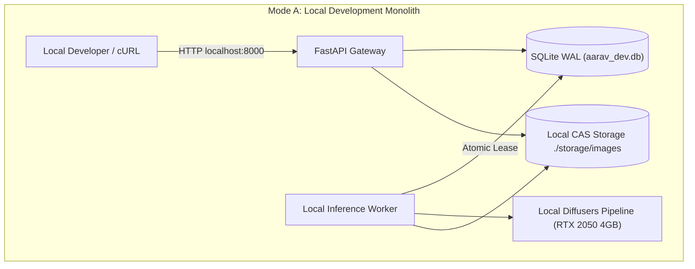
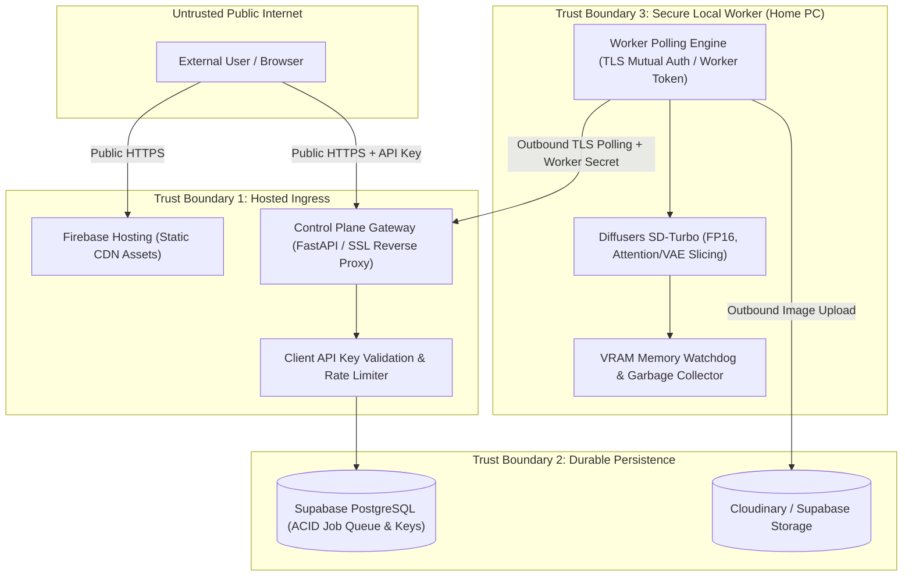
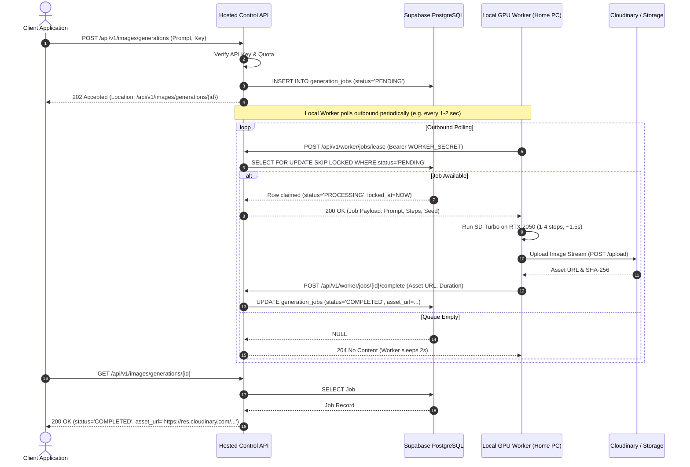

# High-Level Design (HLD) — Aarav Image Generation API

**Document Version:** 2.0.0 (Local GPU First, Cloud Ready Revision)  
**Status:** PROPOSED (Pending Review Gate)  
**Author:** Principal System Design Engineer & ML Infrastructure Architect  
**System:** Aarav Image Generation API (`Inference-1`)

---

## 1. Dual Deployment Architecture Overview

The system is designed with dual-mode operational capability:
- **Mode A (Local Development Monolith):** Runs 100% on the developer's Windows PC. Self-contained, zero internet dependencies (when using local Diffusers or Mock), zero cloud costs.
- **Mode B (Hybrid Hosted Deployment):** Allows public internet users to submit jobs via a web frontend, while the expensive GPU inference is executed on the developer's local RTX 2050 GPU via **Outbound HTTPS Worker Polling**.



---

## 2. Mode B: Hybrid Hosted Architecture

In Mode B, we separate frontend delivery, control-plane job management, persistent database, file storage, and GPU compute across decoupled, free-tier services.

> [!IMPORTANT]
> **Hosting Clarification:**  
> **Firebase Hosting is a static web and CDN hosting platform.** It **cannot** run Python code, execute background daemons, or run GPU inference.  
> Therefore, Firebase Hosting hosts only the static Web UI. The API control plane runs on a free container service (e.g., Render / Fly.io / Supabase Edge Functions), the database is hosted on Supabase PostgreSQL, asset delivery is handled by Cloudinary or Supabase Storage, and the GPU inference runs on your local PC.

```mermaid
graph TB
    subgraph Cloud_Free_Tier ["Cloud Control Plane (Public Internet)"]
        WebUser["Public Web / Mobile User"] -->|HTTPS| FirebaseCDN["Firebase Hosting (Static Web App)"]
        FirebaseCDN -->|REST API Calls| ControlAPI["Hosted FastAPI Control Gateway (Render / Fly.io / VPS)"]
        ControlAPI --> CloudDB[("Supabase PostgreSQL (Durable Job Queue)")]
        CloudStore[("Cloudinary / Supabase Storage (Asset CDN)")]
        ControlAPI --> CloudStore
    end

    subgraph Home_Environment ["Home PC (Private LAN / No Inbound Ports)"]
        LocalGPUWorker["Local GPU Inference Worker (Python 3.12 + PyTorch)"]
        RTX2050["NVIDIA RTX 2050 Mobile (4 GB VRAM)"]
        LocalCache[("HF Model Cache (~/.cache)")]
        
        LocalGPUWorker --> RTX2050
        LocalGPUWorker --> LocalCache
    end

    LocalGPUWorker -->|1. Outbound HTTPS Polling: GET /worker/jobs/lease| ControlAPI
    ControlAPI -->|Atomic SELECT FOR UPDATE SKIP LOCKED| CloudDB
    LocalGPUWorker -->|2. Outbound HTTPS Upload: Image Bytes| CloudStore
    LocalGPUWorker -->|3. Outbound HTTPS Complete: POST /worker/jobs/{id}/complete| ControlAPI
```

---

## 3. Component Responsibilities & Trust Boundaries (Mode B)



### Security & Ingress Principles
1. **Zero Inbound Port Forwarding:** The developer's home router does **not** expose port 80, 443, or 8000. It requires zero Dynamic DNS (DDNS), zero UPnP, and zero firewall holes.
2. **Outbound HTTPS Worker Token:** The local worker authenticates itself to the hosted control plane using a high-entropy secret token (`WORKER_SHARED_SECRET` via `Authorization: Bearer <token>`).
3. **Multi-Tenant Data Isolation:** External users only query their own jobs via `api_key_id`.

---

## 4. End-to-End Hybrid Job Flow (Mode B)



---

## 5. Offline Worker Behavior & Recovery

A common reality of running a local GPU worker at home is that the computer may be shut down, put to sleep, or experience home internet drops:

1. **Queueing While Offline:** If the local PC is powered off:
   - Client requests are still accepted by the Hosted Control API and stored as `PENDING` in Supabase PostgreSQL.
   - Clients polling `GET /images/generations/{id}` receive status `PENDING` with estimated queue position.
   - **Zero Jobs Lost:** Because the queue is durable in PostgreSQL, jobs remain safely stored indefinitely.
2. **Resumption on Power-Up:** When the user boots their PC and runs the worker script:
   - The worker immediately connects via outbound HTTPS, leases the oldest `PENDING` jobs in FIFO order, and executes them sequentially.
3. **Worker Sudden Crash Mid-Generation:**
   - If the local PC crashes or loses power while generating an image:
   - The job has `status='PROCESSING'` and `locked_at = timestamp`.
   - The hosted **Lease Sweeper** checks for jobs where `locked_at < NOW() - 120s`.
   - It resets the job to `PENDING` with `retry_count += 1`.
   - When the worker reconnects, it re-picks up the job. If it fails 3 times, it is safely transitioned to `FAILED` with error `WORKER_TIMEOUT`.

---

## 6. Architecture Alternatives Considered

| Decision Axis | Selected Recommendation | Alternative Considered | Rationale |
| :--- | :--- | :--- | :--- |
| **GPU Inference Location** | **Local RTX 2050 Mobile (Zero Cost)** | Cloud GPU VM (RunPod / AWS G4dn) | Dedicated cloud GPUs cost $0.20–$0.80/hour ($150–$500/mo). Utilizing the local RTX 2050 provides unlimited zero-cost inference for the prototype. |
| **Worker Connectivity** | **Outbound HTTPS Polling** | Inbound Port Forwarding / Ngrok | Inbound port forwarding exposes the home IP to DDoS and port scans, and breaks behind ISP CGNAT. Outbound HTTPS works through any router without firewall modification. |
| **Frontend Platform** | **Firebase Hosting** | Self-hosted Nginx on home PC | Firebase provides free global CDN edge distribution, SSL certificates, and 100% uptime even when the home PC is offline. |
| **Database Engine** | **SQLite (Mode A) / Supabase PG (Mode B)** | MongoDB / DynamoDB | Relational SQL with row-level leasing (`SKIP LOCKED`) provides strict ACID transaction guarantees. MongoDB adds unnecessary multi-database complexity. |

---

## 7. Cost & Infrastructure Breakdown

| Component | Service Provider | Plan / Tier | Monthly Cost | Constraints / Quotas |
| :--- | :--- | :--- | :--- | :--- |
| **GPU Compute** | Local PC (RTX 2050 4GB) | Self-hosted | **₹0** | Limited by 4 GB VRAM (512x512 resolution). |
| **Frontend Hosting** | Firebase Hosting | Spark (Free) | **₹0** | 10 GB storage, 360 MB/day transfer. |
| **Database (Queue)** | Supabase PostgreSQL | Free Tier | **₹0** | 500 MB database, 2 projects, 50,000 monthly active users. |
| **Control Plane API** | Render / Fly.io / Free VPS | Free Tier / Dev | **₹0** | Sleep after 15m inactivity (Render free) or free container hours. |
| **Asset Storage & CDN**| Cloudinary / Supabase | Free Tier | **₹0** | 25 monthly credits (~25,000 transformations or 25 GB bandwidth). |
| **Custom Domain** | Optional (Later) | Namecheap / Porkbun | *₹0 initially* (~₹800/yr if purchased later) | Not required for initial launch; Firebase and Render provide free `*.web.app` and `*.onrender.com` subdomains. |
| **Total Initial Cost** | | | **₹0.00** | **100% Free prototype.** |
