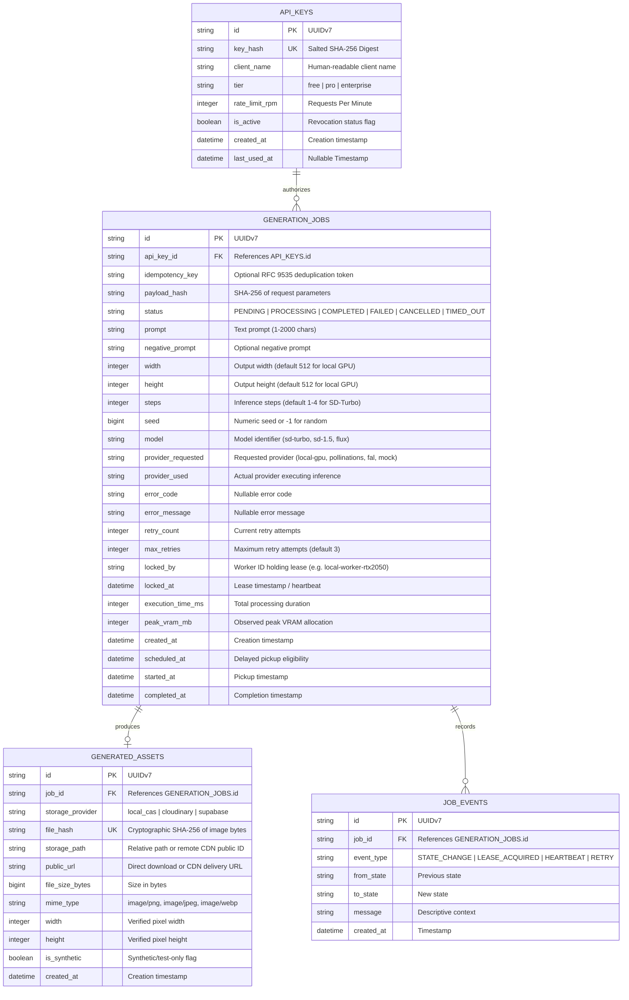

# Data Model & Storage Specification — Aarav Image Generation API

**Document Version:** 2.0.0 (Local GPU First, Cloud Ready Revision)  
**Status:** PROPOSED (Pending Review Gate)  
**Author:** Principal System Design Engineer  
**System:** Aarav Image Generation API (`Inference-1`)

---

## 1. Entity-Relationship Diagram (Mermaid)



---

## 2. Table Schemas & Dialect Specifications

### 2.1 Table: `generation_jobs`

| Column | Type (PG / SQLite) | Constraints | Description |
| :--- | :--- | :--- | :--- |
| `id` | `VARCHAR(36)` | PRIMARY KEY | UUIDv7 string. |
| `api_key_id` | `VARCHAR(36)` | FOREIGN KEY $\rightarrow$ `api_keys(id)` | Authorizing key ID. |
| `idempotency_key` | `VARCHAR(128)` | NULLABLE | Client deduplication token. |
| `payload_hash` | `VARCHAR(64)` | NOT NULL | SHA-256 digest of input parameters. |
| `status` | `VARCHAR(20)` | NOT NULL, DEFAULT `'PENDING'` | State machine value. |
| `prompt` | `TEXT` | NOT NULL | Generation text prompt. |
| `negative_prompt` | `TEXT` | NULLABLE | Negative guidance prompt. |
| `width` | `INTEGER` | NOT NULL, DEFAULT `512` | Pixel width (capped at 512 for local GPU). |
| `height` | `INTEGER` | NOT NULL, DEFAULT `512` | Pixel height (capped at 512 for local GPU). |
| `steps` | `INTEGER` | NOT NULL, DEFAULT `1` | Denoising steps. |
| `seed` | `BIGINT` | NOT NULL, DEFAULT `-1` | Random seed (`-1` = randomized). |
| `model` | `VARCHAR(64)` | NOT NULL, DEFAULT `'sd-turbo'` | Target model. |
| `provider_requested`| `VARCHAR(32)` | NOT NULL, DEFAULT `'local-gpu'`| Requested engine. |
| `provider_used` | `VARCHAR(32)` | NULLABLE | Engine that completed generation. |
| `error_code` | `VARCHAR(64)` | NULLABLE | Machine error code on failure. |
| `error_message` | `TEXT` | NULLABLE | Human-readable error message. |
| `retry_count` | `INTEGER` | NOT NULL, DEFAULT `0` | Retries executed. |
| `max_retries` | `INTEGER` | NOT NULL, DEFAULT `3` | Max retry limit. |
| `locked_by` | `VARCHAR(64)` | NULLABLE | ID of worker holding lease. |
| `locked_at` | `TIMESTAMP` | NULLABLE | Timestamp of lease acquisition/heartbeat. |
| `execution_time_ms` | `INTEGER` | NULLABLE | End-to-end execution latency in ms. |
| `peak_vram_mb` | `INTEGER` | NULLABLE | Peak GPU memory allocated in MB. |
| `created_at` | `TIMESTAMP` | NOT NULL, DEFAULT CURRENT_TIMESTAMP | Submission timestamp. |
| `scheduled_at` | `TIMESTAMP` | NULLABLE | Delay/backoff eligibility timestamp. |
| `started_at` | `TIMESTAMP` | NULLABLE | Worker claim timestamp. |
| `completed_at` | `TIMESTAMP` | NULLABLE | Termination timestamp. |

---

## 3. Database Indexing Strategy (Dual Dialect)

To optimize worker polling and avoid full-table scans:

### In PostgreSQL (Mode B - Supabase):
```sql
-- Partial index: ONLY indexes pending jobs, keeping the index size tiny (<1 MB)
CREATE INDEX idx_jobs_pending_queue 
ON generation_jobs (created_at ASC) 
WHERE status = 'PENDING';

-- Index for lease sweeper: rapidly finds timed-out jobs
CREATE INDEX idx_jobs_stale_leases 
ON generation_jobs (locked_at) 
WHERE status = 'PROCESSING';

-- Unique idempotency enforcement
CREATE UNIQUE INDEX uq_jobs_idempotency 
ON generation_jobs (api_key_id, idempotency_key) 
WHERE idempotency_key IS NOT NULL;
```

### In SQLite (Mode A - Local Dev):
```sql
CREATE INDEX idx_jobs_status_created 
ON generation_jobs (status, created_at ASC);

CREATE INDEX idx_jobs_locked_at 
ON generation_jobs (status, locked_at);

CREATE UNIQUE INDEX uq_jobs_idempotency 
ON generation_jobs (api_key_id, idempotency_key) 
WHERE idempotency_key IS NOT NULL;
```

---

## 4. Asset Storage & CDN Mapping

| Asset Attribute | Mode A (Local CAS) | Mode B (Cloudinary / Supabase) |
| :--- | :--- | :--- |
| **`storage_provider`** | `'local_cas'` | `'cloudinary'` or `'supabase'` |
| **`storage_path`** | `images/a3/9f/a39fbc48....png` | `aarav_assets/a39fbc48` |
| **`public_url`** | `/api/v1/images/{id}/content` | `https://res.cloudinary.com/<cloud>/image/upload/v1/.../a39fbc48.png` |
| **Deduplication** | Filesystem check via SHA-256 before write | Cloudinary asset lookup by public ID (SHA-256) |
