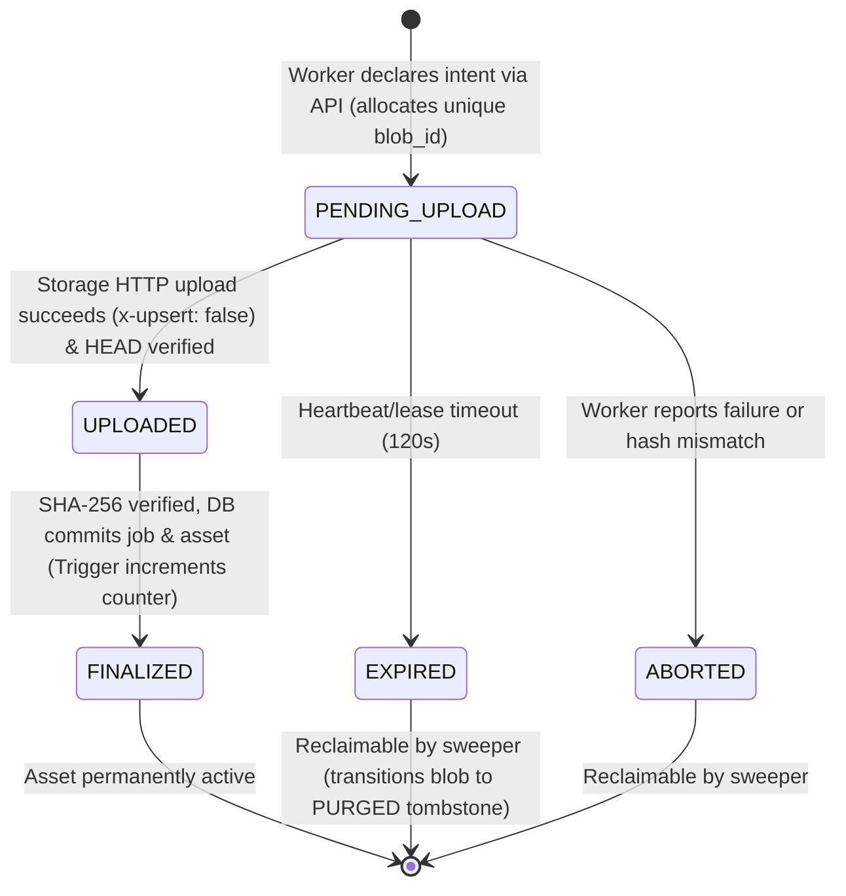
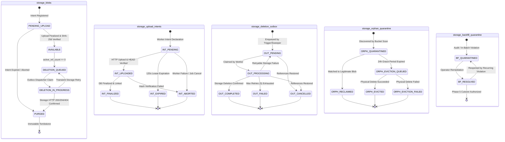
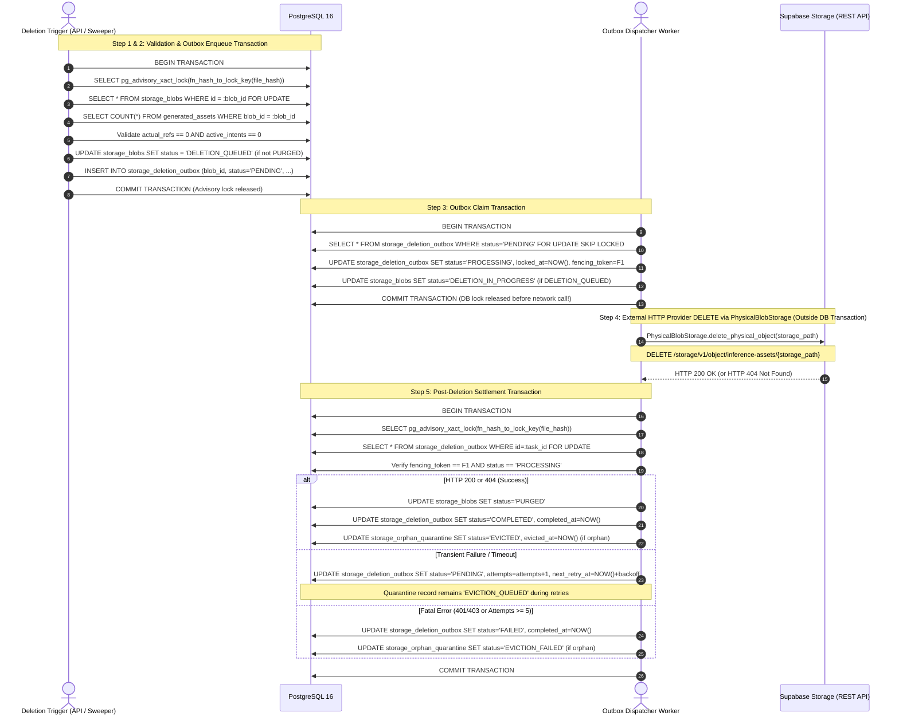
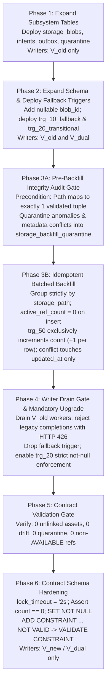

# Remote Asset Storage Research & Implementation Plan: Production-Grade Cloud Object Storage for Inference-1

**Document Version:** 1.3.10  
**Status:** REVISED PROPOSAL — AWAITING EXPLICIT ARCHITECTURE REVIEW  
**Author:** Principal Distributed Systems Engineer, Cloud Storage Specialist, and Security Reviewer  
**System:** Aarav Image Generation API (`Inference-1`)  
**Scope:** Remote Asset Storage Architecture, Deterministic Advisory Lock Key Derivation, Immutable Versioned Physical Keys, Single-Writer Create-Only Protocol, Unified Durable Deletion Pipeline, Database-Enforced Triggers & Reference-Count Invariants, Foreign Key Integrity, Reconciled Cascade Lock Ordering, Canonical Physical Path Identity, Two-Statement Reconciliation Protocol, Resumable Backfill Progress, Quarantine Schema Reconciliation, Transaction-Level Retry Lifecycle, Entity-Specific State Machines, Pure Domain Interface & Physical Deletion Capability Decoupling, Storage Lookup Resolution & Caller Inventory, Backward-Compatible Asset Verification, Hermetic Test Isolation & Expand-Contract Migration Roadmap
**Governing Protocols:** `AGENTS.md` (Stage 4 Architecture Decisions & Stage 5 Approval Gate)  
**Safety Invariant:** Planning and research only. Zero code edits, zero cloud provisioning, zero account creation, zero remote migrations, and strictly conditional ₹0.00 cloud spend.

---

## Revision History & Review Issue Traceability

| Version | Date | Author | Summary of Changes |
| :--- | :--- | :--- | :--- |
| **1.0.0** | 2026-10-22 | System Architecture Lead | Initial comprehensive research and implementation plan comparing Supabase Storage, Cloudflare R2, Cloudinary, and Backblaze B2. |
| **1.1.0** | 2026-10-22 | System Architecture Lead | Initial review corrections: documented non-atomic nature of storage + SQL, removed 30-day auto-purge, added 4-leg bandwidth model, verified REST endpoints. |
| **1.2.0** | 2026-10-22 | System Architecture Lead | Resolved initial blocking issues: added durable outbox, 5-state orphan lifecycle, explicit bandwidth mathematics, and verified API contracts. |
| **1.2.1** | 2026-10-23 | Distributed Systems Lead | Elimination of the asset deletion race condition via per-hash transaction advisory locks (`pg_advisory_xact_lock`), durable upload intents (`storage_upload_intents`), and outbox fencing tokens. |
| **1.2.2** | 2026-10-23 | Distributed Systems Lead | Resolution of the asset deletion race across external HTTP boundaries via immutable versioned physical object keys (`images/{h1}/{h2}/{file_hash}/{blob_id}.png`). Decoupled logical content hash (`file_hash`, SHA-256) from physical storage keys (`blob_id`, UUIDv4 in `storage_blobs`). |
| **1.2.3** | 2026-10-23 | Distributed Systems Lead | Closure of late-upload races, immutability gaps, and reference-count invariants via tombstone retention, single-writer create-only protocol (`x-upsert: false`), and 16-scenario test matrix. |
| **1.2.4** | 2026-10-23 | Distributed Systems Lead | Consolidated ordinary deletion, orphan eviction, and tombstone cleanup into a single 5-step durable outbox workflow. Replaced untracked direct `DELETE` calls with outbox task enqueueing. Added PostgreSQL triggers for ref-count synchronization. |
| **1.2.5** | 2026-10-23 | Distributed Systems Lead | Database Concurrency & Reference-Count Invariants: Trigger counter ownership, `trg_generated_assets_enforce_available`, parent-row locking for pre-deletion SQL, deterministic advisory lock derivation `fn_hash_to_lock_key`, tombstone protection trigger, outbox error classification, 24 test scenarios. |
| **1.2.6** | 2026-10-23 | Distributed Systems Lead | Immutability of `generated_assets.blob_id`, universal hierarchical lock ordering protocol, invariant reconciliation across workflows, corrected 5-state orphan quarantine lifecycle, documented contracts vs. unverified wire behaviors, 32 proposed test scenarios. |
| **1.2.7** | 2026-10-23 | Distributed Systems Lead | Cascade Lock Ordering, Backfill Validation & Safe Expand-Contract Migration Rollout: Publication locks job first; removed trigger advisory locks; Phase 3A integrity audit & quarantine table; non-merging path grouping; 41 proposed test scenarios. |
| **1.2.8** | 2026-10-23 | Distributed Systems Lead | Resolution of Backfill Invariants, Physical Path Identity & Trigger Guarantees: Enforced exclusive trigger counter ownership during Phase 3B backfill (`active_ref_count = 0` insert, conflict touches `updated_at` only); formulated Phase 3A ambiguity audit query and quarantine (`AMBIGUOUS_PATH_METADATA_CONFLICT`); added atomic `FOR UPDATE` lock to fallback trigger; specified Phase 4 strict trigger `fn_enforce_blob_available_strict()`. |
| **1.2.9** | 2026-10-23 | Distributed Systems Lead | Elimination of Lock Inversions, NULL-Safe Audits & Concurrency Hardening: Re-sequenced backfill lock acquisition (Level 2 `FOR UPDATE SKIP LOCKED` before Level 3 upsert); upgraded Phase 3A audit to 4 steps with NULL-safe checks (`MISSING_OR_INVALID_REQUIRED_METADATA`, `AMBIGUOUS_PATH_METADATA_CONFLICT`, `EXISTING_BLOB_NOT_AVAILABLE`); defined single-leader backfill model; added TC-42 through TC-47 (47 total). |
| **1.3.0** | 2026-10-23 | Distributed Systems Lead | Lock Protocol Reconciliation, Stale Audit Recovery & Canonical Metadata Contract: Explicitly traced implicit FK locks (`FOR KEY SHARE`), speculative index conflict tokens, trigger execution ordering; reconciled publication (Parent &rarr; Child) vs deletion/backfill (Child &rarr; Parent); defined Phase 3B Step 5 stale audit quarantine; formalized 5-point canonical metadata validation. *(Sections 4.3, 4.5, 8.4, 14, 16, 18, 19)* |
| **1.3.1** | 2026-10-23 | Distributed Systems Lead | Snapshot Isolation, Backfill Progress & Canonical Path Identity Hardening: Identified PostgreSQL CTE snapshot hazard; formulated Two-Statement Atomic Transaction Protocol with fresh Read Committed snapshot; guaranteed progress for newly inserted invalid rows; bounded lock-safety proofs; strengthened path validation. Added TC-48 and TC-49 (49 total). *(Sections 4.3.1, 4.5.2, 4.5.3, 8.1, 8.4, 14, 16, 18, 19)* |
| **1.3.2** | 2026-10-23 | Distributed Systems Lead | Canonical Blob Identity, Two-Statement Reconciliation Protocol & Resumable Backfill Hardening: Reconciled physical path identity with backfill blob IDs (extracted embedded UUID for versioned paths, surrogate UUID for legacy local CAS); formulated complete two-statement reconciliation protocol under Read Committed; unified canonical path validation; defined worker stall detection (`consecutive_skips > 30`) and cutover blocker proof. Added TC-50, TC-51, TC-52 (52 proposed tests). *(Sections 4.3.1, 4.5.3, 8.0, 8.4, 14, 16, 18, 19)* |
| **1.3.3** | 2026-10-23 | Distributed Systems Lead | Quarantine Schema Reconciliation, Transaction-Level Retry Lifecycle & Entity State Rigor: Reconciled quarantine DDL and column consistency matrix; specified full transaction rollback and fresh retry on `40P01`/`55P03`; audited `ABORTED` ownership strictly to upload intents; formulated 5-entity lifecycle state machines and initial reopening semantics. *(Sections 4.3.1, 5.4, 8.0, 8.4, 14, 16, 18, 19)* |
| **1.3.4** | 2026-10-23 | Distributed Systems Lead | Quarantine Schema Hardening, Driver-Agnostic Retries & Reprocessing Semantics: Added `DEFAULT gen_random_uuid()::text` to `storage_backfill_quarantine.id`; added `chk_backfill_quarantine_reason` checking 9 codes; implemented driver-agnostic `get_sqlstate`; moved `batch_committed = True` post-context; updated Statement 1 & worker completion predicate for resolved records; added single-branch quarantine guarantee; documented safe unlinked disposition via `DELETE FROM generated_assets`. *(Sections 8.0, 8.0.1, 8.4, 8.4.1, 14, 16, 18, 19)* |
| **1.3.5** | 2026-10-23 | Distributed Systems Lead | Audit-Trail Limitation, Uncertain Commit Lifecycle & Qualified Branching Contracts: Removed inaccurate claims of WAL/transaction log application-level event lineage; explicitly bounded queryable audit history to `quarantined_at` and `details` scalar keys; reconciled lifecycle contract distinguishing confirmed server rollback from indeterminate commit outcomes; qualified Statement 2 single-branch guarantee under database schema uniqueness, NOT NULL PK, and explicit CTE exclusion. *(Sections 8.4, 8.4.1, 14, 16, 18, 19)* |
| **1.3.6** | 2026-10-23 | Distributed Systems Lead | **JSONB Audit Field Alignment, Conservative Shutdown Lifecycle & Branch Label Reconciliation**:<br/>• **REV-07. Exact JSONB Audit Field Alignment**: Aligned all document text with exact SQL keys (`prior_reason`, `reopened_from_resolved`, `prior_resolution_action`, `prior_resolved_at`, `reason_changed`, `last_updated_at`); removed ungrounded references (`prior_quarantine_reason`, `prior_details`, `reopened_at`, `reopen_count`); aligned remaining claims with bounded-history contract, explicitly recognizing intermediate reopening cycles are overwritten.<br/>• **REV-08. Conservative Shutdown & Uncertain Commit Handling**: Unified exception handling across pseudocode, error table, and test descriptions for `57P01` (admin_shutdown), `57P02` (crash_shutdown), `08006`, `08001`, `08000`, `08003`, and `connection_invalidated`; eliminated assumptions of server rollback on severed sockets or shutdowns; mandated fail-fast on connection invalidation with state reconciliation upon supervisor restart; clarified that SQLSTATE alone does not determine transaction outcome without execution phase context.<br/>• **REV-09. Exact SQL Branch Labels & Qualified Partitioning**: Aligned Statement 2 branch labels with SQL: Branch 1 `quarantined_ineligible_blobs` (non-`AVAILABLE` blobs), Branch 2 `quarantined_missing_blobs` (missing blobs), and Branch 3 (Catch-All ambiguous/unlinked collisions); preserved single-branch partition guarantee conditioned on schema path uniqueness, NOT NULL PK, and explicit CTE exclusions; reiterated that adversarial tests remain unexecuted verification specifications. *(Sections 8.4, 8.4.1, 14, 16, 18, 19)* |
| **1.3.7** | 2026-10-23 | Distributed Systems Lead | **REV-08 Commit-Phase Timeout Classification & Execution Lifecycle Reconciliation**:<br/>• **Three-Phase Lifecycle Tracking**: Explicitly separated pre-COMMIT statement execution (`statements_completed = False`), in-flight COMMIT (`statements_completed = True, batch_committed = False`), and post-COMMIT acknowledgement (`batch_committed = True`).<br/>• **Unconditional Indeterminate Commit Outcome Classification**: Classified any timeout, query cancellation (`57014`), socket drop, or driver exception while COMMIT is in flight as indeterminate, regardless of SQLSTATE allowlist.<br/>• **Prohibition of In-Process Retry & Rollback Claims on Indeterminate Commits**: Strictly prohibited asserting server rollback or attempting in-process retries when COMMIT is in flight; mandated immediate fail-fast for supervisor restart with fresh-session reconciliation.<br/>• **Preserved Confirmed-Rollback Retries**: Kept confirmed-rollback retries (`40P01`, `55P03`, `40001`) strictly for pre-COMMIT statement failures on healthy connections where context-manager rollback is guaranteed.<br/>• **Unified Alignment Across Matrix, Pseudocode, Error Table, TC-52 & Proof 9**: Reconciled pseudocode error handlers, error-classification table, TC-52 adversarial verification specification, risk mitigations, checklist, and analytical proof 9. *(Sections 8.4, 8.4.1, 14, 16, 18, 19)* |
| **1.3.8** | 2026-10-24 | Distributed Systems Lead | **Transaction Context Exit Closure, Comprehensive Lifecycle States & Exception Scope Alignment**:<br/>• **Comprehensive Exit Path Classification**: Explicitly classified all transaction context exit paths (normal fallthrough, early `return`, and `break`) as entering the in-flight commit phase (`commit_attempted = True`), ensuring context exit exceptions during commit are never misclassified as pre-COMMIT failures.<br/>• **Three-Phase Lifecycle Disambiguation**: Rigorously decoupled pre-COMMIT failure (failure before commit attempted), indeterminate commit outcome (commit attempted but unacknowledged), and acknowledged commit across all code paths.<br/>• **Exception Handling Scope Alignment**: Expanded and aligned exception catching to `(DBAPIError, SQLAlchemyError, TimeoutError)` matching documented promises for driver timeouts and exceptions without overclaiming coverage of arbitrary application exceptions.<br/>• **Preserved Confirmed-Rollback Retries**: Strictly restricted confirmed-rollback retries (`40P01`, `55P03`, `40001`) to pre-COMMIT failures on healthy connections where rollback is guaranteed.<br/>• **Aligned Specifications & Honest Baseline Status**: Unified Section 8.4, 8.4.1 table, TC-52, Risk 7, review checklist, Proof 9, and documented the 115-passed / 7-skipped test suite as an Antigravity-reported result rather than an independently verified external benchmark. *(Sections 8.4, 8.4.1, 14, 16, 18, 19)* |
| **1.3.9** | 2026-10-24 | Distributed Systems Lead | **Path B Commit Boundary Correction & Contention Backoff Placement**:<br/>• **Path B Transaction Boundary Decoupling**: Moved contention backoff sleep (`time.sleep(skip_yield_backoff)`) strictly *outside* the `with dedicated_conn.begin():` transaction context and outside exception handling, eliminating unnecessary open transaction state during backoff sleep.<br/>• **Defensible Transaction Boundary**: Eliminated premature `commit_attempted = True` setting before blocking/raising operations. In `rows_locked == 0 and remaining > 0` (Path B), the read-only transaction finishes cleanly and exits its context manager; `commit_attempted = True` is assigned immediately at the context exit boundary with zero intervening operations.<br/>• **Unambiguous Execution Phase Tracking**: Pre-exit exceptions during query execution cannot be misclassified as commit failures; exceptions during context manager exit (attempted commit) are unconditionally treated as indeterminate without rollback claims or in-process retries.<br/>• **Aligned Specifications & Baseline Integrity**: Reconciled worker pseudocode, Section 8.4.1 table, TC-52 Phase B/C, Risk 7 Item 7, checklist, Proof 9, and reaffirmed unexecuted status of TC-01–52 and Antigravity-reported 115/7 test baseline. *(Sections 8.4, 8.4.1, 14, 16, 18, 19)* |
| **1.3.10** | 2026-10-24 | Distributed Systems Lead & Storage Architect | **Milestone 6.1 Architecture Reconciliation: Interface Purity, Physical Deletion Decoupling, Reproducible Caller Inventory, Hermetic Isolation & Delivery Rollout Gate**:<br/>• **Deletion Contract Reconciliation**: Removed all instructions adding `delete_asset(file_hash)` to the general `AssetStorage` interface. Defined physical blob deletion strictly through the dedicated `PhysicalBlobStorage.delete_physical_object(storage_path)` capability, invoked exclusively by `DeletionOutboxService` in Milestone 6.3. Clearly distinguished logical asset deletion, database metadata/trigger changes, and physical object deletion.<br/>• **Storage Lookup Contract & Reproducible Caller Inventory**: Documented exact search commands across all 61 Python files in `src/` (39 files) and `tests/` (22 files). Distinguished direct source findings from inferred migration proposals. Established physical storage paths as authoritative locators and content hashes as logical identifiers. Remote adapter fails fast with `ValueError` on raw hashes without paths; `LocalStorageCAS` preserves backward-compatible hash derivation.<br/>• **Remote Storage Delivery Rollout Gate**: Strictly prohibited enabling `STORAGE_ADAPTER="supabase"` in any environment for image delivery while `GenerationService` still passes only `file_hash`. Delivery traffic can use Supabase only after Milestone 6.5 migrates the caller to pass authoritative persisted `storage_path`, unless a separately reviewed compatibility mechanism resolves the path without key guessing or prefix listing.<br/>• **`verify_asset` Compatibility & Deterministic Semantics**: Preserved 1-argument call-signature compatibility (`verify_asset(locator)`) and Mode A behavioral compatibility, while explicitly noting that Mode B rejects raw content hashes without an authoritative `storage_path`. Defined explicit 2-argument (`verify_asset(locator, expected_hash)`) semantics. Specified that verification checks BOTH existence and SHA-256 integrity, with deterministic `False` on missing/mismatch and exceptions on malformed traversal locators.<br/>• **Hermetic HTTP Test Isolation (Unverified Pending Authorized Test Run)**: Specified global fail-closed design requirements with `respx.mock(assert_all_mocked=True)`, RFC 2606 `.test` non-routable domains, and synthetic credentials. Explicitly labelled compatibility with `httpx>=0.27.0` and route-interception behavior as unverified pending an authorized test run; required the eventual test implementation to demonstrate unexpected hosts fail closed without network calls, mandating an isolated mock transport or network-denial layer if fixture route-matching alone is insufficient.<br/>• **`AssetStorageView` DI Boundary**: Clarified that `AssetStorageView` is an architectural dependency-injection wrapper (least-privilege facade), not a Python runtime security sandbox.<br/>• **Deferred Dependencies**: Reaffirmed that `asyncpg` remains strictly deferred to Milestone 6.3, and Milestone 6.1 requires only `respx>=0.21.0`. *(Sections 2.1, 2.1.1, 2.1.2, 2.1.3, 2.1.4, 2.2, 2.4, 6.0, 6.1, 6.2, 15, 18, 19)* |

### v1.3.10 Peer Review Findings Traceability Matrix

| Review Finding ID | Category & Core Finding | Architectural Resolution in v1.3.10 | Governing Plan Sections | Concurrency & Validation Contracts | Proposed Adversarial Tests |
| :--- | :--- | :--- | :--- | :--- | :--- |
| **REV-10** | **Physical Deletion Contract Decoupling**<br/>• Milestone 6.1 checklist instructed adding `delete_asset(file_hash: str) -> bool` to `AssetStorage`.<br/>• Contradicted the durable deletion outbox architecture and risked callers bypassing the outbox or deleting physical objects without verifying immutable `blob_id` and reference counts.<br/>• Ambiguity between logical deletion, DB metadata, and physical deletion. | • Removed all instructions adding `delete_asset(file_hash)` to `AssetStorage`.<br/>• Defined physical deletion exclusively through `PhysicalBlobStorage.delete_physical_object(storage_path: str) -> bool`.<br/>• Enforced that physical deletion requires an authoritative physical object key (`storage_path`), not an ambiguous content hash.<br/>• Explicitly separated logical deletion (`DELETE FROM generation_jobs` / `generated_assets`), database trigger synchronization (`active_ref_count` decrement & outbox enqueueing), and asynchronous physical blob deletion (`DeletionOutboxService` Step 4). | Section 2.1 (`AssetStorage` Interface)<br/>Section 2.1.4 (Capability Boundaries)<br/>Section 6.0 (Sequence Diagram)<br/>Section 6.1 (Pre-Deletion SQL)<br/>Section 15 (Milestone 6.1 & 6.3 Checklists)<br/>Section 18 (Checklist) | • Zero deletion methods on `AssetStorage`<br/>• Physical deletion gated to outbox worker<br/>• Authoritative `storage_path` required<br/>• 4-gate deletion safety invariant | **TC-37, TC-42**<br/>**TC-43** |
| **REV-11** | **Storage Lookup Contract & Authoritative Physical Locators**<br/>• Storage lookups generalized to `storage_path_or_hash`, but Supabase adapter cannot safely resolve a raw content hash without database metadata.<br/>• Risk of adapter guessing keys, prefix listing, or arbitrary version selection. | • Established authoritative physical path identity: remote adapter fails fast with `ValueError` on raw 64-char hashes without a path, strictly prohibiting prefix listing or version guessing.<br/>• Maintained 100% backward compatibility in `LocalStorageCAS` (Mode A) by deriving fan-out path from 64-char hash.<br/>• Identified that database metadata resolution already exists in `GeneratedAssetModel.storage_path`; scheduled caller migration (`GenerationService.get_asset_bytes_for_client`) to Milestone 6.5.<br/>• Specified strict path validation rejecting traversal (`../`), null bytes, and non-canonical patterns before filesystem or HTTP access. | Section 2.1.2 (Lookup Resolution Rules)<br/>Section 2.2 (`LocalStorageCAS` & `SupabaseStorageAdapter`)<br/>Section 15 (Milestone 6.1 & 6.5 Checklists) | • Authoritative physical path identity<br/>• Zero prefix-listing or version guessing<br/>• Fail-fast `ValueError` on raw remote hashes<br/>• Traversal protection & regex validation | **TC-45, TC-46**<br/>**TC-50** |
| **REV-12** | **`verify_asset` Compatibility & Deterministic Semantics**<br/>• Proposal introduced `verify_asset(storage_path_or_hash, expected_hash=None)` without defining semantics for each argument combination or specifying whether verification checks existence, hash integrity, or both.<br/>• Risk of breaking existing 1-argument callers or silently bypassing integrity checks. | • Preserved 1-argument call-signature compatibility (`verify_asset(locator)`): Mode A retains behavioral compatibility checking existence and validating on-disk SHA-256 against hash/path; Mode B validates versioned path existence and checks content SHA-256 against embedded hash, while raw hash in Mode B raises fail-fast `ValueError`.<br/>• Defined 2-argument semantics (`verify_asset(locator, expected_hash)`): retrieves object, calculates SHA-256, and verifies it matches `expected_hash.lower()`. If path contains an embedded hash, both must match.<br/>• Clarified verification definition: checks BOTH object existence and content-hash integrity.<br/>• Defined deterministic errors: missing &rarr; `False`; hash mismatch &rarr; `False`; malformed/traversal &rarr; raises validation exception. | Section 2.1.3 (`verify_asset` Specification)<br/>Section 2.2 (`LocalStorageCAS`)<br/>Section 15 (Milestone 6.1 Checklist) | • 1-argument call-signature compatibility (Mode A behaviorally compatible; Mode B requires authoritative path)<br/>• Explicit 2-argument SHA-256 verification<br/>• Deterministic boolean & exception returns<br/>• Existence AND integrity verified | **TC-45, TC-50** |
| **REV-13** | **Hermetic HTTP Test Isolation (Unverified Pending Authorized Test Run)**<br/>• Proposal scoped mocking to Supabase base URL; claim of verified compatibility with `httpx>=0.27.0` and `respx>=0.21.0` was premature without package installation or test execution.<br/>• Relying on `.test` DNS failure alone is insufficient as primary isolation. | • Specified fail-closed test fixture isolation using `respx.mock(assert_all_mocked=True)` combined with a universal catch-all fallback route raising `RuntimeError` on any unmocked outbound request to any host.<br/>• Explicitly labelled compatibility and route-matching behavior as **unverified pending an authorized test run**.<br/>• Prohibited claiming route-matching intercepts every host until empirically validated against selected library version; mandated that eventual test implementation demonstrate unexpected hosts fail without network calls.<br/>• Required isolated transport (`httpx.MockTransport`) or network-denial layer (socket blocking) as defense in depth if fixture alone cannot guarantee complete interception.<br/>• Mandated RFC 2606 `.test` non-routable domains (`https://mock-supabase.test`) as secondary defense-in-depth; strictly required synthetic credentials. | Section 15 (Milestone 6.1 Checklist)<br/>Section 16 (Risk Mitigations)<br/>Section 18 (Checklist) | • Universal fail-closed HTTP interception requirement<br/>• Zero unmocked outbound wire traffic<br/>• Defense in depth: mock transport / network-denial layer<br/>• RFC 2606 non-routable hostnames & synthetic credentials | **TC-01 through TC-36** |
| **REV-14** | **`AssetStorageView` Capability Boundary & Milestone Isolation**<br/>• Description of `AssetStorageView` risked being interpreted as a Python runtime security sandbox.<br/>• `asyncpg` dependency timing needed reaffirmation to prevent scope creep into Milestone 6.1. | • Accurately defined `AssetStorageView` as an architectural dependency-injection facade/wrapper for least-privilege interface segregation, not a Python security sandbox.<br/>• Identified component assignment: `ReadOnlyAssetStorageView` for delivery endpoints, `WriteAssetStorageView` for ingestion, `PhysicalBlobStorage` for outbox dispatcher.<br/>• Reaffirmed that `asyncpg` remains deferred to Milestone 6.3, keeping Milestone 6.1 focused purely on HTTP storage adapter, configuration, factory wiring, and hermetic tests. | Section 2.1.4 (Capability Boundaries)<br/>Section 15 (Milestone 6.1 Boundaries)<br/>Section 18 (Checklist) | • Architectural DI boundary clarified<br/>• Separation of read, write, and deletion<br/>• Strict milestone dependency scoping (`asyncpg` deferred to 6.3) | **TC-44, TC-52** |
| **REV-15** | **Remote Storage Delivery Rollout Gate**<br/>• `SupabaseStorageAdapter` is introduced in Milestone 6.1 and fails fast on raw content hashes, but existing delivery caller (`GenerationService.get_asset_bytes_for_client`) passes only `file_hash` until migrated in Milestone 6.5.<br/>• Risk: Activating `STORAGE_ADAPTER="supabase"` prematurely breaks client image delivery. | • Formulated mandatory rollout gate: strictly prohibited setting `STORAGE_ADAPTER="supabase"` in any environment for image delivery while `GenerationService` passes only `file_hash`.<br/>• Delivery traffic can use Supabase only after Milestone 6.5 migrates the caller to pass authoritative persisted `storage_path`, unless a separately reviewed compatibility mechanism resolves the path without key guessing or prefix listing.<br/>• Embedded gate in explanatory prose, Milestone 6.1 & 6.5 checklists, and Section 18 Go/No-Go checklist. | Section 2.1.2 (Rollout Gate)<br/>Section 2.4 (Caller Flow)<br/>Section 15 (Milestones 6.1 & 6.5)<br/>Section 18 (Checklist) | • Premature adapter activation strictly blocked<br/>• Explicit prerequisite for delivery cutover<br/>• Zero silent regression of client downloads | **TC-01 through TC-36** |
| **REV-16** | **Reproducible Caller Inventory Procedure & Bounded Scope**<br/>• Caller inventory lacked documentation of the exact search commands used for reproduction.<br/>• Needed explicit distinction between direct source findings and inferred migration proposals, with bounded exhaustiveness scope. | • Documented exact PowerShell text-search commands across all 61 Python files in `src/` (39 files) and `tests/` (22 files).<br/>• Explicitly decoupled direct source findings (file, function, line, verbatim argument) from inferred conclusions (argument classification, target milestone).<br/>• Bounded exhaustiveness claim strictly to the 61 inspected Python files in the local working tree. | Section 2.1.1 (Reproducible Procedure)<br/>Section 2.1.1 (Caller Inventory Table) | • Fully reproducible repository audit<br/>• Grounded empirical facts vs. architecture proposals<br/>• Bounded inspection boundaries | **TC-45, TC-50** |

### v1.3.9 Peer Review Findings Traceability Matrix

| Review Finding ID | Category & Core Finding | Architectural Resolution in v1.3.9 | Governing Plan Sections | Concurrency & Validation Contracts | Proposed Adversarial Tests |
| :--- | :--- | :--- | :--- | :--- | :--- | :--- |
| **REV-08 Follow-up 2** | **Path B Commit Boundary & Contention Backoff Placement**<br/>• Edge case: In Path B (`rows_locked == 0 and remaining > 0`), `commit_attempted = True` was assigned before `time.sleep(backoff)` while still inside `with dedicated_conn.begin():`.<br/>• Concurrency penalty: Held the database transaction open unnecessarily during contention sleep.<br/>• Lifecycle classification hazard: If an exception occurred during `time.sleep`, it would be misclassified as an indeterminate commit failure even though COMMIT had not yet been attempted by the context manager. | • Finished read-only transaction and left transaction context cleanly before performing backoff sleep.<br/>• Moved `time.sleep(skip_yield_backoff)` strictly outside `with dedicated_conn.begin():` and outside database error handling, holding zero database transaction locks during sleep.<br/>• Assigned `commit_attempted = True` immediately prior to context exit with zero intervening operations across all paths (early return, contention exit, normal fallthrough).<br/>• Bounded pre-COMMIT failures strictly to operations prior to context exit; classified all context-exit commit failures as indeterminate without rollback claims. | Section 8.4 (Worker Pseudocode)<br/>Section 8.4.1 (Error Classification Table)<br/>Section 14 (TC-52)<br/>Section 16 (Risk 7)<br/>Section 18 (Checklist)<br/>Section 19.1 (Proof 9)<br/>Section 19.3 (Test Baseline) | • Zero open transactions during contention backoff<br/>• Defensible commit boundary with zero intervening operations<br/>• Unconditional indeterminate classification for context exit exceptions<br/>• Unaltered skip limit and termination safety | **TC-44, TC-52** |

### v1.3.8 Peer Review Findings Traceability Matrix

| Review Finding ID | Category & Core Finding | Architectural Resolution in v1.3.8 | Governing Plan Sections | Concurrency & Validation Contracts | Proposed Adversarial Tests |
| :--- | :--- | :--- | :--- | :--- | :--- | :--- |
| **REV-08 Follow-up** | **Transaction Context Exit Closure & Exception Scope Alignment**<br/>• Edge case: `statements_completed = True` was assigned only on the normal processing path, omitting early `return` and `break` paths in `rows_locked == 0`. Exiting the context invokes `commit()`; any context-exit exception could be misclassified as pre-COMMIT failure claiming confirmed rollback.<br/>• Exception scope mismatch: pseudocode caught only `DBAPIError`, while text promised handling generic driver timeouts (`TimeoutError`) and exceptions. | • Closed all context exit paths: defined `commit_attempted = True` before normal block exit, before early `return` (`remaining == 0`), and before `break` (`remaining > 0`), ensuring any exception during context exit is classified as indeterminate.<br/>• Decoupled three execution phases: (1) pre-COMMIT failure (`not commit_attempted`), (2) in-flight COMMIT failure (`commit_attempted and not batch_committed`), and (3) post-COMMIT acknowledged (`batch_committed`).<br/>• Aligned exception catching to `(DBAPIError, SQLAlchemyError, TimeoutError)` covering DBAPI errors, pool/connection errors, and driver/socket timeouts, while clarifying that non-database application exceptions (e.g. `RuntimeError`) propagate directly without retry.<br/>• Bounded confirmed rollback strictly to pre-commit statement failures on active connections. | Section 8.4 (Worker Pseudocode)<br/>Section 8.4.1 (Error Classification Table)<br/>Section 14 (TC-52)<br/>Section 16 (Risk 7)<br/>Section 18 (Checklist)<br/>Section 19.1 (Proof 9)<br/>Section 19.3 (Test Baseline) | • Zero unclassified transaction exit paths<br/>• Unconditional indeterminate classification for context exit exceptions<br/>• Matched exception handling scope<br/>• Idempotent restart reconciliation | **TC-44, TC-52** |

### v1.3.7 Peer Review Findings Traceability Matrix

| Review Finding ID | Category & Core Finding | Architectural Resolution in v1.3.7 | Governing Plan Sections | Concurrency & Validation Contracts | Proposed Adversarial Tests |
| :--- | :--- | :--- | :--- | :--- | :--- |
| **REV-08** | **Commit-Phase Timeout Classification & Rollback Claim Reconciliation**<br/>• Inconsistency: Error table treated commit timeouts as indeterminate, but pseudocode fell through to generic non-retriable handler asserting transaction rollback unless `connection_invalidated` was True or SQLSTATE matched fixed allowlist (`08*`, `57P01`, `57P02`).<br/>• A generic commit timeout (e.g. driver `TimeoutError`, cancellation `57014`) could wrongly claim confirmed rollback or attempt invalid retries. | • Introduced explicit 3-phase execution lifecycle tracking: (1) pre-COMMIT statement execution (`statements_completed = False`), (2) in-flight COMMIT (`statements_completed = True, batch_committed = False`), and (3) post-COMMIT acknowledgement (`batch_committed = True`).<br/>• Unconditionally classified all in-flight COMMIT exceptions as indeterminate, regardless of SQLSTATE or exception type.<br/>• Prohibited rollback assertions and prohibited in-process retries on indeterminate commits; mandated fail-fast for supervisor restart.<br/>• Retained confirmed-rollback retries strictly for pre-COMMIT transaction conflicts (`40P01`, `55P03`, `40001`) on active connections.<br/>• Documented fresh-session reconciliation via canonical candidate query (`WHERE a.blob_id IS NULL AND (q.id IS NULL OR q.status = 'RESOLVED')`). | Section 8.4 (Worker Pseudocode)<br/>Section 8.4.1 (Error Classification Table)<br/>Section 14 (TC-52)<br/>Section 16 (Risk 7)<br/>Section 18 (Checklist)<br/>Section 19.1 (Proof 9) | • Zero rollback claims on unacknowledged commits<br/>• Unconditional indeterminate classification for commit timeouts<br/>• Guaranteed advisory lock cleanup on session termination<br/>• Idempotent state reconciliation on fresh restart | **TC-44, TC-52** |

### v1.3.6 Peer Review Findings Traceability Matrix

| Review Finding ID | Category & Core Finding | Architectural Resolution in v1.3.6 | Governing Plan Sections | Concurrency & Validation Contracts | Proposed Adversarial Tests |
| :--- | :--- | :--- | :--- | :--- | :--- |
| **REV-07** | **Exact JSONB Audit Field Alignment & Bounded History**<br/>• Discrepancy between reported JSONB keys and actual SQL keys (`prior_reason` vs non-existent `prior_quarantine_reason`, `prior_details`, `reopened_at`).<br/>• Remaining claim that quarantine table preserves "complete audit history" and historical mention of `reopen_count`. | • Aligned all JSONB documentation with actual SQL keys: `prior_reason`, `reopened_from_resolved`, `prior_resolution_action`, `prior_resolved_at`, `reason_changed`, `last_updated_at`.<br/>• Removed non-existent fields and eliminated historical `reopen_count` from P1-4 summary.<br/>• Replaced "complete audit history" with explicit bounded diagnostic contract (preserving immutable `quarantined_at` and latest cycle state; intermediate cycles overwritten). | Section 8.0.1 (Consistency Matrix)<br/>Section 8.4 (Phase 3B Statements & Conflict Semantics)<br/>Section 19.1 (Proof 8) | • Initial timestamp permanently preserved<br/>• Preceding state recorded in scalar keys<br/>• Intermediate multi-reopening history explicitly unindexed | **TC-51** |
| **REV-08** | **Conservative Shutdown & Uncertain Commit Outcome Reconciliation**<br/>• Inconsistency: pseudocode omitted `57P01`/`57P02` from connection invalidation set, causing shutdowns to fall through to generic handling that asserted confirmed rollback without evidence.<br/>• Ambiguity regarding transaction outcome determination from SQLSTATE alone. | • Reconciled pseudocode, table, and test descriptions: grouped `57P01` (admin_shutdown), `57P02` (crash_shutdown), `08006`, `08001`, `08000`, `08003`, and `connection_invalidated` into `is_conn_invalidated`.<br/>• Prohibited asserting rollback on dead connections or shutdowns during commit.<br/>• Specified fail-fast for supervisor restart; documented automatic session advisory lock cleanup upon backend termination; required restarted worker state reconciliation via canonical candidate query.<br/>• Clarified that SQLSTATE alone does not determine transaction outcome without execution phase context. | Section 8.4 (Worker Pseudocode)<br/>Section 8.4.1 (Error Classification Table)<br/>Section 14 (TC-52)<br/>Section 19.1 (Proof 9) | • Zero false-positive commit assumptions<br/>• Automatic lock cleanup on session termination<br/>• Idempotent state reconciliation on restart | **TC-44, TC-52** |
| **REV-09** | **Exact Statement 2 SQL Branch Labels & Qualified Partitioning**<br/>• Branch labels in prose must match actual SQL CTE identifiers (`quarantined_ineligible_blobs`, `quarantined_missing_blobs`, Catch-All).<br/>• Single-branch guarantee must remain strictly conditional on documented schema uniqueness, non-null PK, and CTE exclusions.<br/>• Explicit reaffirmation that test cases are unexecuted verification specifications. | • Aligned all Statement 2 references to exact SQL branch names: Branch 1 (`quarantined_ineligible_blobs`, non-`AVAILABLE` blobs), Branch 2 (`quarantined_missing_blobs`, missing blobs), Branch 3 (Catch-All, unlinked collisions with available blobs).<br/>• Formally conditioned single-branch writing on `storage_blobs.storage_path` UNIQUE constraint, NOT NULL primary key on `generated_assets.id`, and explicit `RETURNING asset_id` exclusions.<br/>• Maintained explicit notice that adversarial tests remain unexecuted verification specifications. | Section 8.4 (Specification 5)<br/>Section 14 (TC-51)<br/>Section 19.1 (Proof 8)<br/>Section 19.2 (Status) | • At most one branch writes per candidate<br/>• Avoids PostgreSQL intra-statement update error (`cannot affect row a second time`)<br/>• Honest verification boundaries | **TC-47, TC-48**<br/>**TC-51** |

### v1.3.5 Peer Review Findings Traceability Matrix

| Review Finding ID | Category & Core Finding | Architectural Resolution in v1.3.5 | Governing Plan Sections | Concurrency & Validation Contracts | Proposed Adversarial Tests |
| :--- | :--- | :--- | :--- | :--- | :--- |
| **REV-07** | **Audit-Trail Guarantee Limitation**<br/>• Plan claimed full immutable event lineage is preserved by WAL and transactional audit logs without an application-level mechanism.<br/>• Risk of introducing an unnecessary append-only subsystem for temporary backfill quarantine. | • Removed WAL/audit log event lineage claims.<br/>• Explicitly limited queryable audit history to `quarantined_at` (immutable initial timestamp) and `details` scalar keys (capturing latest failure cycle and immediately preceding state).<br/>• Reaffirmed no new audit table subsystem is required. | Section 8.4 (Specification 6)<br/>Section 19.1 (Proof 8) | • Initial timestamp permanently preserved<br/>• Preceding state recorded in scalar keys<br/>• Intermediate multi-reopening history explicitly unindexed | **TC-51** |
| **REV-08** | **Uncertain Commit Outcomes & Connection Invalidation**<br/>• Contradiction: plan acknowledged uncertain commit outcomes, but logging asserted server had discarded transaction on connection loss.<br/>• Ambiguity regarding session advisory-lock release and worker restart reconciliation. | • Explicitly distinguished confirmed rollback from uncertain commit outcomes.<br/>• Prohibited asserting rollback when commit acknowledgment may have been lost after a successful commit.<br/>• Specified fail-fast on invalidated connection (`connection_invalidated` / socket severance).<br/>• Documented that database session termination automatically releases session advisory locks.<br/>• Required restarted worker to reconcile committed database state via canonical query before continuing. | Section 8.4 (Worker Pseudocode)<br/>Section 8.4.1 (Error Classification Table)<br/>Section 19.1 (Proof 9) | • Zero false-positive commit assumptions<br/>• Automatic lock cleanup on session termination<br/>• Idempotent state reconciliation on restart | **TC-44, TC-52** |
| **REV-09** | **Qualified Single-Branch Guarantee**<br/>• Overclaimed abstract mathematical proof for single-branch writing.<br/>• Required stating exact conditions (schema uniqueness, NOT NULL PK, `RETURNING asset_id` exclusion) partitioning candidates. | • Qualified guarantee: grounded in `storage_blobs.storage_path` UNIQUE constraint, NOT NULL primary key on `generated_assets.id`, explicit `RETURNING asset_id` exclusion, and mutually exclusive status filters.<br/>• Updated proposed test cases for missing blobs, non-AVAILABLE blobs, unresolved collisions, and resolved unlinked records. | Section 8.4 (Specification 5)<br/>Section 14 (Test Matrix)<br/>Section 19.1 (Proof 8) | • At most one branch writes per candidate<br/>• Avoids PostgreSQL intra-statement update error (`cannot affect row a second time`)<br/>• Full test coverage across blob states | **TC-47, TC-48**<br/>**TC-51** |

### v1.3.4 Peer Review Findings Traceability Matrix

| Review Finding ID | Category & Core Finding | Architectural Resolution in v1.3.4 | Governing Plan Sections | Concurrency & Validation Contracts | Proposed Adversarial Tests |
| :--- | :--- | :--- | :--- | :--- | :--- |
| **REV-01** | **Quarantine DDL Default & Reason Constraint**<br/>• `storage_backfill_quarantine.id` lacked default in DDL, conflicting with consistency matrix.<br/>• Reason codes documented only via comment; lacked database-enforced CHECK constraint. | • Added `DEFAULT gen_random_uuid()::text` to `id` in DDL.<br/>• Added `CONSTRAINT chk_backfill_quarantine_reason` checking all 9 valid reasons across Phase 3A & 3B.<br/>• Updated Consistency Matrix row for `id`. | Section 8.0 (Quarantine DDL)<br/>Section 8.0.1 (Consistency Matrix) | • DDL default aligned with matrix<br/>• Strict reason allowlist enforced at DB level<br/>• Phase 3A Step 4 codes fully preserved | **TC-45, TC-46** |
| **REV-02** | **Driver-Agnostic SQLSTATE & Commit Placement**<br/>• `getattr(exc.orig, "pgcode", None)` returns `None` under `asyncpg` and `psycopg3`, misclassifying deadlocks as fatal.<br/>• `batch_committed = True` was assigned inside `begin()`, causing commit errors to be mistaken for success.<br/>• Uncertain commit outcomes and socket loss needed explicit lifecycle rules. | • Implemented `get_sqlstate(exc)` supporting `.sqlstate` and `.pgcode`.<br/>• Moved `batch_committed = True` strictly after context manager exit.<br/>• Defined terminal connection loss policy: abort process on socket drop; rely on PostgreSQL automatic lock cleanup, idempotent batching, and supervisor restart. | Section 8.4 (Python Worker Pseudocode)<br/>Section 8.4.1 (Error Classification Table) | • Complete driver compatibility (`asyncpg`, `psycopg3`, `psycopg2`)<br/>• Zero false-positive batch commits<br/>• Safe fail-fast on severed connection | **TC-44, TC-52** |
| **REV-03** | **Reprocessing of Resolved Quarantines**<br/>• `WHERE a.blob_id IS NULL AND q.id IS NULL` filtered out previously resolved assets with `blob_id = NULL`.<br/>• Statement 2 catch-all `AND q.id IS NULL` rendered `ON CONFLICT DO UPDATE` unreachable dead code. | • Updated Statement 1 selection to `WHERE a.blob_id IS NULL AND (q.id IS NULL OR q.status = 'RESOLVED')`.<br/>• Removed `AND q.id IS NULL` from Statement 2 catch-all.<br/>• Preserved strict branch precedence (`NOT IN ineligible` AND `NOT IN missing`). | Section 8.4 (Phase 3B Statement 1)<br/>Section 8.4 (Phase 3B Statement 2) | • Repaired assets successfully backfilled<br/>• Unresolved violations reopened via conflict<br/>• Reachable conflict handlers | **TC-51** |
| **REV-04** | **Worker Completion vs Cutover Gates**<br/>• Worker termination could be misinterpreted as cutover authorization.<br/>• Completion check query needed alignment with candidate selection. | • Updated completion check to `WHERE a.blob_id IS NULL AND (q.id IS NULL OR q.status = 'RESOLVED')`.<br/>• Clarified: worker completion = zero eligible unquarantined or resolved rows remain. Cutover requires Gate 1 (`blob_id IS NULL == 0`) AND Gate 2 (`resolved_at IS NULL == 0`). | Section 8.4 (Worker Pseudocode)<br/>Section 8.4 (Cutover Boundary) | • Clear operational boundary<br/>• Unresolved/reopened records physically block cutover | **TC-49, TC-52** |
| **REV-05** | **Single-Branch Writing & JSONB History Qualification**<br/>• Risk of multi-branch collision on single candidate.<br/>• Unqualified claims of immutable JSONB preservation under shallow merge. | • Proved mutually exclusive branch filters in Statement 2: Branch 2 excludes Branch 1; Branch 3 excludes Branches 1 and 2.<br/>• Qualified JSONB history: PostgreSQL `\|\|` performs top-level key replacement. Scalar audit fields capture immediately preceding state. | Section 8.4 (Statement 2 Specification)<br/>Section 8.4 (Conflict Semantics) | • Exactly one quarantine branch per asset<br/>• Honest JSONB audit documentation | **TC-51** |
| **REV-06** | **Resolution Semantics & Safe Unlinked Disposition**<br/>• Unclear whether resolution meant automated re-evaluation or manual exclusion.<br/>• Phase 6 NOT NULL constraint prohibits leaving `blob_id = NULL` in production. | • Enforced: resolution = authorization for automated re-evaluation by backfill.<br/>• Intentionally unlinked assets (corrupt / test data) must be deleted from `generated_assets` via established deletion workflows, retaining quarantine row (`resolution_action = 'PURGED_ORPHAN'`). | Section 8.4 (Resolution Semantics)<br/>Section 8.4 (Cutover Hardening) | • Phase 6 NOT NULL safety guaranteed<br/>• Zero bypass of deletion & audit trails | **TC-47, TC-51** |

### v1.3.3 Independent Review Issue Traceability Matrix

| Review Finding ID | Category & Core Finding | Architectural Resolution in v1.3.3 | Governing Plan Sections | Concurrency & Validation Contracts | Proposed Adversarial Tests |
| :--- | :--- | :--- | :--- | :--- | :--- |
| **P0-1** | **Reconcile Quarantine Table DDL & Every SQL Consumer**<br/>• `storage_backfill_quarantine` queries referenced non-existent columns (`created_at`, `updated_at` before DDL declaration).<br/>• Ambiguity between initial quarantine timestamp, last diagnostic update, and resolution timestamp. | • Established canonical timestamp contract: `quarantined_at` (immutable initial timestamp), `updated_at` (most recent diagnostic update/reopening), `resolved_at` (manual remediation timestamp).<br/>• Added `status VARCHAR(20) NOT NULL DEFAULT 'QUARANTINED'` with CHECK constraint synchronized with `resolved_at`.<br/>• Corrected every SQL consumer (Phase 3A Steps 1–4, Phase 3B Statements 1–2, Phase 5/6 gates, diagnostics).<br/>• Provided exhaustive Column-to-Consumer Consistency Matrix. | Section 8.0 (Quarantine DDL)<br/>Section 8.0.1 (Consistency Matrix)<br/>Section 8.4 (Phase 3A Queries)<br/>Section 8.4 (Phase 3B Statements) | • Canonical column list across all consumers<br/>• `quarantined_at` preserved on conflict<br/>• `updated_at = NOW()` on conflict<br/>• No undefined column references | **TC-45, TC-46**<br/>**TC-48, TC-49**<br/>**TC-51** |
| **P0-2** | **Complete Transaction-Level Retry Lifecycle**<br/>• Retrying only a failed SQL statement inside an aborted transaction triggers `25P02`.<br/>• Retry budget, session advisory lock retention, and distinction from persistent stalls required executable specification. | • Specified full transaction rollback on `40P01` (deadlock) and `55P03` (lock timeout).<br/>• Retries entire batch in a fresh transaction with bounded exponential backoff with full jitter (`max_batch_retries = 5`).<br/>• Proved dedicated connection's session advisory lock persists across transaction `ROLLBACK`.<br/>• Proved retry budget resets to 0 on batch commit.<br/>• Distinguished retriable errors from persistent `SKIP LOCKED` stalls (`consecutive_skips > 30`) and fatal errors.<br/>• Provided Backfill Transaction Error Classification & Retry Policy Table and unified with TC-52. | Section 8.4 (Python Worker Lifecycle)<br/>Section 8.4 (Error Classification Table)<br/>Section 14 (TC-52)<br/>Section 19.1 (Item 9) | • Explicit `ROLLBACK` on DBAPIError<br/>• Fresh transaction per attempt<br/>• Advisory lock held on backend session<br/>• `max_batch_retries = 5`<br/>• `max_consecutive_skips = 30` | **TC-52** (Transaction Retry Lifecycle & Idempotent Resume)<br/>**TC-44** |
| **P1-3** | **Reconcile Entity-Specific Lifecycle States**<br/>• `ABORTED` was erroneously referenced as a `storage_blobs` status in prose, queries, and TC-01.<br/>• Formal state machines across all 5 storage entities lacked unified specification. | • Audited all 5 tables: proved `ABORTED` strictly belongs to `storage_upload_intents` and is NOT a valid `storage_blobs` status.<br/>• Removed `ABORTED` from all `storage_blobs` queries, prose, and TC-01.<br/>• Formulated Section 5.4 with complete state machines, allowed states, legal transitions, terminal states, and responsible actors for: `storage_blobs`, `storage_upload_intents`, `storage_deletion_outbox`, `storage_orphan_quarantine`, and `storage_backfill_quarantine`. | Section 4.3.1 (Tombstone Rules)<br/>Section 5.4 (Comprehensive State Machines)<br/>Section 8.0 (DDL CHECK Constraints)<br/>Section 14 (TC-01 Corrected) | • `storage_blobs.status` restricted to 5 states<br/>• `chk_blob_status` enforced<br/>• `storage_upload_intents` owns `ABORTED`<br/>• Rigorous transition actors | **TC-01** (Intent Expiration / Blob Purge)<br/>**TC-06, TC-10**<br/>**TC-11** |
| **P1-4** | **Define Quarantine Conflict & Reopening Semantics**<br/>• `ON CONFLICT (asset_id) DO UPDATE` behavior across unresolved, different-reason, and resolved records required formal semantics.<br/>• Risk of resolved records masking new or recurring integrity violations. | • Specified deterministic conflict semantics: preserves initial `quarantined_at`, updates `updated_at = NOW()`, merges `details` JSONB with structured audit history.<br/>• If existing record was `RESOLVED` (`resolved_at IS NOT NULL`), conflict **reopens** the record: sets `status = 'QUARANTINED'`, clears `resolved_at = NULL` and `resolution_action = NULL`, and records `reopened_from_resolved = true` along with scalar preceding-state keys in `details` (`prior_reason`, `prior_resolution_action`, `prior_resolved_at`).<br/>• Proved that clearing `resolved_at` guarantees Phase 5 Gate Query 2 (`WHERE resolved_at IS NULL`) immediately detects reopened records and blocks cutover. | Section 8.4 (Phase 3B Statements 1 & 2)<br/>Section 8.4 (Conflict & Reopening Semantics)<br/>Section 14 (TC-51)<br/>Section 19.1 (Item 8) | • Atomic `ON CONFLICT DO UPDATE` reopening<br/>• Audit history logged in `details`<br/>• Zero silent masking of violations<br/>• Phase 5 cutover barrier enforced | **TC-51** (Reopening Semantics & Conflict Handling)<br/>**TC-46, TC-49** |

---

## 1. Executive Summary

The Aarav Image Generation API (`Inference-1`) currently supports local execution (Mode A) using a robust filesystem-based Content-Addressable Storage (`LocalStorageCAS`) with two-tier directory fan-out and atomic rename semantics. For hybrid cloud deployment (Mode B), the repository contains an initial `RemoteAssetStorage` adapter ([`src/infrastructure/storage/remote_adapter.py`](file:///c:/Users/psych/Desktop/Inference-1/src/infrastructure/storage/remote_adapter.py)). However, inspection of the codebase reveals that this adapter is currently an **in-memory simulation test double** backed by an ephemeral Python dictionary (`self._remote_blobs: dict[str, bytes]`). It does not persist assets to real shared cloud storage.

When the control plane is deployed to a hosted platform (such as Render) and the GPU worker runs on an on-premise workstation (NVIDIA RTX 2050 Mobile), generated images stored in worker memory or local disk cannot be retrieved by API clients querying the cloud control plane. A genuine remote shared object store is required.

### Key Evaluation Findings

Four potential cloud storage providers were rigorously evaluated against the project's strict architectural invariants: **conditional ₹0 recurring budget**, **no credit card requirement with auto-overage billing**, **private storage by default**, **tenant-authorized delivery**, and **minimal operational complexity**:

1. **Supabase Storage (RECOMMENDED & APPROVED FOR PLANNING)**: Reuses the existing Supabase project already designated for PostgreSQL 16. Includes **1 GB free storage**, **50 MB max file size**, and **5 GB monthly uncached egress (+ 5 GB cached egress)** with **zero credit card required** to create or operate the project. Enforces hard caps that block writes rather than charging unexpected overages. Provides both native REST and S3-compatible APIs.
2. **Cloudflare R2 (DISQUALIFIED)**: While offering a generous free allowance (10 GB storage, $0 egress), Cloudflare R2 **mandates an active credit card or verified payment method to enable the service**. Because R2 is a metered billing product with no hard spending caps, any traffic spike or test loop would automatically charge the card at pay-as-you-go rates, violating the ₹0 hard-cost constraint.
3. **Cloudinary (NOT RECOMMENDED)**: Provides 25 monthly credits without a credit card. However, Cloudinary is architecturally designed as a public media transformation CDN, not a private binary CAS vault. Implementing private authenticated delivery requires complex signed URL transformations or enterprise edge ACLs, and credits are pooled across transformations, storage, and egress.
4. **Backblaze B2 (VIABLE ALTERNATIVE, SECOND CHOICE)**: Offers 10 GB free storage and 3x storage free egress without a credit card on signup. However, it introduces vendor sprawl (a third external provider alongside Render and Supabase), requires AWS S3 SDK dependencies (`boto3`) on Render's 512 MB RAM container, and suffers from aggressive automated anti-fraud signup suspensions.

### Strategic Architectural Decisions

1. **Default Provider**: **Supabase Storage**, accessed via its native async REST API using Python `httpx` (zero heavy SDK dependencies).
2. **Non-Atomic Distributed Boundary Invariant**: Cloud object storage (HTTP REST) and PostgreSQL cannot participate in an atomic two-phase commit. The system enforces a **deterministic, idempotent, content-addressed write workflow** where partial failures are cleanly recovered by worker retries and unreferenced storage objects are reconciled asynchronously without corrupting database state.
3. **Canonical Per-Hash Synchronization**: All database operations touching a given content hash (`file_hash`) are serialized via a **64-bit transaction-scoped PostgreSQL advisory lock (`pg_advisory_xact_lock`)** derived deterministically from the SHA-256 digest. This serializes operations across concurrent connections even when zero rows currently exist in `generated_assets`.
4. **Immutable Versioned Physical Object Keys**: The architecture strictly separates the **logical content address** (`file_hash`, SHA-256 hex digest) from the **physical storage key** (`storage_path` = `images/{h1}/{h2}/{file_hash}/{blob_id}.png`). Every upload target is uniquely identified by a surrogate UUIDv4 `blob_id`. A retired physical key is never reused.
5. **Single-Writer Create-Only Protocol (`x-upsert: false`)**: Each physical key is assigned to exactly one designated writer intent. Uploads are strictly create-only. Existing objects are never overwritten. If an upload retries after an uncertain network outcome, duplicate responses are verified via server-side SHA-256 download checks rather than blind overwrites.
6. **Unified Durable Deletion Pipeline**: All physical deletions—whether originating from user deletion, quarantine expiration, or tombstone cleanup—are mediated exclusively through a **Durable Deletion Outbox**. Direct, untracked HTTP `DELETE` calls from sweepers are prohibited.
7. **Eventual Resurrected Orphan Cleanup**: Durable `PURGED` tombstones in `storage_blobs` ensure that if a stalled worker upload lands late in Supabase Storage after its intent expired and the object was purged, subsequent reconciliation scans detect the tombstone and enqueue outbox cleanup. Safety is immediate (the dead file is never referenced or served); storage cleanup is eventually consistent.
8. **Database-Enforced Reference Counting & Drift Repair**: The authoritative reference is defined as the actual set of rows in `generated_assets` referencing `blob_id`. Database triggers enforce real-time synchronization on insert, delete, or cascade. Physical deletion requires atomic revalidation of actual reference rows under advisory locks. Periodic maintenance audits detect drift and execute non-overwriting serialized repairs.
9. **Delivery Flow**: **Authenticated FastAPI Proxy Streaming** (`GET /api/v1/images/generations/{id}/content`) with tenant ownership enforcement (`job.api_key_id == api_key.id`), `Cache-Control: private, no-transform`, and ETag caching. The cloud bucket remains 100% private with zero public read permissions.
10. **Asset Retention & Safety Invariant**: **User-generated assets (`is_synthetic == False`) are NEVER deleted automatically based on age.** If storage approaches the 1 GB capacity limit, the API gracefully rejects new generation requests with **HTTP 507 Insufficient Storage** while keeping all existing user assets fully intact and readable.

---

## 2. Actual Repository Findings

An exhaustive inspection of the `Inference-1` codebase was conducted to establish exact implementation contracts and avoid undocumented assumptions:

### 2.1 The `AssetStorage` Domain Interface & Capability Boundaries
Location: [`src/domain/interfaces.py`](file:///c:/Users/psych/Desktop/Inference-1/src/domain/interfaces.py#L183-L212)

To maintain absolute architectural transparency, the storage contract is rigorously delineated across three dimensions: the **existing implementation in source**, the **proposed target interface**, and the **migration requirements** necessary to transition between them.

#### 2.1.0.1 Existing Implementation in Source (`src/domain/interfaces.py:183-212`)
The domain interface currently present and executed in the active repository defines pure ingestion, retrieval, existence checking, and integrity verification strictly oriented around 64-character SHA-256 content hashes:

```python
class AssetStorage(ABC):
    """
    Abstract interface for Content-Addressable Storage (CAS) of image assets.
    """

    @abstractmethod
    async def store_image(
        self,
        image_bytes: bytes,
        mime_type: str = "image/png",
        is_synthetic: bool = False,
    ) -> StoredAsset:
        """Validates, hashes, and atomically stores raw image bytes."""
        pass

    @abstractmethod
    async def get_image_bytes(self, file_hash: str) -> Optional[bytes]:
        """Retrieves raw image bytes by SHA-256 content hash."""
        pass

    @abstractmethod
    async def exists(self, file_hash: str) -> bool:
        """Checks if an asset with the given SHA-256 exists in storage."""
        pass

    @abstractmethod
    async def verify_asset(self, file_hash: str) -> bool:
        """Verifies file existence and SHA-256 integrity on disk."""
        pass
```

*Key Baseline Facts in Existing Source:*
- **Interface Purity**: The domain interface defines strictly ingestion, read, and verification capabilities. It contains **zero deletion methods**; no `delete_asset` or equivalent exists.
- **Single-Argument Hash Signatures**: All three read/verify methods (`get_image_bytes`, `exists`, `verify_asset`) strictly declare parameter `file_hash: str`.
- **Existing `verify_asset` Signature**: Takes exactly one argument: `(self, file_hash: str) -> bool`. No `expected_hash` parameter exists in the current source.
- **Existing Concrete Adapters**:
  - `LocalStorageCAS` ([`src/infrastructure/storage/local_cas.py:172-198`](file:///c:/Users/psych/Desktop/Inference-1/src/infrastructure/storage/local_cas.py#L172-L198)): Implements `get_image_bytes(file_hash)`, `exists(file_hash)`, and `verify_asset(file_hash)` by computing relative path `images/{file_hash[:2]}/{file_hash[2:4]}/{file_hash}.png`.
  - `RemoteAssetStorage` ([`src/infrastructure/storage/remote_adapter.py:113-146`](file:///c:/Users/psych/Desktop/Inference-1/src/infrastructure/storage/remote_adapter.py#L113-L146)): In-memory simulation implementing `get_image_bytes(file_hash)` (raising `StorageException` if missing), `exists(file_hash)` (returning `bool`), and `verify_asset(file_hash)` (returning `bool`).

#### 2.1.0.2 Proposed Target Interface (Planned for Milestone 6.1 Implementation)
The proposed architecture generalizes the storage contract to support both Mode A legacy content hashes (with deterministic fan-out mapping) and Mode B remote cloud storage (which requires authoritative physical storage paths):

```python
class AssetStorage(ABC):
    """
    Proposed Milestone 6.1 reconciled interface supporting both legacy
    content hashes (Mode A) and authoritative physical storage paths (Mode B).
    Defines pure read, write, and verification capabilities.
    Does NOT contain physical deletion methods.
    """

    @abstractmethod
    async def store_image(
        self,
        image_bytes: bytes,
        mime_type: str = "image/png",
        is_synthetic: bool = False,
    ) -> StoredAsset:
        """Validates, hashes, and atomically stores raw image bytes."""
        pass

    @abstractmethod
    async def get_image_bytes(self, locator: str) -> Optional[bytes]:
        """Retrieves raw image bytes by authoritative storage_path or content hash."""
        pass

    @abstractmethod
    async def exists(self, locator: str) -> bool:
        """Checks if an asset with the given storage_path or content hash exists."""
        pass

    @abstractmethod
    async def verify_asset(
        self,
        locator: str,
        expected_hash: Optional[str] = None,
    ) -> bool:
        """Verifies object existence AND SHA-256 integrity on storage media."""
        pass
```

#### 2.1.0.3 Contract Reconciliation & Migration Requirements Matrix

| Method Name | Existing Source Contract (`interfaces.py`) | Existing Concrete Behavior (`local_cas.py` / `remote_adapter.py`) | Proposed Target Contract (`AssetStorage` Target) | Proposed Concrete Behavior (`SupabaseStorageAdapter` Mode B / `LocalStorageCAS` Mode A) | Implementation & Migration Requirements | Assigned Milestone |
| :--- | :--- | :--- | :--- | :--- | :--- | :--- |
| **`get_image_bytes`** | `async def get_image_bytes(self, file_hash: str) -> Optional[bytes]:` | Resolves fan-out path `images/{h1}/{h2}/{hash}.png`; reads disk bytes or raises `StorageException` on remote mock. | `async def get_image_bytes(self, locator: str) -> Optional[bytes]:` | Mode A: Resolves hash to disk or path to disk.<br/>Mode B: Accepts authoritative `storage_path`; fails fast with `ValueError` on raw hash without path. | 1. Update parameter name to `locator: str` in `interfaces.py`, `local_cas.py`, `remote_adapter.py`.<br/>2. Implement `SupabaseStorageAdapter.get_image_bytes`.<br/>3. **Milestone 6.5**: Migrate caller `generation_service.py:210` to pass `storage_path` (governed by Delivery Rollout Gate). | **Milestone 6.1** (interface & adapters)<br/>**Milestone 6.5** (caller) |
| **`exists`** | `async def exists(self, file_hash: str) -> bool:` | Validates hash format; returns `True` if file exists on disk or in mock dict; swallows exceptions to `False`. | `async def exists(self, locator: str) -> bool:` | Mode A: Checks disk existence for hash or path.<br/>Mode B: Checks HTTP HEAD on authoritative `storage_path`; fails fast with `ValueError` on raw hash without path. | 1. Update parameter name to `locator: str` in `interfaces.py`, `local_cas.py`, `remote_adapter.py`.<br/>2. Implement `SupabaseStorageAdapter.exists`.<br/>3. Zero caller migrations required (existing callers pass hash to Mode A). | **Milestone 6.1** |
| **`verify_asset`** | `async def verify_asset(self, file_hash: str) -> bool:` | Verifies file existence on disk/mock AND checks computed SHA-256 equals `file_hash`. Returns `bool`. | `async def verify_asset(self, locator: str, expected_hash: Optional[str] = None) -> bool:` | Mode A: 1-arg checks existence + SHA-256 against hash; 2-arg validates against `expected_hash`.<br/>Mode B: 1-arg validates versioned path existence + SHA-256 against embedded hash (raw hash raises `ValueError`); 2-arg validates against `expected_hash`. | 1. Update signature in `interfaces.py` to add `expected_hash: Optional[str] = None`.<br/>2. Update `local_cas.py` and `remote_adapter.py` to support 2-arg calls.<br/>3. Implement `SupabaseStorageAdapter.verify_asset` (Section 2.1.3).<br/>4. Preserves 1-argument call-signature compatibility; preserves runtime behavioral compatibility for hash lookups in Mode A (Mode B fails fast on raw hashes without an authoritative path). | **Milestone 6.1** |

#### 2.1.0.4 Resolution of the `verify_asset` Discrepancy & Compatibility Contract
- **Nature of the Change**: The addition of `expected_hash: Optional[str] = None` is a proposed signature extension designed to support explicit cryptographic integrity verification against a caller-supplied content hash.
- **Call-Signature Compatibility vs. Runtime Behavioral Compatibility**:
  - **Call-Signature Compatibility**: Because `expected_hash` defaults to `None`, every existing caller throughout `src/` and `tests/` that invokes `verify_asset(locator)` with a single positional argument satisfies Python's argument-binding rules and remains syntactically valid without raising a parameter-count `TypeError`.
  - **Runtime Behavioral Compatibility by Adapter Mode**: Call-signature compatibility does **not** guarantee uniform runtime behavioral compatibility across all adapter implementations:
    - **Mode A (`LocalStorageCAS`)**: Existing one-argument hash-based calls remain behaviorally compatible. The adapter deterministically maps the 64-character hash to relative path `images/{hash[:2]}/{hash[2:4]}/{hash}.png`, reads the on-disk file, and verifies that its computed SHA-256 digest matches the supplied hash, subject to documented hash format and path traversal validation.
    - **Mode B (`SupabaseStorageAdapter`)**: The proposed Supabase adapter rejects a raw content hash with a fail-fast `ValueError` whenever an authoritative `storage_path` is required. Remote cloud storage requires an authoritative, immutable physical key to locate an object without database queries and strictly prohibits key guessing, prefix listing, or arbitrary version selection. Adding a defaulted parameter does **not** make raw hash calls behaviorally compatible in Mode B.
- **Coupling to the Mandatory Remote Storage Delivery Rollout Gate**:
  - Because one-argument raw hash lookups fail fast in Mode B, enabling `STORAGE_ADAPTER="supabase"` while callers provide only `file_hash` causes immediate runtime failure.
  - In accordance with the **Mandatory Remote Storage Delivery Rollout Gate** (Section 2.1.2), activating Supabase storage for image delivery is strictly prohibited until the delivery caller (`GenerationService.get_asset_bytes_for_client`) is migrated in Milestone 6.5 to supply the authoritative persisted `storage_path`, unless a separately reviewed and approved resolution mechanism is adopted.
- **Semantics & Verification Invariants**:
  - **Verification Definition**: Whether in Mode A or Mode B, `verify_asset` is never a shallow existence check (such as HTTP HEAD or `os.path.exists`). It always validates **both object existence and SHA-256 content integrity** on storage media.
  - **Two-Argument Enhancement**: When invoked as `verify_asset(locator, expected_hash)`, the adapter retrieves the object at `locator`, computes its SHA-256 digest, and asserts that it strictly matches `expected_hash.lower()`. If `locator` contains an embedded hash token in its path, both hashes must match. This enables callers possessing an authoritative path and a persisted metadata hash to cryptographically prove that the remote physical object has not suffered bit rot or tampering.
  - **Deterministic Error Contracts**: Missing object (HTTP 404 / file absent) &rarr; returns `False`; content hash mismatch &rarr; returns `False`; malformed locator or directory traversal (`../`, null bytes, non-canonical patterns) &rarr; raises a validation exception (`ValueError` / `ValidationException`).
- **Concrete Implementation Work Required (Milestone 6.1)**:
  1. Reconcile abstract signature in `src/domain/interfaces.py` to `async def verify_asset(self, locator: str, expected_hash: Optional[str] = None) -> bool:`.
  2. Extend `LocalStorageCAS.verify_asset` in `src/infrastructure/storage/local_cas.py` to accept `expected_hash: Optional[str] = None`, evaluating 1-argument legacy hashes and 2-argument explicit hash validations while preserving documented hash/path validation.
  3. Extend `RemoteAssetStorage.verify_asset` in `src/infrastructure/storage/remote_adapter.py` to match the target signature.
  4. Implement `SupabaseStorageAdapter.verify_asset` in `src/infrastructure/storage/supabase_adapter.py` adhering to the deterministic error contracts in Section 2.1.3 (failing fast on raw hashes without paths).
  5. Add hermetic unit tests in `tests/unit/` verifying 1-argument call-signature and Mode A behavioral compatibility, fail-fast rejection of raw hashes in Mode B, and 2-argument cryptographic verification.

#### Dedicated Physical Deletion Capability (`PhysicalBlobStorage`)
Physical object deletion is an internal infrastructure capability that MUST NOT be exposed on the general `AssetStorage` interface. Exposing a generic `delete_asset(file_hash)` method would invite callers to bypass the durable deletion outbox, risk deleting shared physical blobs while active references remain, or conflate logical deletion with physical storage purge.

Physical deletion is defined exclusively as an internal, restricted capability:

```python
class PhysicalBlobStorage(ABC):
    """
    Internal capability for physical blob purge operations.
    Restricted to infrastructure services (DeletionOutboxService).
    Never injected into API controllers, workers, or client-facing services.
    """

    @abstractmethod
    async def delete_physical_object(self, storage_path: str) -> bool:
        """
        Permanently purges a physical object from storage by authoritative key.
        
        Args:
            storage_path: The exact, authoritative relative storage key
                          (e.g. 'images/01/02/0102...64/e8a719d2-...png').
                          Content hashes are strictly prohibited.
        Returns:
            True if deleted or already absent (HTTP 200, 204, 404);
            False on transient failure or non-retriable authorization rejection.
        """
        pass
```

#### Tripartite Deletion Model: Delineating Lifecycle Operations
The architecture strictly decouples deletion into three distinct, non-atomic operations across separate trust and transaction boundaries:

1. **Logical Asset Deletion (Control Plane API / User Intent)**:
   - Initiated by an API client or operator via `DELETE /api/v1/images/generations/{id}`.
   - Executes SQL `DELETE FROM generation_jobs WHERE id = :id` or `DELETE FROM generated_assets WHERE id = :asset_id`.
   - Acquires Level 1 (`generation_jobs`) and/or Level 2 (`generated_assets`) database row locks.
   - **Touches ZERO storage APIs or physical files.** Leaves physical storage 100% untouched.

2. **Database Metadata & Reference-Count Synchronization (PostgreSQL Triggers & Enqueueing)**:
   - PostgreSQL engine fires `AFTER DELETE` trigger `trg_60_sync_ref_count_delete`, updating `storage_blobs.active_ref_count = active_ref_count - 1` (Level 3 row lock `FOR NO KEY UPDATE`).
   - If `active_ref_count == 0`, the pre-deletion validation transaction (Section 6.1 Step 1) acquires transaction advisory lock `pg_advisory_xact_lock(fn_hash_to_lock_key(:file_hash))`, confirms `COUNT(generated_assets) == 0` and active upload intents `== 0`, updates `storage_blobs.status = 'DELETION_QUEUED'`, and enqueues an asynchronous task in `storage_deletion_outbox` with status `PENDING`.
   - **Transaction commits cleanly.** DB locks and advisory locks are fully released before any outbound HTTP call.

3. **Physical Object Deletion (Asynchronous Outbox Dispatcher)**:
   - Background worker (`DeletionOutboxService`) claims the outbox task via `SELECT ... FOR UPDATE SKIP LOCKED` and assigns a unique fencing token.
   - Executes outside database transactions: checks feature flag `ENABLE_PHYSICAL_ASSET_DELETION is True`.
   - Invokes `PhysicalBlobStorage.delete_physical_object(storage_path)` using the authoritative `storage_path` recorded in the task.
   - Executes Step 5 Post-Deletion Settlement transaction under advisory lock: updates `storage_blobs.status = 'PURGED'` and marks outbox task `COMPLETED` on HTTP 200/204/404, or schedules exponential backoff retry on transient network errors.

### 2.1.1 Reproducible Repository Caller Inventory of Storage Methods

#### Search Procedure & Inspected Scope
A systematic text-search audit was performed across the repository to locate every definition and call site for `get_image_bytes`, `exists`, `verify_asset`, and `delete_asset`.

- **Environment & Tool**: Windows PowerShell 7 (`pwsh`) executing recursive pattern matching.
- **Search Scope**: Strictly all 61 `.py` files in the repository across `src/` (39 files) and `tests/` (22 files) within `C:\Users\psych\Desktop\Inference-1`. Non-Python files (e.g., markdown, SQL, configuration files) and paths outside `src/` and `tests/` were not inspected and are excluded from this exhaustiveness claim.
- **Exact Executed Command**:
  ```powershell
  Get-ChildItem -Path "src","tests" -Recurse -Filter "*.py" | Select-String -Pattern "get_image_bytes|verify_asset|delete_asset|(def\s+|\.)exists\(" | Select-Object Path, LineNumber, Line
  ```

#### Direct Source Findings (Empirical Code Facts)
The execution of the search procedure above yielded exactly 22 matches across 7 distinct files (20 storage interface, adapter, caller, and test assertions, plus 2 internal filesystem `Path.exists()` checks). The empirical source facts identified verbatim in code are:

| Source Location | Enclosing Definition / Function | Verbatim Line Content | Category | Argument Supplied in Code |
| :--- | :--- | :--- | :--- | :--- |
| [`src/domain/interfaces.py:199`](file:///c:/Users/psych/Desktop/Inference-1/src/domain/interfaces.py#L199) | `AssetStorage` interface | `async def get_image_bytes(self, file_hash: str) -> Optional[bytes]:` | Interface definition | `file_hash: str` parameter |
| [`src/domain/interfaces.py:204`](file:///c:/Users/psych/Desktop/Inference-1/src/domain/interfaces.py#L204) | `AssetStorage` interface | `async def exists(self, file_hash: str) -> bool:` | Interface definition | `file_hash: str` parameter |
| [`src/domain/interfaces.py:209`](file:///c:/Users/psych/Desktop/Inference-1/src/domain/interfaces.py#L209) | `AssetStorage` interface | `async def verify_asset(self, file_hash: str) -> bool:` | Interface definition | `file_hash: str` parameter |
| [`src/infrastructure/storage/local_cas.py:156`](file:///c:/Users/psych/Desktop/Inference-1/src/infrastructure/storage/local_cas.py#L156) | `LocalStorageCAS._atomic_write` | `if temp_path.exists():` | Internal filesystem check | `Path.exists()` on local temp file |
| [`src/infrastructure/storage/local_cas.py:172`](file:///c:/Users/psych/Desktop/Inference-1/src/infrastructure/storage/local_cas.py#L172) | `LocalStorageCAS.get_image_bytes` | `async def get_image_bytes(self, file_hash: str) -> Optional[bytes]:` | Concrete implementation | `file_hash: str` parameter (maps to `images/{h[:2]}/{h[2:4]}/{h}.png`) |
| [`src/infrastructure/storage/local_cas.py:180`](file:///c:/Users/psych/Desktop/Inference-1/src/infrastructure/storage/local_cas.py#L180) | `LocalStorageCAS.exists` | `async def exists(self, file_hash: str) -> bool:` | Concrete implementation | `file_hash: str` parameter (checks if mapped file exists) |
| [`src/infrastructure/storage/local_cas.py:187`](file:///c:/Users/psych/Desktop/Inference-1/src/infrastructure/storage/local_cas.py#L187) | `LocalStorageCAS.verify_asset` | `async def verify_asset(self, file_hash: str) -> bool:` | Concrete implementation | `file_hash: str` parameter (verifies existence and SHA-256) |
| [`src/infrastructure/storage/remote_adapter.py:113`](file:///c:/Users/psych/Desktop/Inference-1/src/infrastructure/storage/remote_adapter.py#L113) | `RemoteAssetStorage.get_image_bytes` | `async def get_image_bytes(self, file_hash: str) -> Optional[bytes]:` | In-memory test double | `file_hash: str` parameter |
| [`src/infrastructure/storage/remote_adapter.py:127`](file:///c:/Users/psych/Desktop/Inference-1/src/infrastructure/storage/remote_adapter.py#L127) | `RemoteAssetStorage` alias | `retrieve = get_image_bytes` | Method alias | Alias binding |
| [`src/infrastructure/storage/remote_adapter.py:129`](file:///c:/Users/psych/Desktop/Inference-1/src/infrastructure/storage/remote_adapter.py#L129) | `RemoteAssetStorage.exists` | `async def exists(self, file_hash: str) -> bool:` | In-memory test double | `file_hash: str` parameter (checks in-memory dictionary) |
| [`src/infrastructure/storage/remote_adapter.py:137`](file:///c:/Users/psych/Desktop/Inference-1/src/infrastructure/storage/remote_adapter.py#L137) | `RemoteAssetStorage.verify_asset` | `async def verify_asset(self, file_hash: str) -> bool:` | In-memory test double | `file_hash: str` parameter |
| [`src/infrastructure/storage/remote_adapter.py:139`](file:///c:/Users/psych/Desktop/Inference-1/src/infrastructure/storage/remote_adapter.py#L139) | `RemoteAssetStorage.verify_asset` | `if not await self.exists(file_hash):` | Internal test double call | `file_hash` argument |
| [`src/infrastructure/storage/remote_adapter.py:141`](file:///c:/Users/psych/Desktop/Inference-1/src/infrastructure/storage/remote_adapter.py#L141) | `RemoteAssetStorage.verify_asset` | `data = await self.get_image_bytes(file_hash)` | Internal test double call | `file_hash` argument |
| [`src/services/generation_service.py:210`](file:///c:/Users/psych/Desktop/Inference-1/src/services/generation_service.py#L210) | `GenerationService.get_asset_bytes_for_client` | `file_bytes = await storage.get_image_bytes(job.asset.file_hash)` | Production service caller | `job.asset.file_hash` (logical SHA-256 digest) |
| [`tests/integration/test_queue_worker.py:117`](file:///c:/Users/psych/Desktop/Inference-1/tests/integration/test_queue_worker.py#L117) | `test_queue_worker_executes_job_locally` | `assert await storage.verify_asset(asset.file_hash) is True` | Integration test caller | `asset.file_hash` |
| [`tests/integration/test_queue_worker.py:370`](file:///c:/Users/psych/Desktop/Inference-1/tests/integration/test_queue_worker.py#L370) | `test_queue_worker_executes_job_locally` | `assert await storage.exists(stored_asset.file_hash) is True` | Integration test caller | `stored_asset.file_hash` |
| [`tests/unit/test_cas_storage.py:46`](file:///c:/Users/psych/Desktop/Inference-1/tests/unit/test_cas_storage.py#L46) | `test_store_image_png_success` | `assert await storage.verify_asset(asset.file_hash) is True` | Unit test caller | `asset.file_hash` |
| [`tests/unit/test_cas_storage.py:115`](file:///c:/Users/psych/Desktop/Inference-1/tests/unit/test_cas_storage.py#L115) | `test_content_addressable_deduplication` | `assert await storage.verify_asset(first_hash) is True` | Unit test caller | `first_hash` |
| [`tests/unit/test_cas_storage.py:116`](file:///c:/Users/psych/Desktop/Inference-1/tests/unit/test_cas_storage.py#L116) | `test_content_addressable_deduplication` | `disk_bytes = await storage.get_image_bytes(first_hash)` | Unit test caller | `first_hash` |
| [`tests/unit/test_hybrid_storage_and_delivery.py:58`](file:///c:/Users/psych/Desktop/Inference-1/tests/unit/test_hybrid_storage_and_delivery.py#L58) | `test_storage_corruption_handling` | `if images_dir.exists():` | Test fixture filesystem check | `Path.exists()` on local test images directory |
| [`tests/unit/test_hybrid_storage_and_delivery.py:79`](file:///c:/Users/psych/Desktop/Inference-1/tests/unit/test_hybrid_storage_and_delivery.py#L79) | `test_delivery_endpoint_returns_png_stream` | `mock_storage.get_image_bytes.return_value = valid_bytes` | Mock setup | N/A (Mock return assignment) |
| [`tests/unit/test_hybrid_storage_and_delivery.py:103`](file:///c:/Users/psych/Desktop/Inference-1/tests/unit/test_hybrid_storage_and_delivery.py#L103) | `test_delivery_endpoint_returns_png_stream` | `mock_storage.get_image_bytes.assert_called_once_with("a" * 64)` | Mock assertion | `"a" * 64` (content hash mock assertion) |

*Additional Verified Baseline Facts in Source:*
1. **Interface Purity**: The domain interface `AssetStorage` ([`src/domain/interfaces.py`](file:///c:/Users/psych/Desktop/Inference-1/src/domain/interfaces.py)) contains **zero deletion methods**; no `delete_asset` or equivalent exists.
2. **Authoritative Column Pre-Existing**: Inspection of `GeneratedAssetModel` ([`src/infrastructure/models.py:122`](file:///c:/Users/psych/Desktop/Inference-1/src/infrastructure/models.py#L122)) confirms that `storage_path = Column(String(255), nullable=False)` is **already defined and persisted in the database schema**.
3. **Single Production Delivery Caller**: Line 210 of `src/services/generation_service.py` is the **sole application service caller** invoking `storage.get_image_bytes(...)` in the entire repository.

#### Inferred Conclusions (Architecture & Migration Proposals)
The following conclusions are architectural deductions and planning proposals, clearly distinguished from direct empirical source findings:
1. **Logical vs. Physical Identity**: The value `job.asset.file_hash` passed at line 210 is a logical 64-character SHA-256 digest representing content bytes. In a multi-provider or versioned storage architecture, multiple physical blobs may share the same content hash.
2. **Inability of Remote Adapter to Resolve Raw Hashes Safely**: In Milestone 6.1 (which has no database access), `SupabaseStorageAdapter` cannot resolve a unique physical object from a raw content hash alone without database queries or forbidden remote prefix listing/key guessing.
3. **Caller Migration Milestone**: The architectural proposal schedules the migration of line 210 in `generation_service.py` (from passing `job.asset.file_hash` to passing `job.asset.storage_path`) to **Milestone 6.5**.
4. **Scope of Completeness**: This inventory is exhaustive solely for the 61 `.py` files inside `src/` and `tests/` inspected by the automated search script. Non-Python files or external packages were not evaluated.

### 2.1.2 Storage Lookup Contract & Locator Resolution Rules
A fundamental architectural requirement is reconciling physical object identity with logical content deduplication:

1. **Authoritative Physical Path Locator**:
   - A known physical storage path (e.g. `images/01/02/0102...64/e8a719d2-7c4f-4a3b-9e12-3456789abcde.png`) is the **authoritative locator** for an immutable, versioned blob.
   - It directly identifies exactly one object on disk or in remote bucket storage.
2. **Logical Content Hash vs Physical Object Key**:
   - A SHA-256 content hash (`file_hash`) identifies the logical bytes of an image, not necessarily a unique physical object.
   - In a multi-provider or versioned storage system, multiple distinct physical blobs (e.g. historical revisions, dual-provider replicas) may share the exact same content hash.
3. **Prohibition of Remote Key Guessing & Prefix Listing**:
   - The remote storage adapter (`SupabaseStorageAdapter`) **MUST NOT** attempt to guess physical keys, execute S3/Supabase prefix listings (e.g. `list('images/01/02/' + hash)`), or pick an arbitrary version when passed a raw content hash.
   - Doing so would introduce race conditions with concurrent deletions, violate immutable key invariants, and exhaust Supabase API rate limits with unbudgeted list operations.
4. **Defined Behavior for Hash-Only Lookups**:
   - **`LocalStorageCAS` (Mode A)**: Fully preserves hash-only lookups. A 64-char hex hash is deterministically mapped to `images/{hash[:2]}/{hash[2:4]}/{hash}.png`. 100% backward-compatible.
   - **`SupabaseStorageAdapter` (Mode B)**: In Milestone 6.1 (which has zero database access), if a caller passes a raw 64-char hash without a path, the adapter **fails fast immediately** by raising:
     ```python
     raise ValueError(
         f"Raw content hash lookup is not supported on SupabaseStorageAdapter without an "
         f"authoritative storage_path (received: '{locator}'). Callers must supply the "
         f"storage_path recorded in generated_assets."
     )
     ```
5. **Database Metadata Resolution Placement**:
   - Database metadata resolution belongs in the **control plane service layer** ([`src/services/generation_service.py`](file:///c:/Users/psych/Desktop/Inference-1/src/services/generation_service.py)), NOT inside low-level storage adapters.
   - Inspection of `GeneratedAssetModel` confirms that `storage_path` is **already a persisted database column** in `generated_assets`!
   - In Milestone 6.5, line 210 of `generation_service.py` will be migrated from:
     ```python
     # Current (Milestone 1-5 legacy):
     file_bytes = await storage.get_image_bytes(job.asset.file_hash)
     # Migrated (Milestone 6.5):
     file_bytes = await storage.get_image_bytes(job.asset.storage_path)
     ```
   - This cleanly decouples storage adapters from database sessions while guaranteeing that remote lookups always use authoritative physical keys.
6. **Strict Path Validation & Traversal Protections**:
   - Prior to any local filesystem access or remote HTTP request, all locators MUST be validated against strict structural rules:
     - Disallow path traversal sequences (`..`, `../`, `..\\`).
     - Disallow leading slashes (`/`), trailing slashes, backslashes (`\`), null bytes (`\0`), whitespace, and control characters.
     - Enforce format regex allowlist:
       - **Canonical Versioned Path (Layout A)**: `^images/[0-9a-f]{2}/[0-9a-f]{2}/[0-9a-f]{64}/[0-9a-f]{8}-[0-9a-f]{4}-[0-9a-f]{4}-[0-9a-f]{4}-[0-9a-f]{12}\.(png|jpg|jpeg|webp)$`
       - **Canonical Legacy Path (Layout B)**: `^images/[0-9a-f]{2}/[0-9a-f]{2}/[0-9a-f]{64}\.(png|jpg|jpeg|webp)$`
       - **Raw Content Hash**: `^[0-9a-f]{64}$`
   - Any locator violating these structural rules raises `ValidationException` / `ValueError` before touching I/O.

#### Mandatory Remote Storage Delivery Rollout Gate
To prevent operational failure during the rollout of remote storage, the following architectural rollout gate is strictly enforced:

> [!CAUTION]
> **DELIVERY ROLLOUT GATE: STRICT PROHIBITION ON PREMATURE SUPABASE DELIVERY CUTOVER**
> 
> Enabling the Supabase adapter (`STORAGE_ADAPTER="supabase"`) in any environment (staging, production, or integration testing) for a delivery path that still passes only `file_hash` is **strictly prohibited**.
> 
> **Architectural Failure Mode**:
> In Milestone 6.1, `SupabaseStorageAdapter` introduces fail-fast validation (`raise ValueError(...)`) whenever `get_image_bytes()` is called with a raw 64-character hash. The existing image delivery path in `GenerationService.get_asset_bytes_for_client` ([`src/services/generation_service.py:210`](file:///c:/Users/psych/Desktop/Inference-1/src/services/generation_service.py#L210)) currently passes `job.asset.file_hash`. If `STORAGE_ADAPTER="supabase"` were activated before line 210 is migrated, every client image retrieval request via `GET /api/v1/images/generations/{id}/content` would immediately fail with an unhandled `ValueError` / HTTP 500 error.
> 
> **Clearance Prerequisite**:
> The affected delivery path can use Supabase **only after Milestone 6.5 migrates `GenerationService.get_asset_bytes_for_client` to pass the authoritative persisted `storage_path`** from `GeneratedAssetModel`, unless a separately reviewed and approved compatibility mechanism resolves the physical path without remote key guessing or prefix listing.
> 
> **Milestone Reconciliation & Scoping Boundaries**:
> The caller migration milestone remains explicitly pinned to **Milestone 6.5**. This rollout gate reconciles Milestone 6.1 through Milestone 6.6 with the expand-and-contract rollout phases:
> - **Milestone 6.1**: Implements `SupabaseStorageAdapter` with hermetic unit tests. Delivery traffic remains on `STORAGE_ADAPTER="local_cas"`.
> - **Milestone 6.2**: Implements control plane ingestion (`complete-with-asset`), which creates versioned physical keys and persists `storage_path`.
> - **Milestone 6.3**: Implements deletion outbox, targeting authoritative `storage_path`.
> - **Milestone 6.4**: Integrates worker uploads to the control plane.
> - **Milestone 6.5**: Migrates `GenerationService.get_asset_bytes_for_client` to pass `job.asset.storage_path`, executes proxied delivery verification, and clears this Delivery Rollout Gate.
> - **Milestone 6.6**: Live cloud verification gate with end-to-end delivery under `STORAGE_ADAPTER="supabase"`.
> 
> Unrelated milestones are not moved or reordered.

### 2.1.3 `verify_asset` Compatibility, Semantics & Error Contracts
The proposal generalizes `verify_asset` to support both legacy content hashes and authoritative storage paths while maintaining call-signature compatibility and preserving runtime behavioral compatibility in Mode A (with Mode B rejecting raw content hashes without an authoritative path):

`async def verify_asset(self, locator: str, expected_hash: Optional[str] = None) -> bool:`

#### Semantics by Argument Combination

1. **One-Argument Call with Content Hash: `verify_asset("a" * 64)`**:
   - *LocalStorageCAS (Mode A)*: Resolves path `images/aa/aa/aaaa...64.png`. Verifies file exists on disk. Reads content, computes SHA-256 digest, and asserts digest strictly matches `"a" * 64`. Returns `True` if valid; `False` if missing or corrupted.
   - *SupabaseStorageAdapter (Mode B)*: Raises `ValueError` (fail-fast: cannot resolve ambiguous physical object from raw hash alone without path).
2. **One-Argument Call with Versioned Storage Path: `verify_asset("images/.../{file_hash}/{blob_id}.png")`**:
   - *SupabaseStorageAdapter / LocalStorageCAS*:
     - Validates path structure and extracts embedded `{file_hash}` token from regex.
     - Checks object existence (HTTP HEAD / `os.path.isfile`).
     - Fetches object bytes (HTTP GET / read).
     - Computes SHA-256 digest of retrieved bytes.
     - Asserts computed SHA-256 strictly equals the embedded `{file_hash}`.
     - Returns `True` if valid; `False` if missing, non-200, or corrupted.
3. **Two-Argument Call with Storage Path & Expected Hash: `verify_asset(locator, expected_hash="a" * 64)`**:
   - *Both Adapters*:
     - Checks object existence at specified `locator`.
     - Fetches object bytes and computes SHA-256 digest.
     - Asserts computed digest strictly equals `expected_hash.lower()`.
     - If `locator` also embeds a hash in its path, asserts that embedded hash, retrieved content hash, and `expected_hash` are all mutually identical.
     - Returns `True` if verified; `False` if missing, unreadable, or hash mismatch.

#### Verification Definition & Invariants
- **Verification means BOTH object existence AND content-hash integrity.** A storage adapter MUST NOT perform a HEAD-only check and claim the asset is verified; bytes must be read and SHA-256 computed.
- Supplying an `expected_hash` forces the retrieved object to be cryptographically validated against that explicit hash.

#### Deterministic Error Contract
- **Missing Object (HTTP 404 / File Not Found)**: Returns `False`. Safe boolean predicate for existence probes.
- **Content Mismatch / Corrupt Payload**: Logs warning with computed vs expected hash and returns `False`.
- **Malformed Locator / Traversal Attack (`../`, null bytes, illegal characters)**: Raises `ValidationException` or `ValueError` immediately. Traversal attacks MUST NOT be silently swallowed as `False`.

### 2.1.4 Capability Boundaries & The `AssetStorageView` Pattern
To enforce the principle of least privilege, access to storage operations is partitioned across architectural roles.

> [!IMPORTANT]
> **Architectural DI Boundary vs Runtime Sandbox Clarification**:
> `AssetStorageView` is an architectural **dependency-injection interface segregation wrapper** (facade pattern). It restricts the methods exposed to consumer components via typing and DI bindings.
> It is **NOT a Python runtime security sandbox**. Python is a dynamic, reflective language; in-process code could theoretically inspect private attributes (`_adapter`) or import concrete classes directly. The boundary is an architectural discipline mechanism to prevent accidental misuse and enforce separation of concerns across service milestones.

#### Component Capability Assignment Matrix

| Architectural Role / Component | Injected Interface | Allowed Storage Capabilities | Prohibited Capabilities |
| :--- | :--- | :--- | :--- |
| **API Delivery Endpoints** ([`src/api/v1/generations.py`](file:///c:/Users/psych/Desktop/Inference-1/src/api/v1/generations.py)) | `ReadOnlyAssetStorageView` | `get_image_bytes`, `exists`, `verify_asset` | `store_image`, `delete_physical_object` |
| **GPU Inference Workers & Ingestion** ([`src/api/v1/worker.py`](file:///c:/Users/psych/Desktop/Inference-1/src/api/v1/worker.py)) | `WriteAssetStorageView` | `store_image`, `get_image_bytes`, `exists`, `verify_asset` | `delete_physical_object` |
| **Outbox Background Dispatcher** (`DeletionOutboxService`, Milestone 6.3) | `PhysicalBlobStorage` | `delete_physical_object(storage_path)` | Public API routing; raw content hash deletion |

The global storage factory `get_asset_storage()` returns `AssetStorage` (pure read/write/verify); physical deletion is strictly isolated in `PhysicalBlobStorage` and wired exclusively into the Milestone 6.3 outbox dispatcher.

### 2.2 Current Storage Implementations

1. **`LocalStorageCAS`** ([`src/infrastructure/storage/local_cas.py`](file:///c:/Users/psych/Desktop/Inference-1/src/infrastructure/storage/local_cas.py)):
   - Derives two-tier fan-out path: `images/{hash[0:2]}/{hash[2:4]}/{hash}.png`.
   - Validates PNG magic bytes (`\x89PNG\r\n\x1a\n`) and validates image dimensions via `PIL.Image.open(io.BytesIO(bytes)).verify()`.
   - Writes to a `.tmp` file in a dedicated temp folder, flushes, calls `os.fsync(f.fileno())`, and executes atomic `os.replace` to prevent corrupted partial files.
   - Strictly enforces path traversal containment: rejects invalid hash characters and verifies `abs_path.relative_to(base_dir)`.

2. **`RemoteAssetStorage`** ([`src/infrastructure/storage/remote_adapter.py`](file:///c:/Users/psych/Desktop/Inference-1/src/infrastructure/storage/remote_adapter.py)):
   - **Simulation status**: All storage operations write to and read from `self._remote_blobs: dict[str, bytes]`.
   - Implements aliases: `store = store_image`, `retrieve = get_image_bytes`.
   - Includes custom HMAC-SHA256 signed URL generation: `generate_signed_url` and `verify_signed_url`.
   - **Architectural gap**: As documented in Milestone 6 deployment planning, this HMAC signature is an *application-layer* construct; third-party object storage providers (Supabase, S3) will reject requests signed with a custom application secret. Real cloud storage requires either provider-native presigned URLs or authenticated control plane proxying.

3. **Storage Factory** ([`src/infrastructure/storage/__init__.py`](file:///c:/Users/psych/Desktop/Inference-1/src/infrastructure/storage/__init__.py)):
   - Uses singleton caching for `_local_cas_instance` and `_remote_storage_instance`.
   - Resolves adapter based on `settings.STORAGE_ADAPTER`:
     - `"remote_vault"` &rarr; `RemoteAssetStorage()` (in-memory test double)
     - `"local_cas"` (default) &rarr; `LocalStorageCAS(base_path=settings.STORAGE_BASE_PATH)`
     - `"supabase"` (Milestone 6.1) &rarr; `SupabaseStorageAdapter(...)`

### 2.3 Database Schema & Asset Metadata
Location: [`src/infrastructure/models.py`](file:///c:/Users/psych/Desktop/Inference-1/src/infrastructure/models.py#L109-L130)

`GeneratedAssetModel` maps asset metadata to PostgreSQL:
- `id`: `String(36)` UUID (Primary Key)
- `job_id`: `String(36)` Foreign Key (`generation_jobs.id`, `ondelete="CASCADE"`, unique, indexed)
- `storage_provider`: `String(32)`, defaults to `"local_cas"` or `"remote_private"`
- `file_hash`: `String(64)` SHA-256 hex digest, indexed
- `storage_path`: `String(255)` relative object key (**authoritative physical storage path already persisted**)
- `public_url`: `Text`, nullable
- `file_size_bytes`: `BigInteger`
- `mime_type`: `String(32)`, defaults to `"image/png"`
- `width`: `Integer`
- `height`: `Integer`
- `is_synthetic`: `Boolean`, defaults to `False`
- `created_at`: `DateTime(timezone=True)`

### 2.4 Worker Lifecycle & Asset Flow
Location: [`src/services/hybrid_worker.py`](file:///c:/Users/psych/Desktop/Inference-1/src/services/hybrid_worker.py#L106-L138) and [`src/api/v1/worker.py`](file:///c:/Users/psych/Desktop/Inference-1/src/api/v1/worker.py#L131-L205)

- In `HybridWorker.poll_and_execute_cycle()`:
  1. Worker executes local GPU diffusion inference &rarr; receives `ProviderResponse(image_bytes=...)`.
  2. Worker invokes `self.storage.store_image(image_bytes)` locally.
  3. Worker posts metadata to `POST /api/v1/worker/jobs/{job_id}/complete`.
- In `complete_job` endpoint:
  1. Validates worker authentication (`WORKER_SHARED_SECRET`).
  2. Verifies active lease ownership (`job.locked_by == worker_id`).
  3. Transitions job to `COMPLETED` and commits `GeneratedAssetModel` record (persisting `storage_path`).
- In `get_generation_content` ([`src/api/v1/generations.py`](file:///c:/Users/psych/Desktop/Inference-1/src/api/v1/generations.py#L130-L164)):
  1. Validates client API key and sets tenant context.
  2. Verifies tenant ownership (`job.api_key_id == api_key.id`).
  3. Invokes `GenerationService.get_asset_bytes_for_client(api_key, id, storage, db)`.
  4. In Milestone 1–5, line 210 invokes `storage.get_image_bytes(job.asset.file_hash)`.
     *(Delivery Rollout Gate: Enabling `STORAGE_ADAPTER="supabase"` for this delivery path is strictly prohibited while step 4 passes only `file_hash`; delivery remains on Mode A `local_cas` to prevent fail-fast `ValueError` exceptions until Milestone 6.5 migrates step 4 to pass `storage_path` or a separately reviewed compatibility mechanism is approved).*
  5. In Milestone 6.5, migrated to `storage.get_image_bytes(job.asset.storage_path)` using the authoritative path persisted in `GeneratedAssetModel.storage_path`, clearing the Delivery Rollout Gate.
  6. Returns raw bytes with `Content-Type: image/png`, `Cache-Control: private, no-transform, max-age=86400`, and ETag.

---

## 3. Comprehensive Provider Comparison

The four candidate providers were evaluated across eleven technical, security, operational, and financial dimensions:

### 3.1 Comparison Matrix

| Evaluation Dimension | 1. Supabase Storage | 2. Cloudflare R2 | 3. Cloudinary | 4. Backblaze B2 |
| :--- | :--- | :--- | :--- | :--- |
| **Official Free-Tier Quota** | **1 GB** file storage | **10 GB-month** standard storage | **25 monthly credits** (rolling 30-day window) | **10 GB** standard storage |
| **Bandwidth / Egress Limit** | **5 GB** uncached (origin) egress + **5 GB** cached egress / mo | **$0.00 / GB** (100% free egress) | Shared credit pool: 1 credit = 1 GB egress | 3x monthly storage (up to **30 GB/mo** free egress) |
| **Operation / Request Limits** | 50,000 monthly active users; standard fair-use API limits | **1M** Class A ops / mo (writes); **10M** Class B ops / mo (reads) | Shared credit pool: 1 credit = 1,000 transformations | 2,500 Class A calls/day; 20,000 Class B calls/day |
| **Max Individual File Size** | **50 MB** per file (hard limit) | 5 TB (via multipart) | 100 MB per image / 100 MB per raw | 5 TB (via multipart) |
| **Payment Card Required?** | **NO** (Card-free signup and free-tier operation) | **YES (MANDATORY)** to enable R2 service | **NO** (Card-free signup for Free plan) | **NO** for initial 10 GB free tier |
| **Overage Enforcement Behavior** | **Hard Failure**: Uploads rejected (HTTP 400/413/507); writes blocked | **Automated Metering**: Charges credit card automatically | **Soft Warning / Suspension**: Notifications sent; service paused if persistent | **Hard Cap**: Uploads stall/fail at 10 GB cap if no card on file |
| **Surprise Billing Risk** | **₹0.00 Conditional**: No card on file; hard caps block writes | **HIGH RISK**: Uncapped pay-as-you-go billing on credit card | **₹0.00 Conditional**: No card on file; account suspends | **₹0.00 Conditional**: No card on file; uploads halt |
| **Bucket Privacy & Access Control** | Native private buckets (`public: false`); access via `service_role` or RLS | Private buckets by default; S3 SigV4 or Cloudflare Workers | Basic `private`/`authenticated` flags; advanced ACLs require paid plan | Private buckets by default; S3 SigV4 or B2 application keys |
| **Python Integration Approach** | Native async `httpx` via REST API or S3 API | AWS SDK (`boto3` / `aioboto3`) via S3 endpoint | `cloudinary` Python SDK or direct REST API | AWS SDK (`boto3`) or `b2sdk` via S3 endpoint |
| **Vendor Sprawl & Topology** | **Zero Sprawl**: Reuses existing PostgreSQL 16 project | Adds 2nd distinct cloud vendor (Cloudflare) | Adds 2nd distinct cloud vendor (Cloudinary) | Adds 3rd distinct cloud vendor (Backblaze) |
| **Account Inactivity Risks** | Pauses after **7 consecutive days** of zero database queries | None (tied to Cloudflare account status) | Account disabled after prolonged inactivity | Inactivity auto-deletion risk on unbilled dormant accounts |
| **Overall Verdict** | **RECOMMENDED & APPROVED FOR PLANNING** | **DISQUALIFIED (Mandatory Card)** | **NOT RECOMMENDED** | **VIABLE ALTERNATIVE** |

---

## 4. Object Lifecycle & Physical Key Architecture

### 4.1 Distributed Boundary Invariant & Re-Upload Races

In distributed storage systems, external HTTP requests cannot participate in local database transactions. Specifically:
- Invalidating a PostgreSQL fencing token or rolling back a transaction **cannot cancel an HTTP request already transmitted over the network**.
- Reusing physical storage paths across deletion and recreation cycles creates an external race condition where a delayed HTTP `DELETE` arrives at cloud storage after a replacement upload, destroying newly written files.

### 4.2 Architectural Alternatives Considered

| Architectural Alternative | Mechanism | Trade-Offs & Failure Modes | Verdict |
| :--- | :--- | :--- | :--- |
| **Alternative A: Synchronous Blocking Deletion in DB Transaction** | Hold open PostgreSQL transaction and row locks while executing HTTP `DELETE`. | Holding DB connections during external HTTP calls (50ms–5,000ms) leads to connection pool starvation, deadlock risks, and catastrophic failure upon network timeouts. | **DISQUALIFIED** |
| **Alternative B: Provider-Native S3 Object Versioning** | Enable S3 Bucket Versioning; rely on provider version IDs. | Supabase Storage Free Tier REST API does not expose native S3 version IDs. S3 versioning retains all deleted versions indefinitely, rapidly exhausting the 1 GB quota and incurring unexpected costs. | **DISQUALIFIED** |
| **Alternative C: Immutable, Versioned Physical Object Keys** *(Selected Candidate)* | Separate logical content identity (`file_hash`, SHA-256) from physical storage key (`storage_path` containing UUIDv4 `blob_id`). | Requires explicit schema tracking of physical blob entities (`storage_blobs`). Eliminates cross-boundary races because replacement uploads never target keys that may have in-flight DELETE calls. Preserves 100% active deduplication. | **RECOMMENDED & SELECTED** |

### 4.3 The Selected Architecture: Immutable Physical Keys with Single-Writer Protocol

1. **Logical Content Identity (`file_hash`)**:
   - The SHA-256 hex digest (64 characters) computed over uncompressed PNG bytes.
   - Identifies content across duplicate generations, client caches, and HTTP `ETag` matching.
2. **Physical Object Key (`storage_path` & `blob_id`)**:
   - Every physical upload in cloud storage is stored at an immutable, versioned path:
     $$\text{storage\_path} = \text{"images/"} + \text{hash}[0:2] + \text{"/"} + \text{hash}[2:4] + \text{"/"} + \text{file\_hash} + \text{"/"} + \text{blob\_id} + \text{".png"}$$
   - Where `blob_id` is a freshly generated surrogate UUIDv4 (`String(36)`).
3. **Single-Writer Create-Only Invariant (`x-upsert: false`)**:
   - A physical key `images/.../{blob_id}.png` is assigned to **exactly ONE** writer intent.
   - All uploads to Supabase Storage enforce **Create-Only** semantics (`x-upsert: false`).
   - Overwriting an existing key is strictly disallowed.
   - If a duplicate upload request reaches the same key (e.g. on client network retry), Supabase returns HTTP 400/409 (Object already exists).
   - The control plane validates existing objects via server-side download and SHA-256 content verification rather than overwriting.

```text
+-------------------------------------------------------------------------------------------------+
|                                 LOGICAL VS. PHYSICAL SEPARATION                                 |
+-------------------------------------------------------------------------------------------------+
| Logical Domain:  file_hash (SHA-256) = e3b0c44298fc1c149afbf4c8996fb92427ae41e4649b934ca49599...|
|                  (Identifies the image bytes; shared across duplicate generations)              |
+-------------------------------------------------------------------------------------------------+
                                               |
                     +-------------------------+-------------------------+
                     | 1:N Version Lineage                               |
                     v                                                   v
+-------------------------------------------+       +-------------------------------------------+
| Physical Version B1 (Retired / Tombstone) |       | Physical Version B2 (Active / Available)  |
+-------------------------------------------+       +-------------------------------------------+
| blob_id: 8a3f12c4-...                     |       | blob_id: f47ac10b-...                     |
| storage_path: .../e3b0.../8a3f12c4...png  |       | storage_path: .../e3b0.../f47ac10b...png  |
| status: PURGED (Durable Tombstone)        |       | status: AVAILABLE                         |
| active_ref_count: 0                       |       | active_ref_count: 1                       |
| HTTP DELETE targets ONLY this URI!        |       | CANNOT BE TOUCHED BY DELETE ON B1!        |
+-------------------------------------------+       +-------------------------------------------+
```

### 4.3.1 Canonical Physical-Key Identity, Path Contracts & Backfill ID Derivation (Resolving P0-1, P1-3)

To eliminate the defect where backfill generated random UUIDs that contradicted physical storage paths and failed `chk_blob_storage_path`, the storage path contract and backfill identity derivation are unified into one single, normative specification governing DDL constraints, Phase 3A audits, Phase 3B in-batch validation, and runtime operations:

#### 1. The Normative Path and Metadata Validation Contract (Resolving P1-3)
A storage path and its associated metadata tuple `(file_hash, storage_provider, storage_path, file_size_bytes, mime_type)` are **normatively valid** if and only if they strictly satisfy all six of the following invariants:

1. **Logical Content Hash (`file_hash`)**:
   - Exactly 64 lowercase hexadecimal characters conforming strictly to `^[0-9a-f]{64}$`.
   - Uppercase characters (`A-F`), non-hex characters (`z`), or strings of length $\neq 64$ are strictly invalid.
2. **Storage Provider (`storage_provider`)**:
   - Must strictly match the supported provider allowlist: `storage_provider IN ('supabase', 'local_cas')`.
3. **Mutually Exclusive Physical Key Layouts**:
   - **Layout A: Canonical Versioned Layout (Mandatory for `'supabase'`, Supported for `'local_cas'`)**:
     $$\text{storage\_path} = \text{"images/"} + h_1 + \text{"/"} + h_2 + \text{"/"} + \text{file\_hash} + \text{"/"} + \text{blob\_id} + \text{"."} + \text{ext}$$
     - Exactly 5 slash-separated segments rooted in `images/`.
     - Segment 2 ($h_1$): strictly equals $\text{SUBSTRING}(\text{file\_hash FROM } 1 \text{ FOR } 2)$.
     - Segment 3 ($h_2$): strictly equals $\text{SUBSTRING}(\text{file\_hash FROM } 3 \text{ FOR } 2)$.
     - Segment 4: strictly equals $\text{file\_hash}$.
     - Segment 5 base filename: strictly equals a canonical 8-4-4-4-12 lowercase UUIDv4 token matching `^[0-9a-f]{8}-[0-9a-f]{4}-[0-9a-f]{4}-[0-9a-f]{4}-[0-9a-f]{12}$`.
     - In `storage_blobs`, this embedded UUID MUST strictly equal `storage_blobs.id`.
   - **Layout B: Legacy Local CAS Layout (Permitted ONLY for `'local_cas'`; Strictly Forbidden for `'supabase'`)**:
     $$\text{storage\_path} = \text{"images/"} + h_1 + \text{"/"} + h_2 + \text{"/"} + \text{file\_hash} + \text{"."} + \text{ext}$$
     - Exactly 4 slash-separated segments rooted in `images/`.
     - Segment 2 ($h_1$): strictly equals $\text{SUBSTRING}(\text{file\_hash FROM } 1 \text{ FOR } 2)$.
     - Segment 3 ($h_2$): strictly equals $\text{SUBSTRING}(\text{file\_hash FROM } 3 \text{ FOR } 2)$.
     - Segment 4 base filename: strictly equals $\text{file\_hash}$.
     - Contains NO embedded blob UUID.
     - Permitted solely to support pre-migration legacy local disk assets without disk reorganization. A `'supabase'` row formatted with Layout B is strictly rejected.
4. **Extension-to-MIME Canonical Correspondence**:
   The file extension $\text{ext}$ extracted from the path must strictly map to declared `mime_type`:
   - `ext = 'png'` $\longleftrightarrow$ `mime_type = 'image/png'`
   - `ext IN ('jpg', 'jpeg')` $\longleftrightarrow$ `mime_type = 'image/jpeg'`
   - `ext = 'webp'` $\longleftrightarrow$ `mime_type = 'image/webp'`
   Mismatches (e.g. `storage_path = '.../file.png'` with `mime_type = 'image/jpeg'`) are strictly invalid.
5. **Filesystem Containment & Path Traversal Prevention**:
   - Must NOT contain directory traversal sequences (`..`).
   - Must NOT begin with a slash (`/`) or drive letter (e.g. `C:`).
   - Must NOT contain Windows backslashes (`\`) or consecutive double slashes (`//`).
   - Must NOT contain null bytes (`\0`), control characters, or non-ASCII characters.
   - Character domain bounded to `^[a-zA-Z0-9_\-\./]+$`.
6. **File Size Bounds**:
   - Strictly positive integer: `file_size_bytes > 0 AND file_size_bytes <= 52428800` (50 MB provider ceiling).

#### 2. Reconciling Physical Path Identity with Backfill Blob IDs (Resolving P0-1)
During Phase 3B backfill, generating an arbitrary `gen_random_uuid()` for versioned paths causes a fatal contradiction: the path on disk or in Supabase already contains UUID $U_1$, but inserting $U_2$ into `storage_blobs.id` violates `chk_blob_storage_path` and breaks subsequent object retrieval.

The migration architecture enforces five immutable rules governing backfill identity derivation:

1. **Existing Versioned Paths (Extraction Contract)**:
   For any legacy asset row whose `storage_path` conforms to Layout A (versioned path), the backfill worker DOES NOT generate a random UUID. Instead, it deterministically extracts the embedded UUID from the physical path:
   $$\text{candidate\_blobs.blob\_id} = \text{SUBSTRING}(\text{storage\_path FROM } '\text{\^images/[0-9a-f]{2}/[0-9a-f]{2}/[0-9a-f]{64}/([0-9a-f]{8}-[0-9a-f]{4}-[0-9a-f]{4}-[0-9a-f]{4}-[0-9a-f]{12})\.'})$$
   This extracted UUID becomes `storage_blobs.id`. The path satisfies `chk_blob_storage_path` ($U_1 \equiv U_1$), and matches the real physical object in Supabase or versioned local storage.
2. **Legacy Local CAS Paths (Surrogate ID Allocation)**:
   For any pre-migration asset whose `storage_path` conforms to Layout B (`images/{h1}/{h2}/{file_hash}.{ext}` under `storage_provider = 'local_cas'`), there is no embedded UUID in the path. For these rows, the backfill worker generates a fresh surrogate UUIDv4:
   $$\text{candidate\_blobs.blob\_id} = \text{gen\_random\_uuid}()::\text{text}$$
   The `storage_blobs` row is registered with this surrogate `id`, while `storage_path` retains the existing legacy physical path. The physical file on disk is NOT renamed, moved, or rewritten. Existing CAS read queries continue accessing the file directly via `storage_path`.
3. **Physical Object Key Immutability**:
   Existing physical files—whether in Supabase Storage buckets or local CAS directory trees—are NEVER renamed or moved during migration. Physical path immutability guarantees:
   - Zero risk of orphaned files caused by interrupted renames.
   - Zero invalidation of pending deletion tasks in `storage_deletion_outbox` that target `storage_path`.
   - Zero filesystem churn or cloud API egress during backfill.
4. **Duplicate Asset Rows Referencing the Same Physical Path**:
   If multiple `generated_assets` rows reference the same physical `storage_path`:
   - Phase 3B groups candidate blobs strictly by `storage_path` (`GROUP BY storage_path`).
   - For versioned paths, all rows share the same embedded UUID; exactly one candidate blob is formed.
   - For legacy paths, exactly one candidate blob is formed with a single `gen_random_uuid()`.
   - Statement 1 links all locked asset rows sharing that path: `UPDATE generated_assets SET blob_id = b.id WHERE storage_path = b.storage_path`.
   - Trigger `trg_50` increments `storage_blobs.active_ref_count` by +1 for every referencing row linked, resulting in `active_ref_count = K` where $K$ is the number of referencing assets.
5. **Tombstones & Non-AVAILABLE Blobs Are Never Reused**:
   If a `storage_blobs` row already exists for `storage_path` with `status IN ('DELETION_QUEUED', 'DELETION_IN_PROGRESS', 'PURGED')` (note: `ABORTED` is strictly an upload intent status in `storage_upload_intents`, not a blob status in `storage_blobs`):
   - The upsert `ON CONFLICT (storage_path) DO UPDATE ... WHERE storage_blobs.status = 'AVAILABLE'` rejects the conflict update and returns 0 rows.
   - Statement 2 observes the committed non-`AVAILABLE` status under a fresh Read Committed snapshot with `FOR UPDATE OF sb`.
   - Statement 2 immediately quarantines the colliding legacy assets under `EXISTING_BLOB_NOT_AVAILABLE`.
   - The tombstone identity is NEVER reused, reactivated, or re-referenced. Physical files awaiting deletion or already purged are never exposed to live traffic.

### 4.4 Deterministic Advisory Lock Key Derivation

In PostgreSQL, dynamically casting arbitrary text strings containing `'x'` to `bit(64)` fails with `ERROR: "x" is not a valid binary digit` because `::bit(N)` parses only binary characters (`0` and `1`). 

To derive a valid, deterministic 64-bit signed integer (`bigint`) from a SHA-256 hex digest across both Python application code and PostgreSQL functions:

#### 1. PostgreSQL Function Derivation:
```sql
CREATE OR REPLACE FUNCTION fn_hash_to_lock_key(p_hash VARCHAR(64))
RETURNS bigint AS $$
DECLARE
    b bytea;
BEGIN
    -- Decode the first 16 hex characters (8 bytes = 64 bits) into bytea
    b := decode(substring(p_hash FROM 1 FOR 16), 'hex');
    -- Reconstruct signed 64-bit bigint using big-endian bitwise shifts
    RETURN (
        (get_byte(b, 0)::bigint << 56) |
        (get_byte(b, 1)::bigint << 48) |
        (get_byte(b, 2)::bigint << 40) |
        (get_byte(b, 3)::bigint << 32) |
        (get_byte(b, 4)::bigint << 24) |
        (get_byte(b, 5)::bigint << 16) |
        (get_byte(b, 6)::bigint << 8)  |
        (get_byte(b, 7)::bigint)
    );
END;
$$ LANGUAGE plpgsql IMMUTABLE STRICT;
```

#### 2. Python Application Derivation:
```python
import struct

def derive_lock_key(file_hash: str) -> int:
    """Derives a deterministic signed 64-bit integer from SHA-256 hex digest."""
    return struct.unpack(">q", bytes.fromhex(file_hash[:16]))[0]
```

#### 3. Lock Key Collision Analysis:
The mapping truncates the 256-bit SHA-256 digest to 64 bits ($2^{64} \approx 1.84 \times 10^{19}$ discrete buckets). By the pigeonhole principle, collisions are mathematically possible. 
- **Safety Impact:** Zero data corruption. The advisory lock functions solely as a concurrency serialization gate. All internal SQL queries filter on the full 64-character `file_hash` and unique `blob_id`.
- **Performance Impact:** A collision causes benign extra serialization (Transaction B waits a few milliseconds for Transaction A to complete). It cannot cause incorrect deletion, publication, or reference leaks.

### 4.5 Universal Hierarchical Lock-Ordering Protocol & Complete Concurrency Analysis

To systematically prevent cyclic wait conditions and eliminate distributed deadlocks (`ERROR: deadlock detected` / PostgreSQL Error Code `40P01`), all application transactions, background sweepers, administrative procedures, and database triggers must adhere to a rigorously reconciled lock protocol.

#### 1. Complete Entity Hierarchy & Implicit Database Locks

Every transaction interacting with the storage subsystem touches a subset of 8 database entities and coordination primitives. PostgreSQL acquires explicit row locks, implicit foreign-key locks, unique-index conflict locks, and trigger locks that are **retained until the transaction commits or rolls back**:

| Hierarchy Level | Entity / Mechanism | Scope | Explicit Lock Mechanism | Implicit Foreign-Key & Index Locks (Engine-Acquired) | Retained Lock Duration |
| :--- | :--- | :--- | :--- | :--- | :--- |
| **Level 1** | **`generation_jobs`** | Job UUID | `SELECT ... FOR UPDATE` (Publication Step A) or row lock during `DELETE FROM generation_jobs`. | B-tree PK index lock on `id`. Referenced by `generated_assets.job_id` and `storage_upload_intents.job_id`. | Transaction completion (`COMMIT` / `ROLLBACK`). |
| **Level 2** | **`generated_assets`** | Asset UUID | Exclusive row lock on `DELETE FROM generated_assets`, `FOR UPDATE SKIP LOCKED` in Backfill CTE 1, or `INSERT` row creation. | • On `INSERT`: Acquires implicit **`FOR KEY SHARE`** lock on parent `generation_jobs` (via `job_id`) and parent `storage_blobs` (via `blob_id`).<br/>• On `UPDATE OF blob_id`: Acquires implicit **`FOR KEY SHARE`** on `storage_blobs(id)`.<br/>• Index locks on PK `id` and partial unique constraints. | Transaction completion (`COMMIT` / `ROLLBACK`). |
| **Level 3** | **`storage_blobs`** | Physical Blob UUID (`blob_id`) or Path | `SELECT ... FOR UPDATE` (Publication, Fallback trigger, Drift Repair) or `UPDATE` in triggers `trg_40`, `trg_50`, `trg_60`. | • On `INSERT ... ON CONFLICT (storage_path) DO UPDATE`: PostgreSQL acquires a speculative insertion token (`SpeculativeToken`) and, upon detecting existing unique tuple, upgrades to row-level **`FOR UPDATE`**.<br/>• Non-key counter updates (`SET active_ref_count = active_ref_count +/- 1`) acquire row-level **`FOR NO KEY UPDATE`**.<br/>• Referenced by FKs from intents, outbox, and assets. | Transaction completion (`COMMIT` / `ROLLBACK`). |
| **Level 4** | **`storage_upload_intents`** | Intent UUID | `SELECT ... FOR UPDATE` during lease extension/finalization, or row lock on `INSERT`. | On `INSERT`: Acquires implicit **`FOR KEY SHARE`** on `storage_blobs` (via `blob_id`) and `generation_jobs` (via `job_id`). | Transaction completion (`COMMIT` / `ROLLBACK`). |
| **Level 5** | **`storage_deletion_outbox`** | Outbox Task UUID | `SELECT ... FOR UPDATE SKIP LOCKED` during dispatcher claiming; `SELECT ... FOR UPDATE` in Step 5 settlement. | On `INSERT`: Acquires implicit **`FOR KEY SHARE`** on `storage_blobs(id)`. Partial unique index `uq_active_deletion_per_blob` locks active task index entries. | Transaction completion (`COMMIT` / `ROLLBACK`). |
| **Level 6** | **`storage_orphan_quarantine`** | Quarantine UUID | Row locks during Pass 2 verification and outbox enqueueing. | Unique index lock on `storage_path`. | Transaction completion (`COMMIT` / `ROLLBACK`). |
| **Level 7** | **`storage_backfill_quarantine`** | Quarantine UUID | Insert-only audit logging for Phase 3A anomalies and Phase 3B collisions. | Unique index `uq_backfill_quarantine_asset` prevents duplicate quarantine entries. Zero parent FK constraints to prevent lock propagation. | Transaction completion (`COMMIT` / `ROLLBACK`). |
| **Level 8** | **`storage_ref_count_audit`** | Audit Entry UUID | Insert-only append logging for drift repairs and reconciliation. | Zero downstream locks acquired. | Transaction completion (`COMMIT` / `ROLLBACK`). |
| **Cross-Table Advisory Locks** | **Content-Hash Advisory Lock** | `file_hash` (64-bit bigint) | `SELECT pg_advisory_xact_lock(fn_hash_to_lock_key(:hash))`. Serializes deduplication, publication, outbox queueing, and drift repair. | Pure logical lock managed by PostgreSQL Lock Manager; zero table or tuple locks. | Released automatically at transaction `COMMIT` / `ROLLBACK`. |
| **Backfill Worker Leader Lock** | **Migration Leader Advisory Lock** | Constant hash `'backfill_worker_leader'` | `SELECT pg_try_advisory_lock(fn_hash_to_lock_key('backfill_worker_leader'))`. | **Session-Level** advisory lock held across sequential batch transactions. | Released on explicit `pg_advisory_unlock` or when worker client socket closes. |

#### 2. Reconciling the Lock Inversion Contradiction: Parent-First vs. Child-First Protocols (Resolving P1-3)

Independent review identified an apparent contradiction in the lock hierarchy:
- **Publication (Parent &rarr; Child):** Acquires Level 1 (`generation_jobs`) &rarr; Advisory Lock &rarr; Level 3 (`storage_blobs` `FOR UPDATE`) &rarr; Level 2 (`generated_assets` `INSERT`).
- **Direct Deletion & Job Cascades (Child &rarr; Parent):** Acquires Level 2 (`generated_assets` row lock) &rarr; Level 3 (`storage_blobs` counter decrement in `trg_60`).
- **Backfill Batch (Child &rarr; Parent):** Acquires Level 2 (`generated_assets` `FOR UPDATE SKIP LOCKED`) &rarr; Level 3 (`storage_blobs` candidate upsert).

If Publication acquires Level 3 before Level 2, while Deletion and Backfill acquire Level 2 before Level 3, does this violate global lock ordering and induce AB-BA deadlocks?

**Mathematical Proof of Compatibility & Invariant Classification:**
An AB-BA deadlock requires a circular wait dependency between two transactions $T_1$ and $T_2$:
$$T_1 \text{ holds Lock } X \text{ and awaits Lock } Y, \quad \text{while} \quad T_2 \text{ holds Lock } Y \text{ and awaits Lock } X.$$

1. **Classification of Enforcing Mechanisms (Schema vs. Application Preconditions):**
   - **Schema-Enforced Invariants:**
     - Primary Key: `generated_assets.id` is generated as a fresh surrogate UUIDv4 (`gen_random_uuid()`), yielding a collision probability of $2^{-122}$.
     - Single-Asset-Per-Job: The table enforces a unique constraint `CONSTRAINT uq_generated_assets_job UNIQUE (job_id)` on `generated_assets`.
     - Referential Integrity: Foreign key `job_id REFERENCES generation_jobs(id) ON DELETE CASCADE` and `blob_id REFERENCES storage_blobs(id) ON DELETE RESTRICT`.
   - **Application & Transactional Preconditions:**
     - Job Serialization: Publication Step A executes `SELECT * FROM generation_jobs WHERE id = :job_id FOR UPDATE`.
     - Status Guard: The transaction verifies `job.status == 'PROCESSING'`. If `job.status IN ('COMPLETED', 'FAILED', 'CANCELLED')`, the transaction aborts cleanly without acquiring blob locks or inserting child rows.
     - Insert-Only Discipline: Publication is strictly insert-only on `generated_assets`. It never executes `UPDATE` or `SELECT ... FOR UPDATE` on `generated_assets`.
     - Atomic Status Transition: In the same transaction that inserts into `generated_assets`, the job status transitions to `'COMPLETED'`.

2. **Proof that Circular Wait on Level 2 is Impossible:**
   - When Publication ($T_1$) executes `INSERT INTO generated_assets (id, job_id, blob_id, ...)`, the row `id` is a newly generated UUIDv4. It does **not exist in the table heap prior to insertion**.
   - Deletions and Backfill ($T_2$) acquire Level 2 row locks exclusively on **existing** child rows in `generated_assets`.
   - For $T_1$ (Publication) to block waiting for $T_2$ on Level 2, $T_1$ would have to request a lock on an existing row held by $T_2$. Because $T_1$ creates a brand-new row and never requests a lock on any existing row held by $T_2$, the wait-graph edge $T_1 \xrightarrow{\text{waits for}} T_2$ on Level 2 **can never exist**.
   - Because no edge directed from Publication to Deletion/Backfill on Level 2 can form, circular wait cycles ($T_1 \to T_2 \to T_1$) are impossible.

3. **Explicit Boundary of Deadlock-Freedom Claims:**
   - Deadlock-freedom between Publication and Deletion/Backfill holds **strictly under the conjunction of**:
     (a) Level 1 job serialization preventing concurrent duplicate publication on the same job,
     (b) Insert-only discipline on Level 2 with fresh PKs, and
     (c) Omission of Level 2 row locking by Publication.
   - **Universal deadlock freedom is NOT claimed for arbitrary multi-worker execution.** As demonstrated in Trace 6, concurrent multi-worker backfill exhibits Level 3 row lock contention caused by physical table heap scan ordering during trigger execution, requiring bounded retries (`SQLSTATE 40P01`). Only Single-Leader Worker is provably deadlock-free.

#### 3. Concrete Interleaving Traces for Plausible Concurrency Cycles

The following traces analyze every concurrent interleaving across different jobs, shared blobs, legacy inserts, sweepers, and repair operations:

##### Trace 1: Publication vs. Direct Asset Deletion on a Shared Blob (Different Jobs)
- **Context:** Blob $B$ has `active_ref_count = 1` from existing asset $A_1$ (Job $J_1$). Job $J_2$ finishes inference producing identical hash $H$, referencing $B$. Concurrently, user deletes $A_1$.
- **Interleaving:**
  1. $T_{\text{pub}}$ (Publication $J_2$): Locks $J_2$ (Level 1), acquires `pg_advisory_xact_lock(H)`, locks Blob $B$ `FOR UPDATE` (Level 3).
  2. $T_{\text{del}}$ (Deletion $A_1$): Executes `DELETE FROM generated_assets WHERE id = A1`. Acquires Level 2 row lock on $A_1$.
  3. $T_{\text{del}}$: Engine fires `AFTER DELETE` trigger `trg_60_sync_ref_count_delete`, executing `UPDATE storage_blobs SET active_ref_count = active_ref_count - 1 WHERE id = B`.
  4. $T_{\text{del}}$ attempts to acquire Level 3 lock on Blob $B$. **$T_{\text{del}}$ blocks waiting for $T_{\text{pub}}$ to release Blob $B$.**
  5. $T_{\text{pub}}$ proceeds: inserts new asset $A_2$ (Level 2). `trg_40` fires, increments $B$'s counter. $T_{\text{pub}}$ marks $J_2$ completed and commits.
  6. $T_{\text{pub}}$ releases Blob $B$ and advisory lock $H$.
  7. $T_{\text{del}}$ unblocks: executes counter decrement on Blob $B$ (count transitions from 2 to 1). $T_{\text{del}}$ commits.
- **Outcome:** Zero deadlock. Net reference count = 1. Both transactions commit cleanly.

##### Trace 2: Publication vs. Job Cascade Deletion
- **Case 2A (Same Job $J_1$):** Publication on $J_1$ and user cascade deletion `DELETE FROM generation_jobs WHERE id = J1` both acquire Level 1 row lock on `generation_jobs` as their very first action. Whichever arrives first executes to completion; the second either finds the job completed or deleted. Zero cycle.
- **Case 2B (Different Jobs $J_1, J_2$ Sharing Blob $B$):**
  1. $T_{\text{casc}}$ (Delete $J_1$): Locks $J_1$ (Level 1), cascades to delete $A_1$ (Level 2). Trigger `trg_60` requests Level 3 lock on Blob $B$.
  2. $T_{\text{pub}}$ (Publish $J_2$): Locks $J_2$ (Level 1), acquires advisory lock $H$, holds Level 3 lock on Blob $B$.
  3. $T_{\text{casc}}$ blocks on Level 3 lock of Blob $B$.
  4. $T_{\text{pub}}$ inserts new asset $A_2$ (child of $J_2$). Does NOT touch $J_1$ or $A_1$. $T_{\text{pub}}$ commits.
  5. $T_{\text{casc}}$ unblocks, decrements Blob $B$, commits.
- **Outcome:** Zero deadlock. Root serialization on Level 1 and one-way wait on Level 3.

##### Trace 3: Backfill vs. Direct Asset Deletion
- **Case 3A (Same Unlinked Asset $A_{\text{leg}}$):**
  1. $T_{\text{back}}$ selects batch with `SELECT ... FROM generated_assets WHERE blob_id IS NULL FOR UPDATE SKIP LOCKED`.
  2. If $T_{\text{del}}$ locked $A_{\text{leg}}$ first: Backfill's `SKIP LOCKED` skips $A_{\text{leg}}$ without blocking! $T_{\text{del}}$ deletes $A_{\text{leg}}$; trigger sees `OLD.blob_id IS NULL` and takes no Level 3 action.
  3. If $T_{\text{back}}$ locked $A_{\text{leg}}$ first: $T_{\text{del}}$ blocks on Level 2 lock of $A_{\text{leg}}$. $T_{\text{back}}$ upserts Blob $B$ (Level 3), updates $A_{\text{leg}}.\text{blob\_id} = B.\text{id}$ (firing `trg_50` +1), and commits. $T_{\text{del}}$ unblocks, deletes $A_{\text{leg}}$, and `trg_60` decrements $B$'s counter to 0.
- **Outcome:** Zero deadlock (`40P01`). Both follow Level 2 &rarr; Level 3.

##### Trace 4: Backfill vs. Publication (Shared Storage Path)
- **Context:** Legacy asset $A_{\text{leg}}$ and concurrent new publication on $J_1$ both map to physical storage path $P$.
- **Interleaving:**
  1. $T_{\text{pub}}$: Locks $J_1$, acquires advisory lock $H$, holds Level 3 lock on Blob $B$.
  2. $T_{\text{back}}$: Locks $A_{\text{leg}}$ (Level 2). Enters CTE 3: `INSERT INTO storage_blobs ... ON CONFLICT (storage_path) DO UPDATE`.
  3. $T_{\text{back}}$ encounters existing row for $P$ locked by $T_{\text{pub}}$. **$T_{\text{back}}$ blocks on Level 3 lock of Blob $B$.**
  4. $T_{\text{pub}}$ executes: inserts new asset $A_{\text{new}}$ (new UUID). Does NOT touch $A_{\text{leg}}$. $T_{\text{pub}}$ commits and releases Blob $B$.
  5. $T_{\text{back}}$ unblocks: conflict branch updates `updated_at` on Blob $B$ (status `AVAILABLE`). Step 4 links $A_{\text{leg}} \to B$. Trigger `trg_50` increments count. $T_{\text{back}}$ commits.
- **Outcome:** Zero deadlock. One-way dependency: $T_{\text{back}}$ waits on $T_{\text{pub}}$ at Level 3.

##### Trace 5: Drift Repair vs. Concurrent Cascade / Deletion / Publication
- Drift repair acquires advisory lock $H$, locks Blob $B$ `FOR UPDATE` (Level 3), and executes:
  ```sql
  SELECT COUNT(*) INTO actual_count FROM generated_assets WHERE blob_id = :blob_id;
  ```
- In PostgreSQL MVCC, aggregate `COUNT(*)` without `FOR UPDATE` is a read-only snapshot scan. It acquires **zero row-level locks on `generated_assets`**.
- Because Drift Repair never acquires Level 2 locks, an AB-BA deadlock between Drift Repair and any deletion or backfill workflow is physically impossible.

##### Trace 6: Multi-Worker Backfill vs. Multi-Worker Backfill (The Heap-Order Trigger Cycle)
- **Context:** Operator runs two concurrent backfill workers ($W_1, W_2$).
- **Interleaving:**
  1. $W_1$ locks Batch 1 assets $\{A_1, A_2\}$ via `FOR UPDATE SKIP LOCKED`. $W_2$ locks Batch 2 assets $\{A_3, A_4\}$.
  2. Assets $A_1$ and $A_4$ map to path $P_X$ (Blob $X$). Assets $A_2$ and $A_3$ map to path $P_Y$ (Blob $Y$).
  3. In CTE 2, both workers sort candidate blobs: $P_X < P_Y$. CTE 3 upserts without conflict.
  4. In Step 4, each worker executes:
     ```sql
     UPDATE generated_assets a SET blob_id = b.id FROM inserted_blobs b WHERE a.id IN (...)
     ```
  5. **The Heap-Order Vulnerability:** PostgreSQL updates rows matching the `WHERE` clause in physical table heap order, NOT in sorted path order!
  6. If $W_1$ updates $A_1$ (Blob $X$) first, its trigger `trg_50` locks Blob $X$ `FOR NO KEY UPDATE`.
  7. Concurrently, $W_2$ updates $A_3$ (Blob $Y$) first, its trigger `trg_50` locks Blob $Y$ `FOR NO KEY UPDATE`.
  8. Next, $W_1$ updates $A_2$ (Blob $Y$): attempts to lock Blob $Y$, blocks waiting for $W_2$.
  9. Next, $W_2$ updates $A_4$ (Blob $X$): attempts to lock Blob $X$, blocks waiting for $W_1$.
  10. **Deadlock!** PostgreSQL detects the circular wait on Level 3 row locks and aborts one worker with `SQLSTATE 40P01` (`deadlock_detected`).
- **Architectural Consequence:** Multi-worker execution CANNOT claim universal deadlock freedom. Deterministic sorting in CTE 2 does NOT govern Step 4 trigger firing order. Multi-worker execution must rely on bounded transaction retries.

##### Trace 7: Phase 3B Stale-Audit Upsert Wait-and-Commit & Fresh Snapshot Quarantine (Resolving P0-1, P0-2)
- **Context:** Legacy asset $A_1$ has path $P$. Blob $B_1$ exists with `status = 'AVAILABLE'` and `active_ref_count = 0`. The backfill transaction runs under `READ COMMITTED` isolation.
- **Interleaving:**
  1. $T_{\text{del}}$ (Outbox Deletion Dispatcher) begins Step 5 settlement for $B_1$: executes `SELECT * FROM storage_blobs WHERE id = B1.id FOR UPDATE` (holds Level 3 lock).
  2. $T_{\text{back}}$ (Backfill Worker) begins Phase 3B batch:
     - Statement 1 executes: locks $A_1$ `FOR UPDATE SKIP LOCKED` (Level 2). Lock is held continuously until transaction commit/rollback. Grouping selects candidate blob for path $P$.
     - Statement 1 CTE 3 executes `INSERT INTO storage_blobs ... ON CONFLICT (storage_path) DO UPDATE ... WHERE status = 'AVAILABLE'`.
     - CTE 3 attempts to acquire Level 3 row lock on $B_1$. **$T_{\text{back}}$ blocks waiting on $T_{\text{del}}$ at Level 3.**
  3. While $T_{\text{back}}$ is blocked, $T_{\text{del}}$ completes its settlement: updates $B_1$ `status = 'PURGED'` and commits! $T_{\text{del}}$ releases Level 3 lock on $B_1$.
  4. $T_{\text{back}}$'s Statement 1 unblocks. PostgreSQL evaluates `ON CONFLICT DO UPDATE WHERE status = 'AVAILABLE'` using EvalPlanQual on the committed row. Since `status = 'PURGED' <> 'AVAILABLE'`, the WHERE condition is false. CTE 3 updates 0 rows and returns 0 rows. Step 4 updates 0 asset rows.
  5. Statement 1 finishes and returns `asset_id = A1.id`, `is_valid_metadata = TRUE`, `is_linked = FALSE`, `is_invalid_quarantined = FALSE`.
  6. $T_{\text{back}}$ immediately executes Statement 2 (Post-Upsert Reconciliation) within the *same* transaction:
     - Because Statement 2 is a separate query under Read Committed isolation, it establishes a **fresh statement snapshot**, observing $T_{\text{del}}$'s committed update (`status = 'PURGED'`).
     - Statement 2 explicitly revalidates that $A_1$ is still unlinked: `SELECT id, file_hash, storage_path, storage_provider FROM generated_assets WHERE id = ANY(:unlinked_ids) AND blob_id IS NULL`. Because $T_{\text{back}}$ still holds the Level 2 row lock on $A_1$, no other transaction could have modified or deleted $A_1$.
     - Statement 2 joins `storage_blobs sb ON sb.storage_path = uc.storage_path` with explicit row locking: `FOR UPDATE OF sb`.
     - Statement 2 locks $B_1$ at Level 3, inspects the latest committed tuple (`status = 'PURGED'`), and inserts a quarantine record into `storage_backfill_quarantine` with `quarantine_reason = 'EXISTING_BLOB_NOT_AVAILABLE'`.
     - Conflict handling: `ON CONFLICT (asset_id) DO UPDATE SET details = storage_backfill_quarantine.details || EXCLUDED.details, updated_at = NOW()` ensures any prior partial audit record is updated with fresh runtime diagnostics without masking the unresolved asset.
  7. $T_{\text{back}}$ commits its transaction cleanly, releasing all Level 2 and Level 3 locks simultaneously.
- **Outcome:** Asset $A_1$ is quarantined in `storage_backfill_quarantine` with full diagnostics. Tombstone $B_1$ remains `PURGED` and is never reactivated or updated. Asset $A_1$ is excluded from future batches by `WHERE q.id IS NULL`. Zero infinite retry loops. Zero deadlock.

##### Trace 8: Backfill Candidate Blob UUID Derivation, Legacy Path Handling & Duplicate Asset Linking (Resolving P0-1, P1-3)
- **Context:** Database contains three legacy unlinked assets:
  - Asset $A_1$: versioned path `images/01/02/0102...hash1/e8a719d2-5a21-4f76-8f3b-65c8a9ef3123.png` (`supabase`).
  - Asset $A_2$: duplicate legacy record referencing the exact same physical path as $A_1$.
  - Asset $A_3$: legacy local CAS path `images/03/04/0304...hash3.png` (`local_cas`, Layout B, no embedded UUID).
- **Interleaving & Derivation:**
  1. $T_{\text{back}}$ begins Phase 3B batch under `READ COMMITTED`. Locks $\{A_1, A_2, A_3\}$ `FOR UPDATE SKIP LOCKED` (Level 2).
  2. Statement 1 evaluates `is_valid_metadata`: all three satisfy the normative validation contract.
  3. `candidate_blobs` groups by `storage_path` (`GROUP BY storage_path`):
     - **Path 1 (`storage_path` of $A_1$ and $A_2$):** Matches versioned regex (Layout A). Statement 1 extracts the embedded UUID `'e8a719d2-5a21-4f76-8f3b-65c8a9ef3123'`. Forms exactly ONE candidate blob row with `blob_id = 'e8a719d2-5a21-4f76-8f3b-65c8a9ef3123'` and `active_ref_count = 0`.
     - **Path 2 (`storage_path` of $A_3$):** Matches legacy regex (Layout B). Generates fresh surrogate UUIDv4 `gen_random_uuid()::text` (e.g. `'d4c16a88-...'`). Forms candidate blob row with `blob_id = 'd4c16a88-...'` and `active_ref_count = 0`.
  4. CTE 3 inserts into `storage_blobs`:
     - Candidate 1 inserted with `id = 'e8a719d2...'`. PostgreSQL validates against `chk_blob_storage_path`: `storage_path` contains `id` (`e8a719d2...`). Constraint succeeds!
     - Candidate 2 inserted with `id = 'd4c16a88...'`. PostgreSQL validates against `chk_blob_storage_path`: matches legacy local CAS rule. Constraint succeeds!
  5. Step 4 links locked assets:
     - Both $A_1$ and $A_2$ join on `storage_path` and are updated with `blob_id = 'e8a719d2...'`. Trigger `trg_50` fires twice, incrementing `storage_blobs.active_ref_count` to exactly 2.
     - $A_3$ joins on `storage_path` and is updated with `blob_id = 'd4c16a88...'`. Trigger `trg_50` fires once, incrementing `storage_blobs.active_ref_count` to exactly 1.
  6. Statement 1 finishes: all 3 assets are linked. Statement 2 is bypassed. Transaction commits cleanly.
- **Outcome:** Zero check constraint violations. Physical keys on disk and in Supabase remain 100% unchanged. Duplicate asset rows reference a single blob row with exact reference counting. Mode A CAS read queries continue working without path rewrites.

#### 4. Execution Topologies, Advisory Lock Lifecycle & Retry Policies

To eliminate operational uncertainty, the architecture explicitly distinguishes between the canonical operational model and the multi-worker fallback:

```mermaid
flowchart TD
    subgraph Canonical ["Canonical Operational Model: Single-Leader Worker"]
        Start1["Worker Process Starts"] --> Conn1["Open Dedicated Database Connection"]
        Conn1 --> Lock1["SELECT pg_try_advisory_lock('backfill_worker_leader')"]
        Lock1 -->|Lock Granted: True| Exec1["Execute Batched Backfill Sequentially<br/>Zero cross-worker deadlocks<br/>Zero heap-order trigger cycles"]
        Lock1 -->|Lock Denied: False| Exit1["Log Notice & Exit 0<br/>Redundant worker terminates cleanly"]
        Exec1 --> Unlock1["Finally: pg_advisory_unlock(...)<br/>Close dedicated connection"]
    end
    
    subgraph MultiWorker ["Experimental Defense-in-Depth: Multi-Worker Mode"]
        Start2["Concurrent Workers"] --> Skip2["SELECT ... FOR UPDATE SKIP LOCKED<br/>Disjoint asset partitioning"]
        Skip2 --> Upsert2["CTE 2 Path Sorting + CTE 3 Upsert"]
        Upsert2 --> Trigger2["Step 4 Update & trg_50 Triggers<br/>Heap-order execution on shared blobs"]
        Trigger2 --> Conflict2{"Deadlock Detected?<br/>SQLSTATE 40P01 / 55P03"}
        Conflict2 -->|No| Commit2["Commit Batch Transaction"]
        Conflict2 -->|Yes| Rollback2["PostgreSQL Rolls Back Entire Batch<br/>Δ active_ref_count = 0"]
        Rollback2 --> Retry2["Bounded Retry: 5 attempts<br/>Exponential backoff + full jitter"]
    end
```



##### 1. Canonical Model: Single-Leader Worker Architecture (FULLY SUPPORTED)
- **Session-Level Advisory Lock:** The backfill process acquires a PostgreSQL session-level advisory lock upon startup:
  ```sql
  SELECT pg_try_advisory_lock(fn_hash_to_lock_key('backfill_worker_leader'));
  ```
- **Dedicated Connection Requirement:** Because session-level advisory locks belong to the database connection (not the transaction), the backfill worker must maintain a **single, dedicated database connection** for its entire lifecycle. It must not return the connection to a shared connection pool between batches.
- **Crash Recovery & Automatic Lock Release:** If the backfill worker process crashes (SIGKILL, OOM, or network failure), the PostgreSQL backend daemon detects the closed TCP socket and immediately releases all session-level advisory locks. No orphaned locks or manual administrator cleanup is required.
- **Deadlock Guarantee:** Under the Single-Leader architecture, cross-batch and heap-order trigger deadlocks (Trace 6) are 100% physically impossible.

##### 2. Experimental Mode: Multi-Worker Defense-in-Depth (CONTINGENCY ONLY)
- Multi-worker operation is supported as an experimental high-throughput fallback, but is **not claimed to be deadlock-free**.
- Workers select disjoint batches via `FOR UPDATE SKIP LOCKED`.
- Any deadlock arising from Step 4 heap-order trigger execution is handled by a **Bounded Transaction Retry Policy**:
  - **Catch:** SQLSTATE `40P01` (`deadlock_detected`) and `55P03` (`lock_not_available`).
  - **Max Retries:** 5 attempts per batch.
  - **Backoff Algorithm:** Exponential backoff with full jitter:
    $$\text{sleep\_ms} = \min\left(2^{\text{attempt}} \times 50\text{ ms} + \text{uniform}(0, 50\text{ ms}), 1000\text{ ms}\right)$$
  - **Idempotency Guarantee:** PostgreSQL automatically rolls back the entire batch transaction upon raising `40P01`. Zero partial row updates, counter increments, or timestamp mutations survive the rollback ($\Delta \text{active\_ref\_count} = 0$). On retry, the worker initiates a fresh transaction; rows already committed in earlier batches are excluded via `WHERE a.blob_id IS NULL`. Exact count and reference integrity are 100% preserved.

#### 5. Reconciled Lock Path Matrix Across All Operations

| System Workflow | Primary Initiator | Explicit Lock Path Sequence | Implicit Engine Locks & Triggers | Deadlock Safety Guarantee |
| :--- | :--- | :--- | :--- | :--- |
| **Asset Publication** | Worker API / App | Level 1 (`generation_jobs` `FOR UPDATE`) &rarr; Advisory Lock (`file_hash`) &rarr; Level 3 (`storage_blobs` `FOR UPDATE`) &rarr; Level 2 (`generated_assets` `INSERT`) | • `BEFORE INSERT` verifies Level 3 `status == 'AVAILABLE'`.<br/>• FK acquires implicit `FOR KEY SHARE` on `storage_blobs` & `generation_jobs`.<br/>• `AFTER INSERT` `trg_40` updates Level 3 counter (`FOR NO KEY UPDATE`). | Locks `generation_jobs` before Advisory Lock; creates *new* child row; never blocks on existing child rows. Cannot deadlock with deletion or backfill. |
| **Job Deletion (Cascade)** | API / Operator | Level 1 (`generation_jobs` row lock) &rarr; Level 2 (`generated_assets` cascade delete) &rarr; Level 3 (`storage_blobs` trigger update) | • Engine locks Level 1, then cascades to lock Level 2.<br/>• `AFTER DELETE` trigger `trg_60` executes `UPDATE storage_blobs` (Level 3 row lock `FOR NO KEY UPDATE`).<br/>• Zero advisory lock in trigger. | Follows Level 1 &rarr; Level 2 &rarr; Level 3 strictly. Serializes with publication on Level 1. |
| **Asset Deletion (Direct SQL)** | API / Operator | Level 2 (`generated_assets` row lock) &rarr; Level 3 (`storage_blobs` trigger update) | `AFTER DELETE` trigger `trg_60` executes `UPDATE storage_blobs SET active_ref_count = active_ref_count - 1` (Level 3 row lock `FOR NO KEY UPDATE`). Zero advisory lock in trigger. | Follows Level 2 &rarr; Level 3 strictly. |
| **Drift Repair** | Background Sweeper | Advisory Lock (`file_hash`) &rarr; Level 3 (`storage_blobs` `FOR UPDATE`) &rarr; Level 8 (`storage_ref_count_audit` insert) | Recounts referencing rows via aggregate `COUNT(*)` snapshot without acquiring Level 2 row locks. Updates Level 3 counter. | Never locks Level 2 rows; cannot invert with asset deletion triggers. |
| **Deletion Queueing** | Sweeper / API | Advisory Lock (`file_hash`) &rarr; Level 3 (`storage_blobs` `FOR UPDATE`) &rarr; Level 5 (`storage_deletion_outbox` insert) | Evaluates `COUNT(*) == 0` on Level 2 via read snapshot while holding Level 3 lock. Updates Level 3 to `DELETION_QUEUED`. | Only proceeds when Level 2 count is 0; zero Level 2 row locks held or awaited. |
| **Dispatcher Settlement** | Outbox Worker | Advisory Lock (`file_hash`) &rarr; Level 5 (`storage_deletion_outbox` `FOR UPDATE`) &rarr; Level 3 (`storage_blobs` update to `PURGED`) &rarr; Level 6 (`storage_orphan_quarantine` update to `EVICTED`) | Follows Level 5 &rarr; Level 3 &rarr; Level 6; zero reverse-hierarchy dependencies. | Strictly ascending across storage subsystem entities. |
| **Orphan Reconciliation** | Reconciler Sweeper | Advisory Lock (`file_hash`) &rarr; Level 3 (`storage_blobs` check) &rarr; Level 4 (`storage_upload_intents` check) &rarr; Level 6 (`storage_orphan_quarantine` insert/update) | Read-only checks on Levels 3 & 4 under Advisory Lock; inserts/updates Level 6. | Zero row mutations on Levels 1–5. |
| **Backfill Batch (Phase 3B)** | Migration Worker | Level 2 (`generated_assets` `FOR UPDATE SKIP LOCKED`) &rarr; Level 3 (`storage_blobs` upsert `FOR UPDATE`) &rarr; Level 2 (`generated_assets` update `blob_id`) &rarr; Level 3 (`storage_blobs` `trg_50` counter update) | • `FOR UPDATE SKIP LOCKED` locks Level 2 assets.<br/>• CTE 3 upsert locks Level 3 `storage_blobs` on conflict.<br/>• FK acquires implicit `FOR KEY SHARE` on `storage_blobs`.<br/>• `AFTER UPDATE` `trg_50` increments counter.<br/>• Step 5 quarantines unlinked collisions. | Single-Leader mode eliminates all inter-worker deadlocks. `SKIP LOCKED` skips deleting rows. Multi-worker mode bounds heap-order contention via retry. |
| **Legacy Write Fallback (Phase 2 & 3)** | Legacy Worker ($V_{old}$) | Level 2 (`generated_assets` insert) &rarr; Level 3 (`storage_blobs` lock `FOR UPDATE` in `trg_10`) &rarr; Level 3 (`storage_blobs` trigger increment in `trg_40`) | `trg_10` locks Level 3 `FOR UPDATE`; `trg_20` verifies status; `trg_40` updates counter. | Follows Level 2 &rarr; Level 3; serialized against concurrent deletion queueing on Level 3 row lock. |

---

## 5. Durable Upload and Finalization Intent Protocol

### 5.1 The Upload Intent Lifecycle

To ensure that the orphan reconciler or deletion worker never deletes a storage object that is actively being uploaded or finalized by a worker, an **Upload Intent** must be durably registered in PostgreSQL **before** any bytes are transmitted to Supabase Storage:



### 5.2 Upload Intent Data Contract

The `storage_upload_intents` table records:
- `id`: `String(36)` UUID (Primary Key)
- `blob_id`: `String(36)` Foreign key to `storage_blobs.id` (`ON DELETE RESTRICT`)
- `file_hash`: `String(64)` SHA-256 digest
- `storage_path`: Canonical versioned key `images/{h1}/{h2}/{file_hash}/{blob_id}.png`
- `job_id`: `String(36)` Foreign key to `generation_jobs.id` (`ON DELETE SET NULL`)
- `worker_id`: Identifier of the leasing GPU worker (`String(64)`)
- `lease_token`: Fencing token matching `generation_jobs.locked_by` (`String(36)`)
- `status`: `PENDING_UPLOAD`, `UPLOADED`, `FINALIZED`, `EXPIRED`, `ABORTED`
- `created_at`: Timestamp
- `expires_at`: Lease expiration deadline (`NOW() + 120s`)
- `finalized_at`: Timestamp of database commit

### 5.3 Intent Registration & Verification Protocol (Step-by-Step)

When a GPU worker completes local inference and prepares to store the asset:
1. Worker sends upload declaration to Control Plane API.
2. Control Plane begins PostgreSQL transaction:
   - **Step A (Level 1 - Root Anchor)**: Lock job row: `SELECT * FROM generation_jobs WHERE id = :job_id FOR UPDATE;`.
   - **Step B (Cross-Table Coordination)**: Acquire per-hash advisory lock: `SELECT pg_advisory_xact_lock(fn_hash_to_lock_key(:file_hash));`. *(Crucial: Locking `generation_jobs` before the advisory lock strictly eliminates AB-BA deadlock between publication and concurrent job deletion cascades).*
   - **Step C**: Verify lease validity: `job.locked_by == worker_id` and `job.status == 'PROCESSING'`.
   - **Step D (Level 3 - Blob Registry)**: Check for existing `AVAILABLE` blob:
     ```sql
     SELECT * FROM storage_blobs 
     WHERE file_hash = :file_hash AND status = 'AVAILABLE' 
     LIMIT 1 FOR UPDATE;
     ```
     - If found: Insert `generated_assets` reference directly (database trigger `trg_generated_assets_ref_count_insert` automatically increments `active_ref_count = active_ref_count + 1`). Transition job to `COMPLETED`. Commit transaction. Skip external upload entirely.
     - If not found: Generate single-writer `blob_id = gen_random_uuid()` and `storage_path = 'images/{h1}/{h2}/{file_hash}/{blob_id}.png'`.
   - **Step E**: Insert new row into `storage_blobs`:
     ```sql
     INSERT INTO storage_blobs (id, file_hash, storage_path, file_size_bytes, mime_type, status, active_ref_count)
     VALUES (:blob_id, :file_hash, :storage_path, :file_size_bytes, 'image/png', 'PENDING_UPLOAD', 0);
     ```
   - **Step F**: Insert `storage_upload_intents` with `status = 'PENDING_UPLOAD'` and `expires_at = NOW() + INTERVAL '120 seconds'`.
   - **Step G**: Commit transaction (releases advisory lock and job row lock).
3. Worker/API proceeds with binary transmission to Supabase Storage:
   - `POST /storage/v1/object/inference-assets/{storage_path}` with `x-upsert: false`.
   - If HTTP 400/409 duplicate is returned (on retry), verify existence with `HEAD`.
4. Control plane executes **Mandatory Content-Hash Verification**:
   - Computes `SHA256(received_bytes)` and asserts equality with `file_hash`.
   - On retry with pre-existing object, issues `GET /storage/v1/object/authenticated/...` and asserts `SHA256(stored_bytes) == file_hash`.
5. Finalization transaction (following strict hierarchical order):
   - **Step A (Level 1)**: Lock job row: `SELECT * FROM generation_jobs WHERE id = :job_id FOR UPDATE;`.
   - **Step B (Cross-Table)**: Acquire per-hash advisory lock: `SELECT pg_advisory_xact_lock(fn_hash_to_lock_key(:file_hash));`.
   - **Step C (Level 3)**: Lock storage blob: `SELECT * FROM storage_blobs WHERE id = :blob_id FOR UPDATE;`.
   - **Step D**: Transition `storage_blobs.status = 'AVAILABLE'`.
   - **Step E (Level 2)**: Insert `GeneratedAssetModel(blob_id=blob_id, storage_path=storage_path)`.
   - **Note on Counter Synchronization:** Application SQL does NOT manually increment `active_ref_count`. The database trigger `trg_generated_assets_ref_count_insert` exclusively owns incrementing `storage_blobs.active_ref_count` by exactly 1 upon row insertion.
   - **Note on Reference Immutability:** Once inserted, `generated_assets.blob_id` is strictly immutable via database trigger `trg_generated_assets_prevent_blob_mutation`. References cannot be shifted, re-parented, or modified through application code or raw SQL.
   - **Step F**: Transition `generation_jobs.status = 'COMPLETED'` and mark upload intent `FINALIZED`.
   - **Step G**: Commit transaction.

### 5.4 Comprehensive Entity-Specific Lifecycle State Machines & Legal Transitions (Resolving P1-3)

To eliminate state ambiguity and prevent lifecycle conflation across registry tables, every storage entity possesses a dedicated, mutually exclusive set of allowed states, legal transitions, and terminal boundaries enforced by database `CHECK` constraints:



#### Complete 5-Entity Lifecycle State Specification Matrix

| Entity & Table Name | Allowed Status Values (`status` Column) | Initial State | Terminal States | Legal Transitions | Transitioning Actor & Transaction Boundary | Database CHECK Constraint Definition |
| :--- | :--- | :--- | :--- | :--- | :--- | :--- |
| **`storage_blobs`**<br/>(Logical & Physical Blob Registry) | `PENDING_UPLOAD`<br/>`AVAILABLE`<br/>`DELETION_QUEUED`<br/>`DELETION_IN_PROGRESS`<br/>`PURGED` | `PENDING_UPLOAD` | `PURGED`<br/>*(Immutable tombstone)* | • `PENDING_UPLOAD` &rarr; `AVAILABLE`<br/>• `PENDING_UPLOAD` &rarr; `PURGED`<br/>• `AVAILABLE` &rarr; `DELETION_QUEUED`<br/>• `DELETION_QUEUED` &rarr; `DELETION_IN_PROGRESS`<br/>• `DELETION_IN_PROGRESS` &rarr; `PURGED`<br/>• `DELETION_IN_PROGRESS` &rarr; `DELETION_QUEUED` | • **Finalization Tx:** `PENDING_UPLOAD` &rarr; `AVAILABLE`<br/>• **Intent Sweeper Tx:** `PENDING_UPLOAD` &rarr; `PURGED`<br/>• **Outbox Enqueue Tx:** `AVAILABLE` &rarr; `DELETION_QUEUED`<br/>• **Dispatcher Claim Tx:** `DELETION_QUEUED` &rarr; `DELETION_IN_PROGRESS`<br/>• **Settlement Tx:** `DELETION_IN_PROGRESS` &rarr; `PURGED` | `CONSTRAINT chk_blob_status CHECK (status IN ('PENDING_UPLOAD', 'AVAILABLE', 'DELETION_QUEUED', 'DELETION_IN_PROGRESS', 'PURGED'))` |
| **`storage_upload_intents`**<br/>(In-Flight Single-Writer Leases) | `PENDING_UPLOAD`<br/>`UPLOADED`<br/>`FINALIZED`<br/>`EXPIRED`<br/>`ABORTED` | `PENDING_UPLOAD` | `FINALIZED`<br/>`EXPIRED`<br/>`ABORTED` | • `PENDING_UPLOAD` &rarr; `UPLOADED`<br/>• `UPLOADED` &rarr; `FINALIZED`<br/>• `PENDING_UPLOAD` &rarr; `EXPIRED`<br/>• `PENDING_UPLOAD` &rarr; `ABORTED`<br/>• `UPLOADED` &rarr; `ABORTED` | • **Worker Upload Report:** `PENDING_UPLOAD` &rarr; `UPLOADED`<br/>• **Finalization Tx:** `UPLOADED` &rarr; `FINALIZED`<br/>• **Lease Sweeper:** `PENDING_UPLOAD` &rarr; `EXPIRED`<br/>• **Worker Failure / Cancel:** `PENDING_UPLOAD` &rarr; `ABORTED`<br/>• **Hash Check Failure:** `UPLOADED` &rarr; `ABORTED` | `CONSTRAINT chk_intent_status CHECK (status IN ('PENDING_UPLOAD', 'UPLOADED', 'FINALIZED', 'EXPIRED', 'ABORTED'))` |
| **`storage_deletion_outbox`**<br/>(Unified Asynchronous Physical Deletion) | `PENDING`<br/>`PROCESSING`<br/>`COMPLETED`<br/>`CANCELLED`<br/>`FAILED` | `PENDING` | `COMPLETED`<br/>`CANCELLED`<br/>`FAILED` | • `PENDING` &rarr; `PROCESSING`<br/>• `PROCESSING` &rarr; `COMPLETED`<br/>• `PROCESSING` &rarr; `PENDING`<br/>• `PROCESSING` &rarr; `FAILED`<br/>• `PENDING` &rarr; `CANCELLED`<br/>• `PROCESSING` &rarr; `CANCELLED` | • **Outbox Dispatcher Claim:** `PENDING` &rarr; `PROCESSING`<br/>• **Outbox Settlement Tx:** `PROCESSING` &rarr; `COMPLETED`<br/>• **Dispatcher Retry:** `PROCESSING` &rarr; `PENDING`<br/>• **Dispatcher Exhaustion:** `PROCESSING` &rarr; `FAILED`<br/>• **Reference Acquisition Cancel:** `*` &rarr; `CANCELLED` | `CONSTRAINT chk_deletion_outbox_status CHECK (status IN ('PENDING', 'PROCESSING', 'COMPLETED', 'CANCELLED', 'FAILED'))` |
| **`storage_orphan_quarantine`**<br/>(Remote Bucket Storage Scan Anomalies) | `QUARANTINED`<br/>`RECLAIMED`<br/>`EVICTION_QUEUED`<br/>`EVICTED`<br/>`EVICTION_FAILED` | `QUARANTINED` | `RECLAIMED`<br/>`EVICTED`<br/>`EVICTION_FAILED` | • `QUARANTINED` &rarr; `RECLAIMED`<br/>• `QUARANTINED` &rarr; `EVICTION_QUEUED`<br/>• `EVICTION_QUEUED` &rarr; `EVICTED`<br/>• `EVICTION_QUEUED` &rarr; `EVICTION_FAILED` | • **Reconciler Late Match:** `QUARANTINED` &rarr; `RECLAIMED`<br/>• **Grace Sweeper (24h):** `QUARANTINED` &rarr; `EVICTION_QUEUED`<br/>• **Outbox Dispatcher:** `EVICTION_QUEUED` &rarr; `EVICTED`<br/>• **Dispatcher Failure:** `EVICTION_QUEUED` &rarr; `EVICTION_FAILED` | `CONSTRAINT chk_quarantine_status CHECK (status IN ('QUARANTINED', 'RECLAIMED', 'EVICTION_QUEUED', 'EVICTED', 'EVICTION_FAILED'))` |
| **`storage_backfill_quarantine`**<br/>(Legacy Unlinked Asset Pre-Backfill & In-Batch Anomalies) | `QUARANTINED`<br/>`RESOLVED` | `QUARANTINED` | `RESOLVED`<br/>*(Enables Phase 5 Cutover)* | • `[*] &rarr; QUARANTINED`<br/>• `QUARANTINED` &rarr; `RESOLVED`<br/>• `RESOLVED` &rarr; `QUARANTINED`<br/>*(Reopened on Conflict)* | • **Audit / Phase 3B Statements:** Insert / Conflict &rarr; `QUARANTINED`<br/>• **Operator Remediation:** `QUARANTINED` &rarr; `RESOLVED`<br/>• **Recurring Violation Reopening:** `RESOLVED` &rarr; `QUARANTINED` (`resolved_at = NULL`) | `CONSTRAINT chk_backfill_quarantine_status CHECK (status IN ('QUARANTINED', 'RESOLVED'))`<br/>`CONSTRAINT chk_backfill_quarantine_resolution CHECK ((status = 'QUARANTINED' AND resolved_at IS NULL AND resolution_action IS NULL) OR (status = 'RESOLVED' AND resolved_at IS NOT NULL AND resolution_action IN ('REPAIRED', 'PURGED_ORPHAN', 'MANUAL_OVERRIDE')))` |

#### Formal Audit of the `ABORTED` Status Lifecycle
- **Ownership:** The status `ABORTED` is **strictly an upload intent status** owned exclusively by `storage_upload_intents`. It denotes that an in-flight worker upload failed, was cancelled by the client, or was rejected due to cryptographic SHA-256 content verification failure during finalization.
- **`storage_blobs` Invariant:** `storage_blobs` does **not** possess an `ABORTED` status. When an upload intent is marked `ABORTED`, the corresponding row in `storage_blobs` remains unfinalized in `status = 'PENDING_UPLOAD'` with `active_ref_count = 0` until the periodic intent sweeper cleans up the unreferenced intent and transitions the blob directly to `status = 'PURGED'`.
- **Query & Contract Consistency:** All database constraints, application queries, and proposed test specifications strictly restrict `storage_blobs.status` to `('PENDING_UPLOAD', 'AVAILABLE', 'DELETION_QUEUED', 'DELETION_IN_PROGRESS', 'PURGED')`.

---

## 6. Unified Durable Deletion Pipeline

All physical deletion operations—whether initiated by user asset deletion, orphan quarantine expiration, or tombstone cleanup of resurrected files—**must follow a single, unified 5-step durable pipeline**. Direct, untracked HTTP `DELETE` calls from background threads or sweepers are strictly prohibited.



### 6.1 Pre-Deletion and Settlement SQL Protocols

In PostgreSQL, aggregate functions (`COUNT(*)`) cannot be combined with row-level lock clauses (`FOR UPDATE`). Furthermore, locking non-existent rows in an empty result set fails to prevent concurrent inserts.

To serialize reference counting and prevent publication to a deleting blob, the dispatcher enforces four mandatory safety gates before executing any physical object removal:
1. **Task Lease Ownership**: Task claimed via `FOR UPDATE SKIP LOCKED` with a unique fencing token.
2. **Advisory Lock Serialization**: Advisory lock acquired via `fn_hash_to_lock_key(:file_hash)`.
3. **Reference Count Invariant**: Authoritative verification that `actual_refs == 0` and `active_intents == 0`.
4. **Feature Flag Activation**: Explicit configuration check that `ENABLE_PHYSICAL_ASSET_DELETION is True`.

Step 4 invokes `PhysicalBlobStorage.delete_physical_object(storage_path)` strictly passing the authoritative physical object key (`storage_path`), never an ambiguous content hash.

#### Step 1: Pre-Deletion Validation Transaction (Enqueueing)
```sql
BEGIN;

-- 1. Acquire transaction advisory lock for hash
SELECT pg_advisory_xact_lock(fn_hash_to_lock_key(:file_hash));

-- 2. Lock the parent blob row exclusively. 
-- Any concurrent reference insertion executes trg_generated_assets_enforce_available,
-- which also attempts to lock this storage_blobs row FOR UPDATE and is blocked.
SELECT * FROM storage_blobs WHERE id = :blob_id FOR UPDATE;

-- 3. Query authoritative reference count (standard aggregate query without invalid FOR UPDATE)
SELECT COUNT(*) AS actual_refs FROM generated_assets WHERE blob_id = :blob_id;

-- 4. Query active in-flight intents
SELECT COUNT(*) AS active_intents FROM storage_upload_intents 
WHERE blob_id = :blob_id AND status IN ('PENDING_UPLOAD', 'UPLOADED') AND expires_at > NOW();

-- 5. If actual_refs = 0 AND active_intents = 0:
UPDATE storage_blobs SET status = 'DELETION_QUEUED', updated_at = NOW() WHERE id = :blob_id;

-- 6. Enqueue outbox task
INSERT INTO storage_deletion_outbox (id, blob_id, file_hash, storage_path, fencing_token, status, attempts, next_retry_at)
VALUES (gen_random_uuid(), :blob_id, :file_hash, :storage_path, gen_random_uuid(), 'PENDING', 0, NOW())
ON CONFLICT (blob_id) WHERE status IN ('PENDING', 'PROCESSING') DO UPDATE
SET next_retry_at = NOW();

COMMIT;
```

#### Step 5: Post-Deletion Settlement Transaction (Executed after HTTP call outside DB)
```sql
BEGIN;

SELECT pg_advisory_xact_lock(fn_hash_to_lock_key(:file_hash));

-- Lock outbox task
SELECT * FROM storage_deletion_outbox WHERE id = :task_id FOR UPDATE;

IF :http_status IN (200, 204, 404) THEN
    -- Transition blob to permanent tombstone
    UPDATE storage_blobs 
    SET status = 'PURGED', updated_at = NOW() 
    WHERE id = :blob_id;

    -- Mark outbox task completed
    UPDATE storage_deletion_outbox 
    SET status = 'COMPLETED', completed_at = NOW() 
    WHERE id = :task_id;

    -- Update orphan quarantine record if task was for an orphan (prohibiting premature EVICTED)
    UPDATE storage_orphan_quarantine 
    SET status = 'EVICTED', evicted_at = NOW() 
    WHERE storage_path = :storage_path AND status = 'EVICTION_QUEUED';

ELSIF :attempts >= 5 OR :http_status IN (401, 403) THEN
    -- Fatal error or retry exhaustion
    UPDATE storage_deletion_outbox 
    SET status = 'FAILED', completed_at = NOW() 
    WHERE id = :task_id;

    UPDATE storage_orphan_quarantine 
    SET status = 'EVICTION_FAILED' 
    WHERE storage_path = :storage_path AND status = 'EVICTION_QUEUED';
ELSE
    -- Transient retry: never mark purged or evicted on timeout/transient failure
    UPDATE storage_deletion_outbox 
    SET status = 'PENDING', attempts = attempts + 1, next_retry_at = NOW() + :backoff_interval 
    WHERE id = :task_id;
    -- Quarantine record remains in 'EVICTION_QUEUED'
END IF;

COMMIT;
```

### 6.2 Deletion Outcome Classification & Error Handling

| Provider Response / Wire Event | Classification | Settlement Transaction Action | Outbox Task Status | Blob Lifecycle State | Orphan Quarantine Record Status |
| :--- | :--- | :--- | :--- | :--- | :--- |
| **HTTP 200 OK** | Success | Completed | `COMPLETED` | `PURGED` (Durable Tombstone) | `EVICTED` (`evicted_at = NOW()`) |
| **HTTP 404 Not Found** | Idempotent Success | Missing / Already Deleted | `COMPLETED` | `PURGED` (Durable Tombstone) | `EVICTED` (`evicted_at = NOW()`) |
| **HTTP 401 Unauthorized / 403 Forbidden** | Fatal Configuration Error | Do NOT mark purged. Alert operator. | `FAILED` | Remains `DELETION_IN_PROGRESS` | `EVICTION_FAILED` (Alert logged) |
| **HTTP 429 Too Many Requests** | Transient Rate Limit | Schedule exponential backoff + jitter | `PENDING` | Remains `DELETION_IN_PROGRESS` | Remains `EVICTION_QUEUED` |
| **HTTP 500, 502, 503, 504** | Transient Provider Outage | Schedule exponential backoff retry | `PENDING` | Remains `DELETION_IN_PROGRESS` | Remains `EVICTION_QUEUED` |
| **Socket Timeout (`httpx.TimeoutException`)** | **Uncertain Outcome** | **Never mark purged on timeout.** Schedule retry. | `PENDING` | Remains `DELETION_IN_PROGRESS` | Remains `EVICTION_QUEUED` |
| **Exceeded Max Attempts (attempts >= 5)** | Persistent Failure | Abort automated retries. Alert admin. | `FAILED` | Remains `DELETION_IN_PROGRESS` | `EVICTION_FAILED` (Operator escalation) |

---

## 7. Orphan Reconciliation with Versioned Object Keys

### 7.1 Six-State Reconciliation Invariants

The reconciliation sweeper lists objects in Supabase Storage and parses both `file_hash` and `blob_id` from the path `images/{h1}/{h2}/{file_hash}/{blob_id}.png`. It serializes checks via `pg_advisory_xact_lock(fn_hash_to_lock_key(file_hash))` and evaluates every physical object against six mutually exclusive states:

```mermaid
flowchart TD
    Scan["Reconciliation Sweeper Runs<br/>Lists Supabase Storage Objects"] --> Parse["Extract file_hash & blob_id<br/>from storage_path"]
    
    Parse --> Lock["Acquire pg_advisory_xact_lock(fn_hash_to_lock_key(hash))"]
    
    Lock --> CheckDB["Query storage_blobs &<br/>storage_upload_intents for blob_id"]
    
    CheckDB --> StateCheck{"Evaluate State"}
    
    StateCheck -->|storage_blobs.status == 'PURGED'| Tombstone["STATE 0: RESURRECTED_ORPHAN<br/>Tombstone hit!<br/>Enqueue outbox task (PENDING)"]
    StateCheck -->|active_ref_count > 0| Keep1["STATE 1: ACTIVE_REFERENCED<br/>Preserve object"]
    StateCheck -->|Unexpired Intent Exists for blob_id| Keep2["STATE 2: IN_FLIGHT_UPLOAD<br/>Preserve object"]
    StateCheck -->|Active Job in PENDING/PROCESSING| Keep3["STATE 3: RETRYABLE_JOB<br/>Preserve object"]
    StateCheck -->|Task in storage_deletion_outbox| Keep4["STATE 4: AWAITING_DELETION<br/>Leave to Outbox Worker"]
    
    StateCheck -->|Zero References, Zero Intents, Missing/Untracked| QCheck{"Already in<br/>storage_orphan_quarantine?"}
    
    QCheck -->|No (First Discovery)| QPass1["Pass 1: Insert into storage_orphan_quarantine<br/>quarantined_at = NOW()<br/>status = 'QUARANTINED'"]
    
    QCheck -->|Yes| AgeCheck{"quarantined_at <= NOW() - 48h?"}
    
    AgeCheck -->|No| QWait["Still in quarantine grace period<br/>Preserve object"]
    
    AgeCheck -->|Yes| FinalLock["Pass 2: Atomic Verification under Advisory Lock<br/>1. Verify ref_count == 0<br/>2. Verify upload_intents == 0<br/>3. Verify jobs in PENDING/PROCESSING == 0"]
    
    FinalLock --> ReRef{"Re-referenced during quarantine?"}
    ReRef -->|Yes| Reclaim["Reclaim: status = 'RECLAIMED'<br/>Preserve object"]
    ReRef -->|No| EnqueueEvict["Enqueue outbox task (PENDING)<br/>status = 'EVICTION_QUEUED'<br/>Commit"]
    EnqueueEvict --> DispatchOutbox["Outbox Dispatcher executes HTTP DELETE<br/>Step 5 Settlement: status = 'EVICTED'<br/>(or 'EVICTION_FAILED' on error)"]
```

### 7.2 Precise Orphan Quarantine Lifecycle States

To ensure database state truthfully represents physical storage reality, records in `storage_orphan_quarantine` progress through distinct intermediate and terminal states:

| Lifecycle State | State Category | Trigger / Transition Event | Meaning & System Invariant |
| :--- | :--- | :--- | :--- |
| **`QUARANTINED`** | Initial / Grace Period | Pass 1 Sweeper Scan | Discovered in physical storage without active reference or intent. Enters 48-hour quarantine grace period. Object remains preserved. |
| **`RECLAIMED`** | Terminal (Preserved) | Pass 2 Sweeper Scan or Reference Insert | During the 48-hour window, a new generation job referenced the hash. Quarantine record is resolved; object is preserved and permanently removed from eviction queue. |
| **`EVICTION_QUEUED`** | **Intermediate State** | Pass 2 Sweeper Verification | 48-hour quarantine expired. Re-verification under `pg_advisory_xact_lock` confirmed 0 references, 0 intents, and 0 retryable jobs. Deletion outbox task enqueued. **Object is NOT marked evicted yet because physical deletion has not occurred.** |
| **`EVICTED`** | **Terminal State (Evicted)** | Outbox Dispatcher Step 5 Settlement | External HTTP `DELETE` succeeded (HTTP 200 or 404). Settlement transaction updates status to `EVICTED` and sets `evicted_at = NOW()`. Physical object is confirmed removed. |
| **`EVICTION_FAILED`** | Terminal (Escalation) | Outbox Dispatcher Step 5 Settlement | Outbox task encountered fatal error (HTTP 401/403) or exhausted max retry attempts (5). Status updated to `EVICTION_FAILED` for administrative alerting. |

---

## 8. Valid Illustrative PostgreSQL Schema & Invariants

*The following DDL provides valid, syntactically correct PostgreSQL 16 schema definitions illustrating the proposed architecture. This is illustrative planning material and has not been executed as a migration:*

```sql
-- 1. Helper Function: Deterministic 64-bit Advisory Lock Key Derivation
CREATE OR REPLACE FUNCTION fn_hash_to_lock_key(p_hash VARCHAR(64))
RETURNS bigint AS $$
DECLARE
    b bytea;
BEGIN
    b := decode(substring(p_hash FROM 1 FOR 16), 'hex');
    RETURN (
        (get_byte(b, 0)::bigint << 56) |
        (get_byte(b, 1)::bigint << 48) |
        (get_byte(b, 2)::bigint << 40) |
        (get_byte(b, 3)::bigint << 32) |
        (get_byte(b, 4)::bigint << 24) |
        (get_byte(b, 5)::bigint << 16) |
        (get_byte(b, 6)::bigint << 8)  |
        (get_byte(b, 7)::bigint)
    );
END;
$$ LANGUAGE plpgsql IMMUTABLE STRICT;

-- 2. Physical Storage Blob Registry (Immutable Object Versions & Durable Tombstones)
CREATE TABLE storage_blobs (
    id VARCHAR(36) PRIMARY KEY, -- UUIDv4 blob_id
    file_hash VARCHAR(64) NOT NULL, -- SHA-256 logical content hash (canonical lowercase hex)
    storage_path VARCHAR(512) NOT NULL UNIQUE, -- Canonical physical path: images/{h1}/{h2}/{file_hash}/{blob_id}.png
    storage_provider VARCHAR(32) NOT NULL DEFAULT 'local_cas', -- 'local_cas' or 'supabase'
    file_size_bytes BIGINT NOT NULL,
    mime_type VARCHAR(100) NOT NULL DEFAULT 'image/png',
    status VARCHAR(30) NOT NULL DEFAULT 'PENDING_UPLOAD',
    active_ref_count INTEGER NOT NULL DEFAULT 0,
    version INTEGER NOT NULL DEFAULT 1,
    created_at TIMESTAMPTZ NOT NULL DEFAULT NOW(),
    updated_at TIMESTAMPTZ NOT NULL DEFAULT NOW(),
    
    CONSTRAINT chk_blob_status CHECK (
        status IN ('PENDING_UPLOAD', 'AVAILABLE', 'DELETION_QUEUED', 'DELETION_IN_PROGRESS', 'PURGED')
    ),
    CONSTRAINT chk_ref_count_non_negative CHECK (active_ref_count >= 0),
    CONSTRAINT chk_blob_file_hash CHECK (file_hash ~ '^[0-9a-f]{64}$'),
    CONSTRAINT chk_blob_storage_provider CHECK (storage_provider IN ('supabase', 'local_cas')),
    CONSTRAINT chk_blob_storage_path CHECK (
        -- 1. Filesystem Containment: Relative path rooted in images/, no traversal, no backslashes, no leading/double slashes
        storage_path ~ '^[a-zA-Z0-9_\-\./]+\.(png|jpg|jpeg|webp)$'
        AND storage_path NOT LIKE '%..%' 
        AND storage_path NOT LIKE '/%'
        AND storage_path NOT LIKE '%\\%'
        AND storage_path NOT LIKE '%//%'
        -- 2. Two-Tier Fanout & Embedded Hash Consistency:
        AND storage_path LIKE ('images/' || SUBSTRING(file_hash FROM 1 FOR 2) || '/' || SUBSTRING(file_hash FROM 3 FOR 2) || '/' || file_hash || '%')
        -- 3. Provider-Specific Structure & Embedded UUID Integrity:
        AND (
            -- Mode B (Supabase Remote CAS): images/{h1}/{h2}/{file_hash}/{blob_id}.{ext}
            (storage_provider = 'supabase' AND storage_path ~ ('^images/' || SUBSTRING(file_hash FROM 1 FOR 2) || '/' || SUBSTRING(file_hash FROM 3 FOR 2) || '/' || file_hash || '/' || id || '\.(png|jpg|jpeg|webp)$'))
            OR
            -- Mode A (Local Filesystem CAS): Either versioned images/{h1}/{h2}/{file_hash}/{blob_id}.{ext} or legacy images/{h1}/{h2}/{file_hash}.{ext}
            (storage_provider = 'local_cas' AND (
                storage_path ~ ('^images/' || SUBSTRING(file_hash FROM 1 FOR 2) || '/' || SUBSTRING(file_hash FROM 3 FOR 2) || '/' || file_hash || '/' || id || '\.(png|jpg|jpeg|webp)$')
                OR
                storage_path ~ ('^images/' || SUBSTRING(file_hash FROM 1 FOR 2) || '/' || SUBSTRING(file_hash FROM 3 FOR 2) || '/' || file_hash || '\.(png|jpg|jpeg|webp)$')
            ))
        )
    ),
    CONSTRAINT chk_blob_file_size CHECK (file_size_bytes > 0 AND file_size_bytes <= 52428800),
    CONSTRAINT chk_blob_mime_type CHECK (mime_type IN ('image/png', 'image/jpeg', 'image/webp')),
    CONSTRAINT chk_blob_extension_mime CHECK (
        (storage_path LIKE '%.png' AND mime_type = 'image/png') OR
        ((storage_path LIKE '%.jpg' OR storage_path LIKE '%.jpeg') AND mime_type = 'image/jpeg') OR
        (storage_path LIKE '%.webp' AND mime_type = 'image/webp')
    )
);

CREATE INDEX idx_blobs_hash_status ON storage_blobs(file_hash, status);
CREATE INDEX idx_blobs_status ON storage_blobs(status);

-- 3. Durable In-Flight Upload Intents (Single-Writer per Blob)
CREATE TABLE storage_upload_intents (
    id VARCHAR(36) PRIMARY KEY, -- UUIDv4 intent_id
    blob_id VARCHAR(36) NOT NULL REFERENCES storage_blobs(id) ON DELETE RESTRICT,
    file_hash VARCHAR(64) NOT NULL,
    storage_path VARCHAR(512) NOT NULL,
    job_id VARCHAR(36) NULL REFERENCES generation_jobs(id) ON DELETE SET NULL,
    worker_id VARCHAR(64) NOT NULL,
    lease_token VARCHAR(36) NOT NULL,
    status VARCHAR(20) NOT NULL DEFAULT 'PENDING_UPLOAD',
    created_at TIMESTAMPTZ NOT NULL DEFAULT NOW(),
    expires_at TIMESTAMPTZ NOT NULL,
    finalized_at TIMESTAMPTZ NULL,
    
    CONSTRAINT chk_upload_intent_status CHECK (
        status IN ('PENDING_UPLOAD', 'UPLOADED', 'FINALIZED', 'EXPIRED', 'ABORTED')
    )
);

CREATE INDEX idx_upload_intents_blob ON storage_upload_intents(blob_id, status);
CREATE INDEX idx_upload_intents_hash ON storage_upload_intents(file_hash, status);
CREATE INDEX idx_upload_intents_expiry ON storage_upload_intents(status, expires_at);

-- 4. Durable Storage Deletion Outbox (Unified Pipeline)
CREATE TABLE storage_deletion_outbox (
    id VARCHAR(36) PRIMARY KEY, -- UUIDv4 outbox_id
    blob_id VARCHAR(36) NOT NULL REFERENCES storage_blobs(id) ON DELETE RESTRICT,
    file_hash VARCHAR(64) NOT NULL,
    storage_path VARCHAR(512) NOT NULL,
    fencing_token VARCHAR(36) NOT NULL, -- UUIDv4 outbox lease fencing token
    status VARCHAR(20) NOT NULL DEFAULT 'PENDING',
    attempts INTEGER NOT NULL DEFAULT 0,
    max_attempts INTEGER NOT NULL DEFAULT 5,
    next_retry_at TIMESTAMPTZ NOT NULL DEFAULT NOW(),
    locked_at TIMESTAMPTZ NULL,
    locked_by VARCHAR(64) NULL,
    cancel_reason TEXT NULL,
    created_at TIMESTAMPTZ NOT NULL DEFAULT NOW(),
    completed_at TIMESTAMPTZ NULL,
    
    CONSTRAINT chk_deletion_outbox_status CHECK (
        status IN ('PENDING', 'PROCESSING', 'COMPLETED', 'CANCELLED', 'FAILED')
    )
);

CREATE UNIQUE INDEX uq_active_deletion_per_blob 
ON storage_deletion_outbox (blob_id) 
WHERE status IN ('PENDING', 'PROCESSING');

CREATE INDEX idx_deletion_outbox_pickup 
ON storage_deletion_outbox (status, next_retry_at);

-- 5. Orphan Quarantine Audit Table
CREATE TABLE storage_orphan_quarantine (
    id VARCHAR(36) PRIMARY KEY,
    storage_path VARCHAR(512) NOT NULL UNIQUE,
    blob_id VARCHAR(36) NULL,
    file_hash VARCHAR(64) NOT NULL,
    status VARCHAR(20) NOT NULL DEFAULT 'QUARANTINED',
    quarantined_at TIMESTAMPTZ NOT NULL DEFAULT NOW(),
    evicted_at TIMESTAMPTZ NULL,
    reclaimed_at TIMESTAMPTZ NULL,
    
    CONSTRAINT chk_quarantine_status CHECK (
        status IN ('QUARANTINED', 'RECLAIMED', 'EVICTION_QUEUED', 'EVICTED', 'EVICTION_FAILED')
    )
);

CREATE INDEX idx_orphan_quarantine_scan 
ON storage_orphan_quarantine (status, quarantined_at);

-- 6. Reference Count Audit Log
CREATE TABLE storage_ref_count_audit (
    id VARCHAR(36) PRIMARY KEY,
    blob_id VARCHAR(36) NOT NULL REFERENCES storage_blobs(id) ON DELETE RESTRICT,
    old_count INTEGER NOT NULL,
    new_count INTEGER NOT NULL,
    repair_reason TEXT NOT NULL,
    repaired_at TIMESTAMPTZ NOT NULL DEFAULT NOW()
);

-- 7. Legacy Storage Backfill Quarantine Table (Phase 3A Pre-Backfill Integrity Audit)
CREATE TABLE storage_backfill_quarantine (
    id VARCHAR(36) PRIMARY KEY DEFAULT gen_random_uuid()::text, -- UUIDv4 quarantine_id
    asset_id VARCHAR(36) NOT NULL, -- references generated_assets.id (legacy unlinked asset)
    file_hash VARCHAR(64) NOT NULL,
    storage_path VARCHAR(512) NOT NULL,
    storage_provider VARCHAR(32) NOT NULL,
    quarantine_reason VARCHAR(64) NOT NULL, -- 'MISSING_OR_INVALID_REQUIRED_METADATA', 'AMBIGUOUS_PATH_METADATA_CONFLICT', 'EMBEDDED_UUID_COLLISION', 'EXISTING_BLOB_NOT_AVAILABLE', 'BLOB_NOT_FOUND_ON_RECONCILIATION', 'FILE_NOT_FOUND', 'HASH_MISMATCH', 'SIZE_MISMATCH', 'INVALID_MIME_HEADER'
    status VARCHAR(20) NOT NULL DEFAULT 'QUARANTINED',
    details JSONB NULL,
    quarantined_at TIMESTAMPTZ NOT NULL DEFAULT NOW(),
    updated_at TIMESTAMPTZ NOT NULL DEFAULT NOW(),
    resolved_at TIMESTAMPTZ NULL,
    resolution_action VARCHAR(64) NULL, -- 'REPAIRED', 'PURGED_ORPHAN', 'MANUAL_OVERRIDE'
    
    CONSTRAINT chk_backfill_quarantine_reason CHECK (
        quarantine_reason IN (
            'MISSING_OR_INVALID_REQUIRED_METADATA',
            'AMBIGUOUS_PATH_METADATA_CONFLICT',
            'EMBEDDED_UUID_COLLISION',
            'EXISTING_BLOB_NOT_AVAILABLE',
            'BLOB_NOT_FOUND_ON_RECONCILIATION',
            'FILE_NOT_FOUND',
            'HASH_MISMATCH',
            'SIZE_MISMATCH',
            'INVALID_MIME_HEADER'
        )
    ),
    CONSTRAINT chk_backfill_quarantine_status CHECK (
        status IN ('QUARANTINED', 'RESOLVED')
    ),
    CONSTRAINT chk_backfill_quarantine_resolution CHECK (
        (status = 'QUARANTINED' AND resolved_at IS NULL AND resolution_action IS NULL)
        OR
        (status = 'RESOLVED' AND resolved_at IS NOT NULL AND resolution_action IN ('REPAIRED', 'PURGED_ORPHAN', 'MANUAL_OVERRIDE'))
    )
);

CREATE UNIQUE INDEX uq_backfill_quarantine_asset ON storage_backfill_quarantine(asset_id);
CREATE INDEX idx_backfill_quarantine_reason ON storage_backfill_quarantine(quarantine_reason);
CREATE INDEX idx_backfill_quarantine_path ON storage_backfill_quarantine(storage_path);
CREATE INDEX idx_backfill_quarantine_status ON storage_backfill_quarantine(status, resolved_at);
```

#### 8.0.1 Column-to-Consumer Consistency Matrix for `storage_backfill_quarantine` (Resolving P0-1)

To strictly enforce that no SQL query, migration script, diagnostic statement, or test assertion references an undeclared column (e.g. eliminating historical references to undeclared `created_at`), the following matrix maps every defined column in `storage_backfill_quarantine` to every SQL consumer across all operational phases:

| Column Name | PostgreSQL Data Type & Nullability | Default Value | Lifecycle Semantics & Timestamp Contract | Phase 3A Pre-Backfill Audit (Steps 1–4) | Phase 3B Statement 1 (Step 1B Invalid Metadata) | Phase 3B Statement 2 (Step 5 Reconciliation) | Phase 3B `ON CONFLICT` Handlers | Phase 5 Gate Query 2 & Operator Diagnostics | Proposed Adversarial Tests (TC-45–52) |
| :--- | :--- | :--- | :--- | :--- | :--- | :--- | :--- | :--- | :--- |
| **`id`** | `VARCHAR(36)` PRIMARY KEY | `gen_random_uuid()::text` | Immutable surrogate primary key for quarantine record | `INSERT` (`gen_random_uuid()`) | `INSERT` (`gen_random_uuid()`) | `INSERT` (`gen_random_uuid()`) | Preserved (untouched) | `SELECT` | Referenced in assertion queries |
| **`asset_id`** | `VARCHAR(36)` NOT NULL | *None* | Unique natural identifier of legacy `generated_assets` row | `INSERT` (`a.id`) | `INSERT` (`lb.id`) | `INSERT` (`uc.id`) | Target conflict column (`ON CONFLICT (asset_id)`) | `SELECT`, `JOIN` | Verified unique via `uq_backfill_quarantine_asset` |
| **`file_hash`** | `VARCHAR(64)` NOT NULL | *None* | Content hash recorded at quarantine time | `INSERT` (`COALESCE(a.file_hash, 'MISSING')`) | `INSERT` (`COALESCE(lb.file_hash, 'MISSING')`) | `INSERT` (`uc.file_hash`) | Preserved (original audited hash retained) | `SELECT` | Checked against `^[0-9a-f]{64}$` |
| **`storage_path`** | `VARCHAR(512)` NOT NULL | *None* | Physical path of quarantined asset | `INSERT` (`COALESCE(a.storage_path, 'MISSING')`) | `INSERT` (`COALESCE(lb.storage_path, 'MISSING')`) | `INSERT` (`uc.storage_path`) | Preserved | `SELECT`, `ORDER BY` | Checked in path collision & fanout tests |
| **`storage_provider`**| `VARCHAR(32)` NOT NULL | *None* | Provider string (`'supabase'`, `'local_cas'`, `'MISSING'`) | `INSERT` (`COALESCE(a.storage_provider, 'MISSING')`) | `INSERT` (`COALESCE(lb.storage_provider, 'MISSING')`) | `INSERT` (`uc.storage_provider`) | Preserved | `SELECT` | Checked against allowlist |
| **`quarantine_reason`**| `VARCHAR(64)` NOT NULL | *None* | Primary failure code governing operator triage (enforced by `chk_backfill_quarantine_reason` for all 9 Phase 3A & 3B codes) | `INSERT` (Reason Code) | `INSERT` (`'MISSING_OR_INVALID_REQUIRED_METADATA'`) | `INSERT` (`'EXISTING_BLOB_NOT_AVAILABLE'`, etc.) | `UPDATE SET quarantine_reason = EXCLUDED.quarantine_reason` | `SELECT`, `FILTER` | Asserted across all test scenarios |
| **`status`** | `VARCHAR(20)` NOT NULL | `'QUARANTINED'` | Explicit lifecycle state: `'QUARANTINED'` vs `'RESOLVED'` | `INSERT` (`'QUARANTINED'`) | `INSERT` (`'QUARANTINED'`) | `INSERT` (`'QUARANTINED'`) | `UPDATE SET status = 'QUARANTINED'` *(Reopens resolved records)* | `SELECT`, `FILTER` (`WHERE status = 'QUARANTINED'`) | Enforces cutover barrier |
| **`details`** | `JSONB` NULL | *None* | Structured diagnostic payload & historical audit trail | `INSERT` (`jsonb_build_object(...)`) | `INSERT` (`jsonb_build_object(...)`) | `INSERT` (`jsonb_build_object(...)`) | `UPDATE SET details = details \|\| EXCLUDED.details \|\| audit_json` | `SELECT` (Inspected by operator) | Verified error flags & reopen history |
| **`quarantined_at`** | `TIMESTAMPTZ` NOT NULL | `NOW()` | **Canonical Immutable Timestamp:** Exact moment asset was first quarantined | `INSERT` (`NOW()`) | `INSERT` (`NOW()`) | `INSERT` (`NOW()`) | **Preserved:** Never overwritten by conflict updates | `SELECT` | Asserted constant across retries |
| **`updated_at`** | `TIMESTAMPTZ` NOT NULL | `NOW()` | **Canonical Mutable Timestamp:** Most recent diagnostic update or reopening | `INSERT` (`NOW()`) | `INSERT` (`NOW()`) | `INSERT` (`NOW()`) | `UPDATE SET updated_at = NOW()` | `SELECT`, `ORDER BY` | Bumped on each collision or audit re-run |
| **`resolved_at`** | `TIMESTAMPTZ` NULL | `NULL` | Timestamp of manual remediation; `NULL` = active blocker | Defaults to `NULL` | Defaults to `NULL` | Defaults to `NULL` | `UPDATE SET resolved_at = NULL` *(Reopening)* | `WHERE resolved_at IS NULL` *(Phase 5 Gate Query 2)* | Asserted `IS NULL` while unresolved |
| **`resolution_action`**| `VARCHAR(64)` NULL | `NULL` | Operator remediation code (`'REPAIRED'`, `'PURGED_ORPHAN'`, etc.) | Defaults to `NULL` | Defaults to `NULL` | Defaults to `NULL` | `UPDATE SET resolution_action = NULL` *(Reopening)* | `SELECT` | Set only on manual operator sign-off |

##### Canonical Timestamp Contract Rules:
1. **Initial Quarantine Time (`quarantined_at`):** Monotonically set via `NOW()` upon initial row insertion. It is **never modified** by `ON CONFLICT (asset_id) DO UPDATE` statements, ensuring that the exact date/time an asset first failed audit is permanently preserved.
2. **Diagnostic Update Time (`updated_at`):** Initialized to `NOW()` upon insertion. Updated to `NOW()` whenever an existing quarantine record is updated with fresh diagnostics, a new reason code, or reopened from a resolved state.
3. **Resolution Time (`resolved_at`):** Remains strictly `NULL` while an asset is actively quarantined. Populated only when an operator explicitly marks the record resolved. If subsequent backfill execution or audit re-evaluates the asset and finds an unresolved violation, `ON CONFLICT` automatically resets `resolved_at = NULL` to reopen the issue and immediately block cutover.

### 8.1 Database-Enforced Triggers for Reference Integrity, Immutability & Counter Synchronization

To guarantee that references can only attach to `AVAILABLE` blobs, that `blob_id` is immutable once assigned, that legacy writer inserts ($V_{old}$) cannot attach to ineligible blobs, and that `active_ref_count` changes exactly once per committed reference change across all write paths (application code, raw SQL, cascades, and backfill), triggers are assigned deterministic names enforcing execution order:

```sql
-- 1. Trigger (Order 10): Legacy Writer Fallback (BEFORE INSERT) - Deployed in Phase 2 & 3
CREATE OR REPLACE FUNCTION fn_legacy_asset_writer_fallback()
RETURNS TRIGGER AS $$
DECLARE
    v_blob_id VARCHAR(36);
BEGIN
    -- If a legacy writer (V_old) inserts a row omitting blob_id:
    IF NEW.blob_id IS NULL THEN
        -- Atomically locate and lock an AVAILABLE blob matching path and hash FOR UPDATE.
        -- Locking FOR UPDATE prevents a concurrent transaction from transitioning the blob to
        -- DELETION_QUEUED, DELETION_IN_PROGRESS, or PURGED while this fallback assignment is evaluated.
        SELECT id INTO v_blob_id
        FROM storage_blobs
        WHERE file_hash = NEW.file_hash 
          AND storage_path = NEW.storage_path
          AND status = 'AVAILABLE'
        LIMIT 1
        FOR UPDATE;

        IF v_blob_id IS NOT NULL THEN
            NEW.blob_id := v_blob_id;
        END IF;
    END IF;
    RETURN NEW;
END;
$$ LANGUAGE plpgsql;

CREATE TRIGGER trg_10_legacy_asset_writer_fallback
BEFORE INSERT ON generated_assets
FOR EACH ROW EXECUTE FUNCTION fn_legacy_asset_writer_fallback();

-- 2. Trigger (Order 20): Enforce AVAILABLE Blob Status (BEFORE INSERT OR UPDATE OF blob_id)
-- Transitional version: allows NULL blob_id for un-backfilled legacy rows during Phase 2 & 3
CREATE OR REPLACE FUNCTION fn_enforce_blob_available_transitional()
RETURNS TRIGGER AS $$
DECLARE
    v_blob_status VARCHAR(30);
BEGIN
    -- If blob_id is set (either by caller V_dual or populated by trg_10):
    IF NEW.blob_id IS NOT NULL THEN
        -- Lock the parent blob row (Level 3) to serialize with deletion state transitions
        SELECT status INTO v_blob_status
        FROM storage_blobs
        WHERE id = NEW.blob_id
        FOR UPDATE;

        IF NOT FOUND THEN
            RAISE EXCEPTION 'Referenced storage_blob id % does not exist', NEW.blob_id
                USING ERRCODE = 'foreign_key_violation';
        END IF;

        IF v_blob_status <> 'AVAILABLE' THEN
            RAISE EXCEPTION 'Cannot reference storage_blob id % with status % (must be AVAILABLE)', 
                NEW.blob_id, v_blob_status
                USING ERRCODE = 'check_violation';
        END IF;
    END IF;
    -- In Phase 2 & 3, NULL blob_id is permitted for un-backfilled legacy records
    RETURN NEW;
END;
$$ LANGUAGE plpgsql;

CREATE TRIGGER trg_20_enforce_blob_available
BEFORE INSERT OR UPDATE OF blob_id ON generated_assets
FOR EACH ROW EXECUTE FUNCTION fn_enforce_blob_available_transitional();

-- 3. Trigger (Order 30): Enforce Immutability of blob_id once assigned (BEFORE UPDATE OF blob_id)
CREATE OR REPLACE FUNCTION fn_prevent_blob_mutation()
RETURNS TRIGGER AS $$
BEGIN
    -- If already set, blob_id cannot be changed to another blob_id or set to NULL
    IF OLD.blob_id IS NOT NULL AND NEW.blob_id IS DISTINCT FROM OLD.blob_id THEN
        RAISE EXCEPTION 'blob_id on generated_assets is immutable once assigned (attempted to reassign from % to %)',
            OLD.blob_id, NEW.blob_id
            USING ERRCODE = 'restrict_violation';
    END IF;
    RETURN NEW;
END;
$$ LANGUAGE plpgsql;

CREATE TRIGGER trg_30_prevent_blob_mutation
BEFORE UPDATE OF blob_id ON generated_assets
FOR EACH ROW EXECUTE FUNCTION fn_prevent_blob_mutation();

-- 4. Trigger (Order 40): Synchronize active_ref_count on INSERT (AFTER INSERT)
CREATE OR REPLACE FUNCTION fn_sync_ref_count_insert()
RETURNS TRIGGER AS $$
BEGIN
    IF NEW.blob_id IS NOT NULL THEN
        UPDATE storage_blobs
        SET active_ref_count = active_ref_count + 1, updated_at = NOW()
        WHERE id = NEW.blob_id;
    END IF;
    RETURN NEW;
END;
$$ LANGUAGE plpgsql;

CREATE TRIGGER trg_40_sync_ref_count_insert
AFTER INSERT ON generated_assets
FOR EACH ROW EXECUTE FUNCTION fn_sync_ref_count_insert();

-- 5. Trigger (Order 50): Synchronize active_ref_count on backfill from NULL (AFTER UPDATE OF blob_id)
CREATE OR REPLACE FUNCTION fn_sync_ref_count_update()
RETURNS TRIGGER AS $$
BEGIN
    -- Exclusively owns counter increments during Phase 3B backfill from NULL
    IF OLD.blob_id IS NULL AND NEW.blob_id IS NOT NULL THEN
        UPDATE storage_blobs
        SET active_ref_count = active_ref_count + 1, updated_at = NOW()
        WHERE id = NEW.blob_id;
    END IF;
    RETURN NEW;
END;
$$ LANGUAGE plpgsql;

CREATE TRIGGER trg_50_sync_ref_count_update
AFTER UPDATE OF blob_id ON generated_assets
FOR EACH ROW EXECUTE FUNCTION fn_sync_ref_count_update();

-- 6. Trigger (Order 60): Synchronize active_ref_count on DELETE / CASCADE (AFTER DELETE)
CREATE OR REPLACE FUNCTION fn_sync_ref_count_delete()
RETURNS TRIGGER AS $$
BEGIN
    IF OLD.blob_id IS NOT NULL THEN
        -- Crucial: Serializing counter decrements relies strictly on PostgreSQL's engine row-level
        -- lock on storage_blobs acquired by the UPDATE statement (Level 3).
        UPDATE storage_blobs
        SET active_ref_count = active_ref_count - 1, updated_at = NOW()
        WHERE id = OLD.blob_id;
    END IF;
    RETURN OLD;
END;
$$ LANGUAGE plpgsql;

CREATE TRIGGER trg_60_sync_ref_count_delete
AFTER DELETE ON generated_assets
FOR EACH ROW EXECUTE FUNCTION fn_sync_ref_count_delete();

-- 7. Trigger: Prohibit hard-deletion of storage_blobs tombstones
CREATE OR REPLACE FUNCTION fn_prevent_hard_delete_storage_blobs()
RETURNS TRIGGER AS $$
BEGIN
    RAISE EXCEPTION 'Hard deletion of storage_blobs is prohibited. Transition status to PURGED instead.'
        USING ERRCODE = 'restrict_violation';
END;
$$ LANGUAGE plpgsql;

CREATE TRIGGER trg_prevent_hard_delete_storage_blobs
BEFORE DELETE ON storage_blobs
FOR EACH ROW EXECUTE FUNCTION fn_prevent_hard_delete_storage_blobs();

-- 8. Phase 4+ Strict Reference & Not-Null Enforcement Function (Swapped into trg_20 in Phase 4)
CREATE OR REPLACE FUNCTION fn_enforce_blob_available_strict()
RETURNS TRIGGER AS $$
DECLARE
    v_blob_status VARCHAR(30);
BEGIN
    -- From Phase 4 onward, NULL blob_id is strictly rejected by the database engine across all writers
    IF NEW.blob_id IS NULL THEN
        RAISE EXCEPTION 'blob_id on generated_assets cannot be NULL (legacy writes rejected in Phase 4+)'
            USING ERRCODE = 'not_null_violation';
    END IF;

    SELECT status INTO v_blob_status
    FROM storage_blobs
    WHERE id = NEW.blob_id
    FOR UPDATE;

    IF NOT FOUND THEN
        RAISE EXCEPTION 'Referenced storage_blob id % does not exist', NEW.blob_id
            USING ERRCODE = 'foreign_key_violation';
    END IF;

    IF v_blob_status <> 'AVAILABLE' THEN
        RAISE EXCEPTION 'Cannot reference storage_blob id % with status % (must be AVAILABLE)', 
            NEW.blob_id, v_blob_status
            USING ERRCODE = 'check_violation';
    END IF;
    RETURN NEW;
END;
$$ LANGUAGE plpgsql;
```

### 8.2 Reference-Count Drift Repair Procedure & Invariant Reconciliations

- **Authoritative Definition:** The authoritative reference count is strictly the actual row count:
  $$\text{Authoritative Count} \equiv \text{COUNT}(*) \text{ FROM generated_assets WHERE blob_id} = \text{blob\_id}$$
- **Drift Detection Query:**
  ```sql
  SELECT b.id, b.file_hash, b.active_ref_count, COUNT(a.id) AS actual_count
  FROM storage_blobs b
  LEFT JOIN generated_assets a ON a.blob_id = b.id
  GROUP BY b.id, b.file_hash, b.active_ref_count
  HAVING b.active_ref_count <> COUNT(a.id);
  ```
- **Deadlock-Free Serialized Repair Workflow (Following Hierarchy Level 3):**
  1. Begin transaction.
  2. Acquire transaction advisory lock: `SELECT pg_advisory_xact_lock(fn_hash_to_lock_key(:file_hash));`.
  3. Lock parent blob row `FOR UPDATE` (Level 3): `SELECT * FROM storage_blobs WHERE id = :blob_id FOR UPDATE;`.
  4. Recount actual referencing rows via clean aggregate query without locking Level 2 asset rows:
     ```sql
     SELECT COUNT(*) INTO actual_count FROM generated_assets WHERE blob_id = :blob_id;
     ```
     *(Crucial: By avoiding individual row locks on `generated_assets`, drift repair can never participate in an AB-BA deadlock with concurrent job cascades or direct asset deletions).*
  5. Log audit entry: `INSERT INTO storage_ref_count_audit (id, blob_id, old_count, new_count, repair_reason) VALUES (gen_random_uuid(), :blob_id, b.active_ref_count, :actual_count, 'reconciliation_repair');`.
  6. Update counter: `UPDATE storage_blobs SET active_ref_count = :actual_count, updated_at = NOW() WHERE id = :blob_id;`.
  7. If `actual_count == 0` and `status == 'AVAILABLE'` and `ENABLE_PHYSICAL_ASSET_DELETION = True`, transition `status = 'DELETION_QUEUED'` and enqueue outbox task.
  8. Commit transaction.

#### 8.2.1 Invariant Reconciliation Across All Operations

The fundamental architectural invariant `active_ref_count == COUNT(generated_assets rows referencing blob_id)` is maintained across all system workflows:

| System Operation | Database-Enforced Mechanism | Application-Enforced Discipline | Atomicity & Abort / Retry Recovery Behavior |
| :--- | :--- | :--- | :--- |
| **Asset Publication** | `trg_generated_assets_ref_count_insert` increments `active_ref_count` by 1 on insert; `trg_generated_assets_enforce_available` verifies blob is `AVAILABLE`. | Acquire `pg_advisory_xact_lock`; reuse existing `AVAILABLE` blob if present; otherwise allocate new `blob_id`. | If transaction aborts or rolls back, inserted asset row and counter increment roll back together. Net change = 0. Retries reuse advisory lock safely. |
| **Asset Deletion (Direct SQL)** | `trg_generated_assets_ref_count_delete` decrements `active_ref_count` by 1 on delete. | When count reaches 0 and deletion enabled, enqueue outbox task under Step 1 pre-deletion transaction. | If deletion transaction rolls back, row removal and counter decrement roll back together. Net change = 0. |
| **Asset Deletion (Job Cascade)** | `generation_jobs.id` foreign key with `ON DELETE CASCADE` deletes `generated_assets` row; delete trigger fires and decrements counter. | Application does not execute manual counter decrements during cascade. | Cascaded row removal and counter decrements are atomic within the job deletion transaction. |
| **`blob_id` Mutation Attempt** | `trg_generated_assets_prevent_blob_mutation` raises `restrict_violation` if `OLD.blob_id IS NOT NULL AND NEW.blob_id IS DISTINCT FROM OLD.blob_id`. | Application code treats `blob_id` as write-once immutable. | Mutation rejected before commit; database state remains 100% unchanged. |
| **Duplicate Completion Retry** | Single-writer intent and unique constraints prevent duplicate `generated_assets` rows for the same `job_id`. | API detects job already completed under advisory lock; returns existing asset without inserting second row. | Triggers do not fire; counter remains unchanged. |
| **Transaction Abort / Rollback** | PostgreSQL ACID transactional rollback reverts all modified rows and trigger side-effects atomically. | Application catches exception, logs failure, and retries under exponential backoff. | Zero counter drift on aborted transactions; no compensation transactions required. |
| **Drift Repair Execution** | Serialized under per-hash advisory lock; locks Level 3 (`storage_blobs` `FOR UPDATE`) and computes `COUNT(*)` without Level 2 row locks. | Repair sweeps in low-priority batches; logs old and new counts to `storage_ref_count_audit`. | Repair cannot deadlock with concurrent job cascades or asset deletion (no Level 2 row locks held); aborting repair leaves state clean for next sweep. |

### 8.3 Data Retention, Archiving & Pruning Policy
1. **Permanent Tombstone Retention:** Records in `storage_blobs` with `status = 'PURGED'` are retained indefinitely as durable tombstones. They occupy negligible database space (~150 bytes per purged image) and ensure late resurrected uploads can always be detected.
2. **Audit & Outbox Task Pruning:** Completed records in `storage_upload_intents` and `storage_deletion_outbox` are retained for an audit window of 30 days, then pruned by a low-priority scheduled job:
   ```sql
   DELETE FROM storage_upload_intents WHERE status IN ('FINALIZED', 'EXPIRED', 'ABORTED') AND created_at < NOW() - INTERVAL '30 days';
   DELETE FROM storage_deletion_outbox WHERE status IN ('COMPLETED', 'CANCELLED') AND completed_at < NOW() - INTERVAL '30 days';
   ```

### 8.4 Expand-and-Contract Migration & Pre-Backfill Integrity Plan Under Concurrent Writers

The current repository schema (`src/infrastructure/models.py`) does not contain `blob_id` on `GeneratedAssetModel`. To deploy remote storage support without data corruption, unlinked reference leaks, or uncoordinated downtime under concurrent writes, the migration follows a structured **Expand-and-Contract Architecture**:

#### 1. Writer Version Classification Across Migration Phases:
- **$V_{old}$ (Legacy Writers)**: Existing application versions and GPU workers (`src/services/hybrid_worker.py` and `complete_job` endpoint) that insert `generated_assets` rows omitting `blob_id`.
- **$V_{dual}$ (Transitional Dual-Writers)**: Intermediate application versions that are aware of `storage_blobs`. If a blob exists or remote storage is active, they allocate and supply `blob_id`; if reading legacy records where `blob_id IS NULL`, they handle nullable references safely.
- **$V_{new}$ (Strict Target Writers)**: Final application versions where all asset creation must be backed by a registered, `AVAILABLE` `storage_blobs` row with non-null `blob_id`.

#### 2. The 6-Phase Expand-and-Contract Rollout Sequence:



##### Phase 1: Expand Subsystem Infrastructure & Registry Tables (Non-Blocking)
- **Allowed Writers:** $V_{old}$ only.
- **Actions:**
  1. Deploy deterministic helper function `fn_hash_to_lock_key`.
  2. Create registry tables: `storage_blobs`, `storage_upload_intents`, `storage_deletion_outbox`, `storage_orphan_quarantine`, `storage_ref_count_audit`, and `storage_backfill_quarantine`.
  3. Create supporting indexes, `UNIQUE (storage_path)` on `storage_blobs`, and unique partial constraints (`uq_active_deletion_per_blob`).
- **Operational Impact:** Tables are initially unreferenced by existing application queries. Zero locking or performance impact on live traffic.

##### Phase 2: Expand Schema with Nullable Column & Transitional Fallback Triggers
- **Allowed Writers:** $V_{old}$ and $V_{dual}$.
- **Actions:**
  1. Add nullable column:
     ```sql
     ALTER TABLE generated_assets ADD COLUMN blob_id VARCHAR(36) NULL;
     CREATE INDEX idx_generated_assets_blob_id ON generated_assets(blob_id);
     ```
  2. Deploy deterministic triggers with numerical ordering prefixes:
     - `trg_10_legacy_asset_writer_fallback` (`fn_legacy_asset_writer_fallback`)
     - `trg_20_enforce_blob_available` (`fn_enforce_blob_available_transitional`)
     - `trg_30_prevent_blob_mutation` (`fn_prevent_blob_mutation`)
     - `trg_40_sync_ref_count_insert` (`fn_sync_ref_count_insert`)
     - `trg_50_sync_ref_count_update` (`fn_sync_ref_count_update`)
     - `trg_60_sync_ref_count_delete` (`fn_sync_ref_count_delete`)
     - `trg_prevent_hard_delete_storage_blobs` (`fn_prevent_hard_delete_storage_blobs`)
- **Deterministic Trigger Execution Ordering & Safety Guarantees:**
  In PostgreSQL, multiple triggers defined for the same event and timing (`BEFORE INSERT`) execute in alphabetical order by trigger name:
  1. `trg_10_legacy_asset_writer_fallback` executes **first**: If a legacy writer ($V_{old}$) inserts a row with `NEW.blob_id IS NULL`, the trigger executes `SELECT id INTO v_blob_id FROM storage_blobs WHERE ... FOR UPDATE`. If an existing `AVAILABLE` blob matches the `(file_hash, storage_path)`, it locks that blob row and sets `NEW.blob_id = v_blob_id`. If no matching blob exists, `NEW.blob_id` remains `NULL`.
  2. `trg_20_enforce_blob_available` (`fn_enforce_blob_available_transitional`) executes **second**: If `NEW.blob_id IS NULL`, it permits the legacy row to proceed without an error (allowing it to be linked during Phase 3B). If `NEW.blob_id IS NOT NULL`, it executes `SELECT status FROM storage_blobs WHERE id = NEW.blob_id FOR UPDATE` and enforces that `status == 'AVAILABLE'`.
  3. `trg_40_sync_ref_count_insert` executes **after insert**: If `NEW.blob_id IS NOT NULL`, it increments `storage_blobs.active_ref_count` by 1.
- **Atomic Protection Against Status Transitions (Resolving P0-3):**
  *Defect Remediation:* In un-synchronized systems, a blob found in `fn_legacy_asset_writer_fallback` could transition away from `AVAILABLE` (e.g. queued for deletion) before row insertion completes.
  In this architecture, `fn_legacy_asset_writer_fallback` acquires a row-level `FOR UPDATE` lock on `storage_blobs`. Because the subsequent eligibility check in `trg_20_enforce_blob_available` also inspects `status FOR UPDATE` within the *same* database transaction, any concurrent transaction attempting to delete or purge the blob is serialized behind this transaction (or this transaction waits for the concurrent status update and immediately sees `status <> 'AVAILABLE'`, aborting the insert). A legacy write can never attach a reference to an ineligible blob.
- **Rollback Safety:** If issues occur, drop the column and triggers. $V_{old}$ traffic is completely unaffected.

##### Phase 3: Phase 3A Pre-Backfill Integrity Audit & Phase 3B Batched Backfill
- **Allowed Writers:** $V_{old}$ and $V_{dual}$.
- **Phase 3A: Pre-Backfill Integrity Audit Gate (Resolving P0-2, P0-3):**

  **1. The Canonical Metadata Validation Contract (Resolving P1-4):**
  Each legacy asset row (`generated_assets WHERE blob_id IS NULL`) must satisfy strict, canonical domain validation across all 5 required metadata fields. Non-empty arbitrary strings do **not** constitute valid metadata:
  - **`file_hash`**: Exactly 64 lowercase hexadecimal characters conforming to POSIX regex `^[0-9a-f]{64}$`. Strings containing non-hex characters (e.g. `'z'`), uppercase characters, or invalid lengths are rejected.
  - **`storage_provider`**: Must match an explicit supported provider allowlist: `storage_provider IN ('supabase', 'local_cas')`. Unrecognized providers (e.g. `'s3_unknown'`, `'cloudinary'`) are rejected.
  - **`storage_path`**: Canonical, safe physical path format conforming to `^[a-zA-Z0-9_\-\./]+\.(png|jpg|jpeg|webp)$`. Must NOT contain directory traversal sequences (`..`), leading slashes (`/`), backslashes (`\`), or double slashes (`//`). Must strictly embody the two-tier fanout and embedded hash corresponding to `file_hash`: `images/{h1}/{h2}/{file_hash}/...` or `images/{h1}/{h2}/{file_hash}.{ext}`.
  - **`file_size_bytes`**: Strictly positive integer bounded by provider hard ceilings: `file_size_bytes > 0 AND file_size_bytes <= 52428800` (50 MB Supabase hard limit; typical Inference-1 512x512 images are ~350 KB). Zero-byte and negative values are rejected.
  - **`mime_type`**: Must match an explicit supported image MIME allowlist: `mime_type IN ('image/png', 'image/jpeg', 'image/webp')`. Arbitrary MIME strings (e.g. `'unknown'`, `'application/octet-stream'`, `'text/plain'`) or whitespace are strictly rejected.

  **2. Unambiguous Physical Path Precondition:**
  Each `storage_path` must map to **strictly one homogeneous, validated tuple** of `(storage_provider, file_hash, file_size_bytes, mime_type)`. Any path with conflicting values (including NULL-vs-non-NULL discrepancies) must be quarantined before Phase 3B.

  **3. Zero Non-AVAILABLE Blob Collisions:**
  A legacy path must not collide with an existing `storage_blobs` row whose status is not `AVAILABLE` (`DELETION_QUEUED`, `DELETION_IN_PROGRESS`, or `PURGED`; note: `ABORTED` is strictly an upload intent status, not a blob status).

  Prior to executing backfill, an automated verification script executes the following four-step audit:

  1. **Step 1: Quarantine Rows with Missing or Invalid Required Metadata (Canonical Path & Format Verification):**
     ```sql
     -- Detect and quarantine any legacy row violating canonical metadata validation or structural path contracts
     INSERT INTO storage_backfill_quarantine (
         id, asset_id, file_hash, storage_path, storage_provider, quarantine_reason, status, details, quarantined_at, updated_at
     )
     SELECT 
         gen_random_uuid(),
         a.id,
         COALESCE(a.file_hash, 'MISSING'),
         COALESCE(a.storage_path, 'MISSING'),
         COALESCE(a.storage_provider, 'MISSING'),
         'MISSING_OR_INVALID_REQUIRED_METADATA',
         'QUARANTINED',
         jsonb_build_object(
             'error', 'Row violates canonical metadata validation contract or structural path contracts',
             'file_hash_invalid', (a.file_hash IS NULL OR a.file_hash !~ '^[0-9a-f]{64}$'),
             'storage_provider_invalid', (a.storage_provider IS NULL OR a.storage_provider NOT IN ('supabase', 'local_cas')),
             'storage_path_invalid', (
                 a.storage_path IS NULL 
                 OR a.storage_path !~ '^[a-zA-Z0-9_\-\./]+\.(png|jpg|jpeg|webp)$' 
                 OR a.storage_path LIKE '%..%' 
                 OR a.storage_path LIKE '/%'
                 OR a.storage_path LIKE '%\%'
                 OR a.storage_path LIKE '%//%'
                 OR (a.file_hash IS NOT NULL AND a.storage_path NOT LIKE ('images/' || SUBSTRING(a.file_hash FROM 1 FOR 2) || '/' || SUBSTRING(a.file_hash FROM 3 FOR 2) || '/' || a.file_hash || '%'))
                 OR NOT (
                     -- Layout A (Versioned 5 segments)
                     (a.file_hash IS NOT NULL AND a.storage_path ~ ('^images/' || SUBSTRING(a.file_hash FROM 1 FOR 2) || '/' || SUBSTRING(a.file_hash FROM 3 FOR 2) || '/' || a.file_hash || '/[0-9a-f]{8}-[0-9a-f]{4}-[0-9a-f]{4}-[0-9a-f]{4}-[0-9a-f]{12}\.(png|jpg|jpeg|webp)$'))
                     OR
                     -- Layout B (Legacy local_cas 4 segments)
                     (a.storage_provider = 'local_cas' AND a.file_hash IS NOT NULL AND a.storage_path ~ ('^images/' || SUBSTRING(a.file_hash FROM 1 FOR 2) || '/' || SUBSTRING(a.file_hash FROM 3 FOR 2) || '/' || a.file_hash || '\.(png|jpg|jpeg|webp)$'))
                 )
             ),
             'extension_mime_mismatch', NOT (
                 (a.storage_path LIKE '%.png' AND a.mime_type = 'image/png')
                 OR ((a.storage_path LIKE '%.jpg' OR a.storage_path LIKE '%.jpeg') AND a.mime_type = 'image/jpeg')
                 OR (a.storage_path LIKE '%.webp' AND a.mime_type = 'image/webp')
             ),
             'file_size_bytes_invalid', (a.file_size_bytes IS NULL OR a.file_size_bytes <= 0 OR a.file_size_bytes > 52428800),
             'mime_type_invalid', (a.mime_type IS NULL OR a.mime_type NOT IN ('image/png', 'image/jpeg', 'image/webp'))
         ),
         NOW(),
         NOW()
     FROM generated_assets a
     LEFT JOIN storage_backfill_quarantine q ON q.asset_id = a.id
     WHERE a.blob_id IS NULL AND q.id IS NULL
       AND (
           a.file_hash IS NULL OR a.file_hash !~ '^[0-9a-f]{64}$'
           OR a.storage_provider IS NULL OR a.storage_provider NOT IN ('supabase', 'local_cas')
           OR a.storage_path IS NULL 
           OR a.storage_path !~ '^[a-zA-Z0-9_\-\./]+\.(png|jpg|jpeg|webp)$' 
           OR a.storage_path LIKE '%..%' 
           OR a.storage_path LIKE '/%'
           OR a.storage_path LIKE '%\%'
           OR a.storage_path LIKE '%//%'
           OR (a.file_hash IS NOT NULL AND a.storage_path NOT LIKE ('images/' || SUBSTRING(a.file_hash FROM 1 FOR 2) || '/' || SUBSTRING(a.file_hash FROM 3 FOR 2) || '/' || a.file_hash || '%'))
           OR NOT (
               (a.file_hash IS NOT NULL AND a.storage_path ~ ('^images/' || SUBSTRING(a.file_hash FROM 1 FOR 2) || '/' || SUBSTRING(a.file_hash FROM 3 FOR 2) || '/' || a.file_hash || '/[0-9a-f]{8}-[0-9a-f]{4}-[0-9a-f]{4}-[0-9a-f]{4}-[0-9a-f]{12}\.(png|jpg|jpeg|webp)$'))
               OR
               (a.storage_provider = 'local_cas' AND a.file_hash IS NOT NULL AND a.storage_path ~ ('^images/' || SUBSTRING(a.file_hash FROM 1 FOR 2) || '/' || SUBSTRING(a.file_hash FROM 3 FOR 2) || '/' || a.file_hash || '\.(png|jpg|jpeg|webp)$'))
           )
           OR NOT (
               (a.storage_path LIKE '%.png' AND a.mime_type = 'image/png')
               OR ((a.storage_path LIKE '%.jpg' OR a.storage_path LIKE '%.jpeg') AND a.mime_type = 'image/jpeg')
               OR (a.storage_path LIKE '%.webp' AND a.mime_type = 'image/webp')
           )
           OR a.file_size_bytes IS NULL OR a.file_size_bytes <= 0 OR a.file_size_bytes > 52428800
           OR a.mime_type IS NULL OR a.mime_type NOT IN ('image/png', 'image/jpeg', 'image/webp')
       );
     ```

  2. **Step 2: Quarantine Conflicting Metadata on Identical `storage_path` (NULL-Safe Grouping):**
     ```sql
     -- Detect conflicting metadata across rows sharing the same storage_path (detects distinct non-NULLs and NULL-vs-non-NULL)
     INSERT INTO storage_backfill_quarantine (
         id, asset_id, file_hash, storage_path, storage_provider, quarantine_reason, status, details, quarantined_at, updated_at
     )
     SELECT 
         gen_random_uuid(),
         a.id,
         a.file_hash,
         a.storage_path,
         a.storage_provider,
         'AMBIGUOUS_PATH_METADATA_CONFLICT',
         'QUARANTINED',
         jsonb_build_object(
             'error', 'Conflicting metadata for physical path',
             'file_hash', a.file_hash,
             'storage_provider', a.storage_provider,
             'file_size_bytes', a.file_size_bytes,
             'mime_type', a.mime_type
         ),
         NOW(),
         NOW()
     FROM generated_assets a
     LEFT JOIN storage_backfill_quarantine q ON q.asset_id = a.id
     WHERE a.blob_id IS NULL AND q.id IS NULL
       AND a.storage_path IN (
           SELECT storage_path
           FROM generated_assets
           WHERE blob_id IS NULL
           GROUP BY storage_path
           HAVING COUNT(DISTINCT file_hash) > 1
               OR COUNT(DISTINCT storage_provider) > 1
               OR COUNT(DISTINCT file_size_bytes) > 1
               OR COUNT(DISTINCT mime_type) > 1
               OR BOOL_OR(file_hash IS NULL) <> BOOL_AND(file_hash IS NULL)
               OR BOOL_OR(storage_provider IS NULL) <> BOOL_AND(storage_provider IS NULL)
               OR BOOL_OR(file_size_bytes IS NULL) <> BOOL_AND(file_size_bytes IS NULL)
               OR BOOL_OR(mime_type IS NULL) <> BOOL_AND(mime_type IS NULL)
       );
     ```

  2B. **Step 2B: Quarantine Collisions on Embedded UUIDs across Distinct Paths (`EMBEDDED_UUID_COLLISION`):**
     ```sql
     -- If two distinct versioned paths embed the same UUID, or collide with an existing blob id having a different path, quarantine them
     INSERT INTO storage_backfill_quarantine (
         id, asset_id, file_hash, storage_path, storage_provider, quarantine_reason, status, details, quarantined_at, updated_at
     )
     SELECT 
         gen_random_uuid(),
         a.id,
         a.file_hash,
         a.storage_path,
         a.storage_provider,
         'EMBEDDED_UUID_COLLISION',
         'QUARANTINED',
         jsonb_build_object(
             'error', 'Embedded UUID in versioned path collides with another distinct path or existing blob id',
             'embedded_uuid', (regexp_match(a.storage_path, '^images/[0-9a-f]{2}/[0-9a-f]{2}/[0-9a-f]{64}/([0-9a-f]{8}-[0-9a-f]{4}-[0-9a-f]{4}-[0-9a-f]{4}-[0-9a-f]{12})\.'))[1],
             'storage_path', a.storage_path
         ),
         NOW(),
         NOW()
     FROM generated_assets a
     LEFT JOIN storage_backfill_quarantine q ON q.asset_id = a.id
     WHERE a.blob_id IS NULL AND q.id IS NULL
       AND a.storage_path ~ '^images/[0-9a-f]{2}/[0-9a-f]{2}/[0-9a-f]{64}/[0-9a-f]{8}-[0-9a-f]{4}-[0-9a-f]{4}-[0-9a-f]{4}-[0-9a-f]{12}\.'
       AND (
           -- Collides with an existing storage_blobs row having a different path
           EXISTS (
               SELECT 1 FROM storage_blobs b
               WHERE b.id = (regexp_match(a.storage_path, '^images/[0-9a-f]{2}/[0-9a-f]{2}/[0-9a-f]{64}/([0-9a-f]{8}-[0-9a-f]{4}-[0-9a-f]{4}-[0-9a-f]{4}-[0-9a-f]{12})\.'))[1]
                 AND b.storage_path <> a.storage_path
           )
           -- Or collides with another unlinked asset row having a different path
           OR EXISTS (
               SELECT 1 FROM generated_assets a2
               WHERE a2.id <> a.id AND a2.blob_id IS NULL
                 AND (regexp_match(a2.storage_path, '^images/[0-9a-f]{2}/[0-9a-f]{2}/[0-9a-f]{64}/([0-9a-f]{8}-[0-9a-f]{4}-[0-9a-f]{4}-[0-9a-f]{4}-[0-9a-f]{12})\.'))[1]
                     = (regexp_match(a.storage_path, '^images/[0-9a-f]{2}/[0-9a-f]{2}/[0-9a-f]{64}/([0-9a-f]{8}-[0-9a-f]{4}-[0-9a-f]{4}-[0-9a-f]{4}-[0-9a-f]{12})\.'))[1]
                 AND a2.storage_path <> a.storage_path
           )
       );
     ```

  3. **Step 3: Quarantine Collisions with Non-AVAILABLE Blobs:**
     ```sql
     -- Prohibit reusing blobs that are queued for deletion, in progress, or purged (note: ABORTED is an upload intent status)
     INSERT INTO storage_backfill_quarantine (
         id, asset_id, file_hash, storage_path, storage_provider, quarantine_reason, status, details, quarantined_at, updated_at
     )
     SELECT 
         gen_random_uuid(),
         a.id,
         a.file_hash,
         a.storage_path,
         a.storage_provider,
         'EXISTING_BLOB_NOT_AVAILABLE',
         'QUARANTINED',
         jsonb_build_object(
             'error', 'storage_path matches an existing blob in non-AVAILABLE state',
             'blob_id', b.id,
             'blob_status', b.status
         ),
         NOW(),
         NOW()
     FROM generated_assets a
     JOIN storage_blobs b ON b.storage_path = a.storage_path
     LEFT JOIN storage_backfill_quarantine q ON q.asset_id = a.id
     WHERE a.blob_id IS NULL AND q.id IS NULL
       AND b.status <> 'AVAILABLE';
     ```

  4. **Step 4: Physical File & Byte Verification:**
     For all remaining non-quarantined legacy rows, verify:
     - **Physical Existence:** File exists at `storage_path` (local filesystem `stat` or Supabase `HEAD`).
     - **Byte & Size Consistency:** Assert `os.path.getsize(storage_path) == file_size_bytes` (or HTTP `Content-Length`).
     - **MIME Type Validation:** Magic bytes match declared `mime_type` (`\x89PNG\r\n\x1a\n` for PNG; `\xff\xd8\xff` for JPEG; `RIFF....WEBP` for WebP).
     - **Cryptographic Hash Verification:** Compute `SHA256(file_bytes)` and assert equality with `file_hash`.
     - Any failing record is inserted into `storage_backfill_quarantine` with columns `(id, asset_id, file_hash, storage_path, storage_provider, quarantine_reason, status, details, quarantined_at, updated_at)` and reasons `'FILE_NOT_FOUND'`, `'SIZE_MISMATCH'`, `'INVALID_MIME_HEADER'`, or `'HASH_MISMATCH'`.

  **Mathematical Proof of Deterministic Identity for `MAX(...)`:**
  Let $S(P)$ be the set of unlinked asset rows sharing physical storage path $P$ that enter Phase 3B:
  1. By Step 1, $\forall r \in S(P)$, all metadata attributes are strictly non-NULL, within bounds, and allowlisted:
     $$r.\text{file\_hash} \in \mathcal{H}_{\text{hex64}}, \quad r.\text{storage\_provider} \in \mathcal{P}_{\text{allowed}}, \quad r.\text{file\_size\_bytes} \in (0, 50\text{MB}], \quad r.\text{mime\_type} \in \mathcal{M}_{\text{image}}.$$
  2. By Step 2, $\forall r_i, r_j \in S(P)$, all metadata attributes are strictly identical:
     $$r_i.\text{file\_hash} = r_j.\text{file\_hash}, \quad r_i.\text{storage\_provider} = r_j.\text{storage\_provider}, \dots$$
  3. Consequently, for any attribute $C \in \{\text{file\_hash}, \text{storage\_provider}, \text{file\_size\_bytes}, \text{mime\_type}\}$:
     $$\max_{r \in S(P)}(r.C) = \min_{r \in S(P)}(r.C) = r_1.C.$$
  `MAX(...)` operates solely as a scalar identity selector over a provably singleton value domain. It is mathematically impossible for `MAX(...)` to conceal missing, incomplete, or conflicting metadata.

- **Phase 3B: Idempotent Batched Backfill, Two-Statement Fresh Snapshot Protocol & Guaranteed Progress (Resolving P0-1, P0-2, P1-3, P1-4):**

  **1. Concurrency-Safe Stale-Audit Quarantine & PostgreSQL Statement Snapshot Mechanics (Resolving P0-1):**
  *The Statement Snapshot Hazard in Single-Statement CTEs:*
  In PostgreSQL Read Committed mode, all parts of a single SQL statement (including all Common Table Expressions, even data-modifying CTEs) execute against the exact same snapshot established at the beginning of that query.
  Consider the interleaving where:
  1. A backfill batch statement begins at $t_0$, establishing statement snapshot $S_0$.
  2. CTE 1 locks a batch of legacy assets sharing physical path $P$.
  3. CTE 3 attempts `INSERT INTO storage_blobs ... ON CONFLICT (storage_path) DO UPDATE ... WHERE storage_blobs.status = 'AVAILABLE'`.
  4. Another concurrent transaction $Tx_{\text{purge}}$ (e.g. an outbox dispatcher or intent expiration worker) is currently modifying the existing `storage_blobs` row for path $P$. CTE 3 blocks waiting on $Tx_{\text{purge}}$'s row lock.
  5. While CTE 3 waits, $Tx_{\text{purge}}$ commits a status transition to `PURGED` (or `DELETION_QUEUED`).
  6. CTE 3 unblocks. PostgreSQL evaluates the `ON CONFLICT DO UPDATE` clause using `EvalPlanQual` (EPQ) recheck semantics on the newly committed tuple version. Because `status = 'PURGED'`, the `WHERE status = 'AVAILABLE'` predicate evaluates to false. PostgreSQL updates 0 rows and returns 0 rows in `RETURNING`.
  7. In CTE 4, `UPDATE generated_assets ... FROM inserted_blobs` updates 0 rows; the asset remains unlinked (`blob_id = NULL`).
  8. *The Hazard:* If Step 5 (quarantine) is placed in the *same* SQL statement as CTE 3, Step 5's ordinary read of `storage_blobs` reads from statement snapshot $S_0$ (taken at $t_0$, before $Tx_{\text{purge}}$ committed). In snapshot $S_0$, `storage_blobs.status` was still `'AVAILABLE'`. Therefore, `sb.status <> 'AVAILABLE'` evaluates to FALSE in snapshot $S_0$!
  9. *Result of the Hazard:* Step 5 selects 0 rows and fails to quarantine the asset. The transaction commits. The asset is left unlinked AND unquarantined, leaving it eligible for future batch selection in an infinite retry loop!

  *The Two-Statement Atomic Transaction Solution:*
  To solve this snapshot hazard, the backfill batch transaction is partitioned into the **Two-Statement Atomic Transaction Protocol** within a single `BEGIN ... COMMIT` boundary:
  - **Statement 1** executes batch locking, runtime metadata validation, invalid row quarantine, candidate upsert, and asset linking, returning the exact list of locked and linked asset IDs.
  - **Statement 2** executes in the *same* database transaction, but because it is a separate SQL query, PostgreSQL takes a **fresh Read Committed snapshot** $S_1$ as of the instant Statement 2 begins. In snapshot $S_1$, $Tx_{\text{purge}}$'s committed update is 100% visible.
  - Furthermore, Statement 2 queries `storage_blobs sb FOR UPDATE OF sb`. This explicitly acquires a row lock on the latest committed version of the `storage_blobs` row, guaranteeing that PostgreSQL inspects the authoritative, committed status.
  - If `sb.status <> 'AVAILABLE'`, Statement 2 immediately quarantines the colliding asset under `EXISTING_BLOB_NOT_AVAILABLE`, preserving tombstones, preventing reactivation, and eliminating the retry loop.
  - Any remaining unresolvable collision (such as conflicting metadata introduced on the same path) is quarantined under `AMBIGUOUS_PATH_METADATA_CONFLICT`.
  - Both statements commit atomically.

  **2. Guaranteed Progress for Newly Inserted Legacy Invalid Rows (Resolving P0-2):**
  *The Zero-Row Batch Endless Loop Hazard:*
  If Phase 3B's batch selection filters out malformed rows with restrictive `WHERE` clauses (`WHERE a.file_hash ~ '^[0-9a-f]{64}$' ...`), any invalid row inserted by a legacy writer ($V_{old}$) after Phase 3A will be skipped by the batch query. However, the worker's completion check counts all unlinked, unquarantined or resolved rows (`WHERE a.blob_id IS NULL AND (q.id IS NULL OR q.status = 'RESOLVED')`), seeing `remaining > 0`. The worker would attempt batch after batch, locking 0 rows while observing `remaining > 0`, looping endlessly in an infinite CPU spin.

  *The In-Batch Validation Resolution:*
  1. **Unconditional Batch Locking:** Phase 3B Statement 1 locks unlinked assets unconditionally:
     `SELECT ... FROM generated_assets a LEFT JOIN storage_backfill_quarantine q ON q.asset_id = a.id WHERE a.blob_id IS NULL AND (q.id IS NULL OR q.status = 'RESOLVED') ORDER BY a.id ASC LIMIT :batch_size FOR UPDATE SKIP LOCKED`.
     No rows are filtered out by metadata format in the `WHERE` clause! Furthermore, permitting `q.status = 'RESOLVED'` enables assets previously repaired by operators to be re-evaluated and linked.
  2. **In-Batch Metadata Evaluation:** Statement 1 computes an in-batch boolean column `is_valid_metadata` evaluating the complete 5-point canonical contract and structural path correspondence.
  3. **Immediate Step 1B Quarantine:** In the same statement, CTE `quarantined_invalid_assets` partitions all rows where `is_valid_metadata = FALSE` and inserts them into `storage_backfill_quarantine` under `MISSING_OR_INVALID_REQUIRED_METADATA`.
  4. **Guaranteed Batch Exhaustion:** Every locked row is either processed and linked, or quarantined. No row remains unhandled.
  5. **Worker Progress & Termination Protocol:** If `rows_locked == 0`, the worker executes the `remaining` query. If `remaining == 0`, the backfill worker has finished processing all eligible records. If `remaining > 0`, unlinked rows exist but are currently locked by concurrent active transactions (`SKIP LOCKED`); the worker applies bounded exponential backoff (up to 30 attempts) before raising an operational alert, completely eliminating zero-row infinite loops.

  **3. Two-Statement Atomic Transaction Protocol SQL:**

  ##### Statement 1: Batch Selection, In-Batch Quarantine, Upsert & Linking (`SQL_PHASE_3B_STATEMENT_1`)
  ```sql
  WITH locked_batch AS (
      -- Step 1 (Level 2): Unconditionally acquire row locks on generated_assets FIRST.
      -- SKIP LOCKED skips any asset currently locked by a concurrent deletion or cascade.
      -- Selecting WITHOUT metadata WHERE filters guarantees newly inserted legacy invalid rows
      -- are locked and processed rather than skipped into an infinite worker loop.
      -- Including (q.id IS NULL OR q.status = 'RESOLVED') allows repaired assets to be linked.
      SELECT 
          a.id, 
          a.storage_path, 
          a.file_hash, 
          a.storage_provider, 
          a.file_size_bytes, 
          a.mime_type, 
          a.created_at,
          CASE WHEN (
              -- 1. Canonical Hash Format: exactly 64 lowercase hex
              a.file_hash IS NOT NULL AND a.file_hash ~ '^[0-9a-f]{64}$'
              -- 2. Supported Provider Allowlist
              AND a.storage_provider IS NOT NULL AND a.storage_provider IN ('supabase', 'local_cas')
              -- 3. Filesystem Containment: safe characters, relative path, no traversal or backslashes
              AND a.storage_path IS NOT NULL 
              AND a.storage_path ~ '^[a-zA-Z0-9_\-\./]+\.(png|jpg|jpeg|webp)$'
              AND a.storage_path NOT LIKE '%..%' 
              AND a.storage_path NOT LIKE '/%'
              AND a.storage_path NOT LIKE '%\\%'
              AND a.storage_path NOT LIKE '%//%'
              -- 4. Two-Tier Fanout & Embedded Hash Alignment
              AND a.storage_path LIKE ('images/' || SUBSTRING(a.file_hash FROM 1 FOR 2) || '/' || SUBSTRING(a.file_hash FROM 3 FOR 2) || '/' || a.file_hash || '%')
              -- 5. Mutually Exclusive Physical Layouts
              AND (
                  -- Layout A (Versioned 5 segments with UUID): images/{h1}/{h2}/{file_hash}/{blob_id}.{ext}
                  a.storage_path ~ ('^images/' || SUBSTRING(a.file_hash FROM 1 FOR 2) || '/' || SUBSTRING(a.file_hash FROM 3 FOR 2) || '/' || a.file_hash || '/[0-9a-f]{8}-[0-9a-f]{4}-[0-9a-f]{4}-[0-9a-f]{4}-[0-9a-f]{12}\.(png|jpg|jpeg|webp)$')
                  OR
                  -- Layout B (Legacy local_cas 4 segments): images/{h1}/{h2}/{file_hash}.{ext} (strictly local_cas)
                  (a.storage_provider = 'local_cas' AND a.storage_path ~ ('^images/' || SUBSTRING(a.file_hash FROM 1 FOR 2) || '/' || SUBSTRING(a.file_hash FROM 3 FOR 2) || '/' || a.file_hash || '\.(png|jpg|jpeg|webp)$'))
              )
              -- 6. Extension-to-MIME Mapping Correspondence
              AND (
                  (a.storage_path LIKE '%.png' AND a.mime_type = 'image/png')
                  OR ((a.storage_path LIKE '%.jpg' OR a.storage_path LIKE '%.jpeg') AND a.mime_type = 'image/jpeg')
                  OR (a.storage_path LIKE '%.webp' AND a.mime_type = 'image/webp')
              )
              -- 7. Positive Size Bounds & MIME Allowlist
              AND a.file_size_bytes IS NOT NULL AND a.file_size_bytes > 0 AND a.file_size_bytes <= 52428800
              AND a.mime_type IS NOT NULL AND a.mime_type IN ('image/png', 'image/jpeg', 'image/webp')
          ) THEN TRUE ELSE FALSE END AS is_valid_metadata
      FROM generated_assets a
      LEFT JOIN storage_backfill_quarantine q ON q.asset_id = a.id
      WHERE a.blob_id IS NULL AND (q.id IS NULL OR q.status = 'RESOLVED')
      ORDER BY a.id ASC
      LIMIT :batch_size
      FOR UPDATE SKIP LOCKED
  ),
  quarantined_invalid_assets AS (
      -- Step 1B: Immediately quarantine invalid legacy rows introduced after Phase 3A audit.
      -- Prevents unhandled malformed rows from causing zero-row batch loops.
      INSERT INTO storage_backfill_quarantine (
          id, asset_id, file_hash, storage_path, storage_provider, quarantine_reason, status, details, quarantined_at, updated_at
      )
      SELECT 
          gen_random_uuid(),
          lb.id,
          COALESCE(lb.file_hash, 'MISSING'),
          COALESCE(lb.storage_path, 'MISSING'),
          COALESCE(lb.storage_provider, 'MISSING'),
          'MISSING_OR_INVALID_REQUIRED_METADATA',
          'QUARANTINED',
          jsonb_build_object(
              'error', 'Newly inserted legacy row violates canonical metadata validation contract',
              'file_hash_invalid', (lb.file_hash IS NULL OR lb.file_hash !~ '^[0-9a-f]{64}$'),
              'storage_provider_invalid', (lb.storage_provider IS NULL OR lb.storage_provider NOT IN ('supabase', 'local_cas')),
              'storage_path_invalid', (
                  lb.storage_path IS NULL 
                  OR lb.storage_path !~ '^[a-zA-Z0-9_\-\./]+\.(png|jpg|jpeg|webp)$' 
                  OR lb.storage_path LIKE '%..%' 
                  OR lb.storage_path LIKE '/%'
                  OR lb.storage_path LIKE '%\%'
                  OR lb.storage_path LIKE '%//%'
                  OR (lb.file_hash IS NOT NULL AND lb.storage_path NOT LIKE ('images/' || SUBSTRING(lb.file_hash FROM 1 FOR 2) || '/' || SUBSTRING(lb.file_hash FROM 3 FOR 2) || '/' || lb.file_hash || '%'))
                  OR NOT (
                      (lb.file_hash IS NOT NULL AND lb.storage_path ~ ('^images/' || SUBSTRING(lb.file_hash FROM 1 FOR 2) || '/' || SUBSTRING(lb.file_hash FROM 3 FOR 2) || '/' || lb.file_hash || '/[0-9a-f]{8}-[0-9a-f]{4}-[0-9a-f]{4}-[0-9a-f]{4}-[0-9a-f]{12}\.(png|jpg|jpeg|webp)$'))
                      OR
                      (lb.storage_provider = 'local_cas' AND lb.file_hash IS NOT NULL AND lb.storage_path ~ ('^images/' || SUBSTRING(lb.file_hash FROM 1 FOR 2) || '/' || SUBSTRING(lb.file_hash FROM 3 FOR 2) || '/' || lb.file_hash || '\.(png|jpg|jpeg|webp)$'))
                  )
              ),
              'extension_mime_mismatch', NOT (
                  (lb.storage_path LIKE '%.png' AND lb.mime_type = 'image/png')
                  OR ((lb.storage_path LIKE '%.jpg' OR lb.storage_path LIKE '%.jpeg') AND lb.mime_type = 'image/jpeg')
                  OR (lb.storage_path LIKE '%.webp' AND lb.mime_type = 'image/webp')
              ),
              'file_size_bytes_invalid', (lb.file_size_bytes IS NULL OR lb.file_size_bytes <= 0 OR lb.file_size_bytes > 52428800),
              'mime_type_invalid', (lb.mime_type IS NULL OR lb.mime_type NOT IN ('image/png', 'image/jpeg', 'image/webp')),
              'phase', '3B_runtime_invalid_metadata_quarantine'
          ),
          NOW(),
          NOW()
      FROM locked_batch lb
      WHERE lb.is_valid_metadata = FALSE
      ON CONFLICT (asset_id) DO UPDATE SET 
          quarantine_reason = EXCLUDED.quarantine_reason,
          status = 'QUARANTINED',
          details = storage_backfill_quarantine.details || EXCLUDED.details || jsonb_build_object(
              'last_updated_at', NOW(),
              'reason_changed', (storage_backfill_quarantine.quarantine_reason <> EXCLUDED.quarantine_reason),
              'prior_reason', CASE WHEN storage_backfill_quarantine.quarantine_reason <> EXCLUDED.quarantine_reason 
                                   THEN storage_backfill_quarantine.quarantine_reason ELSE NULL END,
              'reopened_from_resolved', (storage_backfill_quarantine.resolved_at IS NOT NULL),
              'prior_resolution_action', storage_backfill_quarantine.resolution_action,
              'prior_resolved_at', storage_backfill_quarantine.resolved_at
          ),
          updated_at = NOW(),
          resolved_at = NULL,
          resolution_action = NULL
      RETURNING asset_id
  ),
  valid_assets AS (
      -- Step 2A: Filter for valid candidates
      SELECT * FROM locked_batch WHERE is_valid_metadata = TRUE
  ),
  candidate_blobs AS (
      -- Step 2B: Group locked valid assets by storage_path and sort deterministically.
      -- Reconcile physical path identity with backfill blob IDs (Resolving P0-1, P1-3):
      -- 1. Versioned Layout: Extract validated embedded UUID so storage_blobs.id matches the physical key exactly.
      -- 2. Legacy Layout: Allocate fresh UUIDv4 for local_cas path without embedded UUID.
      SELECT 
          COALESCE(
              (regexp_match(storage_path, '^images/[0-9a-f]{2}/[0-9a-f]{2}/[0-9a-f]{64}/([0-9a-f]{8}-[0-9a-f]{4}-[0-9a-f]{4}-[0-9a-f]{4}-[0-9a-f]{12})\.'))[1],
              gen_random_uuid()::text
          ) AS blob_id,
          storage_path,
          MAX(file_hash) AS file_hash,
          MAX(storage_provider) AS storage_provider,
          MAX(file_size_bytes) AS file_size_bytes,
          MAX(mime_type) AS mime_type,
          MIN(created_at) AS first_created
      FROM valid_assets
      GROUP BY storage_path
      ORDER BY storage_path ASC -- Deterministic sorting
  ),
  inserted_blobs AS (
      -- Step 3 (Level 3): Upsert storage_blobs with active_ref_count = 0.
      -- Prohibits touching existing blobs in non-AVAILABLE states.
      INSERT INTO storage_blobs (
          id, file_hash, storage_path, storage_provider, file_size_bytes, mime_type, status, active_ref_count, created_at, updated_at
      )
      SELECT 
          c.blob_id, c.file_hash, c.storage_path, c.storage_provider, c.file_size_bytes, c.mime_type, 'AVAILABLE', 0, c.first_created, NOW()
      FROM candidate_blobs c
      ON CONFLICT (storage_path) DO UPDATE 
          SET updated_at = NOW()
          WHERE storage_blobs.status = 'AVAILABLE'
      RETURNING id, storage_path, status
  ),
  updated_assets AS (
      -- Step 4: Link valid locked assets. Triggers trg_50 to increment active_ref_count by 1 per row.
      UPDATE generated_assets a
      SET blob_id = b.id
      FROM inserted_blobs b
      WHERE a.id IN (SELECT id FROM valid_assets)
        AND a.storage_path = b.storage_path 
        AND b.status = 'AVAILABLE'
        AND a.blob_id IS NULL
      RETURNING a.id, a.storage_path
  )
  -- Return batch reconciliation summary for Statement 2
  SELECT 
      lb.id AS asset_id,
      lb.is_valid_metadata,
      (ua.id IS NOT NULL) AS is_linked,
      (qa.asset_id IS NOT NULL) AS is_invalid_quarantined
  FROM locked_batch lb
  LEFT JOIN updated_assets ua ON ua.id = lb.id
  LEFT JOIN quarantined_invalid_assets qa ON qa.asset_id = lb.id;
  ```

  ##### Statement 2: Fresh Read Committed Snapshot Post-Upsert Reconciliation & Quarantine (`SQL_PHASE_3B_STATEMENT_2`)
  ```sql
  -- Step 5: Fresh Snapshot Post-Upsert Reconciliation for Colliding or Unresolved Assets
  -- Executes within the same transaction, establishing a FRESH Read Committed statement snapshot.
  -- Observes concurrent status transitions committed while Statement 1 upsert waited.
  WITH unlinked_candidates AS (
      -- Explicit revalidation: assert that the asset in :unlinked_asset_ids is STILL unlinked (blob_id IS NULL)
      -- Level 2 row lock acquired in Statement 1 is held continuously across this statement.
      SELECT a.id, a.file_hash, a.storage_path, a.storage_provider, a.file_size_bytes, a.mime_type
      FROM generated_assets a
      WHERE a.id = ANY(:unlinked_asset_ids)
        AND a.blob_id IS NULL
  ),
  quarantined_ineligible_blobs AS (
      -- Quarantine assets colliding with existing blobs in non-AVAILABLE states under explicit Level 3 row lock
      INSERT INTO storage_backfill_quarantine (
          id, asset_id, file_hash, storage_path, storage_provider, quarantine_reason, status, details, quarantined_at, updated_at
      )
      SELECT 
          gen_random_uuid(),
          uc.id,
          uc.file_hash,
          uc.storage_path,
          uc.storage_provider,
          'EXISTING_BLOB_NOT_AVAILABLE',
          'QUARANTINED',
          jsonb_build_object(
              'error', 'Existing storage_blob transitioned to non-AVAILABLE state; rejected by upsert',
              'storage_path', uc.storage_path,
              'existing_blob_id', sb.id,
              'existing_blob_status', sb.status,
              'reconciliation_snapshot', 'fresh_read_committed'
          ),
          NOW(),
          NOW()
      FROM unlinked_candidates uc
      JOIN storage_blobs sb ON sb.storage_path = uc.storage_path
      WHERE sb.status <> 'AVAILABLE'
      FOR UPDATE OF sb
      ON CONFLICT (asset_id) DO UPDATE SET 
          quarantine_reason = EXCLUDED.quarantine_reason,
          status = 'QUARANTINED',
          details = storage_backfill_quarantine.details || EXCLUDED.details || jsonb_build_object(
              'last_updated_at', NOW(),
              'reason_changed', (storage_backfill_quarantine.quarantine_reason <> EXCLUDED.quarantine_reason),
              'prior_reason', CASE WHEN storage_backfill_quarantine.quarantine_reason <> EXCLUDED.quarantine_reason 
                                   THEN storage_backfill_quarantine.quarantine_reason ELSE NULL END,
              'reopened_from_resolved', (storage_backfill_quarantine.resolved_at IS NOT NULL),
              'prior_resolution_action', storage_backfill_quarantine.resolution_action,
              'prior_resolved_at', storage_backfill_quarantine.resolved_at
          ),
          updated_at = NOW(),
          resolved_at = NULL,
          resolution_action = NULL
      RETURNING asset_id
  ),
  quarantined_missing_blobs AS (
      -- Quarantine assets whose matching blob row was NOT created or found in storage_blobs
      INSERT INTO storage_backfill_quarantine (
          id, asset_id, file_hash, storage_path, storage_provider, quarantine_reason, status, details, quarantined_at, updated_at
      )
      SELECT 
          gen_random_uuid(),
          uc.id,
          uc.file_hash,
          uc.storage_path,
          uc.storage_provider,
          'BLOB_NOT_FOUND_ON_RECONCILIATION',
          'QUARANTINED',
          jsonb_build_object(
              'error', 'Matching storage_blob row not found in registry during reconciliation',
              'storage_path', uc.storage_path,
              'phase', '3B_post_upsert_missing_blob_quarantine'
          ),
          NOW(),
          NOW()
      FROM unlinked_candidates uc
      LEFT JOIN storage_blobs sb ON sb.storage_path = uc.storage_path
      WHERE sb.id IS NULL
        AND uc.id NOT IN (SELECT asset_id FROM quarantined_ineligible_blobs)
      ON CONFLICT (asset_id) DO UPDATE SET 
          quarantine_reason = EXCLUDED.quarantine_reason,
          status = 'QUARANTINED',
          details = storage_backfill_quarantine.details || EXCLUDED.details || jsonb_build_object(
              'last_updated_at', NOW(),
              'reason_changed', (storage_backfill_quarantine.quarantine_reason <> EXCLUDED.quarantine_reason),
              'prior_reason', CASE WHEN storage_backfill_quarantine.quarantine_reason <> EXCLUDED.quarantine_reason 
                                   THEN storage_backfill_quarantine.quarantine_reason ELSE NULL END,
              'reopened_from_resolved', (storage_backfill_quarantine.resolved_at IS NOT NULL),
              'prior_resolution_action', storage_backfill_quarantine.resolution_action,
              'prior_resolved_at', storage_backfill_quarantine.resolved_at
          ),
          updated_at = NOW(),
          resolved_at = NULL,
          resolution_action = NULL
      RETURNING asset_id
  )
  -- Catch-all: Quarantine any remaining unlinked valid assets that had path/metadata conflicts
  INSERT INTO storage_backfill_quarantine (
      id, asset_id, file_hash, storage_path, storage_provider, quarantine_reason, status, details, quarantined_at, updated_at
  )
  SELECT 
      gen_random_uuid(),
      uc.id,
      uc.file_hash,
      uc.storage_path,
      uc.storage_provider,
      'AMBIGUOUS_PATH_METADATA_CONFLICT',
      'QUARANTINED',
      jsonb_build_object(
          'error', 'Asset remained unlinked after upsert and status check (ambiguous path or unresolvable collision)',
          'storage_path', uc.storage_path,
          'phase', '3B_post_upsert_unresolved_quarantine'
      ),
      NOW(),
      NOW()
  FROM unlinked_candidates uc
  WHERE uc.id NOT IN (SELECT asset_id FROM quarantined_ineligible_blobs)
    AND uc.id NOT IN (SELECT asset_id FROM quarantined_missing_blobs)
  ON CONFLICT (asset_id) DO UPDATE SET 
      quarantine_reason = EXCLUDED.quarantine_reason,
      status = 'QUARANTINED',
      details = storage_backfill_quarantine.details || EXCLUDED.details || jsonb_build_object(
          'last_updated_at', NOW(),
          'reason_changed', (storage_backfill_quarantine.quarantine_reason <> EXCLUDED.quarantine_reason),
          'prior_reason', CASE WHEN storage_backfill_quarantine.quarantine_reason <> EXCLUDED.quarantine_reason 
                               THEN storage_backfill_quarantine.quarantine_reason ELSE NULL END,
          'reopened_from_resolved', (storage_backfill_quarantine.resolved_at IS NOT NULL),
          'prior_resolution_action', storage_backfill_quarantine.resolution_action,
          'prior_resolved_at', storage_backfill_quarantine.resolved_at
      ),
      updated_at = NOW(),
      resolved_at = NULL,
      resolution_action = NULL;
  ```

  **Formal Specification of Two-Statement Execution, Isolation & Lock Boundaries (Resolving P0-2):**
  1. **Required Transaction Isolation Level:** Both Statement 1 and Statement 2 execute within a single transaction configured with `SET TRANSACTION ISOLATION LEVEL READ COMMITTED;`. In PostgreSQL Read Committed mode, each individual SQL statement receives a brand-new query snapshot taken at the exact instant that statement begins execution. This guarantees that Statement 2 observes any concurrent transaction's committed state changes that took place while Statement 1 was executing or waiting on locks.
  2. **Row Lock Retention Across Statements:**
     - In Statement 1, `locked_batch` executes `SELECT ... FROM generated_assets FOR UPDATE SKIP LOCKED`. PostgreSQL places exclusive Level 2 tuple locks on every locked `generated_assets` row.
     - In PostgreSQL, tuple-level locks acquired by a statement are **never released when that statement finishes**. They remain continuously and exclusively held until the entire transaction concludes via `COMMIT` or `ROLLBACK`.
     - Consequently, throughout the execution of Statement 2, all locked `generated_assets` rows remain strictly protected against concurrent deletion, updating, or unlinking.
  3. **Explicit Revalidation of Unlinked Eligibility:**
     - Statement 2 begins with `WHERE id = ANY(:unlinked_asset_ids) AND blob_id IS NULL`.
     - Because Level 2 locks were continuously held since Statement 1, no external transaction could have modified these rows. The predicate `blob_id IS NULL` revalidates that Statement 1 did not link the asset (e.g. because the upsert skipped a non-`AVAILABLE` blob or encountered a conflict), confirming eligibility for quarantine.
  4. **Exhaustive Handling Across All Matching Blob States:**
     - **Blob is `AVAILABLE`:** Linked in Statement 1. If transient contention occurred, Statement 2 inspects `sb.status = 'AVAILABLE'` under row lock; if unlinked due to metadata mismatch, it is quarantined under `AMBIGUOUS_PATH_METADATA_CONFLICT`.
     - **Blob is Non-`AVAILABLE` (`DELETION_QUEUED`, `DELETION_IN_PROGRESS`, `PURGED`):** Statement 1's `ON CONFLICT DO UPDATE ... WHERE storage_blobs.status = 'AVAILABLE'` evaluates to false and skips updating/returning the row. Statement 2 joins `storage_blobs sb` under `FOR UPDATE OF sb`, sees `sb.status <> 'AVAILABLE'`, and immediately quarantines the asset under `EXISTING_BLOB_NOT_AVAILABLE`. (Note: `ABORTED` is strictly an upload intent status, not a blob status). Tombstones are never modified or reactivated.
     - **Blob is Missing:** If the candidate blob was not inserted (e.g. due to constraint rejection or abnormal rollback), Statement 2's `quarantined_missing_blobs` identifies `sb.id IS NULL` via `LEFT JOIN` and quarantines under `BLOB_NOT_FOUND_ON_RECONCILIATION`.
     - **Blob is Concurrently Modified:** Statement 2 executes `FOR UPDATE OF sb`. If a concurrent transaction (e.g. outbox dispatcher) is currently modifying `sb`, Statement 2 blocks until that transaction commits or rolls back, then immediately reads and locks the latest committed tuple version using `EvalPlanQual` semantics.
  5. **Qualified Single-Branch Writing Guarantee in Statement 2 (Resolving REV-05, REV-09):**
     Statement 2 structures candidate quarantine into three branches using data-modifying CTEs. In PostgreSQL, if multiple sub-statements in a single SQL statement attempt to insert or update the same target table row, PostgreSQL raises an error (`cannot affect row a second time`) or triggers unpredictable behavior. To guarantee that each candidate in `:unlinked_asset_ids` is written by **at most one** Statement 2 quarantine branch within the statement, the design relies on the conjunction of the following database schema constraints and SQL predicates:
     - **Schema Uniqueness on Physical Paths:** The column `storage_blobs.storage_path` is constrained by a `UNIQUE` index. Consequently, when `unlinked_candidates uc` joins `storage_blobs sb ON sb.storage_path = uc.storage_path`, each candidate asset row matches at most one tuple in `storage_blobs`. Join cardinality is strictly 1:0 or 1:1.
     - **Primary Key NOT NULL on Asset IDs:** Because `generated_assets.id` is the primary key and non-nullable, the values returned by `RETURNING asset_id` in CTE 1 and CTE 2 never contain `NULL`. Subqueries using `NOT IN (SELECT asset_id FROM ...)` evaluate with two-valued boolean determinism (true or false, never unknown).
     - **Mutually Exclusive Selection Predicates:**
       - **Branch 1 (`quarantined_ineligible_blobs`):** Evaluates `JOIN storage_blobs sb ON sb.storage_path = uc.storage_path WHERE sb.status <> 'AVAILABLE'`. It selects only candidates that match an existing non-AVAILABLE blob row (`DELETION_QUEUED`, `DELETION_IN_PROGRESS`, `PURGED`). It returns `RETURNING asset_id`.
       - **Branch 2 (`quarantined_missing_blobs`):** Evaluates `LEFT JOIN storage_blobs sb ON sb.storage_path = uc.storage_path WHERE sb.id IS NULL AND uc.id NOT IN (SELECT asset_id FROM quarantined_ineligible_blobs)`. Because a candidate with a non-AVAILABLE blob has `sb.id IS NOT NULL`, the `sb.id IS NULL` check naturally filters it out; the explicit `NOT IN` subquery provides defense-in-depth against CTE pipeline hazards. It returns `RETURNING asset_id`.
       - **Branch 3 (Catch-All):** Evaluates `FROM unlinked_candidates uc WHERE uc.id NOT IN (SELECT asset_id FROM quarantined_ineligible_blobs) AND uc.id NOT IN (SELECT asset_id FROM quarantined_missing_blobs)`. It captures only candidates whose matching blob row exists in `status = 'AVAILABLE'` (hence excluded by Branch 1 and Branch 2), but which Statement 1 failed to link (due to metadata divergence or structural conflicts).
     
     Under these exact schema and predicate conditions, every unlinked candidate row satisfies the selection criteria of at most one branch. No candidate asset can be written by two quarantine branches within the same statement, eliminating intra-statement write conflicts and diagnostic collisions.
  6. **Quarantine Conflict & Reopening Semantics Specification (Resolving P1-4, REV-03, REV-05, REV-06):**
     Every quarantine insertion in Phase 3B Statements 1 and 2 utilizes `ON CONFLICT (asset_id) DO UPDATE` to maintain complete diagnostic accuracy, prevent masking unresolved assets, and guarantee that the Phase 5 cutover barrier cannot be bypassed. The deterministic behavior across all states is specified as follows:
     - **State A: Unresolved Record with Identical Reason (`status = 'QUARANTINED'`, same `quarantine_reason`):**
       - `quarantine_reason`: Retains its existing value.
       - `status`: Remains `'QUARANTINED'`.
       - `quarantined_at`: Preserved (untouched; retains original initial quarantine timestamp).
       - `updated_at`: Updated to `NOW()` to mark the most recent audit verification.
       - `details`: Merges fresh diagnostics via `details || EXCLUDED.details || jsonb_build_object('last_updated_at', NOW(), 'reason_changed', false)`.
       - `resolved_at` / `resolution_action`: Retains `NULL`.
     - **State B: Unresolved Record with Different Reason (`status = 'QUARANTINED'`, new `quarantine_reason`):**
       - `quarantine_reason`: Updated to `EXCLUDED.quarantine_reason` to highlight the primary blocker.
       - `status`: Remains `'QUARANTINED'`.
       - `quarantined_at`: Preserved (untouched).
       - `updated_at`: Updated to `NOW()`.
       - `details`: Merges fresh diagnostics and appends historical trail: `prior_reason` records the previous reason code; `reason_changed = true`.
       - `resolved_at` / `resolution_action`: Retains `NULL`.
     - **State C: Already Resolved Record Encountered Again (`status = 'RESOLVED'`, `resolved_at IS NOT NULL`):**
       - **Reopening Invariant:** If an asset was previously marked resolved by an operator (e.g. `resolution_action = 'REPAIRED'`), but an in-flight writer, backfill retry, or audit finds it still unlinked (`blob_id IS NULL`) and violating validation or colliding with an existing blob, the record is **immediately reopened**.
       - `status`: Reset to `'QUARANTINED'`.
       - `resolved_at`: Cleared to `NULL`.
       - `resolution_action`: Cleared to `NULL`.
       - `quarantine_reason`: Set to `EXCLUDED.quarantine_reason`.
       - `quarantined_at`: Preserved (records historical initial quarantine time).
       - `updated_at`: Set to `NOW()`.
       - `details`: Preserves audit trail by recording `reopened_from_resolved = true`, `prior_resolution_action`, and `prior_resolved_at`.
       - **Cutover Barrier Enforcement:** Because `resolved_at` is cleared to `NULL` (and `status = 'QUARANTINED'`), Phase 5 Gate Query 2 (`SELECT COUNT(*) FROM storage_backfill_quarantine WHERE resolved_at IS NULL;`) immediately evaluates to $>0$, physically blocking Phase 6 cutover until the reopened asset is re-triaged and remediated.
     - **State D: Reopened Because a New Integrity Violation is Discovered:**
       - Operates identically to State C, ensuring that new structural path anomalies, hash discrepancies, or non-`AVAILABLE` collisions discovered post-resolution can never silently slip through to production.

     **Bounded Diagnostic History in JSONB Details (Resolving REV-05, REV-07):**
     PostgreSQL JSONB concatenation (`details || EXCLUDED.details || jsonb_build_object(...)`) performs shallow top-level key replacement. While distinct top-level keys are merged, duplicate top-level keys in the right-hand operand overwrite previous values. Therefore:
     - The scalar audit keys (`prior_reason`, `reopened_from_resolved`, `prior_resolution_action`, `prior_resolved_at`, and `last_updated_at`) record the **immediately preceding state** at the moment of the most recent conflict or reopening. They do not constitute an unbounded append-only JSON array.
     - The initial quarantine timestamp (`quarantined_at`) remains permanently immutable because it is explicitly omitted from the `DO UPDATE SET` clause.
     - **Audit-Trail Boundary:** Queryable application-level audit history in `storage_backfill_quarantine` is strictly limited to the immutable initial failure timestamp (`quarantined_at`) and the latest failure cycle's diagnostics (`updated_at`, `quarantine_reason`, and the preceding state via scalar keys: `prior_reason`, `prior_resolution_action`, `prior_resolved_at`, along with `reopened_from_resolved` and `last_updated_at`). If an asset undergoes multiple successive reopenings across repeated backfill attempts, intermediate states between the initial failure and the latest cycle are overwritten. Full historical event reconstruction across multiple cycles is not retained at the application query level. Because `storage_backfill_quarantine` is an operational migration triage table bounded to pre-cutover reconciliation, a dedicated append-only event table subsystem is not introduced.

     **Operator Resolution Semantics & Safe Disposition of Intentionally Unlinked Assets (Resolving REV-06):**
     1. **Operator Resolution as Eligibility for Re-Evaluation:** Marking a quarantine record as `status = 'RESOLVED'` (with `resolved_at = NOW()` and `resolution_action = 'REPAIRED'`) asserts that an operator has remediated the underlying issue. It makes the asset eligible for automated re-evaluation by the backfill worker via `(q.id IS NULL OR q.status = 'RESOLVED')`. If the remediation is successful and the blob is `AVAILABLE`, Statement 1 links the asset to `storage_blobs`. If the asset still violates validation or encounters collision, `ON CONFLICT (asset_id) DO UPDATE` immediately reopens the record (`status = 'QUARANTINED', resolved_at = NULL`), restoring the cutover blocker.
     2. **Safe Disposition for Intentionally Unlinked Assets:** Because Phase 6 strictly enforces `ALTER COLUMN blob_id SET NOT NULL`, no asset can remain in `generated_assets` with `blob_id = NULL` post-migration. An operator cannot satisfy cutover by simply marking a corrupted, unrecoverable, or synthetic test asset as `RESOLVED` while leaving `blob_id = NULL` in `generated_assets` (Phase 5 Gate Query 1 would block cutover, and Phase 6 would abort with `check_violation`).
        The safe, compliant disposition for intentionally unlinked assets is deletion via established application deletion workflows:
        ```sql
        -- Step 1: Delete invalid legacy asset through standard deletion / cascade path
        DELETE FROM generated_assets WHERE id = :asset_id;
        
        -- Step 2: Mark quarantine record as terminal audit record
        UPDATE storage_backfill_quarantine 
        SET status = 'RESOLVED',
            resolved_at = NOW(),
            resolution_action = 'PURGED_ORPHAN',
            details = details || jsonb_build_object(
                'safe_disposition', 'PURGED_FROM_GENERATED_ASSETS',
                'purged_at', NOW(),
                'operator_note', 'Intentionally unlinked orphan safely purged prior to cutover'
            )
        WHERE asset_id = :asset_id;
        ```
        This satisfies Phase 5 Gate Query 1 (`blob_id IS NULL == 0`) by removing the unlinked asset from `generated_assets`, satisfies Gate Query 2 (`resolved_at IS NULL == 0`) by resolving the quarantine record, preserves the bounded diagnostic record in `storage_backfill_quarantine` (capturing initial triage timestamp and terminal resolution action), and does not bypass deletion audit trails or reference count triggers.
  7. **Rollback Semantics & Counter Invariant Preservation:**
     - If either Statement 1 or Statement 2 fails (e.g. database connection termination, deadlock `SQLSTATE 40P01`, or lock timeout `SQLSTATE 55P03`), PostgreSQL aborts the entire transaction atomically.
     - All Level 2 locks on `generated_assets` and Level 3 locks on `storage_blobs` are immediately released.
     - Any partial insertions in `storage_blobs`, updates to `generated_assets.blob_id`, or insertions in `storage_backfill_quarantine` are completely undone.
     - The trigger counter invariant $\text{active\_ref\_count} \equiv \text{COUNT}(a.id \text{ WHERE } a.\text{blob\_id} = b.id)$ remains 100% synchronized ($\Delta \text{active\_ref\_count} = 0$).

  **Mathematical Proof of Exact Single-Reference Contribution:**
  Let $K$ be the number of unlinked asset rows sharing a given physical `storage_path` in the batch:
  1. The `INSERT INTO storage_blobs` statement initializes `active_ref_count = 0`.
  2. If the blob row was already inserted in an earlier batch, `ON CONFLICT (storage_path) DO UPDATE SET updated_at = NOW()` leaves `active_ref_count` at its current value $C_{prior}$ ($\Delta C = 0$).
  3. The `UPDATE generated_assets` statement updates exactly $K$ locked rows from `blob_id = NULL` to `blob_id = b.id`.
  4. Each updated row transitions `OLD.blob_id IS NULL` to `NEW.blob_id IS NOT NULL`, firing `trg_50_sync_ref_count_update` exactly once.
  5. The trigger executes: `UPDATE storage_blobs SET active_ref_count = active_ref_count + 1 WHERE id = NEW.blob_id;`.
  6. Total reference increment:
     $$\Delta \text{active\_ref\_count} = 0 + (1 \times K) = K$$
  7. Final reference count:
     $$\text{active\_ref\_count} = C_{prior} + K \equiv \text{COUNT}(a.id \text{ WHERE a.blob\_id} = b.id)$$
  Double-counting is mathematically impossible under this protocol.

  **4. Canonical Single-Leader Python Lifecycle Implementation (Resolving P0-2, P1-4, REV-02, REV-04):**
  ```python
  import time
  import random
  import logging
  from typing import Optional
  from sqlalchemy import create_engine, text
  from sqlalchemy.exc import DBAPIError, SQLAlchemyError

  logger = logging.getLogger("backfill_worker")

  # Retriable PostgreSQL error codes:
  # 40P01: deadlock_detected
  # 55P03: lock_not_available (or lock_timeout)
  # 40001: serialization_failure
  RETRIABLE_PG_CODES = {"40P01", "55P03", "40001"}

  def get_sqlstate(exc: Exception) -> Optional[str]:
      """Extract 5-character SQLSTATE code across database drivers (Resolving REV-02, REV-08 Follow-up):
      - asyncpg / psycopg3: exc.orig.sqlstate
      - psycopg2: exc.orig.pgcode
      """
      orig = getattr(exc, "orig", exc)
      code = getattr(orig, "sqlstate", None) or getattr(orig, "pgcode", None)
      if code and isinstance(code, str) and len(code) == 5:
          return code
      return None

  def run_single_leader_backfill(
      database_url: str, 
      batch_size: int = 100, 
      max_consecutive_skips: int = 30,
      max_batch_retries: int = 5
  ):
      """Executes backfill as a canonical single-leader process on a dedicated connection
      using the Two-Statement Atomic Transaction Protocol and PostgreSQL transaction-level retry lifecycle."""
      engine = create_engine(database_url, pool_pre_ping=True)
      
      # Step 1: Open a DEDICATED database connection (not returned to pool)
      with engine.connect() as dedicated_conn:
          # Step 2: Attempt non-blocking session-level advisory lock
          leader_acquired = dedicated_conn.execute(
              text("SELECT pg_try_advisory_lock(fn_hash_to_lock_key('backfill_worker_leader'));")
          ).scalar()
          
          if not leader_acquired:
              logger.warning("Another backfill leader process is currently active. Exiting cleanly (0).")
              return
          
          logger.info("Acquired backfill worker leader session lock. Beginning batch execution.")
          consecutive_skips = 0
          
          try:
              while True:
                  # Step 3: Execute each batch within a dedicated transaction under READ COMMITTED
                  batch_attempts = 0
                  batch_committed = False
                  
                  while not batch_committed:
                      # Step 3A: Fresh Transaction Boundary & Lifecycle Phase Tracking (Resolving REV-02, REV-08, REV-08 Follow-up, REV-08 Follow-up 2)
                      # Execution Phase Tracking across ALL transaction context exit paths:
                      # - Phase 1: Pre-COMMIT statement execution (commit_attempted = False)
                      # - Phase 2: In-flight COMMIT execution (commit_attempted = True, batch_committed = False)
                      # - Phase 3: Post-COMMIT acknowledged (batch_committed = True)
                      commit_attempted = False
                      skip_yield_backoff: Optional[float] = None
                      try:
                          with dedicated_conn.begin():
                              dedicated_conn.execute(text("SET TRANSACTION ISOLATION LEVEL READ COMMITTED;"))
                              
                              # Statement 1: Unconditional batch locking, invalid metadata quarantine, candidate upsert, and linking
                              result = dedicated_conn.execute(
                                  text(SQL_PHASE_3B_STATEMENT_1), {"batch_size": batch_size}
                              ).fetchall()
                              
                              rows_locked = len(result)
                              if rows_locked == 0:
                                  # No rows locked in this batch. Check if unlinked, unquarantined or resolved rows exist in table.
                                  remaining = dedicated_conn.execute(
                                      text("""
                                          SELECT COUNT(*) FROM generated_assets a
                                          LEFT JOIN storage_backfill_quarantine q ON q.asset_id = a.id
                                          WHERE a.blob_id IS NULL AND (q.id IS NULL OR q.status = 'RESOLVED');
                                      """)
                                  ).scalar()
                                  
                                  if remaining == 0:
                                      # Worker completion predicate satisfied (Resolving REV-04)
                                      logger.info(
                                          "Backfill worker batch execution complete: 0 eligible unquarantined or resolved assets remain. "
                                          "(Note: Worker completion indicates no actionable records remain for backfill; "
                                          "it does NOT mean cutover gates pass. Authorization for Phase 6 requires Phase 5 Gate Query 1 "
                                          "[0 unlinked] and Gate Query 2 [0 active or unresolved quarantines] to strictly pass)."
                                      )
                                      # Path A (Early Return): Read-only transaction completes statements.
                                      # Exiting transaction context invokes commit. Defensible boundary: flag assigned immediately prior to exit.
                                      commit_attempted = True
                                      return
                                  else:
                                      # Rows exist but were skipped because concurrent transactions hold row locks.
                                      consecutive_skips += 1
                                      if consecutive_skips > max_consecutive_skips:
                                          logger.error(
                                              f"Persistent blocker detected: {remaining} unlinked rows remain locked "
                                              f"after {max_consecutive_skips} consecutive attempts. "
                                              "Worker terminating to prevent infinite spin. Operator triage required."
                                          )
                                          # RuntimeError raised inside block exits with active exception; context manager rolls back.
                                          # commit_attempted remains False (pre-COMMIT failure).
                                          raise RuntimeError(
                                              f"Backfill stalled: {remaining} unlinked rows locked persistently across "
                                              f"{max_consecutive_skips} skip cycles."
                                          )
                                      
                                      skip_yield_backoff = min(1.0, 0.05 * (2 ** min(consecutive_skips, 5))) + random.uniform(0, 0.05)
                                      logger.warning(
                                          f"{remaining} unlinked rows exist but are currently locked. Scheduling {skip_yield_backoff:.2f}s "
                                          f"yield backoff (attempt {consecutive_skips}/{max_consecutive_skips})..."
                                      )
                                      # Path B (Contention Yield): Read-only transaction completes statements cleanly.
                                      # Defensible boundary: assign commit_attempted = True immediately prior to context exit with zero intervening operations.
                                      # Finishing read-only transaction and exiting context before sleeping ensures zero locks are held during backoff.
                                      commit_attempted = True
                                      # Transaction context exits cleanly without error, committing read-only transaction.
                              
                              if skip_yield_backoff is None:
                                  # Reset skip counter on successful lock acquisition
                                  consecutive_skips = 0
                                  
                                  # Identify unlinked valid assets requiring Statement 2 fresh snapshot reconciliation
                                  unlinked_ids = [
                                      row.asset_id for row in result 
                                      if not row.is_linked and not row.is_invalid_quarantined
                                  ]
                                  
                                  if unlinked_ids:
                                      # Statement 2: Fresh Read Committed snapshot reconciliation under Level 3 row lock
                                      dedicated_conn.execute(
                                          text(SQL_PHASE_3B_STATEMENT_2),
                                          {"unlinked_asset_ids": unlinked_ids}
                                      )
                                      logger.warning(
                                          f"Quarantined {len(unlinked_ids)} unlinked colliding assets in Statement 2 under fresh snapshot."
                                      )
                                  
                                  linked_count = sum(1 for row in result if row.is_linked)
                                  invalid_count = sum(1 for row in result if row.is_invalid_quarantined)
                                  logger.info(
                                      f"Batch executed: {rows_locked} locked, {linked_count} linked, "
                                      f"{invalid_count} invalid quarantined, {len(unlinked_ids)} collision quarantined."
                                  )
                                  # Phase 1 statement execution completed successfully; entering Phase 2 upon context exit (Path C: Normal Fallthrough)
                                  # Defensible boundary: assign commit_attempted = True immediately prior to context exit.
                                  commit_attempted = True
                                  # Context manager cleanly commits transaction upon exiting this block without error
                          
                          # Step 3B: Set batch_committed = True ONLY after transaction context exits successfully (Resolving REV-02, REV-08 Follow-up)
                          # Phase 3: Post-COMMIT acknowledged (for mutation batch)
                          if skip_yield_backoff is None:
                              batch_committed = True
                              logger.info("Batch transaction committed successfully.")
                          
                      except (DBAPIError, SQLAlchemyError, TimeoutError) as exc:
                          # Step 3C: Handle Failures by Execution Phase & Error Classification (Resolving REV-02, REV-08, REV-08 Follow-up)
                          # Three Execution Lifecycle Phases:
                          # - Phase 1: Pre-COMMIT statement execution (commit_attempted = False)
                          # - Phase 2: In-flight COMMIT execution (commit_attempted = True, batch_committed = False)
                          # - Phase 3: Post-COMMIT acknowledged (batch_committed = True)
                          sqlstate = get_sqlstate(exc)
                          is_conn_severed = (
                              getattr(exc, "connection_invalidated", False)
                              or sqlstate in {"08006", "08001", "08000", "08003", "57P01", "57P02"}
                          )
                          is_commit_in_flight = commit_attempted and not batch_committed
                          
                          # 1. In-Flight COMMIT Failure (Timeout, Driver Exception, or Severed Connection during COMMIT)
                          # When COMMIT has been attempted and its outcome cannot be established on the client across ANY context exit path
                          # (normal fallthrough, early return on remaining == 0, or clean context exit prior to contention backoff sleep),
                          # the result is classified as INDETERMINATE regardless of whether SQLSTATE matches any allowlist.
                          if is_commit_in_flight:
                              logger.critical(
                                  f"Indeterminate commit outcome encountered (SQLSTATE {sqlstate}): {exc}. "
                                  "Transaction context exit attempted COMMIT, but an exception or timeout occurred. "
                                  "Server transaction outcome cannot be established on the client: the transaction may have committed "
                                  "durably server-side before socket/driver failure, or may have aborted server-side. "
                                  "Prohibiting server rollback assertion and prohibiting in-process retry. "
                                  "Failing fast immediately for fresh-session supervisor restart. "
                                  "Database session termination automatically releases session advisory locks. "
                                  "Restarted worker will reconcile committed database state via canonical candidate query."
                              )
                              raise
                          
                          # 2. Connection Loss / Server Shutdown during Pre-COMMIT Statement Execution
                          if is_conn_severed:
                              logger.critical(
                                  f"Connection severed or server shutdown during pre-commit statement execution (SQLSTATE {sqlstate}): {exc}. "
                                  "Connection is invalidated; in-process retry is prohibited. "
                                  "Failing fast immediately for supervisor restart without asserting client-side state. "
                                  "Database session termination automatically releases session advisory locks. "
                                  "Restarted worker will reconcile database state on a fresh connection."
                              )
                              raise
                          
                          # 3. Retriable Transaction Conflict on Active Connection (Confirmed Pre-COMMIT Server Rollback)
                          # Permitted ONLY when failure occurred BEFORE commit (not commit_attempted) on a healthy connection.
                          if sqlstate in RETRIABLE_PG_CODES:
                              batch_attempts += 1
                              if batch_attempts > max_batch_retries:
                                  logger.critical(
                                      f"Exceeded finite retry budget ({max_batch_retries}) for retriable "
                                      f"SQLSTATE {sqlstate}: {exc}. Aborting batch. Operator triage required."
                                  )
                                  raise
                              
                              # Bounded exponential backoff with full jitter: min(1.0, 0.05 * 2^attempt) + jitter
                              retry_backoff = min(1.0, (0.05 * (2 ** batch_attempts))) + random.uniform(0, 0.05)
                              logger.warning(
                                  f"Transient transaction conflict on active connection (SQLSTATE {sqlstate}). "
                                  f"Failure occurred before COMMIT; context manager executed confirmed server-side ROLLBACK. "
                                  f"Retrying entire batch in a fresh transaction in {retry_backoff:.2f}s "
                                  f"(attempt {batch_attempts}/{max_batch_retries}). Dedicated session lock preserved."
                              )
                              time.sleep(retry_backoff)
                              # Inner loop repeats: retries the ENTIRE batch in a fresh transaction
                          else:
                              # 4. Non-Retriable Error on Active Connection (Confirmed Pre-COMMIT Server Rollback)
                              # Failure occurred before COMMIT on an intact connection (e.g. 23505 unique, 23514 check, 23503 fk violation).
                              logger.critical(
                                  f"Non-retriable database error encountered before COMMIT on active connection (SQLSTATE {sqlstate}): {exc}. "
                                  "Statement failed; context manager executed confirmed server-side ROLLBACK. "
                                  "Terminating backfill worker immediately without retry."
                              )
                              raise
                      
                      # Step 3D: Contention Yield Backoff Outside Transaction Context (Resolving REV-08 Follow-up 2)
                      # When rows_locked == 0 and remaining > 0, backoff sleep is executed strictly OUTSIDE the transaction context.
                      # Transaction has exited and committed cleanly server-side; zero database locks or snapshot resources held.
                      if skip_yield_backoff is not None:
                          time.sleep(skip_yield_backoff)
                          continue # Re-attempt batch selection in a fresh transaction
                  
                  # Step 3E: Per-Batch Retry Budget Reset & Inter-Batch Yield
                  # Once a batch commits cleanly, batch_attempts resets to 0 for the subsequent batch.
                  time.sleep(0.01) # Yield CPU briefly between batch transactions
                  
          finally:
              # Step 4: Reliable leader lock & connection cleanup across normal completion, retry exhaustion, or fatal error
              try:
                  dedicated_conn.execute(
                      text("SELECT pg_advisory_unlock(fn_hash_to_lock_key('backfill_worker_leader'));")
                  )
                  logger.info("Released backfill worker leader advisory lock.")
              except Exception as unlock_err:
                  logger.warning(f"Error during explicit advisory unlock (connection close will release): {unlock_err}")

  # Operator Triage Commands & Stalled Worker Remediation:
  # When consecutive skips exceed 30 or a persistent error occurs, operators inspect active blockers:
  # 1. Inspect active locking transactions:
  #    SELECT pid, age(clock_timestamp(), query_start), usename, query, state, wait_event_type, wait_event
  #    FROM pg_stat_activity 
  #    WHERE wait_event_type = 'Lock' OR state = 'active';
  # 2. Inspect unresolved quarantine records:
  #    SELECT id, asset_id, storage_path, quarantine_reason, status, details, quarantined_at, updated_at
  #    FROM storage_backfill_quarantine 
  #    WHERE resolved_at IS NULL 
  #    ORDER BY updated_at DESC;
  # 3. Resume backfill idempotently:
  #    Restarting the worker executes SELECT pg_try_advisory_lock(...) and continues from unlinked rows
  #    with zero duplicate blobs and zero reference count drift.
  ```

  #### 8.4.1 Backfill Transaction Error Classification & Retry Policy Table (Resolving P0-2, REV-02, REV-04, REV-08, REV-08 Follow-up, REV-08 Follow-up 2)

  The backfill worker strictly differentiates between transient transaction conflicts, concurrency contention stalls, non-retriable integrity violations, uncertain commit outcomes, and fatal connection interruptions across three distinct execution phases: Phase 1 (Pre-COMMIT Statement Execution, `commit_attempted = False`), Phase 2 (In-Flight COMMIT, `commit_attempted = True, batch_committed = False`), and Phase 3 (Post-COMMIT Acknowledged, `batch_committed = True`). All paths exiting the transaction context (normal fallthrough, early `return` on `remaining == 0`, and clean context exit prior to contention backoff sleep) assign `commit_attempted = True` at the defensible transaction boundary immediately prior to context exit with zero intervening operations, ensuring that any driver timeout or exception raised during context manager commit is classified as indeterminate. In Path B (`rows_locked == 0 and remaining > 0`), the read-only transaction finishes and exits its context before performing the contention backoff sleep, eliminating unnecessary open transaction state during backoff and holding zero database locks while sleeping. Error codes are extracted in a driver-agnostic manner via `get_sqlstate(exc)` supporting `.sqlstate` (`asyncpg`, `psycopg3`) and `.pgcode` (`psycopg2`), and the exception handler catches `(DBAPIError, SQLAlchemyError, TimeoutError)` covering database driver exceptions, connection pool errors, and socket timeouts without overclaiming coverage of arbitrary application exceptions (e.g. persistent-stall `RuntimeError` propagates directly to invoke `finally` advisory unlock). The executable retry lifecycle across all error categories is formalized in the following matrix:

  | Error Classification / Condition | Exact SQLSTATE / Signal | Rollback Scope | Retry Scope | Backoff & Retry Budget | Session Advisory Lock Behavior | Process Alert & Cutover Gating Impact |
  | :--- | :--- | :--- | :--- | :--- | :--- | :--- |
  | **Retriable Transaction Deadlock** | `40P01` (`deadlock_detected`) during pre-COMMIT statement execution (`commit_attempted = False`) | **Entire batch transaction** rolled back immediately via confirmed server `ROLLBACK`. | **Entire batch** re-executed in a brand-new transaction from Statement 1. Retrying single statements inside aborted transaction is prohibited. | Bounded exponential backoff with jitter ($\min(1.0\text{s}, 0.05 \times 2^n) + \text{jitter}$). Budget: 5 retries per batch. **Resets to 0 upon successful commit.** | **Preserved 100%.** Session lock is attached to the TCP backend session, surviving transaction `ROLLBACK` untouched. | Warning logged. If 5 retries exhausted, raises exception, terminates worker, and blocks Phase 5 cutover until triaged. |
  | **Retriable Lock Contention / Timeout** | `55P03` (`lock_not_available` or `lock_timeout`) during pre-COMMIT statement execution (`commit_attempted = False`) | **Entire batch transaction** rolled back immediately via confirmed server `ROLLBACK`. | **Entire batch** re-executed in a brand-new transaction from Statement 1. | Bounded exponential backoff with jitter ($\min(1.0\text{s}, 0.05 \times 2^n) + \text{jitter}$). Budget: 5 retries per batch. **Resets to 0 upon commit.** | **Preserved 100%.** Session lock remains held on dedicated connection backend throughout retry sleep. | Warning logged. If 5 retries exhausted, raises exception, terminates worker, and blocks Phase 5 cutover. |
  | **Retriable Serialization Failure** | `40001` (`serialization_failure`) during pre-COMMIT statement execution (`commit_attempted = False`) | **Entire batch transaction** rolled back immediately via confirmed server `ROLLBACK`. | **Entire batch** re-executed in a brand-new transaction from Statement 1. | Bounded exponential backoff with jitter. Budget: 5 retries per batch. **Resets to 0 upon commit.** | **Preserved 100%.** Session lock remains held on dedicated connection backend throughout retry sleep. | Warning logged. If 5 retries exhausted, raises exception and blocks Phase 5 cutover. |
  | **Concurrency Contention Stall (`SKIP LOCKED`)** | `rows_locked == 0` while `remaining > 0` | Read-only transaction completes statements cleanly; exits context manager before backoff sleep. Zero mutations. Zero locks held during sleep. | Yields CPU and retries batch selection in a fresh transaction after backoff sleep outside transaction context. Does **not** consume `batch_attempts` retry budget. | Bounded exponential backoff ($\min(1.0\text{s}, 0.05 \times 2^{\min(n, 5)}) + \text{jitter}$). Budget: `max_consecutive_skips = 30`. **Resets to 0 on row lock.** | **Preserved 100%** during skip cycles. Explicitly unlocked in `finally` if 30 skips exceeded. | Warning logged per skip. On attempt 31, raises `RuntimeError`, logs critical alert, terminates worker. Phase 5 gate blocks cutover. |
  | **Non-Retriable Data/Schema Integrity Violation** | `23505` (`unique_violation`), `23514` (`check_violation`), `23503` (`foreign_key_violation`), `42*` (syntax/schema error) during pre-COMMIT statement execution (`commit_attempted = False`) | Mid-statement failure on active connection: confirmed server-side `ROLLBACK` executed by context manager. Rollback assertion valid. | **ZERO retries.** Worker terminates immediately (fail-fast). | None. Worker aborts without retry. | Explicitly released in `finally` block via `pg_advisory_unlock` and connection close. | Critical alert logged. Unlinked rows remain in database; Phase 5 Gate Query 1 (`blob_id IS NULL`) strictly evaluates $>0$, physically blocking cutover. |
  | **Uncertain Commit Outcome / In-Flight Commit Timeout** | Driver timeout (e.g. `TimeoutError`, cancellation `57014`), socket drop, or driver exception while **COMMIT is in flight** (`commit_attempted = True, batch_committed = False`) across any context exit path (normal fallthrough, early `return` on `remaining == 0`, or clean context exit prior to contention backoff sleep); classified as indeterminate **regardless of SQLSTATE allowlist**. | **Strictly INDETERMINATE on client:** commit may have succeeded server-side before socket severance/timeout, or aborted server-side. The client strictly cannot and does not assert rollback. `batch_committed = True` is NOT set. | **In-process retry strictly prohibited.** Worker terminates immediately (fail-fast); external supervisor restarts process on a fresh TCP session. | Supervisor process backoff. Fresh connection acquires session leader lock. | **Guaranteed Release.** Database server backend terminates upon client socket drop / process termination and automatically releases all held session advisory locks. | Critical alert logged. On fresh restart, worker re-acquires leader lock and reconciles committed database state via `WHERE a.blob_id IS NULL AND (q.id IS NULL OR q.status = 'RESOLVED')`: committed rows are skipped as already linked/quarantined; uncommitted rows remain unlinked and are re-evaluated safely. Zero duplicate blobs; zero count drift. |
  | **Fatal Connection / Process Crash / Server Shutdown** | `57P01` (`admin_shutdown`), `57P02` (`crash_shutdown`), `08006`, `08001`, `08000`, `08003`, TCP socket loss, SIGKILL, OOM, or `connection_invalidated` during pre-COMMIT execution (`commit_attempted = False`) | Aborted server-side upon backend termination on active session (if pre-commit); indeterminate on client if occurring during in-flight COMMIT. Client strictly refrains from asserting server rollback on severed socket. | Connection invalidated; in-process retry prohibited. Worker terminates immediately (fail-fast). Supervisor restarts worker process. | Supervisor process backoff. Upon restart, fresh connection acquires advisory lock. | **Guaranteed Release.** PostgreSQL engine detects client socket drop, terminates backend process, and automatically releases all session advisory locks. | Alert triggered. On restart, worker re-acquires leader lock and reconciles committed state by scanning `WHERE a.blob_id IS NULL AND (q.id IS NULL OR q.status = 'RESOLVED')`. Zero duplicate blobs; zero counter drift. |

  **5. Cross-Phase Consistency Boundary & Cutover Authorization Gate (Resolving P1-4):**
  - **Concurrent Legacy Writes ($V_{old}$):** Rows inserted by legacy workers during Phase 3B with `blob_id = NULL` are either linked dynamically via `trg_10_legacy_asset_writer_fallback` (if an `AVAILABLE` blob exists) or committed with `blob_id = NULL`.
  - **Phase 4 Drainage:** Phase 4 rejects legacy payloads with `HTTP 426 Upgrade Required` and swaps in `fn_enforce_blob_available_strict()`, prohibiting any further insertions of `blob_id = NULL`.
  - **Phase 5 Verification Gate (Why Stalled Workers Block Cutover):**
    - Gate Query 1 asserts: `SELECT COUNT(*) FROM generated_assets WHERE blob_id IS NULL;` &rarr; MUST equal 0.
    - Gate Query 2 asserts: `SELECT COUNT(*) FROM storage_backfill_quarantine WHERE resolved_at IS NULL;` &rarr; MUST equal 0.
    - If a backfill worker stalled on concurrently locked rows, failed with an error, or left any unlinked asset rows, Query 1 strictly returns `COUNT(*) > 0`.
    - If an operator has not triaged and resolved quarantined assets, Query 2 strictly returns `COUNT(*) > 0`.
    - Automated CI/CD and deployment scripts treat any non-zero result as an immediate failure, physically aborting the promotion to Phase 6.
  - **Phase 6 Hardening Gate Assertion:**
    - Even if an operator attempts to bypass Phase 5, Phase 6 executes an atomic table lock with an inline PL/pgSQL assertion:
      ```sql
      DO $$
      BEGIN
          IF EXISTS (SELECT 1 FROM generated_assets WHERE blob_id IS NULL) THEN
              RAISE EXCEPTION 'Unlinked assets detected during final cutover window' USING ERRCODE = 'check_violation';
          END IF;
      END $$;
      ```
    - This assertion raises `check_violation` and aborts the cutover transaction before `ALTER COLUMN blob_id SET NOT NULL` is ever reached.
    - Thus, a stalled or failed worker physically cannot authorize Phase 4–6 cutover under any circumstance.
  - **Phase 6 Hardening:** Protected by `SET LOCAL lock_timeout = '2s'` and `LOCK TABLE generated_assets IN SHARE ROW EXCLUSIVE MODE`, the `NOT NULL` constraint and foreign key are enforced without long table locks.

##### Phase 4: Old Writer Drain Gate & Mandatory Upgrade to Strict Reference Triggers
- **Allowed Writers:** $V_{dual}$ and $V_{new}$ only ($V_{old}$ prohibited).
- **Actions:**
  1. **Deploy Application Upgrade:** Upgrade control plane and GPU workers to require `blob_id` on all completions.
  2. **Worker Ingestion Enforcement:** Control plane's `complete_job` endpoint rejects legacy worker payloads omitting `blob_id` with `HTTP 426 Upgrade Required`.
  3. **Drain Gate Verification:** Server telemetry verifies zero $V_{old}$ workers remain connected.
  4. **Drop Temporary Fallback Trigger:**
     ```sql
     DROP TRIGGER trg_10_legacy_asset_writer_fallback ON generated_assets;
     DROP FUNCTION fn_legacy_asset_writer_fallback();
     ```
  5. **Upgrade Reference Eligibility Trigger to Strict Mode:**
     Drop transitional trigger `trg_20_enforce_blob_available` and replace it with `fn_enforce_blob_available_strict()`:
     ```sql
     DROP TRIGGER trg_20_enforce_blob_available ON generated_assets;
     DROP FUNCTION fn_enforce_blob_available_transitional();

     CREATE TRIGGER trg_20_enforce_blob_available
     BEFORE INSERT OR UPDATE OF blob_id ON generated_assets
     FOR EACH ROW EXECUTE FUNCTION fn_enforce_blob_available_strict();
     ```
- **Database Engine Guarantee:** From Phase 4 onward, `fn_enforce_blob_available_strict()` strictly raises a `not_null_violation` exception if `NEW.blob_id IS NULL`. It is physically impossible for any writer (API, worker, or raw SQL) to insert an unlinked asset row or reference a non-`AVAILABLE` blob.

##### Phase 5: Post-Backfill Integrity Validation Gate
Prior to applying hard schema constraints, execute automated verification queries. All four queries must pass with 100% compliance:
1. **Zero Unlinked Assets:**
   ```sql
   SELECT COUNT(*) AS unlinked_assets FROM generated_assets WHERE blob_id IS NULL;
   -- Gate Condition: MUST equal 0.
   ```
2. **Zero Unresolved Quarantine Records:**
   ```sql
   SELECT COUNT(*) AS unresolved_quarantine FROM storage_backfill_quarantine WHERE resolved_at IS NULL;
   -- Gate Condition: MUST equal 0 (all anomalies investigated and resolved).
   ```
3. **Zero Reference Count Drift:**
   ```sql
   SELECT b.id, b.active_ref_count, COUNT(a.id) AS actual_count
   FROM storage_blobs b
   LEFT JOIN generated_assets a ON a.blob_id = b.id
   GROUP BY b.id, b.active_ref_count
   HAVING b.active_ref_count <> COUNT(a.id);
   -- Gate Condition: MUST return 0 rows.
   ```
4. **Zero Ineligible Blobs Referenced:**
   ```sql
   SELECT COUNT(*) AS invalid_refs
   FROM generated_assets a
   JOIN storage_blobs b ON a.blob_id = b.id
   WHERE b.status <> 'AVAILABLE';
   -- Gate Condition: MUST equal 0.
   ```

##### Phase 6: Contract Hardening & Final Cutover (Operational Preconditions & Lock Windows)
Only after Phase 5 passes 100% of validation queries:
1. **Bounded Cutover Lock Window with Timeout:**
   To guarantee that no unlinked row can possibly appear between Phase 5 validation and constraint enforcement:
   - The validation check and constraint activation are executed within a single transaction under an explicit table lock with a strict lock timeout:
     ```sql
     BEGIN;
     -- Bound lock acquisition wait time to prevent queueing stalls on live traffic
     SET LOCAL lock_timeout = '2s';

     -- Acquire table lock preventing concurrent writes while allowing concurrent reads
     LOCK TABLE generated_assets IN SHARE ROW EXCLUSIVE MODE;

     -- Final assertion of zero unlinked assets
     DO $$
     BEGIN
         IF EXISTS (SELECT 1 FROM generated_assets WHERE blob_id IS NULL) THEN
             RAISE EXCEPTION 'Unlinked assets detected during final cutover window' USING ERRCODE = 'check_violation';
         END IF;
     END $$;

     -- Apply NOT NULL (In PostgreSQL 16, metadata-only scan under table lock)
     ALTER TABLE generated_assets ALTER COLUMN blob_id SET NOT NULL;

     -- Add Foreign Key as NOT VALID (avoids scanning the table under exclusive lock)
     ALTER TABLE generated_assets 
     ADD CONSTRAINT fk_generated_assets_blob 
     FOREIGN KEY (blob_id) REFERENCES storage_blobs(id) ON DELETE RESTRICT 
     NOT VALID;

     COMMIT;

     -- Validate constraint concurrently (scans table with SHARE UPDATE EXCLUSIVE lock; allows concurrent reads and writes)
     ALTER TABLE generated_assets VALIDATE CONSTRAINT fk_generated_assets_blob;
     ```
2. **Lock Timeout & Rollback Semantics:**
   - *Lock Timeout Behavior:* If concurrent transactions prevent acquiring `SHARE ROW EXCLUSIVE` lock within 2.0 seconds, PostgreSQL raises `55P03 (lock_not_available)` and immediately rolls back the cutover transaction. Live reads and writes continue without degradation. The cutover script retries during a lower-traffic window.
   - *Table Lock Duration:* The lock window lasts strictly for the metadata assertion and `ALTER COLUMN blob_id SET NOT NULL` check (<100 ms for <100,000 rows).
   - *Application Cutover:* Update domain models and SQLAlchemy mappings in `src/infrastructure/models.py` (`ForeignKey("storage_blobs.id")`, `nullable=False`).

---

## 9. Supabase Storage REST API Specification: Documented Contracts vs. Unverified Wire Behaviors

### 9.1 Documented API Endpoints & Official Protocol Contracts

*The following endpoints, HTTP methods, headers, and payload structures are derived directly from official Supabase Storage REST API documentation (verified October 2026):*

Base URL: `https://<PROJECT_REF>.supabase.co/storage/v1`

| Operation | HTTP Method & Path | Required Headers | Payload / Parameters | Success Response | Documented Error Codes |
| :--- | :--- | :--- | :--- | :--- | :--- |
| **1. Upload Object (Create-Only)** | `POST /storage/v1/object/{bucket}/{wildcard}` | `Authorization: Bearer <KEY>`<br/>`apikey: <KEY>`<br/>`Content-Type: image/png`<br/>`x-upsert: false` | Raw binary PNG bytes (`wildcard` = `images/.../{hash}/{blob_id}.png`) | `HTTP 200 OK`<br/>`{"Id": "uuid", "Key": "path"}` | 400/409 (Duplicate), 413 (>50MB), 400 (Quota), 401 (Auth), 502/504 (Retryable) |
| **2. Check Existence** | `HEAD /storage/v1/object/authenticated/{bucket}/{wildcard}` | `Authorization: Bearer <KEY>`<br/>`apikey: <KEY>` | None | `HTTP 200 OK`<br/>(Headers: Content-Length, ETag) | `HTTP 404 Not Found` |
| **3. Private Download** | `GET /storage/v1/object/authenticated/{bucket}/{wildcard}` | `Authorization: Bearer <KEY>`<br/>`apikey: <KEY>` | None | `HTTP 200 OK`<br/>Streaming binary PNG bytes | `HTTP 404 Not Found`, 401 (Auth) |
| **4. Delete Single** | `DELETE /storage/v1/object/{bucket}/{wildcard}` | `Authorization: Bearer <KEY>`<br/>`apikey: <KEY>` | None (`wildcard` = `images/.../{hash}/{blob_id}.png`) | `HTTP 200 OK`<br/>`{"data": [{"name": "path"}]}` | `HTTP 404` (Documented 200/404) |
| **5. Bulk Delete** | `DELETE /storage/v1/object/{bucket}` | `Authorization: Bearer <KEY>`<br/>`apikey: <KEY>`<br/>`Content-Type: application/json` | `{"prefixes": ["path1", "path2"]}` | `HTTP 200 OK`<br/>`{"data": [...]}` | `HTTP 400`, 401 |
| **6. Presigned Upload** | `POST /storage/v1/object/upload/sign/{bucket}/{wildcard}` | `Authorization: Bearer <KEY>`<br/>`apikey: <KEY>`<br/>`Content-Type: application/json` | `{"upsert": false}` | `HTTP 200 OK`<br/>`{"url": "...", "token": "...", "signedUrl": "..."}` | 400, 401 |
| **7. Presigned Download** | `POST /storage/v1/object/sign/{bucket}/{wildcard}` | `Authorization: Bearer <KEY>`<br/>`apikey: <KEY>`<br/>`Content-Type: application/json` | `{"expiresIn": 60}` | `HTTP 200 OK`<br/>`{"signedURL": "..."}` | 400, 404 |

### 9.2 Unverified Wire Behaviors & Edge-Case Assumptions

*The following edge-case behaviors and wire semantics are documented as architectural assumptions and cannot be confirmed as verified until live contract tests are executed in Milestone 6.6:*

| Edge-Case Behavior | Documented Assumption | Concrete Safety & Defensive Handling Strategy | Verification Requirement (Milestone 6.6) |
| :--- | :--- | :--- | :--- |
| **Deletion of Non-Existent Object** | Supabase Storage returns either HTTP 404 Not Found or HTTP 200 OK with `{"data": []}` when deleting an already absent object. | The settlement transaction in Section 6.1 treats both HTTP 200 and HTTP 404 as **idempotent success**, transitioning the blob to `PURGED` and outbox task to `COMPLETED`. | Execute `DELETE` against non-existent key in test bucket; assert exact status code and response body. |
| **Create-Only Duplicate Collisions** | When `POST` upload is sent with `x-upsert: false` for an existing key, Supabase returns HTTP 400 Bad Request or HTTP 409 Conflict. | Control plane catches both HTTP 400 and 409; immediately issues `HEAD` check; verifies size and performs server-side SHA-256 download check rather than overwriting. | Perform duplicate upload with `x-upsert: false`; record exact HTTP status code and JSON error payload. |
| **Object Listing Visibility Latency** | `POST /storage/v1/object/list/{bucket}` reflects newly created or deleted objects within a brief eventual-consistency window. | The two-pass 48-hour quarantine ensures eventual-consistency delays in listing (seconds or minutes) never trigger false-positive orphan evictions. | Execute upload, immediately list objects; measure propagation delay to listing endpoint. |
| **Authentication & Key Expiration** | Rotated or invalid service role keys return HTTP 401 Unauthorized or HTTP 403 Forbidden. | Deletion worker catches 401/403; does NOT mark object purged; halts retries (`status = 'FAILED'`); logs critical alert for operator. | Test expired/invalid API key; verify outbox aborts without data corruption. |
| **Rate Limiting (HTTP 429)** | Under burst requests, Supabase returns HTTP 429 Too Many Requests with an optional `Retry-After` header. | Worker applies exponential backoff with full jitter ($2^n \times \text{base} + \text{random}$); outbox tasks reset to `PENDING`. | Subject test bucket to burst requests; inspect HTTP 429 headers for `Retry-After`. |

---

## 10. Network Usage, Bandwidth Accounting & Quota Model

### 10.1 Mathematical Definitions & Variables
- $1\text{ GB} = 1,024\text{ MB} = 1,048,576\text{ KB}$
- $S = 350\text{ KB}$ (average compressed 512x512 PNG)
- $M = 1.5\text{ KB}$ (metadata JSON payload)
- $V = 2$ (average client downloads per generated image)
- **Render Web Service Free Egress:** 100 GB/month account allocation.
- **Supabase Storage Free Egress:** 5 GB/month uncached (origin) egress + 5 GB/month cached egress.

### 10.2 Architectural Comparison & Theoretical Quota Limits

*Note: The generation counts below represent theoretical maximum calculations under ideal network conditions with no retransmissions, overhead, or other traffic. They are not guaranteed production capacity figures.*

| Architecture Variation | Upload Leg Mechanics | Download Leg Mechanics | Render Egress per Generation ($V=2$ views) | Supabase Egress per Generation | Theoretical Monthly Generations Cap |
| :--- | :--- | :--- | :--- | :--- | :--- |
| **Option C: Full API-Mediated Proxy** *(Recommended for Phase 1)* | Worker &rarr; Render &rarr; Supabase | Supabase &rarr; Render &rarr; Client | **~1,050 KB (~1.025 MB)**<br/>(350 KB upload + 700 KB download) | **~700 KB (~0.684 MB)**<br/>(2 downloads, uncached origin) | **~7,473 generations** / mo<br/>*(Bounded by Supabase 5 GB uncached egress)* |
| **Option B: Presigned Upload + Proxied Download** *(Recommended for Phase 2)* | Worker &rarr; Supabase directly via presigned URL | Supabase &rarr; Render &rarr; Client | **~701.5 KB (~0.685 MB)**<br/>(1.5 KB JSON + 700 KB download) | **~700 KB (~0.684 MB)**<br/>(2 downloads, uncached origin) | **~7,473 generations** / mo<br/>*(Bounded by Supabase 5 GB uncached egress)* |
| **Option B+: Presigned Upload + Presigned Download (HTTP 307)** | Worker &rarr; Supabase directly via presigned URL | Client &rarr; Supabase directly via 307 Redirect URL | **~2.5 KB**<br/>(1.5 KB JSON + 1.0 KB 307 Redirects) | **~700 KB (~0.684 MB)**<br/>(2 downloads, uncached origin) | **~7,473 generations** / mo<br/>*(Bounded by Supabase 5 GB uncached egress)* |

### 10.3 Prerequisites for Conditional ₹0 Operating Budget
1. **Render**: Inspect Billing settings and confirm **zero payment cards are attached**. Without a payment method, Render enforces service throttling or temporary suspension upon quota exhaustion rather than charging metered overages.
2. **Supabase**: Confirm project is on **Free Plan ($0/month)** with **Spend Cap enabled** ($0 spend cap) and no payment method configured.
3. **Usage Conditionality**: All throughput and generation counts are strictly conditional on actual image size, download frequency, client caching efficiency, and platform terms. ₹0 operation cannot be guaranteed until account-level billing and quota settings are verified.

---

## 11. Upload Reliability, Bounds & Resource Limits

| Boundary Parameter | Enforced Value | Rationale & Protection |
| :--- | :--- | :--- |
| **Max Accepted Image Payload Size** | **10 MB** (10,485,760 bytes) | Diffusion generation at 512x512 produces ~350 KB (max 2.5 MB at 1024x1024). 10 MB ceiling provides a 4x safety buffer while strictly protecting Render from memory bloat and staying well below Supabase's 50 MB limit. |
| **Worker Lease Duration** | **120 seconds** | Ample time for 1.3s GPU inference + 350 KB network upload + retries. |
| **Worker Heartbeat Interval** | **10.0 seconds** | Worker background task pings `/api/v1/worker/jobs/{id}/heartbeat` continuously during upload, keeping `lease_expires_at` fresh in PostgreSQL. |
| **Storage Operation Timeout** | **30.0s** (`connect=10.0s`) | Prevents hanging connections on storage upload/download. |
| **Control Plane Endpoint Timeout** | **45.0s** | Ensures API gracefully terminates stalled uploads before worker lease expires. |
| **Worker Polling Timeout** | **60.0s** (`httpx.Timeout`) | Accommodates Render cold starts (50-60s) without failing. |

---

## 12. Security Threat Model

| Threat ID | Threat Description | Attack Vector | Severity | Mitigation Strategy | Enforcement Location |
| :--- | :--- | :--- | :--- | :--- | :--- |
| **TH-01** | **Public Exposure of Generated Images** | Attacker queries Supabase storage directly to discover user images. | **Critical** | Bucket is configured as `public: false`. Supabase denies all unauthenticated requests. Zero public URLs stored or returned. | Supabase Bucket ACL |
| **TH-02** | **Cross-Tenant Asset Theft** | Tenant A attempts to download Tenant B's image by guessing Job ID. | **Critical** | Ingestion gateway verifies `job.api_key_id == api_key.id` in PostgreSQL before reading from storage. Cross-tenant queries return HTTP 403 Forbidden. | FastAPI Control Plane & PostgreSQL RLS |
| **TH-03** | **Service Credential Leakage** | Local developer workstation compromised; attacker extracts storage keys. | **High** | Worker machine holds **zero cloud storage secrets**. Worker only possesses `WORKER_SHARED_SECRET`. `SUPABASE_SERVICE_ROLE_KEY` is isolated in Render. | Worker Architecture & Least Privilege |
| **TH-04** | **Corrupted or Malicious Image Payloads** | Worker sends executable disguised as PNG or corrupted bytes. | **High** | Control plane independently validates PNG magic bytes (`\x89PNG\r\n\x1a\n`), verifies image structure via PIL, and asserts SHA-256 matches before writing to storage. | Control Plane Validation |
| **TH-05** | **Storage Exhaustion / Quota DoS** | Malicious client or rogue loop floods storage to exceed 1 GB limit. | **High** | Strict sliding-window rate limiting on API key (e.g. 10 req/min); global hard cap in Supabase rejects excess uploads without billing. | Rate Limiter & Supabase Quota |
| **TH-06** | **Orphaned Storage Objects** | Storage upload succeeds, but database transaction fails or crashes. | **Medium** | Reconciled via two-pass quarantine sweeper and durable tombstones for resurrected orphans. | Async Maintenance Task |
| **TH-07** | **Shared Proxy / CDN Caching Leak** | Public CDN or ISP caches private tenant images and serves to others. | **High** | Response headers strictly set `Cache-Control: private, no-transform, max-age=86400` and `X-Content-Type-Options: nosniff`. | FastAPI Response Pipeline |
| **TH-08** | **Worker Lease Spoofing** | Compromised worker attempts to upload asset for job leased by another worker. | **High** | Control plane verifies `job.locked_by == worker_id` in database before accepting asset upload. Stale completions rejected with HTTP 409. | Control Plane Job Lease Engine |
| **TH-09** | **Path Traversal on Storage Key** | Attacker injects `../../` in file hash or blob ID to overwrite arbitrary bucket objects. | **High** | Object keys are strictly generated on the server using regex-validated SHA-256 hex digests and UUIDv4 tokens: `images/{h1}/{h2}/{file_hash}/{blob_id}.png`. | Storage Adapter |
| **TH-10** | **Replay Attacks on Worker Completion** | Attacker intercepts worker completion request and replays it repeatedly. | **Medium** | Job completion is idempotent. Duplicate submissions for already COMPLETED jobs return HTTP 200 without creating duplicate storage blobs or modifying reference counts. | API Completion Handler |

---

## 13. Adapter Design, Configuration & Download Flow

### 13.1 Preserving Dual-Mode Isolation

1. **Mode A (Local / Offline Monolith)**:
   - Untouched: `STORAGE_ADAPTER="local_cas"` resolves `LocalStorageCAS(base_path=settings.STORAGE_BASE_PATH)`.
   - Uses local directory fan-out and `.tmp` atomic replace: `images/{h1}/{h2}/{hash}.png`. Zero cloud dependencies, zero external network calls.
2. **Offline Test Double (`RemoteAssetStorage`)**:
   - Retained in [`src/infrastructure/storage/remote_adapter.py`](file:///c:/Users/psych/Desktop/Inference-1/src/infrastructure/storage/remote_adapter.py) as an in-memory test double for zero-cloud testing.
3. **Mode B (Hybrid Cloud Storage Adapter)**:
   - Implemented in `src/infrastructure/storage/supabase_adapter.py` as `SupabaseStorageAdapter(AssetStorage)`.
   - Interacts with versioned physical paths: `images/{h1}/{h2}/{file_hash}/{blob_id}.png`.

### 13.2 Byte-Returning Interface vs. Streaming Assessment

- **Current Contract**: `get_image_bytes(file_hash: str) -> Optional[bytes]`
- **Memory Assessment**:
  - Image size: 512x512 PNG is **~350 KB**.
  - Holding 350 KB in memory in FastAPI consumes negligible RAM (<1 MB). Even under concurrent load (e.g. 5 concurrent downloads = ~1.75 MB), this represents **<0.4% of Render's 512 MB RAM allocation**.
  - Returning raw `bytes` is safe and avoids unnecessary interface breaking changes. Streaming directly from `httpx.Response.aiter_bytes()` can be introduced as an internal optimization without altering the public domain interface.

---

## 14. Adversarial Concurrency & Crash Test Matrix

*The following 52 adversarial test cases represent proposed automated contract tests to verify system safety prior to release. They are documented for verification planning and have not yet been executed:*

| Test ID | Adversarial Test Scenario | Test Setup & Interleaving | Expected Database State | Expected Physical Storage State | Verified Architectural Invariant |
| :--- | :--- | :--- | :--- | :--- | :--- |
| **TC-01** | **Upload completes after its intent expires** | 1. Worker registers upload intent $I_1$ for blob $B_1$ with 120s lease.<br/>2. Network stalls; binary upload takes 150s.<br/>3. At $t=120s$, intent sweeper marks $I_1$ as `EXPIRED`.<br/>4. At $t=150s$, worker finishes upload and calls finalization endpoint. | Finalization transaction acquires advisory lock, inspects intent $I_1$, sees `status = 'EXPIRED'`. Transaction aborts and returns HTTP 409 Conflict. Intent $I_1$ remains `EXPIRED`. Blob $B_1$ remains `PENDING_UPLOAD` until intent sweeper evicts it to `PURGED`. | Object $B_1$ exists in storage but has 0 references in `generated_assets` and status `PENDING_UPLOAD` in `storage_blobs` (transitioning to `PURGED` upon sweeper eviction). | Orphan reconciler safely quarantines and evicts unfinalized object $B_1$. Unfinalized uploads past deadline are never exposed to clients. |
| **TC-02** | **Upload completes after physical object was purged (Resurrected Orphan)** | 1. Worker begins upload for $B_1$. Worker stalls.<br/>2. Intent expires; outbox sweeper deletes $B_1$ from storage and sets $B_1$ `status = 'PURGED'`.<br/>3. Stalled worker request completes late and writes `images/.../B1.png` to Supabase Storage.<br/>4. Reconciliation sweeper scans storage bucket. | Sweeper parses `blob_id_1`, acquires advisory lock, queries `storage_blobs`. Sees tombstone `status == 'PURGED'`. Sweeper enqueues outbox task (`status = 'PENDING'`). Dispatcher deletes file outside DB tx. Settlement marks `PURGED`. | Object `.../B1.png` is deleted from Supabase Storage without waiting 48h. | **Resurrected Orphan Recovery**: Tombstone hit triggers safe, tracked outbox eviction without risking active references. |
| **TC-03** | **A retry recreates an obsolete physical key** | 1. Blob $B_1$ was purged; tombstone exists.<br/>2. Stale worker retries upload to `.../{file_hash}/{blob_id_1}.png`.<br/>3. Worker calls completion endpoint. | API checks `storage_blobs` where `id = blob_id_1`. Detects `status == 'PURGED'`. Rejects request with HTTP 409 Conflict. | Stale upload is evicted on next sweeper scan via tombstone outbox task. | Retired physical keys can never be reactivated or referenced. |
| **TC-04** | **Two workers upload concurrently to one `blob_id`** | 1. Worker 1 registers intent for $B_1$.<br/>2. Worker 2 attempts to use `blob_id_1`. | API enforces Single-Writer per `blob_id`. Worker 2's intent registration on an active `blob_id` is rejected or blocked under `pg_advisory_xact_lock`. | Only Worker 1 uploads to `blob_id_1`. Zero concurrent overwrites. | Single-writer invariant strictly maintained. |
| **TC-05** | **Duplicate upload arrives after object already exists** | 1. Worker uploads `.../B1.png` (`x-upsert: false`); succeeds.<br/>2. Worker network drops before receiving HTTP 200.<br/>3. Worker retries upload of `.../B1.png` with `x-upsert: false`. | Supabase returns HTTP 400/409 duplicate. Control plane issues `HEAD .../B1.png`, confirms size and existence, validates SHA-256 via GET, and completes finalization. | Single copy of `.../B1.png` in Supabase Storage with original bytes. | Create-only idempotency handles retries safely without overwrite capability. |
| **TC-06** | **Duplicate upload HEAD succeeds but stored bytes have mismatched SHA-256** | 1. Key exists in storage with invalid bytes.<br/>2. Worker retries upload; receives 400/409 duplicate.<br/>3. Control plane runs server-side SHA-256 verification via GET. | Control plane calculates SHA-256; detects mismatch against declared `file_hash`. Aborts transaction, marks intent `ABORTED`, rejects with HTTP 422. | Object left in unreferenced quarantine; never published. | Mandatory server-side SHA-256 check prevents publishing corrupt or tampered storage objects. |
| **TC-07** | **Crash occurs between object creation and database finalization** | 1. Worker successfully uploads `.../B1.png` to Supabase Storage.<br/>2. Worker process terminates abruptly before calling finalization. | Intent $I_1$ remains in `storage_upload_intents` with `status = 'PENDING_UPLOAD'`. Blob $B_1$ remains `PENDING_UPLOAD`. After 120s, intent expires. | Object exists in Supabase Storage. | Sweeper identifies unreferenced object with expired intent; enqueues outbox eviction after quarantine. Zero database references leaked. |
| **TC-08** | **Reference-count updates are retried or rolled back** | 1. Job completes; transaction starts to insert `generated_assets`.<br/>2. Database error occurs; transaction rolls back.<br/>3. Worker retries completion. | On rollback, reference insertion and trigger counter increment are both reverted atomically. On retry, reference is inserted and trigger increments count exactly once. | Object remains in storage. | Reference counts and asset rows change atomically; rollback leaves zero counter drift. |
| **TC-09** | **Trigger and application logic do not double-count a reference** | 1. Worker completes job referencing $B_1$.<br/>2. Application executes finalization; inserts `generated_assets` row without manual counter mutation.<br/>3. Trigger `trg_generated_assets_ref_count_insert` fires. | `storage_blobs.active_ref_count` increments from 0 to exactly 1. | Object remains active and referenced. | Exclusive trigger ownership prevents double-counting references. |
| **TC-10** | **Concurrent publication versus deletion queueing** | 1. Asset reference deletion starts on $B_1$. Deletion tx locks $B_1$ `FOR UPDATE`, checks actual refs = 0, sets `DELETION_QUEUED`.<br/>2. Concurrent job arrives; tries to insert reference to $B_1$. | Concurrent insert fires `trg_generated_assets_enforce_available`, waits for $B_1$ lock, unblocks, reads `status == 'DELETION_QUEUED'`, raises exception. Insert aborts; worker allocates fresh version $B_2$. | Deletion of $B_1$ proceeds safely. $B_2$ created cleanly. | Trigger prevents references from attaching to blobs queued for deletion. |
| **TC-11** | **Publication attempted after `DELETION_IN_PROGRESS`** | 1. Dispatcher claims outbox task; sets $B_1$ `status = 'DELETION_IN_PROGRESS'`.<br/>2. Raw SQL attempts `INSERT INTO generated_assets (blob_id = B1.id)`. | `trg_generated_assets_enforce_available` intercepts insert; reads `status == 'DELETION_IN_PROGRESS'`; aborts insert with check violation exception. | $B_1$ is deleted by dispatcher; zero dangling references created. | Database-enforced trigger blocks references across all write paths, including raw SQL. |
| **TC-12** | **Job deletion with an asset reference (ON DELETE CASCADE)** | 1. User deletes generation job via SQL: `DELETE FROM generation_jobs WHERE id = :job_id`.<br/>2. DB cascade deletes `generated_assets`. | Trigger `trg_generated_assets_ref_count_delete` fires synchronously; decrements `storage_blobs.active_ref_count`. If 0, outbox task is enqueued on subsequent check. | Storage object deleted via outbox pipeline if count reaches 0. | Database triggers ensure reference-count integrity even across raw SQL cascades. |
| **TC-13** | **Foreign-key and cascade behavior preserves tombstones and audit records** | 1. Job and asset references deleted.<br/>2. Admin attempts raw SQL: `DELETE FROM storage_blobs WHERE id = :id`. | Trigger `trg_prevent_hard_delete_storage_blobs` intercepts deletion; raises exception. Tombstone remains in `storage_blobs` with `status = 'PURGED'`. | Physical key retired; tombstone preserved. | Durable tombstones and audit logs are protected from accidental cascade deletion. |
| **TC-14** | **Reconciler discovers tombstone while deletion task is pending or processing** | 1. Blob $B_1$ in `PURGED` tombstone state; outbox task is already `PROCESSING`.<br/>2. Reconciler scans bucket, sees `.../B1.png`. | Reconciler acquires advisory lock; queries outbox. Detects existing task where `status IN ('PENDING', 'PROCESSING')`. Skips enqueueing duplicate. | Storage object deleted once by active outbox task. | Partial unique index `uq_active_deletion_per_blob` and reconciler pre-check prevent duplicate deletion tasks. |
| **TC-15** | **Storage listing is delayed or unavailable during reconciliation** | 1. Reconciler attempts to scan bucket.<br/>2. Supabase Storage returns HTTP 503 or socket timeout. | Reconciler catches HTTP exception, logs warning, and gracefully terminates cycle. | Objects in storage remain untouched. | Listing outages do not cause spurious deletions or database errors; system retries next cycle. |
| **TC-16** | **A late upload completes after multiple scans and cleanup attempts** | 1. Late upload lands after $B_1$ purged.<br/>2. Scan 1 enqueues outbox task.<br/>3. Outbox task deletes file.<br/>4. Second late packet recreates file. | Scan 2 re-discovers file; queries tombstone in `storage_blobs`; enqueues new outbox task. Dispatcher deletes file again. | Resurrected file eventually removed. | Persistent tombstones ensure late uploads are repeatedly detected and evicted across infinite time horizons. |
| **TC-17** | **The chosen advisory-lock expression executes on PostgreSQL 16** | 1. Transaction executes `SELECT pg_advisory_xact_lock(fn_hash_to_lock_key(:hash))`.<br/>2. Passes 64-char hex string. | Function `fn_hash_to_lock_key` decodes hex to bytea and bitwise-shifts 8 bytes into a valid signed `bigint`. Lock acquired without syntax or cast errors. | N/A | Valid SQL key derivation executes cleanly on PostgreSQL 16 lock manager. |
| **TC-18** | **Aggregate-count and row-lock behavior is correct** | 1. Pre-deletion tx executes `SELECT * FROM storage_blobs WHERE id = :blob_id FOR UPDATE`.<br/>2. Executes `SELECT COUNT(*) FROM generated_assets WHERE blob_id = :blob_id`. | Valid SQL executes without `SELECT FOR UPDATE on aggregate` error. Blocks concurrent inserts on parent blob row lock. | N/A | Replaced invalid aggregate lock with valid parent row lock and clean aggregate count. |
| **TC-19** | **Drift repair racing with publication** | 1. Drift repair locks blob $B_1$ `FOR UPDATE` under advisory lock.<br/>2. Concurrent publication attempts to reference $B_1$. | Publication blocks on `pg_advisory_xact_lock`. Repair recounts actual rows, updates counter, commits. Publication acquires lock, inserts reference, trigger increments counter. | Object remains intact and referenced. | Serialized drift repair prevents races with concurrent asset insertions. |
| **TC-20** | **Old DELETE completes after a replacement upload** | 1. Hash $H$ has 0 references. Blob $B_1$ (`.../B1.png`) is marked `DELETION_IN_PROGRESS`.<br/>2. Deletion worker dispatches HTTP `DELETE .../B1.png`; request is delayed in transit.<br/>3. Worker 2 finishes job producing hash $H$. Acquires advisory lock, sees no `AVAILABLE` blob, allocates $B_2$ (`.../B2.png`), uploads, verifies `HEAD`, commits reference.<br/>4. Delayed HTTP `DELETE .../B1.png` executes at Supabase. | Blob $B_1$ marked `PURGED`. Blob $B_2$ marked `AVAILABLE` with `active_ref_count = 1`. Generation references $B_2$. Outbox task for $B_1$ settles `COMPLETED`. | Object `.../B1.png` is deleted. Object `.../B2.png` is present, verified, and intact. | **Core Safety Invariant**: A delayed deletion for version $B_1$ cannot delete replacement physical version $B_2$. |
| **TC-21** | **DELETE succeeds but its HTTP response times out** | 1. Deletion worker dispatches HTTP `DELETE .../B1.png` for unreferenced blob $B_1$.<br/>2. Supabase Storage deletes object, but TCP connection drops before HTTP 200 response reaches worker. | Deletion worker catches `httpx.TimeoutException`. Outbox task remains `status = 'PENDING'` with incremented `attempts = 1` and `next_retry_at = NOW() + backoff`. Blob $B_1$ remains `DELETION_IN_PROGRESS`. | Object `.../B1.png` is absent from Supabase Storage. | On retry, worker dispatches idempotent `DELETE .../B1.png`. Supabase returns HTTP 404/200; DB marks $B_1$ `PURGED` and outbox task `COMPLETED`. Zero corrupted state. |
| **TC-22** | **Provider DELETE succeeds but database settlement fails** | 1. Dispatcher deletes `.../B1.png` in Supabase Storage (HTTP 200).<br/>2. Dispatcher process crashes (SIGKILL) before Step 5 settlement transaction commits. | Outbox task remains `status = 'PROCESSING'` with `locked_at` timestamp. Sweeper resets task to `PENDING` after 120s. Next dispatcher claims task. | Object `.../B1.png` already deleted. | Dispatcher retries `DELETE .../B1.png`, receives HTTP 404 (treated as success), executes Step 5, marks outbox `COMPLETED` and blob `PURGED`. |
| **TC-23** | **Provider timeout and authorization failure during deletion** | 1. Dispatcher calls `DELETE .../{storage_path}`.<br/>2. Provider returns HTTP 401 Unauthorized due to expired or rotated service key. | Dispatcher catches 401. Does NOT mark purged. Marks outbox `status = 'FAILED'`. Dispatches critical alert. | Object remains in storage. | Authorization failures are never treated as successful deletions; operator alerted. |
| **TC-24** | **A quarantined object is referenced again before eviction** | 1. Object $B_1$ unreferenced, placed in `storage_orphan_quarantine` at $t_0$ (`QUARANTINED`).<br/>2. At $t_0 + 24\text{h}$, new generation produces hash $H$, reclaims $B_1$ (`active_ref_count = 1`).<br/>3. At $t_0 + 48\text{h}$, Pass 2 of orphan reconciler runs. | Pass 2 acquires advisory lock, queries `storage_blobs` and `generated_assets` for $B_1$, detects `active_ref_count = 1`. Updates quarantine `status = 'RECLAIMED'`. Cancels outbox enqueueing. | Object $B_1$ is NOT deleted. | Two-pass quarantine with atomic advisory lock verification prevents orphan eviction of re-referenced content. |
| **TC-25** | **Attempted `generated_assets.blob_id` update to a non-AVAILABLE blob** | 1. Asset $A_1$ points to $B_1$. Blob $B_2$ is in `status = 'DELETION_QUEUED'`.<br/>2. Raw SQL attempts: `UPDATE generated_assets SET blob_id = B2.id WHERE id = A1.id;`. | Triggers `trg_generated_assets_prevent_blob_mutation` and `trg_generated_assets_enforce_available` intercept update. Transaction aborts with check/restrict violation exception. $A_1$ remains linked to $B_1$. | Objects $B_1$ and $B_2$ unaffected in storage. | References cannot attach or be reassigned to blobs queued for deletion or purged across any SQL write path. |
| **TC-26** | **Database-enforced immutability of `generated_assets.blob_id`** | 1. Asset $A_1$ points to $B_1$ (`status = 'AVAILABLE'`). Blob $B_2$ is also `AVAILABLE`.<br/>2. Application or raw SQL executes: `UPDATE generated_assets SET blob_id = B2.id WHERE id = A1.id;`. | Trigger `trg_generated_assets_prevent_blob_mutation` rejects update with `restrict_violation` ('blob_id is immutable once assigned'). Zero reference movement; $B_1.active_ref_count$ and $B_2.active_ref_count$ remain unchanged. | Both storage objects unchanged. | CAS immutability strictly preserved; asset records cannot shift underlying binary blobs. |
| **TC-27** | **Concurrent asset deletion and drift repair (Deadlock elimination)** | 1. Blob $B_1$ has 2 referencing assets ($A_1, A_2$).<br/>2. Tx 1 initiates deletion of $A_1$ (locks $A_1$ in `generated_assets`, trigger updates $B_1$ in `storage_blobs`).<br/>3. Tx 2 initiates drift repair on $B_1$ (acquires advisory lock, locks $B_1$ in `storage_blobs` `FOR UPDATE`, and computes `COUNT(*)` without locking Level 2 rows). | Tx 2 waits on Tx 1's lock on $B_1$ in `storage_blobs`. Tx 1 commits (count becomes 1). Tx 2 unblocks, recounts remaining asset ($A_2$), confirms count = 1, commits. Zero deadlock exceptions (`40P01`). | Object $B_1$ remains preserved and referenced. | Locking `storage_blobs` directly and using MVCC aggregate count eliminates AB-BA deadlock between asset deletion and drift repair. |
| **TC-28** | **Parallel lock-ordering interleavings and PostgreSQL deadlock detection** | 1. 3 parallel transactions on blob $B_1$: Tx 1 executes raw SQL `DELETE FROM generated_assets WHERE id = A1.id`; Tx 2 executes `DELETE FROM generation_jobs WHERE id = job2.id` (cascading to $A_2$); Tx 3 executes drift repair on $B_1$. | All transactions serialize via per-hash advisory locks (Level 0) or follow strict hierarchical order (Level 1 &rarr; Level 2 &rarr; Level 3). All complete successfully without `ERROR: deadlock detected`. Final `active_ref_count = 0`. | Blob $B_1$ safely queued for deletion once references reach 0. | Database triggers and hierarchical locking prevent deadlocks under arbitrary concurrent deletion and repair paths. |
| **TC-29** | **Drift repair concurrent with publication, deletion, and cascade** | 1. Tx 1 finishes inference and publishes new asset $A_3$ on hash $H$.<br/>2. Tx 2 cascades job deletion for $A_1$ on hash $H$.<br/>3. Tx 3 runs drift repair on hash $H$. | All three transactions synchronize via `pg_advisory_xact_lock(fn_hash_to_lock_key(H))`. Operations execute strictly serially. Drift repair never reads or writes an uncommitted intermediate count. Final `active_ref_count` strictly equals `COUNT(committed assets)`. | Uploaded image remains valid and accessible. | Per-hash advisory locking combined with trigger counter ownership maintains `active_ref_count == actual_count` across all concurrent workflows. |
| **TC-30** | **Reconciliation status remains `EVICTION_QUEUED` until outbox settlement** | 1. Orphan $O_1$ discovered. 48h elapses.<br/>2. Reconciler Pass 2 verifies 0 refs, sets `storage_orphan_quarantine.status = 'EVICTION_QUEUED'`, enqueues outbox task.<br/>3. Outbox worker encounters transient network outage (HTTP 503). | Quarantine record status remains `EVICTION_QUEUED` (NOT `EVICTED`). Outbox task resets to `PENDING` with retry backoff. Only when outbox worker retries and receives HTTP 200/404 does settlement update quarantine to `EVICTED`. | File exists during retries; removed only upon successful provider DELETE. | Quarantine records are never marked `EVICTED` prematurely upon queueing; eviction reflects verified physical removal. |
| **TC-31** | **Existing-row historical backfill and constraint activation** | 1. Pre-migration database contains legacy `generated_assets` rows with `blob_id = NULL` (Mode A local CAS).<br/>2. Migration Phase 1-3 deploys `storage_blobs` and backfills `blob_id` with unique surrogate UUIDs for each unique `file_hash`. Phase 4 deploys triggers. Phase 5 validates zero NULLs and zero drift. Phase 6 applies `NOT NULL` and `FOREIGN KEY ... ON DELETE RESTRICT` with `NOT VALID` followed by `VALIDATE CONSTRAINT`. | All legacy assets have valid `blob_id` references pointing to `AVAILABLE` blobs with matching reference counts. Foreign key enforced without long exclusive table locks or API downtime. Mode A CAS read queries continue working seamlessly. | Local CAS disk files remain intact. | Multi-phase backfill ensures zero exposure of inconsistent intermediate states and zero downtime. |
| **TC-32** | **Provider HTTP 404 / 200 deletion behavior contract test** | 1. Outbox dispatcher executes `DELETE` on object that was already deleted (e.g. following previous crash after HTTP call but before DB settlement).<br/>2. Provider returns HTTP 404 Not Found (or HTTP 200 with empty data array). | Outbox dispatcher treats HTTP 404 identically to HTTP 200: marks outbox task `COMPLETED`, transitions blob to `PURGED`, updates quarantine record to `EVICTED`. Zero retry loops or error escalations. | Target object is confirmed absent. | Deletion workflow is resilient to provider 200 vs 404 variance, maintaining idempotent terminal settlement. |
| **TC-33** | **Publication holding advisory lock while job deletion holds job row (Cascade Deadlock Prevention)** | 1. Tx A (Publication on Job $J_1$, Hash $H$): Locks `generation_jobs WHERE id = J1 FOR UPDATE` (Level 1).<br/>2. Tx B (User job deletion): Executes `DELETE FROM generation_jobs WHERE id = J1`. Tx B immediately blocks waiting for Tx A to release $J_1$.<br/>3. Tx A proceeds: acquires advisory lock $H$ (Level 2), locks blob $B_1$ (Level 3), inserts asset $A_1$, marks job completed, and commits.<br/>4. Tx B unblocks, deletes $J_1$, cascades to delete $A_1$; trigger updates $B_1$ counter. | Both transactions commit cleanly. Net active_ref_count = 0. Zero PostgreSQL deadlock detection errors (`40P01`). | Blob $B_1$ safely enqueued in deletion outbox if deletion enabled; physical object preserved or evicted per policy. | Acquiring `generation_jobs` lock *before* advisory lock in publication ensures concurrent job cascades serialize on the job row, eliminating circular lock dependencies. |
| **TC-34** | **Job deletion cascading into asset-delete trigger during concurrent asset insertion** | 1. Job $J_1$ references blob $B_1$ (`active_ref_count = 1`).<br/>2. Tx A executes `DELETE FROM generation_jobs WHERE id = J1`. Engine cascades to delete `generated_assets` row $A_1$.<br/>3. Trigger `trg_generated_assets_ref_count_delete` executes `UPDATE storage_blobs SET active_ref_count = active_ref_count - 1 WHERE id = B1.id` (Level 3 row lock).<br/>4. Concurrently, Tx B (Publication for separate Job $J_2$, same hash $H$) locks $J_2$, acquires advisory lock $H$, and attempts `SELECT * FROM storage_blobs WHERE id = B1.id FOR UPDATE`. Blocks on Tx A's Level 3 row lock. | Tx A commits; $B_1.active_ref_count$ decrements to 0. Tx B unblocks, reads `active_ref_count = 0` (or `DELETION_QUEUED`), allocates fresh version $B_2$, uploads, and inserts asset reference. Both transactions commit. | Physical object for $B_1$ cleanly isolated; object for $B_2$ uploaded and referenced. | Engine cascade delete invokes trigger *after* row deletion; row lock on `storage_blobs` serializes counter updates without trigger-level advisory locking. |
| **TC-35** | **Raw SQL deletion versus concurrent publication and drift repair** | 1. Blob $B_1$ has 2 referencing assets ($A_1, A_2$).<br/>2. Tx 1 (Raw SQL): `DELETE FROM generated_assets WHERE id = A1.id;`. Engine deletes $A_1$, invokes trigger which locks $B_1$ and decrements count.<br/>3. Tx 2 (Publication on Job $J_3$, same hash $H$): Locks $J_3$, acquires advisory lock $H$, attempts `SELECT * FROM storage_blobs WHERE id = B1.id FOR UPDATE`. Blocks on Tx 1's blob row lock.<br/>4. Tx 3 (Drift repair on hash $H$): Attempts `SELECT pg_advisory_xact_lock(...)`. Blocks on Tx 2's advisory lock. | Tx 1 commits ($A_1$ deleted, count = 1). Tx 2 unblocks, inserts $A_3$, trigger increments count to 2, commits. Tx 3 unblocks, locks $B_1$, recounts `COUNT(*) = 2`, confirms `active_ref_count = 2`, commits without repair. Zero deadlocks. | Blob $B_1$ remains active with 2 valid references ($A_2, A_3$). | Raw SQL operations without application cooperation safely serialize counter updates via database engine row locks on `storage_blobs`. |
| **TC-36** | **Trigger ordering and exact advisory-lock acquisition point verification** | 1. Tx A starts `INSERT INTO generated_assets (id, job_id, file_hash, storage_path, blob_id)`.<br/>2. Engine fires `trg_generated_assets_enforce_available` (`BEFORE INSERT`). Trigger locks `storage_blobs WHERE id = NEW.blob_id FOR UPDATE` (Level 3).<br/>3. Engine inserts row into `generated_assets` (Level 2).<br/>4. Engine fires `trg_generated_assets_ref_count_insert` (`AFTER INSERT`). Trigger updates `storage_blobs SET active_ref_count = active_ref_count + 1` (Level 3).<br/>5. Tx B attempts `DELETE FROM generated_assets WHERE id = NEW.id`. Blocks on Tx A's uncommitted row. | Tx A commits; Tx B proceeds. Count accurately reflects net operations. | Physical object preserved. | Confirms `BEFORE INSERT` verifies blob status before row insertion, and `AFTER INSERT` increments counter after successful insertion, respecting trigger timing semantics. |
| **TC-37** | **PostgreSQL deadlock detection under high-concurrency cascade interleaving** | 1. 10 concurrent transactions: 5 running `DELETE FROM generation_jobs WHERE id = ...` (cascading into asset deletion) and 5 running publication across shared content hashes.<br/>2. Publication transactions follow Level 1 (`generation_jobs`) &rarr; Advisory Lock &rarr; Level 3 (`storage_blobs`).<br/>3. Cascades follow Level 1 (`generation_jobs`) &rarr; Level 2 (`generated_assets`) &rarr; Level 3 (`storage_blobs` in trigger). | All 10 transactions serialize cleanly. Zero transactions abort with `ERROR: deadlock detected` (`40P01`). Final `active_ref_count` strictly matches remaining asset count. | Physical assets match database reference counts. | System-wide hierarchical lock ordering protocol provably prevents circular waits in PostgreSQL lock graph. |
| **TC-38** | **Mixed legacy writers ($V_{old}$) and transitional writers ($V_{dual}$) during backfill** | 1. Migration Phase 2 active: `blob_id` nullable, `trg_10_legacy_asset_writer_fallback` and `trg_20_enforce_blob_available` installed.<br/>2. Writer 1 ($V_{old}$) inserts asset $A_1$ for hash $H$, path $P$ with `blob_id = NULL`. Fallback trigger sees no blob yet; $A_1$ inserted with `blob_id = NULL`.<br/>3. Writer 2 ($V_{dual}$) finishes job $J_2$ for hash $H$; allocates blob $B_1$, supplies `blob_id = B1.id`. $B_1.active_ref_count = 1$.<br/>4. Writer 3 ($V_{old}$) inserts asset $A_3$ for same hash $H$, path $P$ with `blob_id = NULL`. Fallback trigger acquires `FOR UPDATE` lock on $B_1$, verifies status `AVAILABLE`, sets `NEW.blob_id = B1.id`. Insert trigger `trg_40` increments $B_1.active_ref_count$ to 2! | $A_1$ has `blob_id = NULL` (queued for Phase 3B backfill). $A_2$ and $A_3$ linked to $B_1$. $B_1.active_ref_count = 2$. Zero unlinked leaks for subsequent legacy writes. | Physical file $P$ exists and is referenced. | Legacy fallback trigger with atomic `FOR UPDATE` locking dynamically links legacy writes occurring after blob registration without racing with blob status transitions. |
| **TC-39** | **New unlinked row attempting insert during final cutover validation (Phase 6 Gate)** | 1. Migration enters Phase 6. Transaction executes `SET LOCAL lock_timeout = '2s';` and `LOCK TABLE generated_assets IN SHARE ROW EXCLUSIVE MODE;`.<br/>2. Misconfigured legacy worker ($V_{old}$) attempts `INSERT INTO generated_assets (..., blob_id=NULL)`. Blocks immediately on table lock.<br/>3. Phase 6 transaction executes DO block assertion: `SELECT 1 FROM generated_assets WHERE blob_id IS NULL`. Evaluates to FALSE (0 unlinked).<br/>4. Phase 6 applies `ALTER TABLE generated_assets ALTER COLUMN blob_id SET NOT NULL;` and commits.<br/>5. Blocked legacy worker unblocks, attempts insert with `blob_id = NULL`, immediately rejected by `fn_enforce_blob_available_strict()` and NOT NULL constraint. | Zero unlinked rows created. Schema constraint hardened. Rogue legacy write rejected cleanly. | Physical storage unaffected. | Table lock window with timeout guarantees zero unlinked rows can slip between validation gate and constraint enforcement. |
| **TC-40** | **Same-hash legacy records with conflicting physical paths or storage providers (P0-2)** | 1. Database contains legacy records: Asset $A_1$ (`hash=H, path='images/local/h.png', provider='local_cas'`) and Asset $A_2$ (`hash=H, path='images/remote/h.png', provider='supabase'`).<br/>2. Phase 3A Pre-Backfill Audit runs: validates existence and SHA-256 for both files; detects distinct paths/providers.<br/>3. Phase 3B Backfill executes strict path grouping: `GROUP BY a.storage_path` with deterministic scalar aggregates.<br/>4. Creates Blob $B_1$ for $(H, \text{'images/local/h.png'}, \text{'local_cas'})$ with initial `active_ref_count = 0`. Links $A_1 \to B_1$ via `trg_50` (+1).<br/>5. Creates Blob $B_2$ for $(H, \text{'images/remote/h.png'}, \text{'supabase'})$ with initial `active_ref_count = 0`. Links $A_2 \to B_2$ via `trg_50` (+1). | Two distinct `storage_blobs` rows created for same `file_hash`. No records collapsed. Both blobs have `active_ref_count = 1`. | Both local disk file and Supabase object remain intact and independently referenced. | Non-merging physical path grouping prevents silent collisions and preserves multi-provider physical CAS integrity. |
| **TC-41** | **Failed and resumed backfill without duplicate blob records or counter drift (P0-1)** | 1. 1,000 legacy records with `blob_id = NULL`.<br/>2. Backfill script runs in batches of 100. Batches 1 to 4 succeed (400 assets linked to 150 unique blobs; `trg_50` increments counts to exactly 400).<br/>3. In Batch 5, script crashes abruptly (SIGKILL) mid-batch.<br/>4. PostgreSQL rolls back Batch 5 transaction atomically.<br/>5. Backfill script is restarted: selects unlinked records `WHERE blob_id IS NULL` (picks up remaining 600 records).<br/>6. Candidate blobs inserted with `active_ref_count = 0`; conflict branch `ON CONFLICT (storage_path) DO UPDATE SET updated_at = NOW()` leaves counts untouched.<br/>7. `UPDATE generated_assets` fires `trg_50_sync_ref_count_update` exactly once per newly linked row.<br/>8. Backfill completes all 1,000 records. | Exactly 1,000 assets have non-null `blob_id`. Every `storage_blobs.active_ref_count` strictly equals `COUNT(generated_assets)`. Zero duplicate blobs; zero count drift. | All physical assets preserved. | Idempotent batched backfill with single-owner trigger counter discipline recovers cleanly from crashes without counter double-counting. |
| **TC-42** | **Backfill versus direct asset deletion interleaving (P0-1)** | 1. Legacy asset $A_1$ (`blob_id = NULL`) has path $P$.<br/>2. **Ordering A (Backfill first):** Worker 1 initiates Phase 3B batch: CTE 1 acquires Level 2 row lock on $A_1$ via `SELECT ... FROM generated_assets FOR UPDATE SKIP LOCKED`. Concurrently, raw SQL executes `DELETE FROM generated_assets WHERE id = A1.id` (attempts Level 2 lock) and blocks on Worker 1. Worker 1 proceeds to CTE 3 (upserts candidate blob $B_1$, acquiring Level 3 row lock) and Step 4 (`UPDATE generated_assets SET blob_id = B1.id`), firing `trg_50` (+1 ref). Worker 1 commits.<br/>3. Deletion unblocks, deletes $A_1$, and engine fires `trg_60` (`AFTER DELETE`), acquiring Level 3 lock on $B_1$ and decrementing count to 0.<br/>4. **Ordering B (Deletion first):** Deletion locks $A_1$ (Level 2). Worker 1's CTE 1 `FOR UPDATE SKIP LOCKED` encounters locked $A_1$ and silently skips it without blocking. Deletion removes $A_1$; trigger `trg_60` sees `OLD.blob_id IS NULL` and takes zero Level 3 action. | In Ordering A: $A_1$ is linked to $B_1$, then deleted; $B_1.active_ref_count$ decrements cleanly to 0.<br/>In Ordering B: $A_1$ is deleted unlinked; Worker 1 processes remainder of batch.<br/>Both interleavings execute Level 2 &rarr; Level 3 acquisition order. Zero circular waits or PostgreSQL deadlock detection errors (`SQLSTATE 40P01`). | Blob $B_1$ in storage with `active_ref_count = 0` (or never created if skipped). Queued for deletion outbox if $B_1.active_ref_count = 0$ and deletion enabled. | Hierarchical lock acquisition (Level 2 before Level 3) and `SKIP LOCKED` provably eliminate AB-BA deadlocks between backfill and direct asset deletion. |
| **TC-43** | **Backfill versus job cascade deletion interleaving (P0-1)** | 1. Generation job $J_1$ references legacy asset $A_1$ (`blob_id = NULL`).<br/>2. **Ordering A (Cascade first):** Tx 1 executes `DELETE FROM generation_jobs WHERE id = J1.id;`. Acquires lock on $J_1$ (Level 1), cascades to acquire lock on $A_1$ in `generated_assets` (Level 2). Concurrently, Tx 2 (Backfill) runs Phase 3B batch. CTE 1 executes `SELECT ... FROM generated_assets FOR UPDATE SKIP LOCKED`, encounters locked $A_1$, silently skips it, and processes other batch assets without waiting. Tx 1 deletes $A_1$ and commits.<br/>3. **Ordering B (Backfill first):** Tx 2 locks $A_1$ (Level 2) via `SKIP LOCKED`. Concurrently, Tx 1 executes `DELETE FROM generation_jobs WHERE id = J1.id`, locks $J_1$ (Level 1), and attempts to cascade-delete $A_1$. Tx 1 blocks on Level 2 waiting for Tx 2. Tx 2 creates $B_1$ (Level 3), updates $A_1$, and commits, releasing Level 2. Tx 1 unblocks, deletes $A_1$, trigger `trg_60` acquires Level 3 lock on $B_1$, decrements count to 0, and commits. | Both transactions commit cleanly in both orderings. In Ordering B, Tx 1 waits on Level 2 while Tx 2 holds Level 2; Tx 2 never requests Level 1 or blocks on Tx 1. Zero circular dependencies. Final $B_1.active_ref_count$ is exactly 0. Zero `40P01` errors. | Physical object for $B_1$ preserved or queued for outbox eviction if ref count = 0. | Strict top-down lock acquisition order (Level 1 &rarr; Level 2 &rarr; Level 3) and omission of advisory locks in triggers eliminate circular wait paths between job cascades and backfill. |
| **TC-44** | **Multi-worker backfill execution, heap-order trigger contention & bounded retries (P1-4)** | 1. 2 concurrent workers ($W_1, W_2$) run Phase 3B simultaneously on legacy assets sharing blobs.<br/>2. $W_1$ locks Batch 1 assets $\{A_1, A_2\}$ via `FOR UPDATE SKIP LOCKED`. $W_2$ locks Batch 2 assets $\{A_3, A_4\}$. Assets $A_1$ and $A_4$ map to path $P_X$ (Blob $X$). Assets $A_2$ and $A_3$ map to path $P_Y$ (Blob $Y$).<br/>3. Both workers sort candidate blobs deterministically in CTE 2 via `ORDER BY storage_path ASC` ($P_X < P_Y$) and execute CTE 3 upsert without conflict.<br/>4. In Step 4, each worker executes `UPDATE generated_assets ...`. PostgreSQL updates rows in physical table heap order (not sorted path order). $W_1$ updates $A_1$ first (trigger `trg_50` locks Blob $X$ `FOR NO KEY UPDATE`), while $W_2$ updates $A_3$ first (trigger `trg_50` locks Blob $Y$ `FOR NO KEY UPDATE`).<br/>5. Next, $W_1$ updates $A_2$ (attempts to lock Blob $Y$, blocks on $W_2$). Concurrently, $W_2$ updates $A_4$ (attempts to lock Blob $X$, blocks on $W_1$).<br/>6. PostgreSQL deadlock detector triggers after `deadlock_timeout` (1.0s), detects cycle on Level 3 row locks, and aborts $W_2$ with `SQLSTATE 40P01` (`deadlock_detected`). | PostgreSQL automatically rolls back $W_2$'s entire batch transaction ($\Delta \text{active\_ref\_count} = 0$, zero partial updates). $W_1$ unblocks, completes Step 4 and Step 5, and commits. $W_2$ catches `40P01`, applies exponential backoff with full jitter ($2^1 \times 50\text{ ms} + \text{jitter}$), and retries. On retry, $W_2$ selects remaining unlinked assets (excluding already-committed $A_1, A_2$), links them without contention, and commits. Final `active_ref_count` across both blobs strictly equals 4 ($\text{Blob } X = 2, \text{Blob } Y = 2$). | Physical objects for $X$ and $Y$ intact with matching database references. | Confirms that multi-worker execution cannot claim universal deadlock freedom due to heap-order trigger execution, but is resilient and strictly correct under bounded exponential retries. Confirms Single-Leader Worker as the canonical, deadlock-free production model. |
| **TC-45** | **Phase 3A canonical metadata validation gate (P0-3)** | 1. Database contains legacy rows violating canonical validation: $R_1$ has uppercase/non-hex hash (`'A1B2...Z'`), $R_2$ has hash length $\neq 64$, $R_3$ has invalid provider `'unknown_cloud'`, $R_4$ has path traversal `images/../../evil.png`, $R_5$ has leading slash `/images/01.png`, $R_6$ has `file_size_bytes = 0`, $R_7$ has `file_size_bytes = 60000000` (>50MB), $R_8$ has `mime_type = ''`, $R_9$ has `mime_type = 'application/octet-stream'`, and $R_{10}$ has `mime_type = 'text/plain'`.<br/>2. Phase 3A Step 1 executes canonical validation query checking regex `^[0-9a-f]{64}$`, provider allowlist `('supabase', 'local_cas')`, safe path format `^[a-zA-Z0-9_\-\./]+\.(png|jpg|jpeg|webp)$` (no `..`, no leading `/`), size `0 < size <= 52428800`, and MIME allowlist `('image/png', 'image/jpeg', 'image/webp')`.<br/>3. Unique partial index `uq_backfill_quarantine_asset` ensures idempotent quarantine insertion. | Rows $R_1$ through $R_{10}$ are all quarantined into `storage_backfill_quarantine` with `quarantine_reason = 'MISSING_OR_INVALID_REQUIRED_METADATA'` and detailed JSONB flags indicating the exact failing attributes. Zero malformed rows enter Phase 3B. Phase 5 gate query 2 (`SELECT COUNT(*) FROM storage_backfill_quarantine WHERE resolved_at IS NULL`) evaluates to 10, refusing to permit Phase 6 cutover until operator triages them. | Physical storage unaffected; zero candidate blobs created for malformed assets. | Canonical metadata validation contract strictly isolates invalid hashes, paths, providers, sizes, and arbitrary non-image MIME types before backfill linking. |
| **TC-46** | **Phase 3A NULL-safe grouping audit & deterministic aggregate verification (P0-2, P0-3)** | 1. Legacy records contain conflicting rows sharing `storage_path = 'images/01/02/hash1/blob1.png'`: Row $R_1$ has valid metadata ($H_1, \text{'supabase'}, 350000, \text{'image/png'}$); Row $R_2$ has conflicting hash $H_2$; Row $R_3$ has identical hash $H_1$ but `file_size_bytes IS NULL`; Row $R_4$ has identical hash $H_1$ but `mime_type = 'image/jpeg'`.<br/>2. Phase 3A Step 1 quarantines $R_3$ due to NULL size.<br/>3. Phase 3A Step 2 executes NULL-safe conflict query: evaluates `COUNT(DISTINCT file_hash) > 1`, `COUNT(DISTINCT mime_type) > 1`, and `BOOL_OR(x IS NULL) <> BOOL_AND(x IS NULL)`. Identifies path collision across $R_1, R_2, R_4$.<br/>4. Quarantines all conflicting rows into `storage_backfill_quarantine` with `quarantine_reason = 'AMBIGUOUS_PATH_METADATA_CONFLICT'`.<br/>5. Backfill Phase 3B selects only unquarantined rows, grouping by `storage_path` and executing `MAX(file_hash)`, `MAX(storage_provider)`, `MAX(file_size_bytes)`, `MAX(mime_type)`. | Conflicting rows quarantined. Only paths with 100% homogeneous metadata reach Phase 3B. `MAX(...)` in Phase 3B evaluates over a mathematically proven singleton domain $\{v\}$, producing identical results to `MIN(...)` and scalar identity. Zero ambiguous data merged. | Physical files remain preserved; ambiguous records isolated for operator investigation. | NULL-safe grouping audit guarantees that `MAX(...)` functions strictly as an identity selector over proven homogeneous tuples, preventing SQL `COUNT(DISTINCT)` from ignoring NULLs and eliminating silent metadata corruption. |
| **TC-47** | **Backfill stale-audit race & Step 5 quarantine recovery (P0-2)** | 1. Legacy asset $A_1$ has path $P$. During Phase 3A audit, blob $B$ for path $P$ was `AVAILABLE`.<br/>2. Between Phase 3A and Phase 3B, an outbox settlement or intent expiration transitions blob $B$ to `PURGED` (or `DELETION_QUEUED`).<br/>3. Backfill worker initiates Phase 3B batch containing $A_1$:<br/>• Step 1: Locks $A_1$ `FOR UPDATE SKIP LOCKED`.<br/>• Step 2: Groups candidate blob for path $P$.<br/>• Step 3: Executes `INSERT INTO storage_blobs ... ON CONFLICT (storage_path) DO UPDATE SET updated_at = NOW() WHERE storage_blobs.status = 'AVAILABLE' RETURNING id, storage_path, status`.<br/>• Conflict evaluation: Blob $B$ exists with `status = 'PURGED'`. The `WHERE` clause evaluates to false. PostgreSQL updates 0 rows and returns 0 rows in `inserted_blobs`.<br/>• Step 4: `UPDATE generated_assets ... FROM inserted_blobs b` cannot join on path $P$. Row $A_1$ is NOT updated; `A1.blob_id` remains `NULL`.<br/>• Step 5: Post-batch quarantine query executes in the same transaction: detects locked asset $A_1$ absent from `updated_assets` colliding with non-`AVAILABLE` blob $B$. Inserts quarantine row into `storage_backfill_quarantine` with `quarantine_reason = 'EXISTING_BLOB_NOT_AVAILABLE'` and detailed JSONB metadata.<br/>• Batch commits.<br/>4. Worker executes next batch loop: selects `WHERE a.blob_id IS NULL AND (q.id IS NULL OR q.status = 'RESOLVED')`. | Blob $B$ remains in tombstone status `PURGED`; never reactivated, modified, or referenced. Asset $A_1$ remains `blob_id = NULL` and is immediately quarantined. On subsequent batch iterations, $A_1$ is excluded by the quarantine join, completely breaking the infinite retry loop! Operator alert dispatched. Phase 5 gate refuses cutover until resolved. | Tombstone preserved in Supabase Storage and PostgreSQL; obsolete physical key is never reactivated or exposed to clients. | Phase 3B Step 5 post-upsert quarantine eliminates infinite backfill retry loops caused by stale audits, preserves tombstone immutability, and isolates collisions for operator resolution. |
| **TC-48** | **Phase 3B stale-audit wait-and-commit interleaving & fresh-snapshot quarantine (P0-1)** | 1. Backfill Worker 1 starts batch transaction containing legacy asset $A_1$ for path $P$.<br/>2. Concurrently, Deletion Worker / Dispatcher Tx 2 holds Level 3 row lock on existing blob $B_1$ (path $P$), preparing to commit `status = 'PURGED'`.<br/>3. Worker 1 executes Statement 1 CTE 3 upsert `INSERT ... ON CONFLICT (storage_path) DO UPDATE ... WHERE status = 'AVAILABLE'`. CTE 3 blocks waiting on Tx 2's row lock on $B_1$.<br/>4. Tx 2 commits its status change to `PURGED`.<br/>5. Worker 1 unblocks. PostgreSQL evaluates `EvalPlanQual` against the updated tuple version; `status = 'AVAILABLE'` is false. The upsert updates 0 rows and returns 0 rows in `inserted_blobs`.<br/>6. CTE 4 fails to link $A_1$; $A_1$ remains `blob_id = NULL`. Statement 1 completes, returning $A_1$ as unlinked.<br/>7. Worker 1 executes Statement 2 within the same transaction. PostgreSQL takes a **fresh Read Committed snapshot**, which observes Tx 2's committed `status = 'PURGED'`. Statement 2 locks $B_1$ `FOR UPDATE OF sb`, evaluates `sb.status <> 'AVAILABLE'`, and immediately inserts $A_1$ into `storage_backfill_quarantine` with `quarantine_reason = 'EXISTING_BLOB_NOT_AVAILABLE'`.<br/>8. Transaction commits. | Blob $B_1$ remains in tombstone status `PURGED` (`active_ref_count = 0`, never reactivated, modified, or linked). Asset $A_1$ has `blob_id = NULL` and is quarantined. Next batch iteration does not reselect $A_1$. Zero infinite loop. Operator alert surfaced. | Target physical object remains purged/evicted; tombstone protected. | Two-Statement Atomic Transaction Protocol eliminates the PostgreSQL statement snapshot stale-audit hazard, preserves tombstone immutability, and guarantees immediate quarantine of rejected collision assets without endless retry loops. |
| **TC-49** | **Newly inserted legacy invalid rows during active backfill (P0-2, REV-03, REV-04)** | 1. Phase 3A pre-backfill audit completes and passes.<br/>2. Before Phase 3B finishes, misconfigured or legacy writer ($V_{old}$) inserts 3 malformed asset rows with `blob_id = NULL`: $M_1$ (`file_hash = 'bad_hex_zzz'`), $M_2$ (`storage_path = 'images/../../traversal.png'`), and $M_3$ (`file_size_bytes = -100`). Concurrently, legacy writer inserts valid row $V_1$ with `blob_id = NULL`.<br/>3. Backfill worker executes Phase 3B batch:<br/>• Statement 1 executes unconditional batch selection `FOR UPDATE SKIP LOCKED`, locking $\{M_1, M_2, M_3, V_1\}$.<br/>• Evaluates `is_valid_metadata`: $\{M_1, M_2, M_3\}$ evaluate to `FALSE`; $V_1$ evaluates to `TRUE`.<br/>• CTE `quarantined_invalid_assets` immediately inserts $\{M_1, M_2, M_3\}$ into `storage_backfill_quarantine` under `MISSING_OR_INVALID_REQUIRED_METADATA` (validated by `chk_backfill_quarantine_reason`).<br/>• Valid candidate $V_1$ is grouped, upserted, and linked to its blob via `trg_50`.<br/>• Statement 1 commits cleanly.<br/>4. Worker executes completion query `SELECT COUNT(*) WHERE a.blob_id IS NULL AND (q.id IS NULL OR q.status = 'RESOLVED')`. Evaluates to 0!<br/>5. Worker terminates cleanly without looping on zero-row batches; completion indicates zero eligible candidate rows remain for backfill (distinguished from cutover authorization). Phase 5 gate query 2 flags 3 unresolved quarantine records, preventing Phase 6 cutover until operator review. | $V_1$ linked to valid `AVAILABLE` blob with `active_ref_count = 1`. $M_1, M_2, M_3$ quarantined with detailed error JSONB flags. Zero unlinked, unquarantined rows remain. | Physical object for $V_1$ preserved; zero candidate blobs created for invalid assets. | Unconditional batch locking with in-batch metadata evaluation quarantines newly inserted invalid legacy rows immediately, guarantees forward progress, and prevents zero-row endless loops. |
| **TC-50** | **Blob UUID Derivation vs Physical Path Integrity across Layouts & Duplicate Assets (P0-1, P1-3)** | 1. Database contains legacy rows across diverse physical layouts:<br/>• Asset $A_1$ (Versioned Supabase): `storage_path = 'images/01/02/0102...64/e8a719d2-7c4f-4a3b-9e12-3456789abcde.png'`, `provider = 'supabase'`.<br/>• Asset $A_2$ (Duplicate Versioned Supabase): identical `storage_path` to $A_1$.<br/>• Asset $A_3$ (Legacy Local CAS): `storage_path = 'images/ab/cd/abcd...64.png'`, `provider = 'local_cas'`.<br/>2. Phase 3B Statement 1 executes: `candidate_blobs` extracts embedded UUID `'e8a719d2-7c4f-4a3b-9e12-3456789abcde'` for $A_1/A_2$, assigning it to `blob_id`. For $A_3$, generates fresh UUIDv4 surrogate `blob_id`.<br/>3. CTE 3 inserts into `storage_blobs`: validates `chk_blob_storage_path` and `chk_blob_extension_mime`. Both rows pass DDL check constraints cleanly.<br/>4. Step 4 links $A_1, A_2, A_3$. Trigger `trg_50` fires twice for Blob 1 and once for Blob 2. | Blob 1 has `id = 'e8a719d2...'` and `active_ref_count = 2`. Blob 2 has surrogate UUID and `active_ref_count = 1`. Both assets $A_1$ and $A_2$ link to Blob 1. All physical storage keys match database paths 100%. Zero physical files renamed, moved, or rewritten. | Physical objects in Supabase Storage (`.../e8a719d2...png`) and local filesystem (`.../abcd...64.png`) remain untouched and referenced. | Reconciles canonical blob identity by extracting embedded UUIDs for versioned paths while allocating surrogate UUIDs for legacy CAS paths, satisfying DDL constraints and eliminating physical file rewrites. |
| **TC-51** | **Statement 2 Revalidation, Qualified Single-Branch Quarantine, Exhaustive Blob States & Quarantine Reopening (P0-1, P1-4, REV-03, REV-05, REV-06, REV-07, REV-09)** | 1. Backfill worker executes Statement 1 on batch with unlinked assets $A_1, A_2, A_3, A_4$. Statement 1 selection includes `(q.id IS NULL OR q.status = 'RESOLVED')`.<br/>2. Concurrently: (a) Non-AVAILABLE blob: Blob for $A_1$ transitions to `PURGED`; (b) Missing blob: Candidate blob for $A_2$ was never created in `storage_blobs` (`sb.id IS NULL`); (c) Unresolved collision: Asset $A_3$ has path matching an `AVAILABLE` blob, but failed to link in Statement 1 due to conflicting metadata (e.g. hash/size mismatch); (d) Resolved unlinked asset: Asset $A_4$ was previously marked resolved by an operator (`status = 'RESOLVED'`, `resolved_at IS NOT NULL`, `resolution_action = 'REPAIRED'`) but remains unlinked in `generated_assets` with an ongoing integrity violation.<br/>3. Statement 1 returns $A_1, A_2, A_3, A_4$ as unlinked.<br/>4. Worker executes Statement 2 in the same transaction under fresh `READ COMMITTED` snapshot:<br/>• Revalidates `WHERE id = ANY(:unlinked_ids) AND blob_id IS NULL` under active Level 2 row lock.<br/>• Non-`AVAILABLE` blob check: Locks `storage_blobs FOR UPDATE OF sb`. Evaluates `sb.status <> 'AVAILABLE'` for $A_1$, inserting into Branch 1 with `EXISTING_BLOB_NOT_AVAILABLE`, returning `asset_id`.<br/>• Missing blob check: Identifies missing blob for $A_2$ via `LEFT JOIN storage_blobs WHERE sb.id IS NULL AND uc.id NOT IN (SELECT asset_id FROM quarantined_ineligible_blobs)`, inserting into Branch 2 with `BLOB_NOT_FOUND_ON_RECONCILIATION`, returning `asset_id`.<br/>• Unresolved collision check: Quarantines $A_3$ under Branch 3 (Catch-All) with `AMBIGUOUS_PATH_METADATA_CONFLICT` (`WHERE uc.id NOT IN Branch 1 AND NOT IN Branch 2`).<br/>• Resolved record re-evaluation: Re-evaluates previously resolved asset $A_4$: `ON CONFLICT (asset_id) DO UPDATE` detects existing row, clears `resolved_at = NULL`, resets `status = 'QUARANTINED'`, `resolution_action = NULL`, bumps `updated_at = NOW()`, and records immediate preceding state in `details` (`reopened_from_resolved = true`, `prior_resolution_action = 'REPAIRED'`, bounded shallow JSONB merge without unbounded event history).<br/>• Single-Branch Writing Verification: Confirms that under schema uniqueness on `storage_blobs.storage_path`, NOT NULL PK, and `RETURNING asset_id` exclusion, $A_1, A_2, A_3, A_4$ are each written by exactly one branch in the statement, preventing PostgreSQL `cannot affect row a second time` errors.<br/>• Safe Disposition Verification: An intentionally unlinked invalid asset is deleted via `DELETE FROM generated_assets` while marking quarantine `status = 'RESOLVED', resolution_action = 'PURGED_ORPHAN'`.<br/>5. Transaction commits atomically. | All 4 assets are quarantined under `status = 'QUARANTINED'` with `resolved_at IS NULL` and `updated_at = NOW()`. Asset $A_4$ is cleanly reopened from `RESOLVED` state with immediately preceding state captured in scalar keys. Phase 5 Gate Query 2 (`SELECT COUNT(*) FROM storage_backfill_quarantine WHERE resolved_at IS NULL`) evaluates to 4 (>0), strictly blocking cutover to Phase 6 until all 4 rows are remediated. Zero masked violations. | Physical storage unchanged; non-AVAILABLE tombstones preserved without reactivation. | Completes two-statement reconciliation protocol with revalidation of unlinked assets, qualified single-branch quarantine writing guarantee, bounded JSONB diagnostics, operator resolution semantics, and fail-safe reopening of resolved records preventing premature cutover. |
| **TC-52** | **PostgreSQL Transaction-Level Retry Lifecycle, Driver-Agnostic Extraction, Session Lock Invariance & Stall Alerting (P0-2, P1-4, REV-02, REV-04, REV-08, REV-08 Follow-up, REV-08 Follow-up 2)** | 1. Database contains 50 unlinked assets.<br/>2. **Phase A (Transient Deadlock / Lock Timeout & Driver-Agnostic Extraction):** Backfill worker begins batch transaction (Batch 1, 20 assets). Concurrently, external job completion transaction locks asset row in `generated_assets`, causing PostgreSQL deadlock detector to abort worker transaction with `SQLSTATE 40P01` (or lock timeout `55P03`).<br/>• SQLAlchemy/Python catch block catches `(DBAPIError, SQLAlchemyError, TimeoutError)`. `get_sqlstate(exc)` extracts `40P01` accurately across `asyncpg` (`.sqlstate`) and `psycopg2` (`.pgcode`).<br/>• Server-side `ROLLBACK` is executed by context manager: entire batch transaction rolled back; all locks acquired by Batch 1 released.<br/>• Session-level advisory lock (`backfill_worker_leader`) remains 100% held on dedicated backend connection throughout rollback.<br/>• Worker increments `batch_attempts = 1` (of max 5), applies bounded exponential backoff with jitter ($\min(1.0\text{s}, 0.05 \times 2^1) + \text{jitter}$), and retries the **entire batch in a brand-new transaction**.<br/>• On attempt 2, contention has cleared: Batch 1 locks and links 20 assets cleanly. Transaction commits. Context manager exits successfully, and `batch_committed = True` is assigned post-exit. `batch_attempts` resets to 0 for subsequent batches.<br/>3. **Phase B (Persistent Contention vs. Stall Limit):** On Batch 2, external transaction holds exclusive lock on remaining 5 unlinked assets without committing. Worker executes `SKIP LOCKED`; `rows_locked == 0` while `remaining == 5` (`WHERE a.blob_id IS NULL AND (q.id IS NULL OR q.status = 'RESOLVED')`).<br/>• Worker completes read-only transaction statements, marks `commit_attempted = True` at the defensible boundary immediately prior to context exit with zero intervening operations, exits the transaction context cleanly (releasing all server snapshots and locks), and performs contention backoff sleep strictly outside the transaction context before re-attempting batch selection in a fresh transaction.<br/>• Increments `consecutive_skips` (1 to 30) without consuming `batch_attempts`.<br/>• On attempt 31, worker detects persistent blocker, logs critical alert, and raises `RuntimeError` (which bypasses database error handling and propagates directly to `finally:` session unlock).<br/>• Python `finally` block executes `pg_advisory_unlock(...)`, cleanly releasing the leader lock.<br/>4. **Phase C (Execution Lifecycle Phases, Context Exit Closure & Uncertain Commit Outcomes):** Execution lifecycle strictly tracks three distinct phases: (1) pre-COMMIT statement execution (`commit_attempted = False`), (2) in-flight COMMIT execution (`commit_attempted = True, batch_committed = False`), and (3) post-COMMIT acknowledgement (`batch_committed = True`). All context exit paths—including normal statement completion (Path C), early `return` when `remaining == 0` (Path A), and clean context exit prior to contention backoff sleep (Path B)—set `commit_attempted = True` at the defensible boundary immediately prior to exiting `with dedicated_conn.begin():` with zero intervening operations. If a driver timeout (e.g. `TimeoutError`, cancellation `57014`), socket drop, server shutdown (`SQLSTATE 57P01`, `57P02`, `08006`, `08001`, `08000`, `08003`), or driver exception occurs during context exit while COMMIT is in flight (`commit_attempted = True, batch_committed = False`), the result is classified as **INDETERMINATE** regardless of whether the exception matches any SQLSTATE allowlist. The client strictly prohibits asserting server-side rollback and strictly prohibits in-process retries. The worker fails fast immediately. PostgreSQL engine terminates the backend process upon client process/socket termination and automatically releases the session-level advisory lock (`backfill_worker_leader`). When an external supervisor restarts the worker on a fresh TCP session, the worker re-acquires the leader lock and executes the canonical candidate query `WHERE a.blob_id IS NULL AND (q.id IS NULL OR q.status = 'RESOLVED')`, reconciling committed state idempotently: rows from a batch committed server-side before the timeout have non-null `blob_id` and are naturally skipped; rows from an aborted batch remain unlinked and are re-evaluated safely. Confirmed-rollback retries (`40P01`, `55P03`, `40001`) are retained strictly for pre-COMMIT statement failures where rollback is verified on an active connection. Zero false-positive commits; zero count drift.<br/>5. Operator terminates blocking transaction and restarts backfill worker. Worker re-acquires session advisory lock, finishes remaining 5 assets, and commits cleanly. | All 50 assets are linked to valid blobs. During retries, zero partial mutations occurred. Setting `batch_committed = True` post-exit prevented premature success claims. Session advisory lock was maintained continuously through transaction rollbacks and retries, preventing standby worker split-brain, and was reliably released upon process termination. On restart, backfill completed with zero duplicate blobs and zero reference count drift. Worker completion distinguished from cutover gate passage. | All physical assets linked and accounted for. | Executable control flow for SQLSTATE 40P01/55P03 and commit timeouts: comprehensive transaction exit path closure (normal, return, break), three-phase lifecycle tracking, matched exception scope (DBAPIError, SQLAlchemyError, TimeoutError), driver-agnostic code extraction, post-context commit placement, confirmed transaction rollback for pre-commit statement failures on active connections, fresh transaction retry, per-batch retry budget reset on commit, session advisory lock preservation during retries, unconditional indeterminate classification for in-flight commit timeouts, prohibition of rollback claims and in-process retries on indeterminate commits, terminal connection loss fail-fast, fresh-session reconciliation on restart, and reliable lock cleanup. |

---

## 15. Phased Implementation Checklist & Stage Gates

Implementation must proceed in controlled, independently verifiable milestones following explicit approval:

### Milestone 6.1: Provider Adapter, Pure Domain Interface & Hermetic Isolation
- [ ] Reconcile domain interface in `src/domain/interfaces.py`:
  - Retain pure read, write, and verify methods on `AssetStorage`: `store_image`, `get_image_bytes(locator: str)`, `exists(locator: str)`, `verify_asset(locator: str, expected_hash: Optional[str] = None)`.
  - Prohibit adding `delete_asset` or any deletion method to `AssetStorage`.
  - Define dedicated internal capability `PhysicalBlobStorage(ABC)` with `delete_physical_object(storage_path: str) -> bool`.
- [ ] Implement `SupabaseStorageAdapter` in `src/infrastructure/storage/supabase_adapter.py`:
  - Implements `AssetStorage` and `PhysicalBlobStorage`.
  - Enforces versioned physical keys (`images/{h1}/{h2}/{file_hash}/{blob_id}.png`) and create-only uploads (`x-upsert: false`).
  - Implements strict path validation rejecting traversal segments (`..`), leading slashes, backslashes, null bytes, and non-canonical patterns.
  - In `get_image_bytes`, `exists`, and `verify_asset`, fails fast with `ValueError` on raw 64-char hashes without paths, requiring callers to provide authoritative `storage_path`.
  - Implements `PhysicalBlobStorage.delete_physical_object(storage_path: str)` accepting only authoritative physical storage paths.
- [ ] Reconcile `LocalStorageCAS` and `RemoteAssetStorage`:
  - Update signatures to accept `locator: str` and `verify_asset(locator: str, expected_hash: Optional[str] = None)`.
  - Maintain 100% backward-compatible hash derivation in `LocalStorageCAS` for Mode A.
  - Implement `PhysicalBlobStorage` on `LocalStorageCAS` to unlink physical files by path when invoked by outbox dispatcher.
- [ ] Add configuration settings in `src/core/config.py`:
  - `SUPABASE_URL: str = ""`
  - `SUPABASE_STORAGE_BUCKET: str = "inference-assets"`
  - `SUPABASE_SERVICE_ROLE_KEY: SecretStr = SecretStr("")`
  - `STORAGE_TIMEOUT_SECONDS: float = 10.0`
  - `ENABLE_PHYSICAL_ASSET_DELETION: bool = False`
- [ ] Update storage factory in `src/infrastructure/storage/__init__.py`:
  - Add support for `STORAGE_ADAPTER="supabase"` instantiating `SupabaseStorageAdapter`.
  - Return `AssetStorage` view; physical deletion capability is not exposed through the public factory.
- [ ] Implement hermetic unit tests with `respx>=0.21.0` (Unverified Pending Authorized Test Run):
  - **Verification Status**: Compatibility of `respx>=0.21.0` with pinned `httpx>=0.27.0` and global route-matching behavior are **explicitly unverified pending an authorized test run** (`respx` is not installed in the repository and tests have not been executed).
  - Configure `respx.mock(assert_all_mocked=True)` to block pass-through requests globally.
  - Register a universal catch-all route at the end of the route table raising `RuntimeError("FAIL-CLOSED: Unmocked HTTP request")`. Retain this fail-closed design requirement, but do not claim that a catch-all route intercepts every host until empirically verified against the selected library version and routing behavior.
  - Require the eventual test implementation to demonstrate that an unexpected host fails without any real network request. If the fixture alone cannot guarantee this, require an isolated transport (`httpx.MockTransport`) or network-denial layer (e.g., socket blocking) as defense in depth.
  - Enforce RFC 2606 `.test` non-routable domains (`https://mock-supabase.test`) and synthetic credentials.
  - Test upload duplicate collisions (HTTP 400/409 handling), missing objects (HTTP 404), auth rejections (HTTP 401/403), rate limits (HTTP 429), and server outages (HTTP 500/503).
  - Test path traversal protection, raw hash lookup fail-fast rejection, and 1-arg/2-arg `verify_asset` integrity contracts.
- [ ] Remote Storage Delivery Rollout Gate Enforced:
  - Explicitly document and enforce that setting `STORAGE_ADAPTER="supabase"` in any environment (production, staging, or testing) for client image delivery is **strictly prohibited** while `GenerationService` still passes only `file_hash`.
  - Delivery traffic can use Supabase only after Milestone 6.5 migrates the caller to pass authoritative persisted `storage_path`, unless a separately reviewed compatibility mechanism resolves the path without key guessing or prefix listing.
- [ ] Milestone Scoping Invariant:
  - Requires only adding test dependency `respx>=0.21.0` (version compatibility with `httpx>=0.27.0` to be verified upon authorized installation).
  - `asyncpg>=0.29.0` remains strictly deferred to Milestone 6.3.
  - Zero database connections, schema migrations, or cloud resource provisioning in Milestone 6.1.

### Milestone 6.2: Control Plane API-Mediated Ingestion Endpoint
- [ ] Implement `POST /api/v1/worker/jobs/{job_id}/complete-with-asset` accepting multipart payload (metadata + binary).
- [ ] Enforce 10 MB maximum payload size limit with immediate HTTP 413 rejection.
- [ ] Validate `WORKER_SHARED_SECRET` and verify active job lease ownership.
- [ ] Execute server-side PNG magic byte check and SHA-256 derivation and verification.
- [ ] Dispatch to active `AssetStorage` adapter with single-writer versioned physical key generation.
- [ ] Commit database transaction recording `GeneratedAssetModel` and updating `GenerationJobModel.status = 'COMPLETED'`.
- [ ] Verify idempotent duplicate handling for repeated completions.

### Milestone 6.3: Unified Deletion Outbox, Tombstones & Orphan Engine
- [ ] Add `asyncpg>=0.29.0` dependency for PostgreSQL production concurrency.
- [ ] Add Alembic migrations following rollout order (Tables &rarr; Triggers &rarr; Backfill &rarr; Constraints).
- [ ] Implement `DeletionOutboxService`: atomic pre-deletion validation, task enqueueing, and claiming.
- [ ] Implement background outbox dispatcher with advisory locking, versioned path targeting, and Step 1–5 settlement calling `PhysicalBlobStorage.delete_physical_object(storage_path)`.
- [ ] Implement two-pass orphan reconciliation sweeper with tombstone hit detection and outbox enqueueing.
- [ ] Implement periodic reference-count drift detection and non-overwriting repair task under `pg_advisory_xact_lock`.
- [ ] Ensure `ENABLE_PHYSICAL_ASSET_DELETION = False` by default.

### Milestone 6.4: Hybrid Worker Upload Integration
- [ ] Update `src/services/hybrid_worker.py`: When configured for Mode B, worker dispatches completed image bytes to the control plane API-mediated completion endpoint.
- [ ] Ensure background heartbeat task maintains lease during upload.
- [ ] Validate worker error handling, timeouts, and exponential backoff retry on transient HTTP 502/504 errors.
- [ ] Ensure worker logs never disclose secrets or auth tokens.

### Milestone 6.5: Authenticated Proxied Download Integration & Caller Migration
- [ ] Clear Remote Storage Delivery Rollout Gate:
  - Migrate `GenerationService.get_asset_bytes_for_client` ([`src/services/generation_service.py:210`](file:///c:/Users/psych/Desktop/Inference-1/src/services/generation_service.py#L210)) to pass authoritative `job.asset.storage_path` rather than `job.asset.file_hash`.
  - Clearing this rollout gate unlocks enabling `STORAGE_ADAPTER="supabase"` for client image delivery traffic after verified end-to-end testing passes.
- [ ] Update `tests/unit/test_hybrid_storage_and_delivery.py` mock expectations to assert `storage_path` instead of raw hash.
- [ ] Verify `GET /api/v1/images/generations/{id}/content` streams bytes smoothly from `SupabaseStorageAdapter` using authoritative `storage_path`.
- [ ] Confirm `Cache-Control: private, no-transform, max-age=86400`, `ETag`, and `X-Content-Type-Options: nosniff` headers are strictly preserved.
- [ ] Test cross-tenant isolation and verify HTTP 403 Forbidden enforcement.

### Milestone 6.6: Live Controlled Verification Gate
- [ ] Request explicit user authorization before connecting to any real Supabase project.
- [ ] Create disposable private bucket `inference-assets-test` in the existing Supabase project.
- [ ] Run `test_live_supabase_storage.py` to verify real cloud connectivity.
- [ ] Verify that Local Mode A continues to pass 100% of tests (115 passed).

---

## 16. Remaining Uncertainties & Operational Risks

1. **Supabase 7-Day Inactivity Auto-Pause**:
   - *Risk*: If the project receives no database queries for 7 consecutive days, Supabase pauses the project. The storage REST API will return HTTP 503 until manually unpaused in the Supabase dashboard.
   - *Mitigation*: The control plane's `/health/readiness` probe detects database/storage unavailability. For a portfolio deployment, unpausing takes under 1 minute via the web dashboard.
2. **Storage Capacity Ceiling (1 GB / ~2,995 Images)**:
   - *Risk*: At 500 images/month (~171 MB/mo), the 1 GB free bucket will reach capacity in ~6 months if all user images are retained.
   - *Mitigation*: Once storage reaches 920 MB, the system gracefully rejects new generation requests with HTTP 507 without corrupting existing data. The administrator can export/archive older images to local disk or clear synthetic test assets.
3. **Render Monthly Bandwidth Limit (100 GB Web Service Egress)**:
   - *Risk*: Under API-mediated proxying, Render handles both upload and download egress. If downloads spike unexpectedly, Render will throttle or suspend the free service.
   - *Mitigation*: Monitor Render workspace bandwidth. If bandwidth reaches threshold, transition worker uploads to Presigned Single-Use Upload URLs (Phase 2), saving ~350 KB of Render egress per generation.
4. **Supabase Storage List API Eventual Consistency**:
   - *Risk*: Bucket listing operations may exhibit brief eventual consistency delays immediately after object creation or deletion.
   - *Mitigation*: The two-pass 48-hour quarantine and durable tombstone model explicitly accommodate listing latency.
5. **Provider Response on Deletion of Non-Existent Keys (HTTP 200 vs. 404)**:
   - *Risk*: Supabase documentation notes both HTTP 200 with empty array and HTTP 404 for missing objects.
   - *Mitigation*: The settlement transaction in Section 6.1 treats both HTTP 200 and HTTP 404 as idempotent success. Live wire behavior will be confirmed during Milestone 6.6 contract testing.
6. **Create-Only Duplicate Collision Error Format**:
   - *Risk*: Exact HTTP status code (400 vs 409) and error JSON payload for `x-upsert: false` duplicates.
   - *Mitigation*: Control plane catches both 400 and 409 and executes existence check via `HEAD` and content verification via `GET` rather than assuming schema.
7. **Legacy File Inconsistencies, Path Identity, Concurrency Snapshot Races & Resumable Backfill (Resolving P0-1, P0-2, P1-3, P1-4, REV-01–09)**:
   - *Risk*: Legacy databases may contain corrupt files, non-hex hashes, arbitrary MIME strings, structural path violations, conflicting metadata across rows sharing the same path, invalid legacy rows inserted after the Phase 3A audit, or blobs that transition to `PURGED`/`DELETION_QUEUED` while an upsert waits. In a naive implementation, generating random UUIDs for versioned paths breaks download URLs and violates `chk_blob_storage_path`. In a single-statement CTE implementation, an upsert rejected due to a concurrent purge cannot be observed by Step 5 due to statement snapshot isolation, leaving the asset unlinked and unquarantined in an endless retry loop. Furthermore, worker stall on concurrently locked rows could cause infinite CPU spin or allow cutover with unlinked rows. Attempting statement-level retries inside an aborted PostgreSQL transaction fails with `25P02`, and failing to reopen previously resolved quarantine records could allow fresh integrity violations to bypass the cutover barrier. Additionally, driver incompatibility (`asyncpg` vs `psycopg2`), setting commit flags prematurely inside transaction blocks, multi-branch write collisions, and ambiguous resolution semantics could lead to false-positive completions or data loss.
   - *Mitigation*: 
     1. **Quarantine Schema Hardening & Consistency Matrix (Section 8.0, 8.0.1, Resolving REV-01):** Enforces `id VARCHAR(36) PRIMARY KEY DEFAULT gen_random_uuid()::text` and database-enforced `CONSTRAINT chk_backfill_quarantine_reason` checking all 9 valid reason codes across Phase 3A and 3B, aligning DDL with the consistency matrix.
     2. **Normative Metadata & Path Validation Contract (Phase 3A Step 1, Section 4.3.1):** Quarantines legacy rows violating canonical formats (lowercase 64-char hex regex `^[0-9a-f]{64}$`, provider allowlist, structural path fanout and embedded hash alignment, containment without traversal, size bounded 1 B to 50 MB, explicit extension-to-MIME alignment across Layout A vs Layout B) under `MISSING_OR_INVALID_REQUIRED_METADATA`.
     3. **NULL-Safe Grouping Audit & Embedded UUID Collision Quarantine (Phase 3A Steps 2 & 2B):** Detects distinct non-NULL and NULL-vs-non-NULL discrepancies on identical paths (`AMBIGUOUS_PATH_METADATA_CONFLICT`) and quarantines colliding embedded UUIDs across distinct paths (`EMBEDDED_UUID_COLLISION`), mathematically ensuring `MAX(...)` evaluates over singleton domains.
     4. **Canonical Physical Path Identity & Blob ID Derivation (Phase 3B Statement 1, Resolving P0-1):** In `candidate_blobs`, extracts validated embedded UUID for versioned paths so `storage_blobs.id` matches the physical key exactly, satisfying `chk_blob_storage_path`. For legacy `local_cas` paths without embedded UUIDs, allocates a surrogate UUIDv4 without renaming or moving physical files on disk. Duplicate asset rows link to the single derived blob row.
     5. **Unconditional Batch Selection & Reprocessing of Resolved Records (Phase 3B Statement 1, Resolving REV-03):** Locks unlinked assets unconditionally without metadata filters (`FOR UPDATE SKIP LOCKED`). Selection predicate `WHERE a.blob_id IS NULL AND (q.id IS NULL OR q.status = 'RESOLVED')` allows operator-repaired assets to be re-evaluated and linked. In-batch boolean evaluation (`is_valid_metadata`) identifies any malformed legacy rows inserted after Phase 3A and immediately quarantines them under `MISSING_OR_INVALID_REQUIRED_METADATA`, eliminating zero-row batch loops.
     6. **Two-Statement Fresh Snapshot Reconciliation, Qualified Single-Branch Guarantee & Bounded Diagnostics (Phase 3B Statement 2, Resolving P0-2, P1-4, REV-03, REV-05, REV-06, REV-07, REV-09):** Executes as a separate query within the same transaction to obtain a **fresh Read Committed snapshot**. Explicitly revalidates `blob_id IS NULL` under continuously held Level 2 locks, locks `storage_blobs FOR UPDATE OF sb`, observes committed non-`AVAILABLE` states with 100% visibility, and quarantines non-`AVAILABLE` blobs (`EXISTING_BLOB_NOT_AVAILABLE`), missing blobs (`BLOB_NOT_FOUND_ON_RECONCILIATION`), and ambiguous conflicts (`AMBIGUOUS_PATH_METADATA_CONFLICT`) using `ON CONFLICT (asset_id) DO UPDATE` with canonical reopening semantics (`status = 'QUARANTINED', resolved_at = NULL, resolution_action = NULL`). Qualifies Single-Branch Writing Guarantee under schema path uniqueness, NOT NULL PK, and explicit `RETURNING asset_id` exclusion. Binds queryable audit history to immutable `quarantined_at` and scalar preceding state keys in `details` without overclaiming WAL event lineage. Preserves operator resolution as eligibility for backfill re-evaluation, and documents safe disposition for intentionally unlinked assets via deletion from `generated_assets` while marking quarantine `PURGED_ORPHAN`.
     7. **Driver-Agnostic Retries, Comprehensive Context Exit Closure, Defensible Commit Boundary & In-Flight Timeout Classification (Section 8.4, 8.4.1, Resolving P0-2, REV-02, REV-04, REV-08, REV-08 Follow-up, REV-08 Follow-up 2):** Implements `get_sqlstate(exc)` supporting `.sqlstate` (`asyncpg`, `psycopg3`) and `.pgcode` (`psycopg2`). Closes all transaction context exit paths (normal fallthrough, early `return` on `remaining == 0`, and clean context exit prior to contention backoff sleep) by assigning `commit_attempted = True` at the defensible transaction boundary immediately prior to exiting `with dedicated_conn.begin():`, ensuring context-exit exceptions during commit are never misclassified as pre-COMMIT failures while preventing premature flag assignment before operations that can raise. In Path B (`rows_locked == 0 and remaining > 0`), finishes the read-only transaction and exits its context before performing the contention backoff sleep, eliminating unnecessary open transaction state during backoff and guaranteeing zero database locks held while sleeping. Sets `batch_committed = True` strictly after transaction context exits cleanly. Decouples three execution phases: pre-COMMIT statement execution (`commit_attempted = False`), in-flight COMMIT execution (`commit_attempted = True, batch_committed = False`), and post-COMMIT acknowledgement (`batch_committed = True`). Catches `(DBAPIError, SQLAlchemyError, TimeoutError)` matching driver timeouts and connection exceptions, while non-database application exceptions (e.g. `RuntimeError`) propagate unhandled to invoke `finally:` session lock release. Unconditionally classifies any timeout, socket drop, or driver exception while COMMIT is in flight as indeterminate, regardless of SQLSTATE allowlist. Strictly prohibits server rollback assertions and in-process retries on indeterminate commits; specifies fail-fast on invalidated connections and in-flight timeouts; documents session advisory lock release upon database session termination; and requires restarted worker to reconcile committed state via canonical query before continuing. Retains confirmed-rollback retries strictly for pre-COMMIT conflicts on active connections. Clarifies that worker completion (`remaining == 0`) indicates zero eligible unquarantined or resolved assets remain; it does not assert that Phase 5/6 cutover gates pass.
     8. **Cutover Readiness Gate (Resolving P1-4):** Proves why a stalled or failed worker physically blocks cutover: Phase 5 Gate Query 1 (`unlinked_assets == 0`), Gate Query 2 (`unresolved_quarantine == 0`), and Phase 6 inline PL/pgSQL assertion strictly abort cutover if any unlinked row exists.
8. **Sub-Second Write Quiescence & Lock Timeout During Phase 6 Hardening**:
   - *Risk*: A burst of concurrent writes during `LOCK TABLE generated_assets IN SHARE ROW EXCLUSIVE MODE` could experience brief queuing delay or block if another transaction holds a lock.
   - *Mitigation*: The transaction sets `SET LOCAL lock_timeout = '2s'`. If the lock cannot be acquired within 2 seconds, PostgreSQL raises `55P03` and aborts the cutover transaction immediately without stalling live traffic. The cutover script retries during a lower-traffic window. The actual lock duration once acquired is strictly bounded to the `ALTER COLUMN blob_id SET NOT NULL` metadata check (<100 ms).

---

## 17. Official Source Links & Reference Documentation

*All documentation verified and accessed in October 2026:*

1. **Supabase Storage Documentation & REST API Reference**:
   - Official Storage Guide: [https://supabase.com/docs/guides/storage](https://supabase.com/docs/guides/storage)
   - Storage REST API Reference: [https://supabase.com/docs/reference/api/storage](https://supabase.com/docs/reference/api/storage)
   - Signed Upload URLs: [https://supabase.com/docs/reference/javascript/storage-createsigneduploadurl](https://supabase.com/docs/reference/javascript/storage-createsigneduploadurl)
   - Supabase Pricing & Quotas: [https://supabase.com/pricing](https://supabase.com/pricing)
2. **PostgreSQL 16 Documentation (Advisory Locks, Triggers & Concurrency Control)**:
   - Explicit Locking & Advisory Locks: [https://www.postgresql.org/docs/16/explicit-locking.html#ADVISORY-LOCKS](https://www.postgresql.org/docs/16/explicit-locking.html#ADVISORY-LOCKS)
   - Triggers: [https://www.postgresql.org/docs/16/triggers.html](https://www.postgresql.org/docs/16/triggers.html)
3. **Render Free Tier Quotas & Bandwidth Policy**:
   - Free Web Services Documentation: [https://render.com/docs/free](https://render.com/docs/free)
   - Outbound Bandwidth Pricing & Quotas: [https://render.com/docs/pricing#bandwidth](https://render.com/docs/pricing#bandwidth)
4. **Cloudflare R2 Pricing & Payment Requirements**:
   - R2 Pricing & Free Tier Terms: [https://developers.cloudflare.com/r2/pricing/](https://developers.cloudflare.com/r2/pricing/)
   - Billing & Account Payment Requirements: [https://developers.cloudflare.com/fundamentals/account-and-billing/](https://developers.cloudflare.com/fundamentals/account-and-billing/)
5. **Backblaze B2 Storage & Free Tier Terms**:
   - B2 Cloud Storage Pricing: [https://www.backblaze.com/cloud-storage/pricing](https://www.backblaze.com/cloud-storage/pricing)
   - Caps & Alerts Documentation: [https://www.backblaze.com/docs/cloud-storage-caps-and-alerts](https://www.backblaze.com/docs/cloud-storage-caps-and-alerts)

---

## 18. Review Gate: Go/No-Go Checklist

Prior to requesting implementation authorization, all criteria must be confirmed:

- [x] **Provider Recommendation Approved for Planning**: Supabase Storage approved as preferred provider.
- [x] **Unified Physical Deletion Pipeline Specified**: All deletion paths use the 5-step durable outbox workflow; direct untracked DELETE calls removed.
- [x] **Deterministic Advisory Lock Derivation Formulated**: Byte extraction via `fn_hash_to_lock_key` and Python `struct.unpack(">q", ...)` ensures valid execution on PostgreSQL 16.
- [x] **Double Reference Counting Eliminated Across Operations & Backfill (P0-1)**: Exclusive trigger ownership of `active_ref_count` across all application workflows and Phase 3B backfill. Candidate `storage_blobs` inserted with `active_ref_count = 0`; conflict branch touches only `updated_at`; `trg_50_sync_ref_count_update` exclusively increments counts (+1 per linked row from NULL), guaranteeing exact counts and crash/retry idempotency.
- [x] **Blob Eligibility & Fallback Concurrency Enforced (P0-3)**: Database triggers `trg_10_legacy_asset_writer_fallback` and `trg_20_enforce_blob_available` lock blobs `FOR UPDATE` to eliminate races with concurrent blob status changes. Phase 4 swaps in `fn_enforce_blob_available_strict()` which rejects `NULL` `blob_id` with `not_null_violation` at the engine level across all writers.
- [x] **Immutability of `generated_assets.blob_id` Enforced**: Database trigger `trg_30_prevent_blob_mutation` prohibits re-parenting or modifying `blob_id` across all application and raw SQL paths.
- [x] **Universal Hierarchical Lock-Ordering Protocol Reconciled (P0-1, P1-4)**: Publication locks `generation_jobs` before advisory lock; backfill acquires Level 2 asset locks `FOR UPDATE SKIP LOCKED` before Level 3 `storage_blobs` upsert; cascade `AFTER DELETE` triggers rely on engine row locks on `storage_blobs` without trigger advisory locking; eliminating AB-BA deadlocks across backfill, direct deletion, publication, cascades, and drift repair.
- [x] **Counter Triggers & Authoritative Invariant Reconciled**: Invariant `active_ref_count == COUNT(generated_assets)` guaranteed across insert, delete, update, rollback, cascade, duplicate completion, and drift repair.
- [x] **Entity-Specific Lifecycle State Machines Reconciled Across All 5 Entities (P1-3)**: Explicit lifecycle state models for `storage_blobs` (`PENDING_UPLOAD`, `AVAILABLE`, `DELETION_QUEUED`, `DELETION_IN_PROGRESS`, `PURGED`), `storage_upload_intents` (`PENDING_UPLOAD`, `FINALIZED`, `EXPIRED`, `ABORTED`), `storage_deletion_outbox` (`PENDING`, `PROCESSING`, `COMPLETED`, `FAILED`), `storage_orphan_quarantine` (`QUARANTINED`, `RECLAIMED`, `EVICTION_QUEUED`, `EVICTED`, `EVICTION_FAILED`), and `storage_backfill_quarantine` (`QUARANTINED`, `RESOLVED`). Erroneous references to `ABORTED` on `storage_blobs` audited and removed.
- [x] **Pre-Deletion SQL Aggregate Defect Fixed**: Invalid aggregate `COUNT(*) ... FOR UPDATE` replaced with parent-row locking and clean aggregate counting.
- [x] **Foreign Key Integrity & Tombstone Protection Enforced**: Trigger prohibits raw deletion of `storage_blobs`; `storage_upload_intents.job_id` uses `ON DELETE SET NULL`.
- [x] **Uncertain Deletion Outcomes Tightened**: Complete classification for timeouts, auth failures, and rate limits; timeouts never mark blobs purged.
- [x] **Documented Contracts vs. Unverified Wire Behaviors Separated**: Official endpoint specifications separated from unverified wire assumptions; live contract tests gated to Milestone 6.6.
- [x] **Pure Domain Interface & Dedicated Physical Deletion Decoupling (REV-10)**: `AssetStorage` interface contains zero deletion methods; physical deletion capability is exclusively isolated in `PhysicalBlobStorage.delete_physical_object(storage_path)` for the Milestone 6.3 outbox dispatcher. Logical deletion, DB metadata updates, and physical blob deletion are strictly decoupled into separate operations.
- [x] **Authoritative Storage Lookup Contract & Reproducible Caller Inventory (REV-11, REV-12, REV-16)**: Authoritative physical storage paths distinguished from logical content hashes. Remote adapter fails fast with `ValueError` on raw 64-char hashes without a path; `LocalStorageCAS` preserves backward compatibility; `verify_asset(locator, expected_hash=None)` maintains 1-arg call-signature compatibility and Mode A behavioral compatibility (with Mode B rejecting raw content hashes without an authoritative path) while defining deterministic 2-arg existence AND SHA-256 integrity checks; reproducible caller inventory documented with exact PowerShell search commands across all 61 Python files in `src/` and `tests/`, clearly separating direct source findings from inferred migration proposals with bounded exhaustiveness; `GenerationService` caller migration assigned to Milestone 6.5.
- [x] **Remote Storage Delivery Rollout Gate Formulated (REV-15)**: The plan explicitly prohibits enabling `STORAGE_ADAPTER="supabase"` for image delivery in any environment while `GenerationService` passes only `file_hash`. Delivery traffic can use Supabase only after Milestone 6.5 migrates the caller to pass authoritative persisted `storage_path` (or a separately reviewed compatibility mechanism is approved), preventing broken client delivery due to fail-fast raw hash rejection.
- [x] **Hermetic HTTP Test Isolation & Scoped Milestone Boundaries (REV-13, REV-14)**: Test design specifies global fail-closed interception with `respx.mock(assert_all_mocked=True)`, universal catch-all fallback route, RFC 2606 `.test` non-routable domains, and synthetic credentials. Compatibility with pinned `httpx>=0.27.0` and route-matching behavior are explicitly labeled unverified pending an authorized test run; does not claim catch-all route intercepts every host until empirically verified, and mandates an isolated transport (`httpx.MockTransport`) or network-denial layer (socket blocking) as defense in depth. `AssetStorageView` accurately documented as a dependency-injection boundary rather than a Python runtime sandbox. `asyncpg` remains strictly deferred to Milestone 6.3.
- [x] **Safe Expand-and-Contract Migration, Canonical Identity & Two-Statement Reconciliation (P0-1, P0-2, P1-3, P1-4, REV-01–09, REV-08 Follow-up, REV-08 Follow-up 2)**: 6-phase rollout classifying writers ($V_{old}$, $V_{dual}$, $V_{new}$); unified path validation contract and Layout A vs. Layout B separation; Phase 3A pre-backfill audit enforcing canonical 6-point metadata validation, structural path correspondence, embedded UUID collision detection, and non-`AVAILABLE` blob pre-quarantine; Phase 3B Two-Statement Atomic Reconciliation Protocol deriving canonical blob UUIDs from versioned paths without key rewrites, allocating surrogate UUIDs for legacy CAS paths, executing Statement 1 unconditional batch locking with in-batch metadata evaluation, reprocessing of repaired assets (`(q.id IS NULL OR q.status = 'RESOLVED')`), and immediate quarantine of post-audit invalid legacy rows, and Statement 2 fresh Read Committed snapshot post-upsert reconciliation under `FOR UPDATE OF sb` row locks with Qualified Single-Branch Writing Guarantee and catch-all conflict reachability (`q.id IS NULL` omitted); canonical quarantine schema (`id DEFAULT gen_random_uuid()::text`, `quarantine_reason` constrained by `chk_backfill_quarantine_reason`, `status`, `quarantined_at`, `updated_at`, `resolved_at`, `resolution_action`) with column consistency across all SQL consumers; unmasked quarantine conflict and reopening handling (`ON CONFLICT (asset_id) DO UPDATE SET status = 'QUARANTINED', resolved_at = NULL, resolution_action = NULL`) with bounded shallow JSONB history merge; operator resolution semantics preserving eligibility for re-evaluation and documented safe disposition for intentionally unlinked assets via deletion from `generated_assets` (`PURGED_ORPHAN`); Phase 3B executing under canonical single-leader dedicated-session advisory lock with driver-agnostic SQLSTATE extraction (`get_sqlstate`), three-phase commit lifecycle tracking (`commit_attempted`, `batch_committed`) closing all transaction context exit paths (normal fallthrough, early return, contention yield) with defensible transaction boundary placement assigning `commit_attempted = True` immediately prior to context exit with zero intervening operations, finishing and exiting the read-only transaction context before performing contention backoff sleep to eliminate unnecessary open transaction state, post-context commit boundary placement (`batch_committed = True`), exception catching scope aligned to `(DBAPIError, SQLAlchemyError, TimeoutError)`, unconditional indeterminate classification of in-flight commit timeouts without rollback claims or in-process retries, confirmed rollback retries strictly bounded to pre-COMMIT failures on active connections, terminal connection-loss fail-fast, fresh-session restart reconciliation, stall detection (`max_consecutive_skips = 30`), and automated Phase 5/6 barrier assertions physically blocking cutover on unresolved violations; bounded Phase 6 cutover with `SET LOCAL lock_timeout = '2s'` and sub-second metadata check.
- [x] **Immutable Versioned Physical Keys Formulated**: Physical storage keys (`images/{h1}/{h2}/{file_hash}/{blob_id}.png`) decouple logical content identity from physical object lifecycle.
- [x] **Single-Writer Create-Only Protocol Specified**: Each key has strictly one writer; uploads use `x-upsert: false`; existing keys are never overwritten.
- [x] **Late-Upload Resurrected Orphan Protocol Defined Without Overclaiming**: Durable `PURGED` tombstones enable eventual outbox eviction upon storage scan; immediate security isolation guaranteed.
- [x] **Mandatory Server-Side Content-Hash Verification**: Control plane validates SHA-256 via streaming / GET before finalization.
- [x] **Automatic Deletion Disabled**: Physical deletion disabled by default (`ENABLE_PHYSICAL_ASSET_DELETION = False`); user-generated assets never deleted by age.
- [x] **Illustrative PostgreSQL DDL Valid**: Complete, syntactically valid schema with canonical metadata validation `CHECK` constraints (`chk_blob_file_hash`, `chk_blob_storage_provider`, `chk_blob_storage_path`, `chk_blob_file_size`, `chk_blob_mime_type`, `chk_blob_extension_mime`), quarantine constraints (`chk_backfill_quarantine_reason` covering all 9 codes, `chk_backfill_quarantine_status`, `chk_backfill_quarantine_resolution`), and idempotent quarantine index `uq_backfill_quarantine_asset`.
- [x] **Adversarial Concurrency Test Matrix Complete (52 Proposed Scenarios)**: 52 explicit concurrency and crash scenarios (TC-01 through TC-52) detailing cascade lock order, backfill vs. deletion deadlock elimination, canonical metadata validation contract and NULL-safe grouping audit, stale-audit wait-and-commit interleaving with fresh snapshot quarantine (TC-48), newly inserted legacy invalid rows during active backfill (TC-49), candidate blob UUID derivation vs. physical path integrity across layouts and duplicate asset rows (TC-50), Statement 2 revalidation & quarantine conflict/reopening semantics across exhaustive blob states (TC-51), and PostgreSQL transaction-level retry lifecycle, driver-agnostic extraction, dedicated session lock invariance & stall alerting (TC-52); all marked proposed and unexecuted.
- [x] **Conditional Zero-Cost Prerequisites Explicit**: Render card-free requirement and Supabase Free/Spend-Cap prerequisites documented.
- [x] **Mode A Dual-Mode Invariant Preserved**: Local execution remains 100% offline; existing 115 tests passing.

---

## 19. Architecture Verification Status & Analytical Boundaries

In strict compliance with `AGENTS.md` (Stage 4 Architecture Decisions & Stage 5 Design Approval Gate) and the project's engineering discipline rules, this architecture plan rigorously distinguishes between **mathematical design proofs**, **proposed unexecuted test matrices**, and **empirically executed test suites**:

### 19.1 Mathematical Proofs & Formal Concurrency Analyses (Completed in Planning)
The following concurrency and data-integrity invariants have been formally modeled and mathematically proven through graph analysis, state machines, and relational algebra:
1. **Reconciliation of Parent-First vs. Child-First Protocols (Section 4.5.2):** Proved that because Publication creates brand-new child rows in `generated_assets` with new primary keys and single-use `job_id` values, it never requests or awaits a lock on an existing child row. Therefore, an edge $T_{\text{pub}} \xrightarrow{\text{waits for}} T_{\text{del}}$ on Level 2 can never exist in the PostgreSQL wait-for graph, rendering AB-BA deadlocks between publication and deletion/backfill mathematically impossible.
2. **Cycle Analysis Across 8 Workflow Interleavings (Section 4.5.3):** Concrete step-by-step transaction traces prove that Traces 1–5, Trace 7, and Trace 8 serialize without circular wait states. Trace 6 identifies that multi-worker execution exhibits heap-order trigger contention on Level 3 row locks, demonstrating why Single-Leader Worker is the only topology with universal deadlock-free guarantees. Trace 8 proves that backfill candidate blob UUID derivation reconciles physical path identity with `chk_blob_storage_path` without file renames or key rewrites, safely grouping duplicate asset rows under a single blob record.
3. **Session Advisory Lock Dedicated Connection & Crash Recovery Semantics (Section 4.5.4):** Verified PostgreSQL 16 lock manager specification confirming that session advisory locks belong to the underlying backend server process. When the client TCP socket terminates (SIGKILL, OOM, power loss), PostgreSQL daemon automatically closes the backend and releases all session advisory locks with zero orphan leaks.
4. **Deterministic Identity Proof for `MAX(...)` Aggregates (Section 8.4):** Mathematically proved that Phase 3A Steps 1, 2, and 2B quarantine all rows with missing, out-of-bounds, non-allowlisted, or ambiguous metadata. Therefore, for every physical path $P$ entering Phase 3B, candidate metadata domain $S(P)$ is a verified singleton set $\{v\}$, guaranteeing $\max(S(P)) = \min(S(P)) = v$.
5. **Exact Reference Count Invariant Proof (Section 8.4):** Proved that inserting candidate blobs with `active_ref_count = 0`, keeping conflict updates restricted to `updated_at`, and having trigger `trg_50` solely increment the counter guarantees $\Delta \text{active\_ref\_count} = \text{COUNT}(\text{linked assets})$ across any batch size, crash restart, or retry.
6. **Stale-Audit Fresh Read Committed Snapshot Reconciliation Proof (Section 4.5.3, Section 8.4):** Proved that executing Statement 2 as a separate SQL statement within the batch transaction takes a brand-new Read Committed query snapshot, making any concurrent status transition committed during Statement 1 100% visible; explicit Level 3 row locking `FOR UPDATE OF sb` acquires the latest committed tuple version, guaranteeing immediate quarantine under `EXISTING_BLOB_NOT_AVAILABLE` without reactivating tombstones or looping endlessly.
7. **Guaranteed Progress for Newly Inserted Legacy Invalid Rows Proof (Section 8.4):** Proved that unconditional batch locking (`FOR UPDATE SKIP LOCKED`) combined with in-batch boolean evaluation (`is_valid_metadata`) and immediate Step 1B quarantine ensures that all locked rows are either processed or quarantined, eliminating zero-row batch loops while bounded backoff yields cleanly for concurrently locked rows.
8. **Canonical Blob UUID Derivation, Qualified Single-Branch Writing Guarantee & Bounded Diagnostics (Section 4.3.1, Section 8.4, Resolving REV-03, REV-05, REV-06, REV-07, REV-09):** Proved that: (a) extracting validated embedded UUIDs for Layout A versioned paths guarantees $U_1 \equiv U_1$ compliance with `chk_blob_storage_path`, while allocating surrogate UUIDs for Layout B legacy local CAS preserves existing physical keys without orphaning files; (b) Statement 2 revalidation (`WHERE id = ANY(:unlinked_asset_ids) AND blob_id IS NULL`) under active Level 2 row locks prevents duplicate linking or overwriting concurrent publications; (c) Statement 2 Qualified Single-Branch Writing Guarantee proves that under schema uniqueness on `storage_blobs.storage_path`, NOT NULL primary keys, and explicit `RETURNING asset_id` exclusions, the three quarantine branches—Branch 1 `quarantined_ineligible_blobs` (non-`AVAILABLE` blobs), Branch 2 `quarantined_missing_blobs` (missing blobs), and Branch 3 Catch-All (`WHERE uc.id NOT IN Branch 1 AND NOT IN Branch 2`)—partition `unlinked_candidates` such that no candidate asset can be written by multiple branches or trigger PostgreSQL intra-statement mutation conflicts (`cannot affect row a second time`); (d) bounded diagnostic history in JSONB details (Resolving REV-07) preserves immutable initial triage timestamps (`quarantined_at`) and captures latest failure cycles via exact scalar keys (`prior_reason`, `reopened_from_resolved`, `prior_resolution_action`, `prior_resolved_at`, `reason_changed`, `last_updated_at`) without claiming full application event lineage or introducing an unneeded audit subsystem; (e) operator resolution semantics preserve eligibility for automated backfill re-evaluation (`(q.id IS NULL OR q.status = 'RESOLVED')`), with safe unlinked orphan disposition via deletion from `generated_assets` (`resolution_action = 'PURGED_ORPHAN'`); and (f) worker stall detection (`consecutive_skips > 30`) coupled with Phase 5/6 automated barrier queries physically prevents a stalled worker from authorizing cutover.
9. **Transaction-Level Retry Lifecycle, Context Exit Closure, Defensible Commit Boundary & Indeterminate Commit Classification (Section 8.4, Resolving P0-2, P1-4, REV-02, REV-04, REV-08, REV-08 Follow-up, REV-08 Follow-up 2):** Proved that: (a) rolling back an aborted batch transaction (`40P01`, `55P03`) on a dedicated backend connection resets server transaction state while leaving the session-level advisory lock (`pg_try_advisory_lock`) 100% intact, preventing standby worker split-brain; (b) driver-agnostic SQLSTATE extraction (`get_sqlstate`) accurately classifies deadlocks and lock timeouts across `asyncpg` (`.sqlstate`) and `psycopg2` (`.pgcode`); (c) setting `batch_committed = True` strictly after transaction context exits cleanly eliminates false-positive commit reporting on commit-phase failures; (d) retrying the entire batch in a fresh transaction with bounded exponential backoff and resetting `batch_attempts` upon commit guarantees forward progress without infinite poison loops; (e) closing all transaction context exit paths (normal fallthrough, early `return` on `remaining == 0`, and contention yield) by assigning `commit_attempted = True` at the defensible transaction boundary immediately prior to exiting `with dedicated_conn.begin():` with zero intervening operations ensures that context exit exceptions during commit are never misclassified as pre-COMMIT failures while preventing premature flag assignment before operations that can raise; (e2) finishing the read-only transaction and leaving its context manager before performing the contention backoff sleep in Path B (`rows_locked == 0 and remaining > 0`) eliminates open transaction state, holds zero database locks during sleep, preserves the bounded skip counter ($\le 30$) and termination behavior, and ensures any exception prior to context exit is handled as a pre-COMMIT failure without false indeterminate claims; (f) three-phase execution lifecycle tracking (pre-COMMIT statement execution `commit_attempted = False`, in-flight COMMIT `commit_attempted = True, batch_committed = False`, and post-COMMIT acknowledgement `batch_committed = True`) rigorously decouples confirmed server rollback from indeterminate commit outcomes: any driver timeout, query cancellation (`57014`), socket severance, or driver exception occurring while COMMIT is in flight is unconditionally classified as indeterminate regardless of whether SQLSTATE matches an allowlist; (g) exception catching scope `(DBAPIError, SQLAlchemyError, TimeoutError)` safely intercepts driver timeouts, pool disconnects, and database errors without overclaiming coverage of arbitrary application exceptions (e.g. `RuntimeError` on persistent contention blockers propagates unhandled to invoke `finally:` session lock release); (h) the client strictly prohibits asserting server rollback and prohibits in-process retries for indeterminate commits, eliminating false rollback assertions and duplicate mutation hazards; (i) fatal connection loss (`08006`, `08001`, `08000`, `08003`), server shutdown (`57P01`, `57P02`), in-flight commit timeouts, or socket severance fail fast immediately, PostgreSQL backend termination releases session advisory locks with zero orphan leaks, and a restarted worker reconciles committed database state via canonical candidate queries (`WHERE a.blob_id IS NULL AND (q.id IS NULL OR q.status = 'RESOLVED')`) on a fresh session before resuming, safely absorbing indeterminate outcomes through query idempotency; (j) confirmed-rollback retries (`40P01`, `55P03`, `40001`) are retained strictly for pre-COMMIT statement failures where rollback is confirmed on an active, healthy connection; (k) distinguishing transient lock contention from persistent `SKIP LOCKED` stalls (`consecutive_skips > 30`) and non-retriable constraint errors guarantees fail-stop safety; (l) quarantine conflict semantics (`ON CONFLICT (asset_id) DO UPDATE`) reset `resolved_at = NULL, status = 'QUARANTINED', resolution_action = NULL` if an unresolved or previously resolved asset re-encounters an integrity violation, ensuring Phase 5 Gate Query 2 strictly evaluates to $>0$ and physically blocks cutover until re-resolved; (m) worker completion (`remaining == 0`) strictly signifies the absence of actionable candidate rows for the backfill process and is decoupled from cutover authorization; and (n) the 5-entity lifecycle state machines cleanly decouple `ABORTED` strictly to `storage_upload_intents`.

### 19.2 Proposed Adversarial Test Suite (Documented for Verification, Not Yet Executed)
The 52 adversarial scenarios documented in Section 14 (TC-01 through TC-52), the unverified wire assumptions in Section 9.2, and the live cloud verification gate in Milestone 6.6 are **verification specifications for future milestones**:
- **Execution Status:** **NOT EXECUTED.** None of TC-01 through TC-52 have been executed against live infrastructure or test doubles during this planning phase.
- **Milestone Gating:** Live cloud connectivity tests (Milestone 6.6) remain blocked pending explicit user authorization and separate deployment approval.
- **Wire Semantics:** HTTP wire status codes (e.g. Supabase 400 vs 409 duplicate responses, 200 vs 404 deletion responses) are documented as defensive assumptions requiring contract test verification in Milestone 6.6.

### 19.3 Verified Empirical Test Baseline (Executed in Current Repository)
- **Local Test Suite:** The current repository has an Antigravity-reported local baseline of **115 passing tests and 7 skipped tests** using `pytest` (`tests/unit/` and `tests/integration/`). (Note: This baseline reflects the Antigravity-reported local test results; it has not been independently re-executed or verified during this architecture documentation review).
- **Scope of Passing Tests:** Covers Mode A Content-Addressable Storage (`LocalStorageCAS`), API key validation, rate limiting, and SQLite in-memory database models.
- **Zero Regressions Invariant:** The architecture preserves Mode A without modifying existing code.
- **Zero Unauthorized Mutations:** Zero application source files, database migrations, package dependencies, or cloud resources have been modified, executed, or provisioned during this architecture task.

---

**Version 1.3.10 prepared for independent architecture review — implementation not authorized.**
